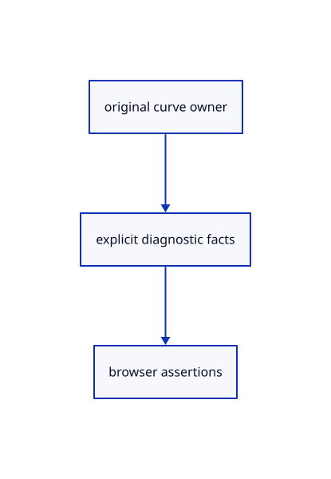

# 14.6.4 · Inspect original curve data through the browser contract

**Chapter 14 · Coordinates and geometry tools · Section 14.6 · Parabolas and exact curve editing** · [Contents](contents.md)

**Typing: 4–8 minutes.** [Estimate](typing-load.md).

Expose original control storage, knot storage, rational flag and GUID for the existing browser acceptance checks.

## Type

Continue from [Create editable freeform curves](76b-retain-editable-freeform-controls-in-the-point-collector.md). [Save or recover your work](recovery.md).

### 1. `src/browser.rs`

Expose original curve identity, weighted controls and knots for current browser acceptance.

<details>
<summary>Locate the existing block</summary>

```rust
    canvas.set_attribute("data-edit-preview", &editor.edit_preview.as_ref().map_or_else(|| "null".into(),|p| serde_json::json!({"ids":p.ids().iter().map(|id| id.value()).collect::<Vec<_>>(),"matrix":p.matrix()}).to_string()))?;
    let originals=serde_json::json!({"points":editor.scene.points().iter().map(|row|(0..3).map(|i|row.prepared.source[i]).collect::<Vec<_>>()).collect::<Vec<_>>(),"lines":editor.scene.lines().iter().map(|row|{let s=&row.prepared.source;[s.start(),s.end()].map(|p|[p[0],p[1],p[2]])}).collect::<Vec<_>>(),"polylines":editor.scene.paths().iter().filter(|row|matches!(row.prepared.source,crate::chain::Source::Polyline(_))).map(|row|row.prepared.source.coordinates()).collect::<Vec<_>>()});
    canvas.set_attribute("data-drawing-originals",&originals.to_string())?;
    canvas.set_attribute("data-cplane",&serde_json::json!({"fixed":editor.construction_plane.is_some(),"mode":format!("{:?}",editor.construction_plane),"chooser":editor.plane_menu}).to_string())?;
```

</details>

Edit the existing block to match this code; keep unchanged lines:

```rust
--8<-- "journey/code/76c-inspect-original-curve-data-through-the-browser-contract-01.rs"
```

## Run and check

Run this from `session_viewer` to select the fixed dependency versions and install supplied binary assets. It updates Cargo.lock and preserves the previous lock. It does not write implementation code:

```sh
npm --prefix ../session_tests run course -- dependencies 14.6.4
```

In your project:

```sh
cd workspace/journey
REGEN_PROTO=0 cargo build --lib --locked --target wasm32-unknown-unknown -j1
REGEN_PROTO=0 CARGO_BUILD_JOBS=1 trunk serve --port 8780
```

Open `http://127.0.0.1:8780/`. Keep an existing Trunk server running; saving rebuilds it.


### Recorded visual result

**Previous native render — current verification pending.**

Original Cylinder, Cone, Sphere and Torus remain visible.


*This recorded image predates a source or checker change. Rebuild this checkpoint before using it as current evidence; browser controls require separate acceptance.*

This reference image is shared with [14.5.5 · Exercise round originals and one transaction](75c-exercise-round-originals-and-one-transaction.md). It does not demonstrate a new feature by itself.

<details>
<summary>Code explanation and diagram</summary>


original curve owner → explicit diagnostic facts → browser assertions.



Does a browser diagnostic change saved geometry?

No. It reads the original source for acceptance checks. The command input and geometry owner remain the same.

Study estimate, including typing and experiments: 0.5–1 hours.

</details>

<details>
<summary>Optional experiment</summary>

Create an Arc Center of90 degrees. Compare its three controls and rational flag before Undo and after Redo.

</details>

<details>
<summary>Check and save your work</summary>

Restore experimental edits, then run from `session_viewer`:

```sh
npm --prefix ../session_tests run course -- check 14.6.4
npm --prefix ../session_tests run course -- save 14.6.4
```

Source comparison leaves your project untouched. [Save and recovery instructions](recovery.md).

</details>

<details>
<summary>Viewer coverage and verification</summary>


The preceding round contract remains authored and unrun. The final curve contract adds exact arc validation and correction, original rational controls, Undo/Redo, closed XZ input and five displayed curve families. Actual browser execution remains required.

[Full validation scope](release.md).

To reproduce the scripted acceptance of the reference checkpoint, run from `session_viewer` with the [course bundle server](release.md#reproduce) running on port 8781:

```sh
npm --prefix ../session_tests run course -- capture 14.6.4
```

This uses the verified reference bundle; it does not check or change your typed project.

</details>
