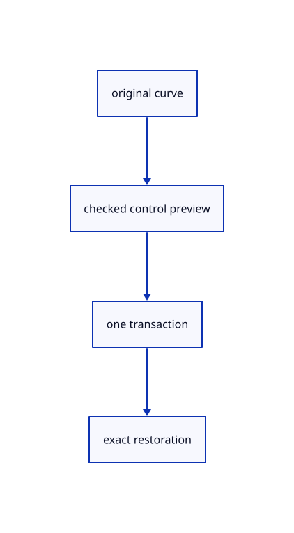

# 14.6.5 · Exercise exact curves and rational control edits

**Chapter 14 · Coordinates and geometry tools · Section 14.6 · Parabolas and exact curve editing** · [Contents](contents.md)

**Typing: 0–0 minutes.** [Estimate](typing-load.md).

Verify current original builders, failed input, world replay, history and exact archive reopening. Reuse the existing source-edit preview for a created rational arc.

## Type

Continue from [Inspect original curve data through the browser contract](76c-inspect-original-curve-data-through-the-browser-contract.md). [Save or recover your work](recovery.md).

<details>
<summary>Supplied validation fixture</summary>

Copy this supplied authoring fixture once. Continue with the browser build below; the course does not require running native tests.

### 1. `src/freeform_tests.rs`

Copy integrated exact-original, closure/world-replay, failed-input, rational-edit and archive fixtures.

Copy this supplied file:

```text
--8<-- "journey/code/76d-exercise-exact-curves-and-rational-control-edits-01.rs"
```

</details>

<details>
<summary>Supplied validation fixture</summary>

Copy this supplied authoring fixture once. Continue with the browser build below; the course does not require running native tests.

### 2. `src/lib.rs`

Register the current curve component.

<details>
<summary>Locate the existing block</summary>

```text

pub mod freeform_curve;
```

</details>

After that block, append this supplied code:

```text
--8<-- "journey/code/76d-exercise-exact-curves-and-rational-control-edits-02.rs" skip=25
```

</details>

## Run and check

Run this from `session_viewer` to select the fixed dependency versions and install supplied binary assets. It updates Cargo.lock and preserves the previous lock. It does not write implementation code:

```sh
npm --prefix ../session_tests run course -- dependencies 14.6.5
```

In your project:

```sh
cd workspace/journey
REGEN_PROTO=0 cargo build --lib --locked --target wasm32-unknown-unknown -j1
REGEN_PROTO=0 CARGO_BUILD_JOBS=1 trunk serve --port 8780
```

Open `http://127.0.0.1:8780/`. Keep an existing Trunk server running; saving rebuilds it.

Five original NURBS curve families render on white. Curve controls remain editable; rational edits preserve weights and knots. Failed input keeps accepted answers and original source identity survives archive reopening.

### Recorded visual result

**Previous native render — current verification pending.**

Original Circle, Ellipse, Arc, Parabola and freeform Curve display from completed maintained commands.


*This recorded image predates a source or checker change. Rebuild this checkpoint before using it as current evidence; browser controls require separate acceptance.*

<details>
<summary>Code explanation and diagram</summary>


original curve → checked control preview → one transaction → exact restoration.



What must moving a rational control preserve?

Keep its weight and the knot vector. Convert the edited Euclidean point back to homogeneous coordinates using the same weight, leaving other controls unchanged.

Study estimate, including typing and experiments: 0.5–1 hours.

</details>

<details>
<summary>Optional experiment</summary>

Type Close, CPlane XY, Nurbs Curve Circle w-2,0,0 0.5, Nurbs Curve Ellipse w-0.7,0,0 0.55 0.3, Nurbs Curve Arc Center w0.7,0,0 0.5 270, Nurbs Curve Parabola w1.5,0,0 1 0.5, Curve w-0.5,1,0 w0,1.6,0 w0.5,1,0, View Reset and Fit. Select a curve, use Controls or F10, select a control and move its handle; Undo restores the original control. Save and reopen to retain original weights and knots.

</details>

<details>
<summary>Check and save your work</summary>

Restore experimental edits, then run from `session_viewer`:

```sh
npm --prefix ../session_tests run course -- check 14.6.5
npm --prefix ../session_tests run course -- save 14.6.5
```

Source comparison leaves your project untouched. [Save and recovery instructions](recovery.md).

</details>

<details>
<summary>Viewer coverage and verification</summary>

Copy maintained Nurbs Curve Circle, Ellipse, Arc Center/3 Points and Parabola question/read/outline/build definitions and native fixtures. Reuse the checked current frame and atomic question owner. Arc uses rational quadratic spans of at most90 degrees, with homogeneous weighted controls. Freeform Curve retains current degree and repeated-start closure rules. Existing original curve control editing keeps rational weights and knots while changing only the selected Euclidean point. Original controls, knots, weights and GUIDs survive Save/Open; display samples and temporary guides are derived. Current world-prefixed finished-point replay prevents applying XZ or a tilted plane twice.

Earlier checks remain. Six copied current curve-family checks and four integrated fixtures cover exact original representations, smooth closed world replay, failed input and temporary wires, archive control/weight/knot identity, one creation transaction and rational control editing with Undo/Redo.

The preceding round contract remains authored and unrun. The final curve contract adds exact arc validation and correction, original rational controls, Undo/Redo, closed XZ input and five displayed curve families. Actual browser execution remains required.

[Full validation scope](release.md).

To reproduce the scripted acceptance of the reference checkpoint, run from `session_viewer` with the [course bundle server](release.md#reproduce) running on port 8781:

```sh
npm --prefix ../session_tests run course -- capture 14.6.5
```

This uses the verified reference bundle; it does not check or change your typed project.

</details>
