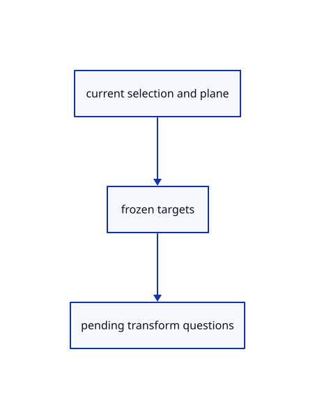

# 15.1.20 · Own transformation questions and the selected original targets

**Chapter 15 · Transforms and surface construction · Section 15.1 · Transforms, extrusions and revolutions** · [Contents](contents.md)

**Typing: 17–34 minutes.** [Estimate](typing-load.md).

Keep the tool kind, scale mode, accepted points, current plane and frozen original targets in one owner.

## Type

Continue from [Preserve hole winding and complete original mesh topology](77sr-preserve-hole-winding-and-complete-original-mesh-topology.md). [Save or recover your work](recovery.md).

### 1. `src/transform_draft.rs`

Own current transformation questions, modes, accepted points and original targets.

Create the file and type:

```rust
--8<-- "journey/code/77a-own-transformation-questions-and-the-selected-original-targets-01.rs"
```

### 2. `src/lib.rs`

Register the source transformation component.

<details>
<summary>Locate the existing block</summary>

```rust

pub mod source_topology_colour;
```

</details>

After that block, type:

```rust
--8<-- "journey/code/77a-own-transformation-questions-and-the-selected-original-targets-02.rs" skip=33
```

## Run and check

Run this from `session_viewer` to select the fixed dependency versions and install supplied binary assets. It updates Cargo.lock and preserves the previous lock. It does not write implementation code:

```sh
npm --prefix ../session_tests run course -- dependencies 15.1.20
```

In your project:

```sh
cd workspace/journey
REGEN_PROTO=0 cargo build --lib --locked --target wasm32-unknown-unknown -j1
REGEN_PROTO=0 CARGO_BUILD_JOBS=1 trunk serve --port 8780
```

Open `http://127.0.0.1:8780/`. Keep an existing Trunk server running; saving rebuilds it.

The five original curve families remain visible while source transformations connect. The final exercise copies and independently scales and rotates original boxes.

### Recorded visual result

**Previous native render — current verification pending.**

Original Circle, Ellipse, Arc, Parabola and freeform Curve remain visible.


*This recorded image predates a source or checker change. Rebuild this checkpoint before using it as current evidence; browser controls require separate acceptance.*

This reference image is shared with [14.6.5 · Exercise exact curves and rational control edits](76d-exercise-exact-curves-and-rational-control-edits.md). It does not demonstrate a new feature by itself.

<details>
<summary>Code explanation and diagram</summary>


current selection and plane → frozen targets → pending transform questions.



Can hover become saved placement?

No. The question owner and temporary preview remain separate from scene placement and its history.

Study estimate, including typing and experiments: 0.5–1 hours.

</details>

<details>
<summary>Optional experiment</summary>

Compare Copy target prompts, Scale1D reference prompts and Rotate center/angle prompts.

</details>

<details>
<summary>Check and save your work</summary>

Restore experimental edits, then run from `session_viewer`:

```sh
npm --prefix ../session_tests run course -- check 15.1.20
npm --prefix ../session_tests run course -- save 15.1.20
```

Source comparison leaves your project untouched. [Save and recovery instructions](recovery.md).

</details>

<details>
<summary>Viewer coverage and verification</summary>


The preceding curve contract remains authored and unrun. The final transformation contract adds direct Copy and Rotate, repeat Copy and Undo, typed interactive Scale modes, invalid input/cancellation and a three-box exercise. Actual browser execution remains required.

[Full validation scope](release.md).

To reproduce the scripted acceptance of the reference checkpoint, run from `session_viewer` with the [course bundle server](release.md#reproduce) running on port 8781:

```sh
npm --prefix ../session_tests run course -- capture 15.1.20
```

This uses the verified reference bundle; it does not check or change your typed project.

</details>
