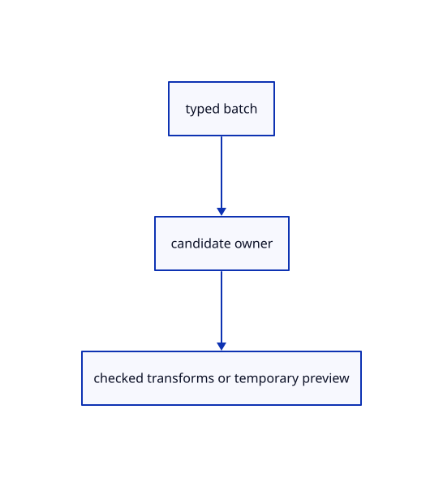

# 15.1.22 · Resolve typed batches and temporary transformation previews

**Chapter 15 · Transforms and surface construction · Section 15.1 · Transforms, extrusions and revolutions** · [Contents](contents.md)

**Typing: 18–36 minutes.** [Estimate](typing-load.md).

Validate all typed words before replacing the owner. Copy repeats after a target; other transforms finish after their result.

## Type

Continue from [Validate point and number transformation answers](77b-validate-point-and-number-transformation-answers.md). [Save or recover your work](recovery.md).

### 1. `src/transform_draft.rs`

Resolve current options and atomic batches, temporary preview matrices and tool buttons.

<details>
<summary>Locate the existing block</summary>

```rust
        }
    }
}
```

</details>

Edit the existing block to match this code; keep unchanged lines:

```rust
--8<-- "journey/code/77c-resolve-typed-batches-and-temporary-transformation-previews-01.rs"
```

## Run and check

Run this from `session_viewer` to select the fixed dependency versions and install supplied binary assets. It updates Cargo.lock and preserves the previous lock. It does not write implementation code:

```sh
npm --prefix ../session_tests run course -- dependencies 15.1.22
```

In your project:

```sh
cd workspace/journey
REGEN_PROTO=0 cargo build --lib --locked --target wasm32-unknown-unknown -j1
REGEN_PROTO=0 CARGO_BUILD_JOBS=1 trunk serve --port 8780
```

Open `http://127.0.0.1:8780/`. Keep an existing Trunk server running; saving rebuilds it.


### Recorded visual result

**Previous native render — current verification pending.**

Original Circle, Ellipse, Arc, Parabola and freeform Curve remain visible.


*This recorded image predates a source or checker change. Rebuild this checkpoint before using it as current evidence; browser controls require separate acceptance.*

This reference image is shared with [14.6.5 · Exercise exact curves and rational control edits](76d-exercise-exact-curves-and-rational-control-edits.md). It does not demonstrate a new feature by itself.

<details>
<summary>Code explanation and diagram</summary>


typed batch → candidate owner → checked transforms or temporary preview.



Does extra input after Scale completion create a partial edit?

No. Reject the entire typed batch before adopting any transform or answer.

Study estimate, including typing and experiments: 0.5–1 hours.

</details>

<details>
<summary>Optional experiment</summary>

Try Scale with origin, factor and an extra word. Compare Copy with two targets and Enter with the same tool cancelled by Escape.

</details>

<details>
<summary>Check and save your work</summary>

Restore experimental edits, then run from `session_viewer`:

```sh
npm --prefix ../session_tests run course -- check 15.1.22
npm --prefix ../session_tests run course -- save 15.1.22
```

Source comparison leaves your project untouched. [Save and recovery instructions](recovery.md).

</details>

<details>
<summary>Viewer coverage and verification</summary>


The preceding curve contract remains authored and unrun. The final transformation contract adds direct Copy and Rotate, repeat Copy and Undo, typed interactive Scale modes, invalid input/cancellation and a three-box exercise. Actual browser execution remains required.

[Full validation scope](release.md).

To reproduce the scripted acceptance of the reference checkpoint, run from `session_viewer` with the [course bundle server](release.md#reproduce) running on port 8781:

```sh
npm --prefix ../session_tests run course -- capture 15.1.22
```

This uses the verified reference bundle; it does not check or change your typed project.

</details>
