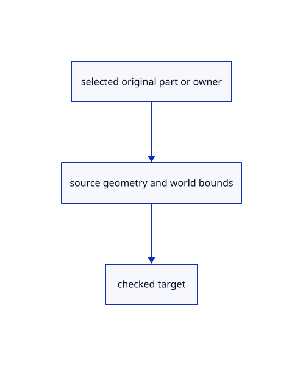

# 15.1.23 · Resolve original CAD parts and complete selected bounds

**Chapter 15 · Transforms and surface construction · Section 15.1 · Transforms, extrusions and revolutions** · [Contents](contents.md)

**Typing: 19–38 minutes.** [Estimate](typing-load.md).

Map displayed CAD face/boundary identities back to original geometry. Include Line, Point and Curve in precise selected bounds.

## Type

Continue from [Resolve typed batches and temporary transformation previews](77c-resolve-typed-batches-and-temporary-transformation-previews.md). [Save or recover your work](recovery.md).

### 1. `src/source_part.rs`

Resolve existing CAD face and boundary targets against original kernel geometry.

Create the file and type:

```rust
--8<-- "journey/code/77d-resolve-original-cad-parts-and-complete-selected-bounds-01.rs"
```

### 2. `src/lib.rs`

Register the source transformation component.

<details>
<summary>Locate the existing block</summary>

```rust

pub mod transform_draft;
```

</details>

After that block, type:

```rust
--8<-- "journey/code/77d-resolve-original-cad-parts-and-complete-selected-bounds-02.rs" skip=26
```

### 3. `src/scene.rs`

Connect current transformation behavior to the existing input and history owner.

<details>
<summary>Locate the existing block</summary>

```rust
        if let Some(row)=self.texts.iter().find(|row|row.id==id) {return row.bounds();}
        if let Some(row)=self.sheets.iter().find(|row|row.id==id) {return row.bounds();}
        let object = self.objects.iter().find(|object| object.id == id)?;
        let mut vertices = object.mesh.vertices().iter();
```

</details>

Edit the existing block to match this code; keep unchanged lines:

```rust
--8<-- "journey/code/77d-resolve-original-cad-parts-and-complete-selected-bounds-03.rs"
```

## Run and check

Run this from `session_viewer` to select the fixed dependency versions and install supplied binary assets. It updates Cargo.lock and preserves the previous lock. It does not write implementation code:

```sh
npm --prefix ../session_tests run course -- dependencies 15.1.23
```

In your project:

```sh
cd workspace/journey
REGEN_PROTO=0 cargo build --lib --locked --target wasm32-unknown-unknown -j1
REGEN_PROTO=0 CARGO_BUILD_JOBS=1 trunk serve --port 8780
```

Open `http://127.0.0.1:8780/`. Keep an existing Trunk server running; saving rebuilds it.


### Recorded visual result

**Previous native render — current verification pending.**

Original Circle, Ellipse, Arc, Parabola and freeform Curve remain visible.


*This recorded image predates a source or checker change. Rebuild this checkpoint before using it as current evidence; browser controls require separate acceptance.*

This reference image is shared with [14.6.5 · Exercise exact curves and rational control edits](76d-exercise-exact-curves-and-rational-control-edits.md). It does not demonstrate a new feature by itself.

<details>
<summary>Code explanation and diagram</summary>


selected original part or owner → source geometry and world bounds → checked target.



Why does direct rotation need selected line bounds?

Its gizmo center comes from the selected bounds. Without them a line incorrectly rotates about the world origin.

Study estimate, including typing and experiments: 0.5–1 hours.

</details>

<details>
<summary>Optional experiment</summary>

Select a line from 1,0,0 to2,0,0; its center is1.5,0,0. Compare that with a selected surface boundary’s original points.

</details>

<details>
<summary>Check and save your work</summary>

Restore experimental edits, then run from `session_viewer`:

```sh
npm --prefix ../session_tests run course -- check 15.1.23
npm --prefix ../session_tests run course -- save 15.1.23
```

Source comparison leaves your project untouched. [Save and recovery instructions](recovery.md).

</details>

<details>
<summary>Viewer coverage and verification</summary>


The preceding curve contract remains authored and unrun. The final transformation contract adds direct Copy and Rotate, repeat Copy and Undo, typed interactive Scale modes, invalid input/cancellation and a three-box exercise. Actual browser execution remains required.

[Full validation scope](release.md).

To reproduce the scripted acceptance of the reference checkpoint, run from `session_viewer` with the [course bundle server](release.md#reproduce) running on port 8781:

```sh
npm --prefix ../session_tests run course -- capture 15.1.23
```

This uses the verified reference bundle; it does not check or change your typed project.

</details>
