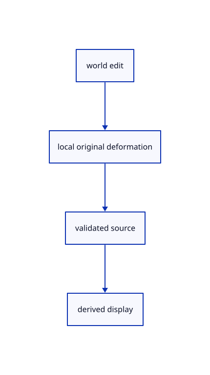

# 15.1.24 · Rebuild an edited original CAD source before adoption

**Chapter 15 · Transforms and surface construction · Section 15.1 · Transforms, extrusions and revolutions** · [Contents](contents.md)

**Typing: 20–40 minutes.** [Estimate](typing-load.md).

Apply the world delta in the original local frame, validate adjacent trims, and prepare the edited source before changing the row.

## Type

Continue from [Resolve original CAD parts and complete selected bounds](77d-resolve-original-cad-parts-and-complete-selected-bounds.md). [Save or recover your work](recovery.md).

### 1. `src/scene.rs`

Connect current transformation behavior to the existing input and history owner.

<details>
<summary>Locate the existing block</summary>

```rust
        let model=self.placement(target.owner).ok_or("Part owner is missing")?;
        let local=&(&model.inverse().ok_or("Part placement cannot be inverted")?*delta)*&model;
        if let Some(row)=self.objects.iter_mut().find(|r|r.id==target.owner) {
            if row.surface.is_some()||row.cad.is_some() {return Err("CAD surface part editing connects after source parameter mapping");}
            let mut source=(**row.geometry().ok_or("Reload editable sources before editing a part")?).clone();
            for key in crate::part_preview::keys(&source,target.part)? {
```

</details>

Edit the existing block to match this code; keep unchanged lines:

```rust
--8<-- "journey/code/77e-rebuild-an-edited-original-cad-source-before-adoption-01.rs"
```

### 2. `src/part_preview.rs`

Connect current transformation behavior to the existing input and history owner.

Edit these blocks from bottom to top. Keep the surrounding lines unchanged.

<details>
<summary>Locate this block</summary>

```rust

fn same_source(a:&Scene,b:&Scene,id:ObjectId) -> bool {
    if let Some(row)=a.objects().iter().find(|r|r.id==id) {
        return b.objects().iter().find(|r|r.id==id).and_then(|r|r.geometry()).zip(row.geometry()).is_some_and(|(a,b)|Rc::ptr_eq(a,b));
    }
    a.paths().iter().find(|r|r.id==id).zip(b.paths().iter().find(|r|r.id==id)).is_some_and(|(a,b)|a.prepared.source.owner()==b.prepared.source.owner())
}
```

</details>

Replace it with:

```rust

fn same_source(a:&Scene,b:&Scene,id:ObjectId) -> bool {
    if let Some(row)=a.objects().iter().find(|r|r.id==id) {
        return b.objects().iter().find(|r|r.id==id).is_some_and(|other|match(&row.cad,&other.cad,&row.surface,&other.surface){(Some(a),Some(b),_,_)=>Rc::ptr_eq(&a.source,&b.source),(_,_,Some(a),Some(b))=>Rc::ptr_eq(&a.source,&b.source),(None,None,None,None)=>other.geometry().zip(row.geometry()).is_some_and(|(a,b)|Rc::ptr_eq(a,b)),_=>false});
    }
    a.paths().iter().find(|r|r.id==id).zip(b.paths().iter().find(|r|r.id==id)).is_some_and(|(a,b)|a.prepared.source.owner()==b.prepared.source.owner())
}
```

<details>
<summary>Locate this block</summary>

```rust
    if matches!(target.part,Part::CloudPoint(_)) {return Err("Cloud point editing connects with source transforms");}
    let model=scene.placement(target.owner).ok_or("Part owner is missing")?;
    let points=if let Some(row)=scene.objects().iter().find(|r|r.id==target.owner) {
        if row.surface.is_some()||row.cad.is_some() {return Err("CAD surface part editing connects after source parameter mapping");}
        let mesh=row.geometry().ok_or("Reload editable sources before editing a part")?;
        keys(mesh,target.part)?.into_iter().map(|key|mesh.vertex_point(key).ok_or("Missing source vertex")).collect::<Result<Vec<_>,_>>()?
    } else {
        let row=scene.paths().iter().find(|r|r.id==target.owner).ok_or("Select a mesh face, edge or curve control")?;
        let (crate::chain::Source::Curve(curve,_),Part::Control(index))=(&row.prepared.source,target.part) else {return Err("Select a curve control point");};
```

</details>

Replace it with:

```rust
    if matches!(target.part,Part::CloudPoint(_)) {return Err("Cloud point editing connects with source transforms");}
    let model=scene.placement(target.owner).ok_or("Part owner is missing")?;
    let points=if let Some(row)=scene.objects().iter().find(|r|r.id==target.owner) {
        if row.surface.is_some()||row.cad.is_some() {crate::source_part::points(scene,target).map_err(|_|"Cannot resolve original CAD part")?}else{
        let mesh=row.geometry().ok_or("Reload editable sources before editing a part")?;
        keys(mesh,target.part)?.into_iter().map(|key|mesh.vertex_point(key).ok_or("Missing source vertex")).collect::<Result<Vec<_>,_>>()?}
    } else {
        let row=scene.paths().iter().find(|r|r.id==target.owner).ok_or("Select a mesh face, edge or curve control")?;
        let (crate::chain::Source::Curve(curve,_),Part::Control(index))=(&row.prepared.source,target.part) else {return Err("Select a curve control point");};
```

<details>
<summary>Complete updated block reference</summary>

```rust
use crate::{scene::{Scene,ObjectId},pick_sources::{Part,Target}};
use session_rust::{Point,Xform};
use std::rc::Rc;

pub fn points(scene:&Scene,target:Target) -> Result<Vec<Point>, &'static str> {
    if scene.instances.contains_key(&target.owner) {return Err("Detach the shared definition before editing its source geometry");}
    if !target.valid(scene) {return Err("Selected part is no longer editable");}
    if matches!(target.part,Part::SheetEntity(_)) {return Err("Sheet entities are display references; edit the original drawing");}
    if matches!(target.part,Part::CloudPoint(_)) {return Err("Cloud point editing connects with source transforms");}
    let model=scene.placement(target.owner).ok_or("Part owner is missing")?;
    let points=if let Some(row)=scene.objects().iter().find(|r|r.id==target.owner) {
        if row.surface.is_some()||row.cad.is_some() {crate::source_part::points(scene,target).map_err(|_|"Cannot resolve original CAD part")?}else{
        let mesh=row.geometry().ok_or("Reload editable sources before editing a part")?;
        keys(mesh,target.part)?.into_iter().map(|key|mesh.vertex_point(key).ok_or("Missing source vertex")).collect::<Result<Vec<_>,_>>()?}
    } else {
        let row=scene.paths().iter().find(|r|r.id==target.owner).ok_or("Select a mesh face, edge or curve control")?;
        let (crate::chain::Source::Curve(curve,_),Part::Control(index))=(&row.prepared.source,target.part) else {return Err("Select a curve control point");};
        vec![curve.get_cv(index).ok_or("Missing curve control")?]
    };
    Ok(points.into_iter().map(|p|model.transform_point(&p)).collect())
}

pub fn origin(scene:&Scene,target:Target) -> Option<[f64;3]> {
    if let Part::CloudPoint(id)=target.part {let p=crate::cloud_pick::position(scene,target.owner,id)?;return Some([p[0],p[1],p[2]]);}
    let points=points(scene,target).ok()?;
    if points.is_empty() {return None;}
    Some(std::array::from_fn(|i|points.iter().map(|p|p[i]/points.len() as f64).sum()))
}

pub fn keys(mesh:&session_rust::Mesh,part:Part) -> Result<Vec<usize>, &'static str> {
    let mut keys=match part {
        Part::Face(key)=> {let mut keys=mesh.face.get(&key).ok_or("Unknown mesh face")?.clone();
            if let Some(holes)=mesh.face_holes.get(&key) {keys.extend(holes.iter().flatten());} keys},
        Part::MeshEdge(a,b) if mesh.edges().contains(&(a,b))=>vec![a,b],
        _=>return Err("Select a mesh face or edge"),
    };
    keys.sort_unstable();keys.dedup();
    if keys.iter().any(|key|mesh.vertex_point(*key).is_none()) {return Err("Missing source vertex");}
    Ok(keys)
}

// Part previews deform a cloned original source; the saved source and all other owners remain shared until one commit.
pub struct Preview {base:Scene,pub scene:Scene,target:Target,transform:Xform}

impl Preview {
    pub fn new(scene:&Scene,target:Target) -> Result<Self,&'static str> {
        points(scene,target)?;
        scene.placement(target.owner).and_then(|m|m.inverse()).ok_or("Part placement cannot be inverted")?;
        Ok(Self {base:scene.clone(),scene:scene.clone(),target,transform:Xform::identity()})
    }
    pub fn scenes(&self)->[&Scene;2] {[&self.base,&self.scene]}
    pub fn matrix(&self)->&[f64;16] {&self.transform.m}
    pub fn set(&mut self,transform:Xform) -> Result<(), &'static str> {
        if !crate::placement::valid(&transform.m) {return Err("Invalid part transform");}
        let mut scene=self.base.clone();
        if transform.m!=Xform::identity().m {scene.deform_part(self.target,&transform)?;}
        self.scene=scene;self.transform=transform;Ok(())
    }
    pub fn commit(&self,scene:&mut Scene,history:&mut crate::history::History) -> Result<bool,&'static str> {
        if !self.target.valid(scene) || scene.placement(self.target.owner).map(|m|m.m)!=self.base.placement(self.target.owner).map(|m|m.m)
            || !same_source(scene,&self.base,self.target.owner) {return Err("Part source changed; start editing again");}
        if self.transform.m==Xform::identity().m {return Ok(false);}
        history.try_edit(scene,|scene|scene.deform_part(self.target,&self.transform))?;Ok(true)
    }
}

fn same_source(a:&Scene,b:&Scene,id:ObjectId) -> bool {
    if let Some(row)=a.objects().iter().find(|r|r.id==id) {
        return b.objects().iter().find(|r|r.id==id).is_some_and(|other|match(&row.cad,&other.cad,&row.surface,&other.surface){(Some(a),Some(b),_,_)=>Rc::ptr_eq(&a.source,&b.source),(_,_,Some(a),Some(b))=>Rc::ptr_eq(&a.source,&b.source),(None,None,None,None)=>other.geometry().zip(row.geometry()).is_some_and(|(a,b)|Rc::ptr_eq(a,b)),_=>false});
    }
    a.paths().iter().find(|r|r.id==id).zip(b.paths().iter().find(|r|r.id==id)).is_some_and(|(a,b)|a.prepared.source.owner()==b.prepared.source.owner())
}
```

</details>

<details>
<summary>Optional patch references</summary>

Use these original edit fragments when comparing a saved checkpoint. Apply the complete blocks above.

```text
--8<-- "journey/code/77e-rebuild-an-edited-original-cad-source-before-adoption-02.rs"
```

```text
--8<-- "journey/code/77e-rebuild-an-edited-original-cad-source-before-adoption-03.rs"
```

</details>

## Run and check

Run this from `session_viewer` to select the fixed dependency versions and install supplied binary assets. It updates Cargo.lock and preserves the previous lock. It does not write implementation code:

```sh
npm --prefix ../session_tests run course -- dependencies 15.1.24
```

In your project:

```sh
cd workspace/journey
REGEN_PROTO=0 cargo build --lib --locked --target wasm32-unknown-unknown -j1
REGEN_PROTO=0 CARGO_BUILD_JOBS=1 trunk serve --port 8780
```

Open `http://127.0.0.1:8780/`. Keep an existing Trunk server running; saving rebuilds it.


### Recorded visual result

**Previous native render — current verification pending.**

Original Circle, Ellipse, Arc, Parabola and freeform Curve remain visible.


*This recorded image predates a source or checker change. Rebuild this checkpoint before using it as current evidence; browser controls require separate acceptance.*

This reference image is shared with [14.6.5 · Exercise exact curves and rational control edits](76d-exercise-exact-curves-and-rational-control-edits.md). It does not demonstrate a new feature by itself.

<details>
<summary>Code explanation and diagram</summary>


world edit → local original deformation → validated source → derived display.



What happens if an edit breaks incident trims?

Refuse the result and keep the original source, row placement and history unchanged.

Study estimate, including typing and experiments: 0.5–1 hours.

</details>

<details>
<summary>Optional experiment</summary>

Move a box face, Undo, then inspect original source identity and face boundaries after Save/Open.

</details>

<details>
<summary>Check and save your work</summary>

Restore experimental edits, then run from `session_viewer`:

```sh
npm --prefix ../session_tests run course -- check 15.1.24
npm --prefix ../session_tests run course -- save 15.1.24
```

Source comparison leaves your project untouched. [Save and recovery instructions](recovery.md).

</details>

<details>
<summary>Viewer coverage and verification</summary>


The preceding curve contract remains authored and unrun. The final transformation contract adds direct Copy and Rotate, repeat Copy and Undo, typed interactive Scale modes, invalid input/cancellation and a three-box exercise. Actual browser execution remains required.

[Full validation scope](release.md).

To reproduce the scripted acceptance of the reference checkpoint, run from `session_viewer` with the [course bundle server](release.md#reproduce) running on port 8781:

```sh
npm --prefix ../session_tests run course -- capture 15.1.24
```

This uses the verified reference bundle; it does not check or change your typed project.

</details>
