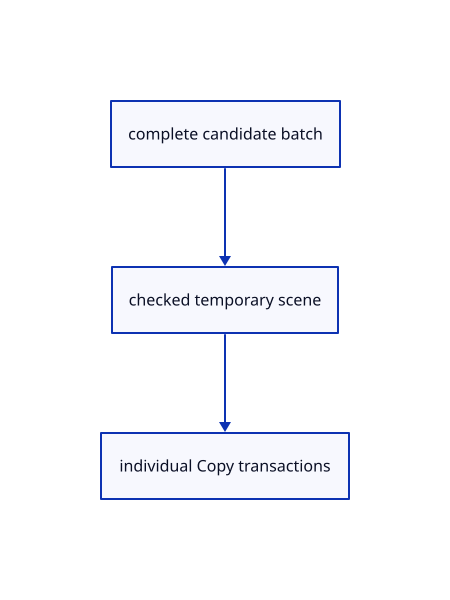

# 15.1.28 · Adopt validated outcomes and preserve repeat copy transactions

**Chapter 15 · Transforms and surface construction · Section 15.1 · Transforms, extrusions and revolutions** · [Contents](contents.md)

**Typing: 24–47 minutes.** [Estimate](typing-load.md).

Preflight the full typed batch against a temporary scene, then record each Copy target as one transaction.

## Type

Continue from [Validate selected originals before beginning or committing a transform](77h-validate-selected-originals-before-beginning-or-committing-a-transform.md). [Save or recover your work](recovery.md).

### 1. `src/editor.rs`

Connect checked original transformations to the current Editor transaction boundary.

<details>
<summary>Locate the existing block</summary>

```rust
        let mut draft=crate::tool::Draft::new(crate::tool::Shape::Transform(kind));draft.frame=frame;let transform=draft.transform.as_mut().unwrap();transform.frame=frame;transform.owners=owners;transform.target=target;
        self.edit_preview=None;self.transform_preview=preview;self.draft=Some(draft);self.snap_index=None;self.tool_status=self.draft.as_ref().unwrap().prompt();Ok(Change::Preview)
    }
    fn tool_text(&mut self,text:&str) -> Result<Change,&'static str> {
```

</details>

Edit the existing block to match this code; keep unchanged lines:

```rust
--8<-- "journey/code/77i-adopt-validated-outcomes-and-preserve-repeat-copy-transactions-01.rs"
```

## Run and check

Run this from `session_viewer` to select the fixed dependency versions and install supplied binary assets. It updates Cargo.lock and preserves the previous lock. It does not write implementation code:

```sh
npm --prefix ../session_tests run course -- dependencies 15.1.28
```

In your project:

```sh
cd workspace/journey
REGEN_PROTO=0 cargo build --lib --locked --target wasm32-unknown-unknown -j1
REGEN_PROTO=0 CARGO_BUILD_JOBS=1 trunk serve --port 8780
```

Open `http://127.0.0.1:8780/`. Keep an existing Trunk server running; saving rebuilds it.


### Recorded visual result

**Previous native render — current verification pending.**

Original Circle, Ellipse, Arc, Parabola and freeform Curve remain visible.


*This recorded image predates a source or checker change. Rebuild this checkpoint before using it as current evidence; browser controls require separate acceptance.*

This reference image is shared with [14.6.5 · Exercise exact curves and rational control edits](76d-exercise-exact-curves-and-rational-control-edits.md). It does not demonstrate a new feature by itself.

<details>
<summary>Code explanation and diagram</summary>


complete candidate batch → checked temporary scene → individual Copy transactions.



Does Escape undo completed Copy targets?

No. It ends the unfinished tool; Undo removes each completed target copy in reverse order.

Study estimate, including typing and experiments: 0.5–1 hours.

</details>

<details>
<summary>Optional experiment</summary>

Enter a Copy base and two targets, finish, then Undo twice and Redo twice. Cancel another unfinished target and verify Redo remains.

</details>

<details>
<summary>Check and save your work</summary>

Restore experimental edits, then run from `session_viewer`:

```sh
npm --prefix ../session_tests run course -- check 15.1.28
npm --prefix ../session_tests run course -- save 15.1.28
```

Source comparison leaves your project untouched. [Save and recovery instructions](recovery.md).

</details>

<details>
<summary>Viewer coverage and verification</summary>


The preceding curve contract remains authored and unrun. The final transformation contract adds direct Copy and Rotate, repeat Copy and Undo, typed interactive Scale modes, invalid input/cancellation and a three-box exercise. Actual browser execution remains required.

[Full validation scope](release.md).

To reproduce the scripted acceptance of the reference checkpoint, run from `session_viewer` with the [course bundle server](release.md#reproduce) running on port 8781:

```sh
npm --prefix ../session_tests run course -- capture 15.1.28
```

This uses the verified reference bundle; it does not check or change your typed project.

</details>
