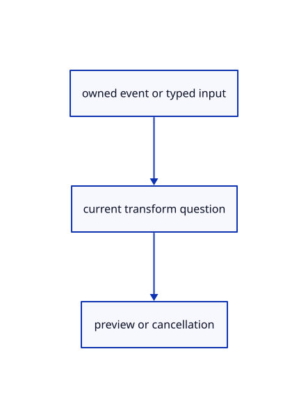

# 15.1.29 · Route transform input cancellation and current plane changes

**Chapter 15 · Transforms and surface construction · Section 15.1 · Transforms, extrusions and revolutions** · [Contents](contents.md)

**Typing: 10–19 minutes.** [Estimate](typing-load.md).

Connect clicked and typed answers, current-plane changes and cancellation while keeping Polyline Close separate from transformation completion.

## Type

Continue from [Adopt validated outcomes and preserve repeat copy transactions](77i-adopt-validated-outcomes-and-preserve-repeat-copy-transactions.md). [Save or recover your work](recovery.md).

### 1. `src/editor.rs`

Connect current transformation behavior to the existing input and history owner.

Edit these blocks from bottom to top. Keep the surrounding lines unchanged.

<details>
<summary>Locate this block</summary>

```rust
            let viewport = crate::snap_math::Screen { matrix: self.camera.view_projection().m, size };
            index.query(viewport, &ray, [(screen[0] as f64+1.)*size[0]/2., (1.-screen[1] as f64)*size[1]/2.], self.snapping.modes, from)
        } else { None };
        let own=self.draft.as_ref().filter(|d|d.primitive.is_none() && d.tool.count()==0 && d.points.len()>=2 && self.snapping.objects && self.snapping.modes&crate::snap::END!=0).and_then(|d|{
            let point=*d.points.first()?;let viewport=crate::snap_math::Screen {matrix:self.camera.view_projection().m,size};let p=viewport.point(point)?;
            let cursor=[(screen[0] as f64+1.)*size[0]/2.,(1.-screen[1] as f64)*size[1]/2.];
            ((p[0]-cursor[0]).hypot(p[1]-cursor[1])<=12.).then_some(crate::snap::Hit {point,kind:crate::snap::Kind::End,owner:None})
```

</details>

Replace it with:

```rust
            let viewport = crate::snap_math::Screen { matrix: self.camera.view_projection().m, size };
            index.query(viewport, &ray, [(screen[0] as f64+1.)*size[0]/2., (1.-screen[1] as f64)*size[1]/2.], self.snapping.modes, from)
        } else { None };
        let own=self.draft.as_ref().filter(|d|d.primitive.is_none() && d.transform.is_none() && d.tool.count()==0 && d.points.len()>=2 && self.snapping.objects && self.snapping.modes&crate::snap::END!=0).and_then(|d|{
            let point=*d.points.first()?;let viewport=crate::snap_math::Screen {matrix:self.camera.view_projection().m,size};let p=viewport.point(point)?;
            let cursor=[(screen[0] as f64+1.)*size[0]/2.,(1.-screen[1] as f64)*size[1]/2.];
            ((p[0]-cursor[0]).hypot(p[1]-cursor[1])<=12.).then_some(crate::snap::Hit {point,kind:crate::snap::Kind::End,owner:None})
```

<details>
<summary>Locate this block</summary>

```rust
        let outcome=next.text(text,draft.cursor,self.construction_plane).map_err(|message|self.primitive_failure(message))?;self.transform_outcome(next,outcome)
    }
    fn tool_text(&mut self,text:&str) -> Result<Change,&'static str> {
        if self.draft.as_ref().is_some_and(|d|d.primitive.is_some() && d.plane_points.is_none()) {return self.primitive_text(text);}
        let draft=self.draft.as_ref().ok_or("No point tool is running")?;
        let points=draft.plane_points.as_deref().unwrap_or(&draft.points);
```

</details>

Replace it with:

```rust
        let outcome=next.text(text,draft.cursor,self.construction_plane).map_err(|message|self.primitive_failure(message))?;self.transform_outcome(next,outcome)
    }
    fn tool_text(&mut self,text:&str) -> Result<Change,&'static str> {
        if self.draft.as_ref().is_some_and(|d|d.transform.is_some()&&d.plane_points.is_none()){return self.transform_text(text);}

        if self.draft.as_ref().is_some_and(|d|d.primitive.is_some() && d.plane_points.is_none()) {return self.primitive_text(text);}
        let draft=self.draft.as_ref().ok_or("No point tool is running")?;
        let points=draft.plane_points.as_deref().unwrap_or(&draft.points);
```

<details>
<summary>Locate this block</summary>

```rust
    }

    fn place_tool_point(&mut self, point: [f64; 3]) -> Result<Change, &'static str> {
        let draft=self.draft.as_mut().ok_or("No point tool is running")?;
        if let Some(points)=draft.plane_points.as_mut() {
            let point=crate::tool_coords::checked(point)?;let mut picked=points.clone();picked.push(point);
```

</details>

Replace it with:

```rust
    }

    fn place_tool_point(&mut self, point: [f64; 3]) -> Result<Change, &'static str> {
        if self.draft.as_ref().is_some_and(|d|d.transform.is_some()&&d.plane_points.is_none()){return self.transform_point(point);}

        let draft=self.draft.as_mut().ok_or("No point tool is running")?;
        if let Some(points)=draft.plane_points.as_mut() {
            let point=crate::tool_coords::checked(point)?;let mut picked=points.clone();picked.push(point);
```

<details>
<summary>Locate this block</summary>

```rust
            if text.trim().is_empty() || primitive.shape.option_in(&words).is_some() || words.first().is_some_and(|word|word.parse::<f64>().is_ok() || crate::drawing_coords::parse_world(word).is_some() || word.contains(',') || word.contains('<') || word.starts_with('@')) {return Some(Ok(Action::ToolText(text.to_owned())));}
            return None;
        }
        if text.trim().eq_ignore_ascii_case("Close") && draft.tool.count()==0 {return Some(Ok(Action::CloseTool));}
        if text.trim().is_empty() {return Some(Ok(if draft.tool.count()==0 && !self.plane_only {Action::FinishTool}else{Action::CancelTool}));}
        let word=text.trim();
```

</details>

Replace it with:

```rust
            if text.trim().is_empty() || primitive.shape.option_in(&words).is_some() || words.first().is_some_and(|word|word.parse::<f64>().is_ok() || crate::drawing_coords::parse_world(word).is_some() || word.contains(',') || word.contains('<') || word.starts_with('@')) {return Some(Ok(Action::ToolText(text.to_owned())));}
            return None;
        }
        if draft.plane_points.is_none() && draft.transform.is_some(){
            let first=text.split_whitespace().next();if text.trim().is_empty()||first.is_some_and(|word|word.parse::<f64>().is_ok()||word.contains(',')||word.contains('<')||word.starts_with('@')||word.starts_with('w')||word.starts_with('W')||["1D","2D","3D"].iter().any(|mode|word.eq_ignore_ascii_case(mode))){return Some(Ok(Action::ToolText(text.into())))}return None;
        }
        if text.trim().eq_ignore_ascii_case("Close") && draft.tool.count()==0 {return Some(Ok(Action::CloseTool));}
        if text.trim().is_empty() {return Some(Ok(if draft.tool.count()==0 && !self.plane_only {Action::FinishTool}else{Action::CancelTool}));}
        let word=text.trim();
```

<details>
<summary>Complete updated block reference</summary>

```rust
use crate::{background::Background, camera::Camera, history::History, scene::{ObjectId, Scene}};

pub enum Action {
    StreamRefresh,
    PrimitiveBegin {shape:&'static crate::primitive_shape::Shape,option:usize,text:String},
    ToolSides(usize),
    ConstructionPlane(Option<crate::cplane::CPlane>), PlaneMenu, Plane3,
    Draw {shape:crate::tool::Shape,text:String}, ToolText(String), FinishTool, CloseTool,
    CanvasStart {from:[f32;2],to:[f32;2],size:[f64;2],modified:bool,pointer:i32},
    CanvasMove {screen:[f32;2],size:[f64;2]},
    CanvasRelease {screen:[f32;2],size:[f64;2],add:bool,remove:bool},
    CanvasHit(Option<ObjectId>),CanvasCancel,
    SelectRows {ids:Vec<ObjectId>,add:bool,remove:bool},
    PanScreen {delta:[f64;2],size:[f64;2]},ZoomAt {factor:f32,screen:[f32;2]},
    Touch(Vec<Action>),
    LayerEdit {key:String,edit:crate::layer_edit::Edit},
    LayerProperty {key:String,property:crate::layer_properties::Property},
    TreePick {ids:Vec<ObjectId>,additive:bool},
    GizmoPress {pointer:i32,screen:[f32;2],size:[f64;2],modified:bool},
    GizmoTouch {pointer:i32,screen:[f32;2],size:[f64;2]},
    GizmoMove {pointer:i32,screen:[f32;2],size:[f64;2],shift:bool},
    GizmoRelease {pointer:i32,screen:[f32;2],size:[f64;2],shift:bool},
    GizmoCancel,
    GizmoNumber(String),
    Snap(crate::snap::Setting),
    ToolScreen { screen: [f32; 2], size: [f64; 2], commit: bool },
    BeginTool(crate::tool::Shape),
    ToolPoint([f64; 3]),
    ToolHover(Option<[f64; 3]>),
    CancelTool,
    Pick([f32; 2]),
    Picked(Option<ObjectId>),
    PickedTarget(Option<crate::pick_sources::Target>),
    PickedMany { target: Option<crate::pick_sources::Target>, additive: bool },
    SelectAll,
    PickMode(crate::pick_sources::Mode),
    Live(Box<Scene>),
    Adopt {scene:Box<Scene>,replace:bool},
    Import(Vec<u8>),
    Replace(Vec<u8>),
    ImportAt(Vec<u8>, std::rc::Rc<crate::reload_url::ReloadUrl>),
    ReplaceAt(Vec<u8>, std::rc::Rc<crate::reload_url::ReloadUrl>),
    Close,
    UnloadSources,
    Hide,
    Show,
    AddBox,
    AddNested,
    AddCloudLod,
    AddCloud,
    AddCad,
    AddInstances,
    AddShapeReuse,
    AddNestedInstances,
    AddSheet,
    AddText(crate::text::TextPlacement),
    AddSurface,
    AddLine,
    AddPoint,
    AddCurve,
    AddColours(crate::colour::Mode),
    NormalView(bool),
    Grid(Option<crate::grid::Settings>),
    AddNormals(crate::normal_example::Mode),
    Controls(bool),
    AddPolyline,
    AddArrow,
    Translate([f64; 3]),
    ToggleExtra,
    SelectNext,
    Delete,
    Undo,
    Redo,
    Background,
    Zoom(f32),
    Pan(f32, f32),
    Orbit(f64, f64),
    Isometric,
    ResetView,
    Fit,
    FitSelected,
    Projection(crate::camera::Projection),
}

#[derive(Debug, PartialEq, Eq)]
pub enum Change {
    View,
    Scene,
    Preview,
}

pub struct Editor {
    pub canvas_drag:Option<crate::canvas_drag::Drag>,
    pub gizmo_edit:Option<crate::gizmo_edit::Edit>,
    gizmo_hover:Option<crate::gizmo::Handle>,
    pub edit_preview: Option<crate::edit_preview::Preview>,
    pub transform_preview:Option<crate::gizmo_edit::Preview>,
    pub snapping: crate::snap::Settings,
    snap_index: Option<crate::snap_index::Index>,
    pub draft: Option<crate::tool::Draft>,
    pub construction_plane:Option<crate::cplane::CPlane>,
    pub plane_menu:bool,
    pub plane_only:bool,
    pub tool_status: String,
    pub scene: Scene,
    pub selected: Option<ObjectId>,
    pub selected_part: Option<crate::pick_sources::Part>,
    pub pick_mode: crate::pick_sources::Mode,
    objects: crate::object_selection::Objects,
    pub camera: Camera,
    pub background: Background,
    pub normal_view: bool,
    history: History,
    last_release: u64,
}

impl Default for Editor {
    fn default() -> Self {
        Self {
            canvas_drag:None, gizmo_edit:None, gizmo_hover:None, edit_preview: None, snapping: Default::default(), snap_index: None,
            transform_preview:None,draft: None, tool_status: String::new(), construction_plane:None, plane_menu:false, plane_only:false,
            scene: Scene::demo(),
            selected: None, selected_part: None, pick_mode: Default::default(), objects: Default::default(),
            camera: Camera::default(),
            background: Background::default(),
            normal_view: false,
            history: History::default(),
            last_release: 0,
        }
    }
}

impl Editor {
    pub fn display_scene(&self) -> &Scene {
        self.canvas_drag.as_ref().and_then(|d|d.preview.as_ref()).map_or_else(||self.gizmo_edit.as_ref().map_or_else(||self.transform_preview.as_ref().map_or_else(||self.edit_preview.as_ref().map_or(&self.scene,|p| &p.scene),|p|p.scene()),|g|g.preview.scene()),|p|&p.scene)
    }

    pub fn gizmo_origin(&self)->Option<[f64;3]> {
        if self.draft.is_some()||self.canvas_drag.is_some() {return None;}
        if self.scene.clouds().iter().any(|r|r.controls_visible)||self.scene.streams().iter().any(|r|r.controls_visible) {return None;}
        if let Some(edit)=self.gizmo_edit.as_ref() {return Some(edit.origin());}
        if let Some(target)=self.selection().filter(|_|self.selected_part.is_some()) {return crate::part_preview::origin(&self.scene,target);}
        self.scene.bounds_of(&self.selected_objects()).map(|b|b.centre())
    }

    pub fn gizmo_hit(&self,screen:[f32;2],size:[f64;2])->Option<crate::gizmo::Handle> {self.gizmo_hit_radius(screen,size,8.)}

    pub fn gizmo_hit_radius(&self,screen:[f32;2],size:[f64;2],radius:f64)->Option<crate::gizmo::Handle> {
        if size.iter().any(|v| !v.is_finite() || *v<=0.) {return None;}
        let origin=self.gizmo_origin()?;
        let scale=crate::widget_layout::world_per_pixel(&self.camera.view_projection(),origin,size[1])?;
        let ray=self.camera.ray(screen)?;
        crate::gizmo::Gizmo::new(session_rust::Point::new(origin[0],origin[1],origin[2])).hit_with_radius(&ray.origin,&ray.direction,scale,radius)
    }

    pub fn number_prompt(&self,size:[f64;2])->Option<crate::number_box::NumberPrompt> {
        let edit=self.gizmo_edit.as_ref()?;let handle=edit.gizmo.typing?;
        let origin=edit.origin();let matrix=self.camera.view_projection();let scale=crate::widget_layout::world_per_pixel(&matrix,origin,size[1])?;
        let point=edit.gizmo.handle_point(handle,scale);
        let at=crate::snap_math::Screen {matrix:matrix.m,size}.point([point[0],point[1],point[2]])?;
        let unit=handle.labels().2;
        Some(crate::number_box::NumberPrompt {handle,title:handle.title(),unit,hint:if unit=="factor" {"1"} else {"0"},at:at.map(|v|v as f32)})
    }

    pub fn gizmo_active(&self)->f32 {crate::gizmo_edit::code(self.gizmo_edit.as_ref().and_then(|e|e.active()).or(self.gizmo_hover))}

    pub fn hover_gizmo(&mut self,screen:Option<([f32;2],[f64;2])>) {
        self.gizmo_hover=if self.gizmo_edit.is_some() {None} else {screen.and_then(|(point,size)|self.gizmo_hit(point,size))};
    }

    fn gizmo_press(&mut self,pointer:i32,screen:[f32;2],size:[f64;2],modified:bool)->Result<Change,&'static str> {
        self.gizmo_press_radius(pointer,screen,size,modified,8.)
    }

    fn gizmo_press_radius(&mut self,pointer:i32,screen:[f32;2],size:[f64;2],modified:bool,radius:f64)->Result<Change,&'static str> {
        if modified || self.draft.is_some() || self.gizmo_edit.as_ref().is_some_and(|g|g.pointer.is_some()) {return Ok(Change::View);}
        let Some(handle)=self.gizmo_hit_radius(screen,size,radius) else {return Ok(Change::View);};
        let origin=self.gizmo_origin().ok_or("No editable selection")?;
        let preview=crate::gizmo_edit::Preview::new(&self.scene,self.selected_objects(),self.selection().filter(|_|self.selected_part.is_some()))?;
        let ray=self.camera.ray(screen).ok_or("Invalid handle ray")?;
        let gizmo=crate::gizmo::Gizmo::new(session_rust::Point::new(origin[0],origin[1],origin[2]));
        self.gizmo_edit=crate::gizmo_edit::Edit::begin(gizmo,handle,&ray,preview,pointer,screen);Ok(Change::View)
    }

    fn gizmo_move(&mut self,pointer:i32,screen:[f32;2],size:[f64;2],shift:bool)->Result<Change,&'static str> {
        if size.iter().any(|v| !v.is_finite() || *v<=0.) {return Err("Invalid handle viewport");}
        let Some(ray)=self.camera.ray(screen) else {return Err("Invalid handle ray");};
        let Some(edit)=self.gizmo_edit.as_mut() else {return Ok(Change::View);};
        Ok(if edit.update(pointer,screen,size,&ray,shift)? {Change::Preview} else {Change::View})
    }

    fn gizmo_release(&mut self,pointer:i32,screen:[f32;2],size:[f64;2],shift:bool)->Result<Change,&'static str> {
        if self.gizmo_edit.as_ref().is_none_or(|g|g.pointer!=Some(pointer)) {return Ok(Change::View);}
        self.gizmo_move(pointer,screen,size,shift)?;
        let edit=self.gizmo_edit.as_mut().unwrap();
        if edit.click() {self.tool_status=format!("{}: type a value in {}, Enter applies, Esc closes",edit.active().unwrap().title(),edit.active().unwrap().labels().2);return Ok(Change::Preview);}
        let changed=edit.preview.commit(&mut self.scene,&mut self.history)?; self.gizmo_edit=None;
        self.tool_status="Handle edit completed.".into();Ok(if changed {Change::Scene} else {Change::Preview})
    }

    fn gizmo_number(&mut self,text:&str)->Result<Change,&'static str> {
        let edit=self.gizmo_edit.as_mut().ok_or("No handle number is being requested")?;
        let handle=edit.gizmo.typing.ok_or("No handle number is being requested")?;
        let value=crate::gizmo::typed_value(handle,text).map_err(|_|"Enter a finite number; scale needs a positive factor")?;
        let Some(value)=value else {self.gizmo_edit=None;return Ok(Change::Preview);};
        edit.preview.set(edit.gizmo.typed(handle,value))?;
        let changed=edit.preview.commit(&mut self.scene,&mut self.history)?;self.gizmo_edit=None;
        self.tool_status=format!("{} {value} {}",handle.title(),handle.labels().2);Ok(if changed {Change::Scene} else {Change::Preview})
    }

    fn update_edit_preview(&mut self) -> Result<Change, &'static str> {
        if let Some(transform)=self.draft.as_ref().and_then(|draft|draft.transform.as_ref()) {
            let matrix=transform.preview(self.draft.as_ref().and_then(|draft|draft.cursor)).unwrap_or_else(session_rust::Xform::identity);
            if let Some(preview)=self.transform_preview.as_mut(){preview.set(matrix)?;return Ok(Change::Preview);}return Ok(Change::View);
        }
        let Some(preview)=self.edit_preview.as_mut() else { return Ok(Change::View); };
        let offset=self.draft.as_ref().and_then(|d| d.points.first().zip(d.cursor)).map(|(a,b)| std::array::from_fn::<_,3,_>(|i| b[i]-a[i])).unwrap_or([0.;3]);
        preview.set(session_rust::Xform::translation(offset[0],offset[1],offset[2]))?; Ok(Change::Preview)
    }

    pub fn scenes(&self) -> impl Iterator<Item = &Scene> {
        std::iter::once(&self.scene).chain(self.history.scenes())
    }

    pub fn presentation_scenes(&self)->impl Iterator<Item=&Scene> {
        self.scenes().chain(self.transform_preview.iter().flat_map(|p|p.scenes())).chain(self.canvas_drag.iter().filter_map(|d|d.preview.as_ref()).flat_map(|p|p.scenes())).chain(self.edit_preview.iter().flat_map(|p|p.scenes())).chain(self.gizmo_edit.iter().flat_map(|g|g.preview.scenes()))
    }

    pub fn reload_keys(&self) -> Vec<crate::rehydrate::ReloadKey> {
        let mut seen = std::collections::HashSet::new();
        self.scene.objects().iter().filter_map(crate::rehydrate::ReloadKey::of)
            .filter(|key| seen.insert(key.origin.id)).collect()
    }

    fn scenes_mut(&mut self) -> impl Iterator<Item = &mut Scene> {
        std::iter::once(&mut self.scene).chain(self.history.scenes_mut())
    }

    pub fn hydrate(&mut self, values: Vec<(crate::rehydrate::ReloadKey, Vec<u8>)>) -> Result<bool, &'static str> {
        if values.is_empty() { return Ok(false); }
        let mut seen = std::collections::HashSet::new();
        for (key, _) in &values {
            if !seen.insert(key.origin.id) || !self.scene.objects().iter().any(|row| key.matches(row)) {
                return Ok(false);
            }
        }
        let prepared: Vec<_> = values.into_iter().map(|(key, bytes)|
            crate::rehydrate::PreparedReload::new(key, &bytes)).collect::<Result<_, _>>()?;
        for plan in &prepared {
            if self.scenes().flat_map(|scene| scene.objects()).filter(|row| plan.key.matches(row))
                .any(|row| !plan.validates(row)) { return Err("Reloaded source GUID or metadata does not match"); }
        }
        for scene in self.scenes_mut() {
            for plan in &prepared { scene.hydrate(plan); }
        }
        if self.edit_preview.take().is_some() { self.draft=None; } self.gizmo_edit=None; self.snap_index = None; Ok(true)
    }

    fn unload_sources(&mut self) -> Result<(), &'static str> {
        let mut origins: std::collections::HashSet<_> = self.scenes().flat_map(|scene| scene.objects())
            .filter(|row| row.can_unload()).filter_map(|row| row.origin().map(|origin| origin.id)).collect();
        for row in self.scenes().flat_map(|scene| scene.objects()) {
            if let Some(origin) = row.origin() {
                if !row.can_unload() { origins.remove(&origin.id); }
            }
        }
        if origins.is_empty() { return Err("No eligible imported sources to unload"); }
        let epoch = self.last_release.checked_add(1).ok_or("Release epochs exhausted")?;
        for scene in self.scenes_mut() { scene.unload(&origins, epoch); }
        self.last_release = epoch;
        Ok(())
    }

    pub fn move_object(&mut self, id: ObjectId, offset: [f64; 3]) -> Result<Change, &'static str> {
        if !offset.iter().all(|value| value.is_finite()) { return Err("Move needs finite coordinates"); }
        if !self.scene.contains(id) {return Err("Object not found");}
        let object=self.scene.objects().iter().find(|row|row.id==id);
        if self.scene.forest.readonly(id) {return Err("Object attributes follow their parent and are read only");}
        if object.is_some_and(|object|object.geometry().is_none()) {return Err("Reload editable sources before Move");}
        if offset.iter().all(|&value| value == 0.0) { return Ok(Change::View); }
        let ids=self.scene.with_descendants(&[id]);let delta=session_rust::Xform::translation(offset[0],offset[1],offset[2]);
        self.history.try_edit(&mut self.scene,|scene| {for id in ids {let matrix=&delta*&scene.placement(id).ok_or("Object not found")?;scene.place_following(id,matrix)?;}Ok(())})?;
        if self.edit_preview.take().is_some() { self.draft=None; }
        self.gizmo_edit=None; self.snap_index = None; Ok(Change::Scene)
    }

    pub fn delete_object(&mut self, id: ObjectId) -> Result<Change, &'static str> {
        if !self.scene.contains(id) {return Err("Object not found");}
        if self.scene.forest.readonly(id) {return Err("Object attributes follow their parent and are read only");}
        if self.scene.objects().iter().find(|row| row.id == id).is_some_and(|row| row.geometry().is_none()) {
            return Err("Reload editable sources before Delete");
        }
        let ids=self.scene.with_descendants(&[id]);
        self.history.edit(&mut self.scene, |scene| {for id in ids {scene.remove(id);}});
        if self.edit_preview.take().is_some() { self.draft=None; }
        self.objects.retain(&self.scene);
        if self.selected == Some(id) { self.selected = self.objects.primary(); self.selected_part = None; }
        self.gizmo_edit=None; self.snap_index = None; Ok(Change::Scene)
    }

    pub fn selected_objects(&self) -> Vec<ObjectId> {
        if self.selected_part.is_some() { return Vec::new(); }
        if self.objects.primary() == self.selected { self.objects.rows().to_vec() }
        else { self.selected.into_iter().filter(|id| self.scene.pick_id(id.value()).is_some()).collect() }
    }

    pub fn select_objects(&mut self, rows: impl IntoIterator<Item = ObjectId>, additive: bool) {
        if additive { let old = self.selected_objects(); self.objects.set(&self.scene, old, false); }
        self.selected_part = None; self.objects.set(&self.scene, rows, additive); self.selected = self.objects.primary();
    }

    pub fn select_rows(&mut self,ids:Vec<ObjectId>,add:bool,remove:bool) {
        if remove {let old=self.selected_objects();self.objects.set(&self.scene,old,false);self.objects.remove(&self.scene,ids);self.selected=self.objects.primary();self.selected_part=None;}
        else {self.select_objects(ids,add);}
    }

    fn finish_canvas(&mut self)->Result<Change,&'static str> {
        let Some(mut drag)=self.canvas_drag.take() else {return Ok(Change::View);};
        let (add,remove)=drag.released.unwrap_or((false,false));
        if let Some(preview)=drag.preview.take() {let changed=preview.commit(&mut self.scene,&mut self.history)?;if changed {self.snap_index=None;}return Ok(if changed {Change::Scene} else {Change::Preview});}
        if drag.missed {if let Some(rectangle)=drag.rectangle() {let ids=crate::rect_select::found(&self.scene,&self.camera.view_projection().m,drag.size,rectangle);self.select_rows(ids,add,remove);}}
        Ok(Change::View)
    }

    fn repair_selection(&mut self) {
        if self.objects.primary() == self.selected && self.selected_part.is_none() {
            self.objects.retain(&self.scene); self.selected = self.objects.primary();
        } else { self.objects.clear(); }
    }

    fn move_selection(&mut self, offset: [f64; 3]) -> Result<Change, &'static str> {
        if !offset.iter().all(|n| n.is_finite()) { return Err("Move needs finite coordinates"); }
        let ids = self.selected_objects(); if ids.is_empty() { return Err("Select an object before Move"); }
        if offset.iter().all(|&n| n == 0.) { return Ok(Change::View); }
        let mut preview=crate::edit_preview::Preview::new(&self.scene,ids)?;
        preview.set(session_rust::Xform::translation(offset[0],offset[1],offset[2]))?;
        preview.commit(&mut self.scene,&mut self.history)?;Ok(Change::Scene)
    }

    fn delete_selection(&mut self) -> Result<Change, &'static str> {
        if self.selected_part.is_some() { return Err("Use Select Object before Delete"); }
        let ids = self.selected_objects(); if ids.is_empty() { return Ok(Change::View); }
        if self.scene.objects().iter().any(|r| ids.contains(&r.id) && r.geometry().is_none()) {
            return Err("Reload editable sources before Delete");
        }
        let ids=self.scene.with_descendants(&ids);
        self.history.edit(&mut self.scene, |scene| { for id in ids { scene.remove(id); } });
        self.objects.clear(); self.selected = None; Ok(Change::Scene)
    }

    pub fn selection(&self) -> Option<crate::pick_sources::Target> {
        self.selected.map(|owner| crate::pick_sources::Target { owner, part: self.selected_part.unwrap_or(crate::pick_sources::Part::Object) })
    }

    pub fn whole_selection(&self) -> Option<ObjectId> { self.selected.filter(|_| self.selected_part.is_none()) }

    pub fn tool_line(&self, text: &str) -> Option<Result<Action, &'static str>> {
        if self.gizmo_edit.as_ref().is_some_and(|e|e.gizmo.typing.is_some() || text.trim().eq_ignore_ascii_case("Escape")) {
            return Some(Ok(if text.trim().eq_ignore_ascii_case("Escape") {Action::GizmoCancel} else {Action::GizmoNumber(text.to_owned())}));
        }
        if self.plane_menu {return Some(crate::drawing_input::choice(text).ok_or("Choose XY, XZ, YZ, 3 Point, View or Cancel"));}
        let draft=self.draft.as_ref()?;
        if let Some(choice)=crate::drawing_input::choice(text) {return Some(Ok(choice));}
        if draft.plane_points.is_none() && draft.primitive.is_some() {
            let words:Vec<_>=text.split_whitespace().collect();let primitive=draft.primitive.as_ref().unwrap();
            if text.trim().is_empty() || primitive.shape.option_in(&words).is_some() || words.first().is_some_and(|word|word.parse::<f64>().is_ok() || crate::drawing_coords::parse_world(word).is_some() || word.contains(',') || word.contains('<') || word.starts_with('@')) {return Some(Ok(Action::ToolText(text.to_owned())));}
            return None;
        }
        if draft.plane_points.is_none() && draft.transform.is_some(){
            let first=text.split_whitespace().next();if text.trim().is_empty()||first.is_some_and(|word|word.parse::<f64>().is_ok()||word.contains(',')||word.contains('<')||word.starts_with('@')||word.starts_with('w')||word.starts_with('W')||["1D","2D","3D"].iter().any(|mode|word.eq_ignore_ascii_case(mode))){return Some(Ok(Action::ToolText(text.into())))}return None;
        }
        if text.trim().eq_ignore_ascii_case("Close") && draft.tool.count()==0 {return Some(Ok(Action::CloseTool));}
        if text.trim().is_empty() {return Some(Ok(if draft.tool.count()==0 && !self.plane_only {Action::FinishTool}else{Action::CancelTool}));}
        let word=text.trim();
        if word.split_whitespace().next().is_some_and(|s|s.eq_ignore_ascii_case("Sides")) && draft.tool.sides().is_some() {
            let parts:Vec<_>=word.split_whitespace().collect();
            return Some(match parts.as_slice() {[_name,value]=>value.parse::<usize>().ok().filter(|n|(3..crate::tool::MAX_POINTS).contains(n)).map(Action::ToolSides).ok_or("Polygon sides must be between 3 and 4095"),_=>Err("Use Sides 6")});
        }
        let coordinate=crate::drawing_coords::parse_world(word).is_some() || word.contains(',') || word.contains('<') || word.starts_with('@') || word.starts_with('w') || word.starts_with('W') || word.split_whitespace().next().is_some_and(|p|crate::drawing_coords::parse_world(p).is_some());
        coordinate.then(|| {
            let points=draft.plane_points.as_deref().unwrap_or(&draft.points);
            crate::drawing_input::points(word,self.construction_plane,draft.frame,points,draft.cursor).map(|_|Action::ToolText(word.to_owned()))
        })
    }

    fn place_tool_point(&mut self, point: [f64; 3]) -> Result<Change, &'static str> {
        if self.draft.as_ref().is_some_and(|d|d.transform.is_some()&&d.plane_points.is_none()){return self.transform_point(point);}

        let draft=self.draft.as_mut().ok_or("No point tool is running")?;
        if let Some(points)=draft.plane_points.as_mut() {
            let point=crate::tool_coords::checked(point)?;let mut picked=points.clone();picked.push(point);
            if picked.len()==3 {
                let p:Vec<_>=picked.iter().map(|p|session_rust::Point::new(p[0],p[1],p[2])).collect();
                let plane=crate::cplane::CPlane::from_3_points(&p[0],&p[1],&p[2]).ok_or("The three points are in line; pick the third again")?;
                draft.plane_points=None;self.apply(Action::ConstructionPlane(Some(plane)))?;
                if self.plane_only {self.draft=None;self.plane_only=false;}return Ok(Change::View);
            }
            *points=picked;self.tool_status=draft.prompt();return Ok(Change::View);
        }
        if draft.primitive.is_some() {return self.primitive_answer(session_rust::Point::new(point[0],point[1],point[2]));}
        crate::drawing_coords::set_plane(self.construction_plane);
        let Some(built)=draft.submit(point)? else {self.tool_status=draft.prompt();self.snap_index=None;return self.update_edit_preview();};
        self.commit_tool(built)
    }

    fn commit_tool(&mut self,built:crate::tool::Built) -> Result<Change,&'static str> {
        let name=self.draft.as_ref().ok_or("No point tool is running")?.tool.name();
        if let crate::tool::Built::Move(offset)=built {
            let preview=self.edit_preview.as_mut().ok_or("No placement preview is running")?;
            preview.set(session_rust::Xform::translation(offset[0],offset[1],offset[2]))?;
            let changed=preview.commit(&mut self.scene,&mut self.history)?;
            self.edit_preview=None;self.draft=None;self.tool_status="Move completed.".into();return Ok(if changed {Change::Scene}else{Change::Preview});
        }
        self.history.try_edit(&mut self.scene,|scene|match built {
            crate::tool::Built::Point(point)=>scene.insert_point(point).map(|_|()),
            crate::tool::Built::Line(line)=>scene.insert_line(line).map(|_|()),
            crate::tool::Built::Polyline(line)=>scene.insert_path(line).map(|_|()),
            crate::tool::Built::Geometry(geometry)=>crate::primitive_geometry::insert(scene,geometry).map(|_|()),
            crate::tool::Built::Move(_)=>unreachable!("Move uses its placement preview"),
        })?;
        self.draft=None;self.tool_status=format!("{name} created.");Ok(Change::Scene)
    }

    fn primitive_failure(&mut self,message:String)->&'static str {self.tool_status=message;"Shape input invalid"}
    fn primitive_answer(&mut self,point:session_rust::Point)->Result<Change,&'static str> {
        let draft=self.draft.as_mut().ok_or("No shape tool is running")?;
        let result=draft.primitive.as_mut().ok_or("No shape tool is running")?.accept(crate::primitive_shape::Answer::Point(point.clone()));
        let geometry=result.map_err(|message|self.primitive_failure(message))?;
        let draft=self.draft.as_mut().unwrap();draft.points.push([point[0],point[1],point[2]]);draft.cursor=None;draft.snapped=None;
        if let Some(geometry)=geometry {return self.commit_tool(crate::tool::Built::Geometry(geometry));}
        self.tool_status=draft.prompt();Ok(Change::View)
    }
    fn primitive_text(&mut self,text:&str)->Result<Change,&'static str> {
        let draft=self.draft.as_mut().ok_or("No shape tool is running")?;
        let result=draft.primitive.as_mut().ok_or("No shape tool is running")?.text(text,draft.cursor,self.construction_plane);
        let geometry=result.map_err(|message|self.primitive_failure(message))?;
        let draft=self.draft.as_mut().unwrap();draft.points=draft.primitive.as_ref().unwrap().answers.iter().filter_map(|answer|match answer {crate::primitive_shape::Answer::Point(p)=>Some([p[0],p[1],p[2]]),_=>None}).collect();draft.cursor=None;draft.snapped=None;
        if let Some(geometry)=geometry {return self.commit_tool(crate::tool::Built::Geometry(geometry));}
        self.tool_status=draft.prompt();Ok(Change::View)
    }
    fn apply_transform(&mut self,kind:crate::transform_draft::Kind,delta:&session_rust::Xform,ids:&[ObjectId],target:Option<crate::pick_sources::Target>)->Result<Change,&'static str> {
        if !crate::placement::valid(&delta.m){return Err("Transform must be finite, affine and invertible");}
        if kind==crate::transform_draft::Kind::Copy {
            if target.is_some(){return Err("Copy works on whole objects");}
            self.history.try_edit(&mut self.scene,|scene|crate::layer_edit::copy_objects(scene,ids,delta).map(|_|()))?;return Ok(Change::Scene);
        }
        let mut preview=crate::gizmo_edit::Preview::new(&self.scene,ids.to_vec(),target)?;preview.set(delta.clone())?;let changed=preview.commit(&mut self.scene,&mut self.history)?;Ok(if changed{Change::Scene}else{Change::Preview})
    }
    fn begin_transform(&mut self,kind:crate::transform_draft::Kind)->Result<Change,&'static str> {
        let owners=self.selected_objects();let target=self.selection().filter(|_|self.selected_part.is_some());
        let preview=if kind==crate::transform_draft::Kind::Copy {if target.is_some(){return Err("Copy works on whole objects");}let mut candidate=self.scene.clone();crate::layer_edit::copy_objects(&mut candidate,&owners,&session_rust::Xform::identity())?;None}else{Some(crate::gizmo_edit::Preview::new(&self.scene,owners.clone(),target)?)};
        let frame=self.construction_plane.unwrap_or_else(||crate::cplane::CPlane::view(&self.camera.orientation.rotate_vector(session_rust::Vector::y_axis())));
        let mut draft=crate::tool::Draft::new(crate::tool::Shape::Transform(kind));draft.frame=frame;let transform=draft.transform.as_mut().unwrap();transform.frame=frame;transform.owners=owners;transform.target=target;
        self.edit_preview=None;self.transform_preview=preview;self.draft=Some(draft);self.snap_index=None;self.tool_status=self.draft.as_ref().unwrap().prompt();Ok(Change::Preview)
    }
    fn transform_outcome(&mut self,next:crate::transform_draft::Draft,outcome:crate::transform_draft::Outcome)->Result<Change,&'static str> {
        // Validate the entire typed batch against a temporary scene before recording its separate Copy target transactions.
        let mut candidate=self.scene.clone();
        for delta in &outcome.transforms {if next.kind==crate::transform_draft::Kind::Copy {crate::layer_edit::copy_objects(&mut candidate,&next.owners,delta)?;}else{let mut preview=crate::gizmo_edit::Preview::new(&candidate,next.owners.clone(),next.target)?;preview.set(delta.clone())?;let mut history=crate::history::History::default();preview.commit(&mut candidate,&mut history)?;}}
        for delta in &outcome.transforms {self.apply_transform(next.kind,delta,&next.owners,next.target)?;}
        let changed=!outcome.transforms.is_empty();
        if outcome.finished {self.draft=None;self.transform_preview=None;self.tool_status=format!("{} completed.",next.kind.name());return Ok(if changed{Change::Scene}else{Change::Preview});}
        let draft=self.draft.as_mut().ok_or("No transform tool is running")?;draft.points=next.points.clone();draft.transform=Some(next);draft.cursor=None;draft.snapped=None;self.tool_status=draft.prompt();
        if changed {self.snap_index=None;return Ok(Change::Scene);}self.update_edit_preview()
    }
    fn transform_point(&mut self,point:[f64;3])->Result<Change,&'static str> {
        let mut next=self.draft.as_ref().and_then(|draft|draft.transform.clone()).ok_or("No transform tool is running")?;
        let transform=next.accept(crate::primitive_shape::Answer::Point(session_rust::Point::new(point[0],point[1],point[2]))).map_err(|message|self.primitive_failure(message))?;
        let finished=transform.is_some()&&next.kind!=crate::transform_draft::Kind::Copy;self.transform_outcome(next,crate::transform_draft::Outcome{transforms:transform.into_iter().collect(),finished})
    }
    fn transform_text(&mut self,text:&str)->Result<Change,&'static str> {
        let draft=self.draft.as_ref().ok_or("No transform tool is running")?;let mut next=draft.transform.clone().ok_or("No transform tool is running")?;
        let outcome=next.text(text,draft.cursor,self.construction_plane).map_err(|message|self.primitive_failure(message))?;self.transform_outcome(next,outcome)
    }
    fn tool_text(&mut self,text:&str) -> Result<Change,&'static str> {
        if self.draft.as_ref().is_some_and(|d|d.transform.is_some()&&d.plane_points.is_none()){return self.transform_text(text);}

        if self.draft.as_ref().is_some_and(|d|d.primitive.is_some() && d.plane_points.is_none()) {return self.primitive_text(text);}
        let draft=self.draft.as_ref().ok_or("No point tool is running")?;
        let points=draft.plane_points.as_deref().unwrap_or(&draft.points);
        let added=crate::drawing_input::points(text,self.construction_plane,draft.frame,points,draft.cursor)?;
        if draft.plane_points.is_some() {
            if added.len()!=1 {return Err("Supply one construction-plane point at a time");}return self.place_tool_point(added[0]);
        }
        let draft=self.draft.as_mut().unwrap();
        let Some(built)=draft.submit_many(&added)? else {self.tool_status=draft.prompt();self.snap_index=None;return self.update_edit_preview();};
        self.commit_tool(built)
    }

    pub fn snap_point(&mut self, screen: [f32; 2], size: [f64; 2]) -> Option<crate::snap::Hit> {
        if let Some(primitive)=self.draft.as_ref()?.primitive.as_ref() {if primitive.next().is_some_and(|ask|ask.kind==crate::primitive_shape::Kind::Height) {return primitive.on_axis(&self.camera,screen).map(|point|crate::snap::Hit {point,kind:crate::snap::Kind::Near,owner:None});}}
        let ray = self.camera.ray(screen)?;
        let from = self.draft.as_ref()?.points.last().copied();
        let hit = if self.snapping.objects {
            let exclude=self.edit_preview.as_ref().filter(|_| from.is_some()).map_or_else(Vec::new,|p| p.ids().to_vec());
            let index = self.snap_index.get_or_insert_with(|| crate::snap_index::Index::new(&self.scene).excluding(&exclude));
            let viewport = crate::snap_math::Screen { matrix: self.camera.view_projection().m, size };
            index.query(viewport, &ray, [(screen[0] as f64+1.)*size[0]/2., (1.-screen[1] as f64)*size[1]/2.], self.snapping.modes, from)
        } else { None };
        let own=self.draft.as_ref().filter(|d|d.primitive.is_none() && d.transform.is_none() && d.tool.count()==0 && d.points.len()>=2 && self.snapping.objects && self.snapping.modes&crate::snap::END!=0).and_then(|d|{
            let point=*d.points.first()?;let viewport=crate::snap_math::Screen {matrix:self.camera.view_projection().m,size};let p=viewport.point(point)?;
            let cursor=[(screen[0] as f64+1.)*size[0]/2.,(1.-screen[1] as f64)*size[1]/2.];
            ((p[0]-cursor[0]).hypot(p[1]-cursor[1])<=12.).then_some(crate::snap::Hit {point,kind:crate::snap::Kind::End,owner:None})
        });
        own.or(hit).or_else(|| {
            let draft=self.draft.as_ref()?;
            let frame=self.construction_plane.unwrap_or(draft.frame);
            let through=if self.construction_plane.is_none() {draft.points.last().copied()}else{None};
            let point=crate::drawing_input::on_at(&self.camera,screen,frame,through)?;
            let (x,y)=frame.axes();let o=frame.origin();
            let point=if self.snapping.grid {crate::snap_math::grid(point,[o[0],o[1],o[2]],[[x[0],x[1],x[2]],[y[0],y[1],y[2]]],self.snapping.step)?}else{point};
            Some(crate::snap::Hit {point,kind:if self.snapping.grid {crate::snap::Kind::Grid}else{crate::snap::Kind::Near},owner:None})
        })
    }

    pub fn snap_usage(&self) -> [u64; 2] { self.snap_index.as_ref().map_or([0,0], |index| [index.builds,index.visits as u64]) }

    pub fn apply(&mut self, action: Action) -> Result<Change, &'static str> {
        match action {
            Action::StreamRefresh=>{self.snap_index=None;return Ok(Change::Scene);},
            Action::Touch(actions)=> {let mut change=Change::View;for action in actions {let next=self.apply(action)?;if next!=Change::View {change=next;}}return Ok(change);},
            Action::CanvasStart {from,to,size,modified,pointer}=>{self.canvas_drag=crate::canvas_drag::Drag::new(from,to,size,modified);if let Some(drag)=self.canvas_drag.as_mut() {drag.pointer=pointer;}return Ok(Change::View);},
            Action::CanvasMove {screen,size}=>{if let Some(drag)=self.canvas_drag.as_mut() {if drag.released.is_none()&&drag.size==size&&screen.iter().all(|v|v.is_finite()) {drag.to=screen;drag.update(&self.camera)?;}if drag.preview.is_some() {return Ok(Change::Preview);}}return Ok(Change::View);},
            Action::CanvasRelease {screen,size,add,remove}=>{if let Some(drag)=self.canvas_drag.as_mut() {if drag.size!=size {self.canvas_drag=None;return Ok(Change::Preview);}drag.to=screen;drag.released=Some((add,remove));drag.update(&self.camera)?;if drag.preview.is_some()||drag.missed {return self.finish_canvas();}}return Ok(Change::View);},
            Action::CanvasHit(hit)=>{
                let Some(drag)=self.canvas_drag.as_ref() else {return Ok(Change::View);};let ids=hit.filter(|id|!drag.modified&&self.scene.pick_id(id.value()).is_some());
                if let Some(id)=ids {let mut rows=self.selected_objects();if !rows.contains(&id) {self.select_objects([id],false);rows=vec![id];}if let Err(error)=self.canvas_drag.as_mut().unwrap().grab(&self.scene,rows,&self.camera) {self.canvas_drag=None;return Err(error);}}
                else {self.canvas_drag.as_mut().unwrap().missed=true;}
                if self.canvas_drag.as_ref().unwrap().released.is_some() {return self.finish_canvas();}return Ok(Change::Preview);
            },
            Action::CanvasCancel=>{let preview=self.canvas_drag.take().is_some_and(|d|d.preview.is_some());return Ok(if preview {Change::Preview} else {Change::View});},
            Action::SelectRows {ids,add,remove}=>{self.select_rows(ids,add,remove);return Ok(Change::View);},
            _=>{}
        }
        self.canvas_drag=None;
        let keep_gizmo=matches!(&action,Action::GizmoPress {..}|Action::GizmoTouch {..}|Action::GizmoMove {..}|Action::GizmoRelease {..}|Action::GizmoCancel|Action::GizmoNumber(_)|Action::Zoom(_)|Action::ZoomAt {..}|Action::PanScreen {..}|Action::Pan(_,_)|Action::Orbit(_,_)|Action::Fit|Action::FitSelected|Action::Projection(_)|Action::ResetView|Action::Background|Action::NormalView(_)|Action::Grid(_)|Action::Snap(_));
        let keep_edit=matches!(&action, Action::GizmoPress {..} | Action::GizmoTouch {..} | Action::GizmoMove {..} | Action::GizmoRelease {..} | Action::GizmoCancel | Action::GizmoNumber(_) | Action::BeginTool(_) | Action::Draw {..} | Action::ToolText(_) | Action::FinishTool | Action::CloseTool | Action::ConstructionPlane(_) | Action::PlaneMenu | Action::Plane3 | Action::ToolSides(_) | Action::PrimitiveBegin {..} | Action::ToolPoint(_) | Action::ToolScreen {..} | Action::ToolHover(_) | Action::CancelTool | Action::Snap(_) | Action::Zoom(_) | Action::ZoomAt {..} | Action::PanScreen {..} | Action::Pan(_,_) | Action::Orbit(_,_) | Action::Fit | Action::FitSelected | Action::Projection(_) | Action::ResetView | Action::Background | Action::NormalView(_) | Action::Grid(_));
        let mut change=self.apply_action(action)?;
        self.gizmo_hover=None;
        if !keep_gizmo && self.gizmo_edit.take().is_some() && change==Change::View {change=Change::Preview;}
        if !keep_edit && self.edit_preview.take().is_some() { self.draft=None; if change==Change::View { change=Change::Preview; } }
        if change==Change::Scene { self.snap_index=None; }
        Ok(change)
    }

    fn apply_action(&mut self, action: Action) -> Result<Change, &'static str> {

        if matches!(&action, Action::Close | Action::Undo | Action::Redo | Action::Adopt {..} | Action::Live(_) | Action::Import(_) | Action::Replace(_) | Action::ImportAt(_, _) | Action::ReplaceAt(_, _)) { self.draft = None;self.plane_menu=false;self.plane_only=false; }
        match action {
            Action::PrimitiveBegin {shape,option,text}=>{
                let frame=self.construction_plane.unwrap_or_else(||crate::cplane::CPlane::view(&self.camera.orientation.rotate_vector(session_rust::Vector::y_axis())));
                let mut primitive=crate::primitive_draft::Draft::new(shape,frame,option).map_err(|message|self.primitive_failure(message))?;
                let geometry=if text.trim().is_empty() {None}else{primitive.text(&text,None,self.construction_plane).map_err(|message|self.primitive_failure(message))?};
                self.apply(Action::BeginTool(crate::tool::Shape::Primitive(shape)))?;
                let draft=self.draft.as_mut().unwrap();draft.primitive=Some(primitive);draft.points=draft.primitive.as_ref().unwrap().answers.iter().filter_map(|answer|match answer {crate::primitive_shape::Answer::Point(p)=>Some([p[0],p[1],p[2]]),_=>None}).collect();
                if let Some(geometry)=geometry {return self.commit_tool(crate::tool::Built::Geometry(geometry));}
                self.tool_status=draft.prompt();return Ok(Change::View);
            },
            Action::ToolSides(sides)=>{
                let draft=self.draft.as_mut().ok_or("Sides works while drawing a polygon")?;draft.tool.set_sides(sides)?;self.tool_status=draft.prompt();return Ok(Change::View);
            },
            Action::ConstructionPlane(plane)=>{
                let frame=plane.unwrap_or_else(||crate::cplane::CPlane::view(&self.camera.orientation.rotate_vector(session_rust::Vector::y_axis())));
                if let Some(primitive)=self.draft.as_mut().and_then(|draft|draft.primitive.as_mut()) {primitive.set_plane(frame).map_err(|message|{self.tool_status=message;"Shape input invalid"})?;}
                self.construction_plane=plane;crate::drawing_coords::set_plane(plane);self.plane_menu=false;
                let frame=plane.unwrap_or_else(||crate::cplane::CPlane::view(&self.camera.orientation.rotate_vector(session_rust::Vector::y_axis())));
                if let Some(draft)=self.draft.as_mut() {draft.frame=frame;draft.cursor=None;draft.snapped=None;}
                self.tool_status="Construction plane changed.".into();return Ok(Change::View);
            },
            Action::PlaneMenu=>{self.plane_menu=true;self.tool_status="CPlane · XY XZ YZ 3 Point View Cancel".into();return Ok(Change::View);},
            Action::Plane3=>{
                self.plane_menu=false;self.plane_only=self.draft.is_none();
                if self.plane_only {self.apply(Action::BeginTool(crate::tool::Shape::Point))?;}
                let draft=self.draft.as_mut().unwrap();draft.plane_points=Some(Vec::new());draft.frame=crate::cplane::CPlane::Xy;
                self.tool_status=draft.prompt();return Ok(Change::View);
            },
            Action::Draw {shape,text}=>{
                let frame=self.construction_plane.unwrap_or_else(||crate::cplane::CPlane::view(&self.camera.orientation.rotate_vector(session_rust::Vector::y_axis())));
                let added=crate::drawing_input::points(&text,self.construction_plane,frame,&[],None)?;
                let mut draft=crate::tool::Draft::new(shape);draft.frame=frame;
                let built=draft.submit_many(&added)?;
                let built=if built.is_none() && draft.tool.count()==0 && added.len()>=2 {Some(draft.finish()?)}else{built};
                self.apply(Action::BeginTool(shape))?;self.draft=Some(draft);
                if let Some(built)=built {return self.commit_tool(built);}self.tool_status=self.draft.as_ref().unwrap().prompt();return Ok(Change::View);
            },
            Action::ToolText(text)=>return self.tool_text(&text),
            Action::CloseTool=>{
                let draft=self.draft.as_ref().ok_or("No point tool is running")?;
                if draft.tool.count()!=0 || draft.points.len()<3 {return Err("Close needs at least three polyline points");}
                if draft.points.len()>=crate::tool::MAX_POINTS {return Err("Drawing commands accept at most 4096 points");}
                let mut points=draft.points.clone();points.push(points[0]);
                crate::drawing_coords::set_plane(self.construction_plane);
                let built=draft.build_world(&points)?;return self.commit_tool(built);
            },
            Action::FinishTool=>{crate::drawing_coords::set_plane(self.construction_plane);let built=self.draft.as_ref().ok_or("No point tool is running")?.finish()?;return self.commit_tool(built);},
            Action::LayerEdit {key,edit}=>{
                if matches!(edit,crate::layer_edit::Edit::Current) {crate::layer_edit::apply(&mut self.scene,&key,edit)?;return Ok(Change::View);}
                self.history.try_edit(&mut self.scene,|scene|crate::layer_edit::apply(scene,&key,edit))?;self.repair_selection();
            },
            Action::LayerProperty {key,property}=>{crate::layer_properties::apply(&mut self.scene,&key,property)?;self.repair_selection();if self.selected.is_some_and(|id|self.scene.pick_id(id.value()).is_none()) {self.selected=None;self.selected_part=None;}self.snap_index=None;return Ok(Change::Preview);},
            Action::Hide=>{let ids=self.scene.with_descendants(&self.selected_objects());std::rc::Rc::make_mut(&mut self.scene.view).hide(&ids,true);self.select_objects([],false);self.snap_index=None;return Ok(Change::Preview);},
            Action::Show=>{std::rc::Rc::make_mut(&mut self.scene.view).show_all();self.snap_index=None;return Ok(Change::Preview);},
            Action::TreePick {ids,additive}=>{let eligible=ids.into_iter().filter(|id|self.scene.pick_id(id.value())==Some(*id)).collect::<Vec<_>>();if eligible.is_empty() {return Err("This tree row has no visible editable objects");}self.select_objects(eligible,additive);return self.apply(Action::FitSelected);},
            Action::GizmoTouch {pointer,screen,size}=>return self.gizmo_press_radius(pointer,screen,size,false,18.),
            Action::GizmoPress {pointer,screen,size,modified}=>return self.gizmo_press(pointer,screen,size,modified),
            Action::GizmoMove {pointer,screen,size,shift}=>return self.gizmo_move(pointer,screen,size,shift),
            Action::GizmoRelease {pointer,screen,size,shift}=>return self.gizmo_release(pointer,screen,size,shift),
            Action::GizmoCancel=>{self.gizmo_edit=None;self.tool_status="Handle edit cancelled.".into();return Ok(Change::Preview);},
            Action::GizmoNumber(text)=>return self.gizmo_number(&text),
            Action::Snap(setting) => {
                self.tool_status = self.snapping.apply(setting)?;
                if let Some(draft) = self.draft.as_mut() { draft.cursor = None; draft.snapped = None; }
                return self.update_edit_preview();
            }
            Action::ToolScreen { screen, size, commit } => {
                let hit = self.snap_point(screen,size);
                if let Some(draft) = self.draft.as_mut() { draft.snapped = hit.filter(|h| h.owner.is_some() || h.kind == crate::snap::Kind::Grid).map(|h| h.kind); }
                if commit {
                    if hit.is_some_and(|h|self.draft.as_ref().is_some_and(|d|d.primitive.is_none() && d.tool.count()==0 && d.points.len()>=2 && d.points.first().is_some_and(|p|(0..3).all(|i|(p[i]-h.point[i]).abs()<=1e-12)))) {return self.apply(Action::CloseTool);}
                    return hit.map_or(Ok(Change::View), |hit| self.place_tool_point(hit.point));
                }
                if let Some(draft) = self.draft.as_mut() { draft.hover(hit.map(|h| h.point))?; }
                return self.update_edit_preview();
            }
            Action::BeginTool(shape) => {
                let preview=if matches!(shape,crate::tool::Shape::Move) {
                    if self.selected_part.is_some() { return Err("Use Select Object before Move"); }
                    Some(crate::edit_preview::Preview::new(&self.scene,self.selected_objects())?)
                } else { None };
                let changed=preview.is_some() || self.edit_preview.is_some(); self.edit_preview=preview;
                self.snap_index=None;let mut draft=crate::tool::Draft::new(shape);
                draft.frame=self.construction_plane.unwrap_or_else(||crate::cplane::CPlane::view(&self.camera.orientation.rotate_vector(session_rust::Vector::y_axis())));
                if let Some(primitive)=draft.primitive.as_mut() {primitive.set_plane(draft.frame).map_err(|message|{self.tool_status=message;"Shape input invalid"})?;}
                self.draft=Some(draft);self.tool_status=self.draft.as_ref().unwrap().prompt();
                return Ok(if changed { Change::Preview } else { Change::View });
            }
            Action::ToolPoint(point) => return self.place_tool_point(point),
            Action::ToolHover(point) => { if let Some(draft) = self.draft.as_mut() { draft.snapped=None; draft.hover(point)?; } return self.update_edit_preview(); }
            Action::CancelTool => { let changed=self.edit_preview.take().is_some(); self.draft=None;self.plane_menu=false;self.plane_only=false; self.tool_status="Tool cancelled.".into(); return Ok(if changed { Change::Preview } else { Change::View }); }
            Action::Picked(id) => self.select_objects(id, false),
            Action::PickedMany { target, additive } => {
                if self.pick_mode != crate::pick_sources::Mode::Object { return self.apply(Action::PickedTarget(target)); }
                self.select_objects(target.filter(|t| t.part == crate::pick_sources::Part::Object && t.valid(&self.scene)).map(|t| t.owner), additive);
            }
            Action::SelectAll => {
                let ids: Vec<_> = self.scene.objects().iter().map(|r| r.id).chain(self.scene.lines().iter().map(|r| r.id))
                    .chain(self.scene.paths().iter().map(|r| r.id)).chain(self.scene.points().iter().map(|r| r.id)).chain(self.scene.texts().iter().map(|r|r.id)).chain(self.scene.clouds().iter().map(|r|r.id)).chain(self.scene.streams().iter().map(|r|r.id)).chain(self.scene.sheets().iter().map(|r|r.id)).collect();
                self.select_objects(ids, false);return Ok(Change::View);
            }
            Action::PickedTarget(target) => {
                let target = target.filter(|target| target.valid(&self.scene));
                self.objects.clear();
                self.selected = target.map(|target| target.owner);
                if let Some(target) = target.filter(|t| t.part == crate::pick_sources::Part::Object) { self.objects.set(&self.scene, [target.owner], false); }
                self.selected_part = target.map(|target| target.part).filter(|part| *part != crate::pick_sources::Part::Object);
            }
            Action::PickMode(mode) => { if mode!=crate::pick_sources::Mode::Control {self.scene.cloud_controls(None);} self.pick_mode = mode; self.selected = None; self.selected_part = None; self.objects.clear(); }
            Action::Pick(screen) => {
                let id = self.camera.ray(screen).and_then(|ray| crate::picking::pick(&self.scene, &ray));
                self.select_objects(id, false);
            }
            Action::UnloadSources => self.unload_sources()?,
            Action::Close => {
                self.scene.clear();
                self.history.clear();
                self.objects.clear(); self.selected = None;
            }
            Action::AddText(placement)=>{let source=std::rc::Rc::new(crate::scene_label::example(placement));let prepared=crate::scene_label::Prepared::new(source)?;self.history.try_edit(&mut self.scene,|scene|scene.insert_text(prepared).map(|_|()))?;},
            Action::AddCloudLod=>{let source=std::rc::Rc::new(crate::cloud::large_example());let prepared=crate::cloud::Prepared::new(source)?;self.history.try_edit(&mut self.scene,|scene|scene.insert_cloud(prepared).map(|_|()))?;},
            Action::AddCloud=>{let source=std::rc::Rc::new(crate::cloud::example());let prepared=crate::cloud::Prepared::new(source)?;self.history.try_edit(&mut self.scene,|scene|scene.insert_cloud(prepared).map(|_|()))?;},
            Action::AddSheet=>{self.history.try_edit(&mut self.scene,|scene|crate::scene_document::import(scene,&crate::sheet_example::bytes(),"",&session_rust::Xform::identity(),0.).map(|_|()).map_err(|_|"Cannot prepare original drawing sheet"))?;},
            Action::AddNestedInstances=>{self.history.try_edit(&mut self.scene,|scene|crate::scene_document::import(scene,&crate::nested_example::bytes(),"",&session_rust::Xform::identity(),0.).map(|_|()).map_err(|_|"Cannot prepare nested original placements"))?;},
            Action::AddShapeReuse=>{self.history.try_edit(&mut self.scene,|scene|crate::scene_document::import(scene,&crate::cad_shape_example::bytes(),"",&session_rust::Xform::identity(),0.).map(|_|()).map_err(|_|"Cannot prepare congruent original CAD"))?;},
            Action::AddInstances=>{self.history.try_edit(&mut self.scene,|scene|crate::scene_document::import(scene,&crate::instance_specimen::display_bytes(),"",&session_rust::Xform::identity(),0.).map(|_|()).map_err(|_|"Cannot prepare original definition instances"))?;},
            Action::AddCad=>{let source=std::rc::Rc::new(crate::cad_display::example());self.history.try_edit(&mut self.scene,|scene|scene.insert_cad(source).map(|_|()))?;},
            Action::AddSurface=>{let source=std::rc::Rc::new(crate::surface::example());self.history.try_edit(&mut self.scene,|scene|scene.insert_surface(source).map(|_|()))?;},
            Action::AddNested=>{let loaded=crate::document::load(&crate::tree_specimen::nested(true))?;self.history.try_edit(&mut self.scene,|scene|scene.import(loaded))?;},
            Action::Live(ready)=>{self.history.clear();self.scene.restore(*ready);},
            Action::Adopt {scene:ready,..}=>{self.history.edit(&mut self.scene,|scene|scene.restore(*ready));},
            Action::Replace(bytes) => {
                let loaded = crate::document::load(&bytes)?;
                self.history.try_edit(&mut self.scene, |scene| scene.replace(loaded))?;
            }
            Action::Import(bytes) => {
                let loaded = crate::document::load(&bytes)?;
                self.history.try_edit(&mut self.scene, |scene| scene.import(loaded))?;
            }
            Action::ImportAt(bytes, location) => {
                let loaded = crate::document::load_at(&bytes, Some(location))?;
                self.history.try_edit(&mut self.scene, |scene| scene.import(loaded))?;
            }
            Action::ReplaceAt(bytes, location) => {
                let loaded = crate::document::load_at(&bytes, Some(location))?;
                self.history.try_edit(&mut self.scene, |scene| scene.replace(loaded))?;
            }
            Action::AddPolyline | Action::AddArrow => {
                let prepared = if matches!(action, Action::AddPolyline) {
                    let mut line = session_rust::Polyline::new(vec![session_rust::Point::new(-0.6, -0.4, 0.0),
                        session_rust::Point::new(0.0, 0.0, 0.0), session_rust::Point::new(0.6, -0.4, 0.0)]);
                    line.width = 6.0; line.linecolor = session_rust::Color::new(0.0, 0.0, 0.0, 0.5);
                    crate::chain::PreparedChain::polyline(std::rc::Rc::new(line))?
                } else {
                    let mut line = session_rust::Line::new(-0.6, 0.3, 0.0, 0.6, 0.3, 0.0);
                    line.width = 5.0; line.linecolor = session_rust::Color::new(0.0, 0.0, 0.0, 1.0);
                    line.arrowhead = session_rust::Arrowhead::BOTH;
                    crate::chain::PreparedChain::line(std::rc::Rc::new(line))?
                };
                self.history.try_edit(&mut self.scene, |scene| scene.insert_path(prepared).map(|_| ()))?;
            }
            Action::Controls(visible) => {
                let parent=if visible {self.selected.filter(|id|self.scene.clouds().iter().any(|r|r.id==*id)||self.scene.streams().iter().any(|r|r.id==*id))} else {None};
                if parent.is_some() && self.pick_mode==crate::pick_sources::Mode::Control && (self.scene.clouds().iter().any(|r|Some(r.id)==parent && r.controls_visible)||self.scene.streams().iter().any(|r|Some(r.id)==parent&&r.controls_visible)) {return Ok(Change::View);}
                self.scene.cloud_controls(parent);
                self.scene.show_controls(visible);
                if parent.is_some() {self.pick_mode=crate::pick_sources::Mode::Control;self.objects.clear();self.selected_part=None;}
                else if !visible && self.pick_mode==crate::pick_sources::Mode::Control {self.pick_mode=crate::pick_sources::Mode::Object;self.selected_part=None;self.select_objects(self.selected,false);}
            },
            Action::AddNormals(mode) => {
                let prepared = crate::prepared::PreparedMesh::new(crate::normal_example::specimen(mode))?;
                self.history.try_edit(&mut self.scene, |scene| scene.insert(prepared).map(|_| ()))?;
            }
            Action::AddColours(mode) => {
                let prepared = crate::prepared::PreparedMesh::new(crate::colour::specimen(mode))?;
                self.history.try_edit(&mut self.scene, |scene| scene.insert(prepared).map(|_| ()))?;
            }
            Action::AddCurve => {
                let mut curve = session_rust::NurbsCurve::create(false, 2, &[session_rust::Point::new(-0.6, -0.4, 0.0),
                    session_rust::Point::new(0.0, 0.6, 0.0), session_rust::Point::new(0.6, -0.4, 0.0)]);
                curve.width = 5.0; curve.linecolors = vec![session_rust::Color::new(0.0, 0.0, 0.0, 0.5)];
                let prepared = crate::chain::PreparedChain::curve(std::rc::Rc::new(curve))?;
                self.history.try_edit(&mut self.scene, |scene| scene.insert_path(prepared).map(|_| ()))?;
            }
            Action::AddPoint => {
                let mut point = session_rust::Point::new(0.0, 0.0, 0.0);
                point.width = 12.0; point.pointcolor = session_rust::Color::new(0.0, 0.0, 0.0, 0.5);
                let prepared = crate::marker::PreparedPoint::new(std::rc::Rc::new(point))?;
                self.history.try_edit(&mut self.scene, |scene| scene.insert_point(prepared).map(|_| ()))?;
            }
            Action::AddLine => {
                let mut line = session_rust::Line::new(-0.6, 0.0, 0.0, 0.6, 0.0, 0.0);
                line.width = 5.0; line.linecolor = session_rust::Color::new(0.0, 0.0, 0.0, 1.0);
                let prepared = crate::stroke::PreparedLine::new(std::rc::Rc::new(line))?;
                self.history.try_edit(&mut self.scene, |scene| scene.insert_line(prepared).map(|_| ()))?;
            }
            Action::AddBox => {
                self.history.try_edit(&mut self.scene, |scene| scene.add_box().map(|_| ()))?;
            }
            Action::Translate(offset) => return self.move_selection(offset),
            Action::ToggleExtra => self.history.edit(&mut self.scene, Scene::toggle_extra),
            Action::SelectNext => { let id = self.scene.next(self.selected); self.select_objects(id, false); }
            Action::Delete => return self.delete_selection(),
            Action::Undo => { self.history.undo(&mut self.scene); }
            Action::Redo => { self.history.redo(&mut self.scene); }
            view => {
                match view {
                    Action::Background => self.background.toggle(),
                    Action::NormalView(visible) => self.normal_view = visible,
                    Action::Grid(settings) => {
                        if let Some(grid) = settings { grid.half()?; grid.reach(self.camera.target)?; }
                        self.camera.grid = settings;
                    }
                    Action::Zoom(factor) => self.camera.zoom(factor),
                    Action::ZoomAt {factor,screen}=>self.camera.zoom_at(factor,screen),
                    Action::PanScreen {delta,size}=>self.camera.pan_screen(delta,size),
                    Action::Pan(dx, dy) => self.camera.pan(dx, dy),
                    Action::Orbit(yaw, pitch) => self.camera.orbit(yaw, pitch),
                    Action::Isometric => self.camera.isometric(),
                    Action::Projection(mode) => self.camera.projection = mode,
                    Action::Fit => {
                        if let Some(bounds) = self.display_scene().bounds_of(&self.selected_objects()).or_else(||self.display_scene().bounds()) {
                            self.camera.fit(&bounds);
                        }
                    }
                    Action::FitSelected => {
                        if let Some(bounds) = self.display_scene().bounds_of(&self.selected_objects()).or_else(|| self.selected_part.and(self.selected).and_then(|id| self.scene.selected_bounds(id)))
                        {
                            self.camera.fit(&bounds);
                        }
                    }
                    Action::ResetView => {
                        let aspect = self.camera.aspect;
                        self.camera = Camera { aspect, grid: self.camera.grid,frame:self.camera.frame, ..Camera::default() };
                    }
                    _ => unreachable!("Document actions were handled above"),
                }
                return Ok(Change::View);
            }
        }
        // Deletion and history travel can invalidate selection; repair it in one place.
        self.repair_selection();
        self.selected = self.selected.filter(|id| self.scene.contains(*id));
        if let (Some(owner), Some(part)) = (self.selected, self.selected_part) {
            if !(crate::pick_sources::Target { owner, part }).valid(&self.scene) { self.selected = None; }
        }
        if self.selected.is_none() { self.selected_part = None; }
        Ok(Change::Scene)
    }
}

#[cfg(test)]
mod tests {
    use super::*;

    #[test]
    fn a_modified_history_row_protects_only_its_own_import_origin() {
        use std::rc::Rc;
        let mut editor = Editor::default(); let bytes = crate::specimen::bytes();
        let first = Rc::new(crate::reload_url::ReloadUrl::new("test:first".into()));
        editor.apply(Action::ReplaceAt(bytes.clone(), first)).unwrap();
        let origin = editor.scene.objects()[0].origin().unwrap().id;
        let original = Rc::downgrade(editor.scene.objects()[0].geometry().unwrap());
        let second = Rc::new(crate::reload_url::ReloadUrl::new("test:second".into()));
        editor.apply(Action::ImportAt(bytes, second)).unwrap();
        let copy = Rc::downgrade(editor.scene.objects()[3].geometry().unwrap());
        editor.apply(Action::SelectNext).unwrap(); editor.apply(Action::Translate([0.25, 0.0, 0.0])).unwrap();
        editor.apply(Action::Undo).unwrap();
        let saved = editor.history.scenes_mut().last().unwrap();
        assert_eq!(saved.objects()[0].origin().unwrap().id, origin);
        Rc::make_mut(&mut saved.objects_mut()[0].metadata).is_locked = true;
        assert!(editor.scene.objects()[0].can_unload());
        editor.apply(Action::UnloadSources).unwrap();
        assert!(original.upgrade().is_some()); assert!(copy.upgrade().is_none());
        assert!(editor.scene.objects()[0].geometry().is_some());
        assert!(editor.scene.objects()[3].geometry().is_none());
        assert_eq!(editor.last_release, 1);
        assert!(editor.apply(Action::UnloadSources).is_err()); assert_eq!(editor.last_release, 1);
    }

    #[test]
    fn release_epochs_do_not_wrap_or_reset_on_close() {
        use std::rc::Rc;
        let mut editor = Editor::default(); let bytes = crate::specimen::bytes();
        let url = Rc::new(crate::reload_url::ReloadUrl::new("test:epoch".into()));
        editor.apply(Action::ReplaceAt(bytes.clone(), Rc::clone(&url))).unwrap();
        editor.last_release = u64::MAX;
        assert_eq!(editor.apply(Action::UnloadSources), Err("Release epochs exhausted"));
        assert!(editor.scene.objects()[0].geometry().is_some());
        editor.last_release = 0; editor.apply(Action::UnloadSources).unwrap();
        assert_eq!(editor.scene.objects()[0].release_epoch(), Some(1));
        editor.apply(Action::Close).unwrap();
        editor.apply(Action::ImportAt(bytes, url)).unwrap();
        editor.apply(Action::UnloadSources).unwrap();
        assert_eq!(editor.scene.objects()[0].release_epoch(), Some(2));
    }

    #[test]
    fn close_ends_history_and_keeps_issued_ids_and_view_settings() {
        let mut editor = Editor::default();
        editor.apply(Action::Import(crate::specimen::bytes())).unwrap();
        editor.apply(Action::AddBox).unwrap(); editor.apply(Action::Undo).unwrap();
        let old: Vec<_> = editor.scenes().flat_map(|scene| scene.objects().iter().map(|row| row.id)).collect();
        editor.apply(Action::SelectNext).unwrap();
        editor.apply(Action::Pan(0.2, 0.1)).unwrap(); editor.apply(Action::Background).unwrap();
        let view = editor.camera.uniform(); let background = editor.background.rgb();
        editor.apply(Action::Close).unwrap();
        assert!(editor.scene.objects().is_empty() && editor.selected.is_none());
        assert_eq!(editor.scenes().count(), 1);
        editor.apply(Action::Undo).unwrap(); editor.apply(Action::Redo).unwrap();
        assert!(editor.scene.objects().is_empty());
        assert_eq!(editor.camera.uniform(), view); assert_eq!(editor.background.rgb(), background);
        editor.apply(Action::AddBox).unwrap();
        assert!(!old.contains(&editor.scene.objects()[0].id));
    }

    #[test]
    fn repeated_close_is_empty_and_drops_sources_without_gpu_owners() {
        let mut editor = Editor::default();
        let display = std::rc::Rc::downgrade(&editor.scene.objects()[0].mesh);
        let source = std::rc::Rc::downgrade(editor.scene.objects()[0].geometry().unwrap());
        editor.apply(Action::Close).unwrap(); editor.apply(Action::Close).unwrap();
        assert!(display.upgrade().is_none() && source.upgrade().is_none());
        assert_eq!(crate::memory::cpu(editor.scenes(), std::iter::empty()), [0, 0, 0, 0, 0, 1]);
    }

    #[test]
    fn close_releases_imported_history_documents_and_reopening_uses_fresh_ids() {
        use std::rc::Rc;
        let mut editor = Editor::default();
        let bytes = crate::specimen::bytes();
        editor.apply(Action::Import(bytes.clone())).unwrap();
        editor.apply(Action::Replace(bytes.clone())).unwrap();
        let displays: Vec<_> = editor.scenes().flat_map(|scene| scene.objects().iter()
            .map(|row| Rc::downgrade(&row.mesh))).collect();
        let sources: Vec<_> = editor.scenes().flat_map(|scene| scene.objects().iter()
            .map(|row| Rc::downgrade(row.geometry().unwrap()))).collect();
        let documents: Vec<_> = editor.scenes().flat_map(|scene| scene.objects().iter()
            .filter_map(|row| row.source().map(|source| Rc::downgrade(&source.document)))).collect();
        let old: Vec<_> = editor.scenes().flat_map(|scene| scene.objects().iter().map(|row| row.id)).collect();
        assert!(!documents.is_empty());
        editor.apply(Action::Close).unwrap();
        assert!(displays.iter().all(|owner| owner.upgrade().is_none()));
        assert!(sources.iter().all(|owner| owner.upgrade().is_none()));
        assert!(documents.iter().all(|owner| owner.upgrade().is_none()));
        editor.apply(Action::Import(bytes)).unwrap();
        assert!(editor.scene.objects().iter().all(|row| !old.contains(&row.id)));
    }

    #[test]
    fn resetting_the_view_preserves_its_current_aspect() {
        let mut editor = Editor::default();
        editor.camera.aspect = 2.0;
        editor.apply(Action::Zoom(2.0)).unwrap();
        editor.apply(Action::ResetView).unwrap();
        assert_eq!(editor.camera.aspect, 2.0);
        assert_eq!(editor.camera.distance, 3.0);
    }

    #[test]
    fn undo_changes_the_document_without_rewinding_the_view() {
        let mut editor = Editor::default();
        editor.apply(Action::AddBox).unwrap();
        editor.apply(Action::Zoom(2.0)).unwrap();
        editor.apply(Action::Background).unwrap();
        editor.apply(Action::Undo).unwrap();
        assert_eq!(editor.scene.objects().len(), 2);
        assert_eq!(editor.camera.distance, 1.5);
        assert_eq!(editor.background.rgb(), [0.9, 0.9, 0.9]);
    }

    #[test]
    fn undo_repairs_selection_and_empty_delete_preserves_redo() {
        let mut editor = Editor::default();
        editor.apply(Action::AddBox).unwrap();
        for _ in 0..3 {
            editor.apply(Action::SelectNext).unwrap();
        }
        let box_id = editor.selected.unwrap();
        editor.apply(Action::Undo).unwrap();
        assert!(editor.selected.is_none());
        editor.apply(Action::Delete).unwrap();
        editor.apply(Action::Redo).unwrap();
        assert!(editor.scene.contains(box_id));
    }

    #[test]
    fn picking_a_moved_view_uses_the_editors_current_camera() {
        let mut editor = Editor::default();
        editor.apply(Action::Pan(0.2, 0.1)).unwrap();
        let point = session_rust::Point::new(0.2, 0.3, 0.75);
        let screen = editor.camera.view_projection().transform_point(&point);
        assert_eq!(editor.apply(Action::Pick([screen[0] as f32, screen[1] as f32])).unwrap(), Change::Scene);
        assert_eq!(editor.selected, Some(editor.scene.objects()[1].id));
        assert_eq!(editor.apply(Action::Zoom(2.0)).unwrap(), Change::View);
    }
}
```

</details>

<details>
<summary>Optional patch references</summary>

Use these original edit fragments when comparing a saved checkpoint. Apply the complete blocks above.

```text
--8<-- "journey/code/77j-route-transform-input-cancellation-and-current-plane-changes-01.rs"
```

```text
--8<-- "journey/code/77j-route-transform-input-cancellation-and-current-plane-changes-02.rs"
```

```text
--8<-- "journey/code/77j-route-transform-input-cancellation-and-current-plane-changes-03.rs"
```

```text
--8<-- "journey/code/77j-route-transform-input-cancellation-and-current-plane-changes-04.rs"
```

</details>

## Run and check

Run this from `session_viewer` to select the fixed dependency versions and install supplied binary assets. It updates Cargo.lock and preserves the previous lock. It does not write implementation code:

```sh
npm --prefix ../session_tests run course -- dependencies 15.1.29
```

In your project:

```sh
cd workspace/journey
REGEN_PROTO=0 cargo build --lib --locked --target wasm32-unknown-unknown -j1
REGEN_PROTO=0 CARGO_BUILD_JOBS=1 trunk serve --port 8780
```

Open `http://127.0.0.1:8780/`. Keep an existing Trunk server running; saving rebuilds it.


### Recorded visual result

**Previous native render — current verification pending.**

Original Circle, Ellipse, Arc, Parabola and freeform Curve remain visible.


*This recorded image predates a source or checker change. Rebuild this checkpoint before using it as current evidence; browser controls require separate acceptance.*

This reference image is shared with [14.6.5 · Exercise exact curves and rational control edits](76d-exercise-exact-curves-and-rational-control-edits.md). It does not demonstrate a new feature by itself.

<details>
<summary>Code explanation and diagram</summary>


owned event or typed input → current transform question → preview or cancellation.



Can a transform click close a Polyline collector?

No. Only the open point collector owns start-point closure. Transform questions determine their own completion.

Study estimate, including typing and experiments: 0.5–1 hours.

</details>

<details>
<summary>Optional experiment</summary>

Hover Scale and Rotate, change CPlane, type an invalid answer, cancel, and verify saved originals remain unchanged.

</details>

<details>
<summary>Check and save your work</summary>

Restore experimental edits, then run from `session_viewer`:

```sh
npm --prefix ../session_tests run course -- check 15.1.29
npm --prefix ../session_tests run course -- save 15.1.29
```

Source comparison leaves your project untouched. [Save and recovery instructions](recovery.md).

</details>

<details>
<summary>Viewer coverage and verification</summary>


The preceding curve contract remains authored and unrun. The final transformation contract adds direct Copy and Rotate, repeat Copy and Undo, typed interactive Scale modes, invalid input/cancellation and a three-box exercise. Actual browser execution remains required.

[Full validation scope](release.md).

To reproduce the scripted acceptance of the reference checkpoint, run from `session_viewer` with the [course bundle server](release.md#reproduce) running on port 8781:

```sh
npm --prefix ../session_tests run course -- capture 15.1.29
```

This uses the verified reference bundle; it does not check or change your typed project.

</details>
