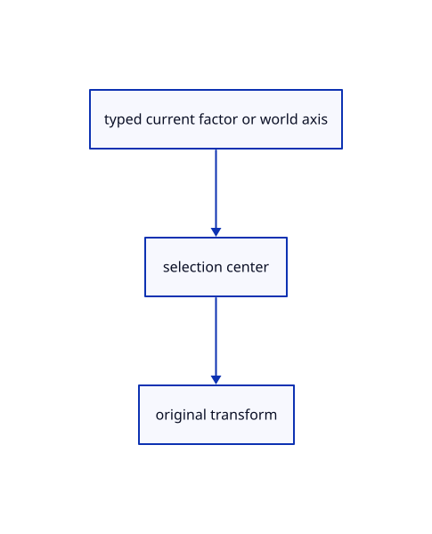

# 15.1.32 · Apply direct Scale and Rotate about the current selection center

**Chapter 15 · Transforms and surface construction · Section 15.1 · Transforms, extrusions and revolutions** · [Contents](contents.md)

**Typing: 14–27 minutes.** [Estimate](typing-load.md).

Validate the direct factor or world-axis angle and apply it about the current gizmo center, falling back to the world origin when absent.

## Type

Continue from [Register Copy Scale Rotate and their current aliases](77l-register-copy-scale-rotate-and-their-current-aliases.md). [Save or recover your work](recovery.md).

### 1. `src/editor.rs`

Apply direct current Scale and Rotate about the selection gizmo center.

<details>
<summary>Locate the existing block</summary>

```rust
        if matches!(&action, Action::Close | Action::Undo | Action::Redo | Action::Adopt {..} | Action::Live(_) | Action::Import(_) | Action::Replace(_) | Action::ImportAt(_, _) | Action::ReplaceAt(_, _)) { self.draft = None;self.plane_menu=false;self.plane_only=false; }
        match action {
            Action::BeginTransformation(kind)=>return self.begin_transform(kind),
            Action::Transformation {kind,delta}=>{let ids=self.selected_objects();let target=self.selection().filter(|_|self.selected_part.is_some());return self.apply_transform(kind,&delta,&ids,target);},
```

</details>

Edit the existing block to match this code; keep unchanged lines:

```rust
--8<-- "journey/code/77m-apply-direct-scale-and-rotate-about-the-current-selection-center-01.rs"
```

## Run and check

Run this from `session_viewer` to select the fixed dependency versions and install supplied binary assets. It updates Cargo.lock and preserves the previous lock. It does not write implementation code:

```sh
npm --prefix ../session_tests run course -- dependencies 15.1.32
```

In your project:

```sh
cd workspace/journey
REGEN_PROTO=0 cargo build --lib --locked --target wasm32-unknown-unknown -j1
REGEN_PROTO=0 CARGO_BUILD_JOBS=1 trunk serve --port 8780
```

Open `http://127.0.0.1:8780/`. Keep an existing Trunk server running; saving rebuilds it.


### Recorded visual result

**Previous native render — current verification pending.**

Original Circle, Ellipse, Arc, Parabola and freeform Curve remain visible.


*This recorded image predates a source or checker change. Rebuild this checkpoint before using it as current evidence; browser controls require separate acceptance.*

This reference image is shared with [14.6.5 · Exercise exact curves and rational control edits](76d-exercise-exact-curves-and-rational-control-edits.md). It does not demonstrate a new feature by itself.

<details>
<summary>Code explanation and diagram</summary>


typed current factor or world axis → selection center → original transform.



Does Rotate z90 use the construction plane normal?

The explicit z form uses the world Z axis. Interactive Rotate uses the current construction plane normal.

Study estimate, including typing and experiments: 0.5–1 hours.

</details>

<details>
<summary>Optional experiment</summary>

Rotate a selected line about its center, then compare an interactive XZ reference turn and Undo each independently.

</details>

<details>
<summary>Check and save your work</summary>

Restore experimental edits, then run from `session_viewer`:

```sh
npm --prefix ../session_tests run course -- check 15.1.32
npm --prefix ../session_tests run course -- save 15.1.32
```

Source comparison leaves your project untouched. [Save and recovery instructions](recovery.md).

</details>

<details>
<summary>Viewer coverage and verification</summary>


The preceding curve contract remains authored and unrun. The final transformation contract adds direct Copy and Rotate, repeat Copy and Undo, typed interactive Scale modes, invalid input/cancellation and a three-box exercise. Actual browser execution remains required.

[Full validation scope](release.md).

To reproduce the scripted acceptance of the reference checkpoint, run from `session_viewer` with the [course bundle server](release.md#reproduce) running on port 8781:

```sh
npm --prefix ../session_tests run course -- capture 15.1.32
```

This uses the verified reference bundle; it does not check or change your typed project.

</details>
