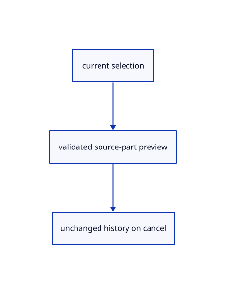

# 15.1.33 · Retain earlier selection checks with source part support

**Chapter 15 · Transforms and surface construction · Section 15.1 · Transforms, extrusions and revolutions** · [Contents](contents.md)

**Typing: 0–0 minutes.** [Estimate](typing-load.md).

Strengthen the earlier part-preview check: cancellation must restore the original placements. The selection and parent-deletion guards now change in 77k, alongside part Move.

## Type

Continue from [Apply direct Scale and Rotate about the current selection center](77m-apply-direct-scale-and-rotate-about-the-current-selection-center.md). [Save or recover your work](recovery.md).

<details>
<summary>Supplied validation fixture</summary>

Copy this supplied authoring fixture once. Continue with the browser build below; the course does not require running native tests.

### 1. `src/edit_preview_tests.rs`

Copy retained selection/preview fixtures with current source-part Move support.

<details>
<summary>Locate the existing block</summary>

```text

#[test]
fn preview_rejects_parts_locked_or_cold_sources_and_stale_targets() {
    let mut e=editor(); let id=e.scene.objects()[0].id;
    assert!(Preview::new(&e.scene,vec![]).is_err()); let mut preview=Preview::new(&e.scene,vec![id,id]).unwrap(); assert_eq!(preview.ids(),&[id]);
    preview.set(Xform::translation(1.,0.,0.)).unwrap(); e.scene.translate(id,[2.,0.,0.]).unwrap();
    assert!(preview.commit(&mut e.scene,&mut crate::history::History::default()).is_err());
    e.apply(Action::SelectAll).unwrap(); e.selected_part=Some(crate::pick_sources::Part::Face(0)); e.apply(Action::BeginTool(Shape::Move)).unwrap(); assert!(e.transform_preview.is_some()); e.apply(Action::CancelTool).unwrap();
    let mut mesh=session_rust::Mesh::create_box(1.,1.,1.); mesh.is_locked=true;
    let locked=e.scene.insert(crate::prepared::PreparedMesh::new(mesh).unwrap()).unwrap(); assert!(Preview::new(&e.scene,vec![locked]).is_err());
```

</details>

Update the existing block with this supplied code; keep unchanged lines:

```text
--8<-- "journey/code/77n-retain-earlier-selection-checks-with-source-part-support-02.rs"
```

</details>

## Run and check

Run this from `session_viewer` to select the fixed dependency versions and install supplied binary assets. It updates Cargo.lock and preserves the previous lock. It does not write implementation code:

```sh
npm --prefix ../session_tests run course -- dependencies 15.1.33
```

In your project:

```sh
cd workspace/journey
REGEN_PROTO=0 cargo build --lib --locked --target wasm32-unknown-unknown -j1
REGEN_PROTO=0 CARGO_BUILD_JOBS=1 trunk serve --port 8780
```

Open `http://127.0.0.1:8780/`. Keep an existing Trunk server running; saving rebuilds it.


### Recorded visual result

**Previous native render — current verification pending.**

Original Circle, Ellipse, Arc, Parabola and freeform Curve remain visible.


*This recorded image predates a source or checker change. Rebuild this checkpoint before using it as current evidence; browser controls require separate acceptance.*

This reference image is shared with [14.6.5 · Exercise exact curves and rational control edits](76d-exercise-exact-curves-and-rational-control-edits.md). It does not demonstrate a new feature by itself.

<details>
<summary>Code explanation and diagram</summary>


current selection → validated source-part preview → unchanged history on cancel.



Does enabling part Move allow Delete to remove its parent implicitly?

No. Delete still requires whole-object selection. Invalid edits and cancelled previews leave selection history unchanged.

Study estimate, including typing and experiments: 0.5–1 hours.

</details>

<details>
<summary>Optional experiment</summary>

Select an original part, start Move and cancel with Escape. Confirm its placement is restored, then select its parent and compare Delete/Undo. Read the retained cold, locked and stale-owner cases as optional boundary validation.

</details>

<details>
<summary>Check and save your work</summary>

Restore experimental edits, then run from `session_viewer`:

```sh
npm --prefix ../session_tests run course -- check 15.1.33
npm --prefix ../session_tests run course -- save 15.1.33
```

Source comparison leaves your project untouched. [Save and recovery instructions](recovery.md).

</details>

<details>
<summary>Viewer coverage and verification</summary>


The preceding curve contract remains authored and unrun. The final transformation contract adds direct Copy and Rotate, repeat Copy and Undo, typed interactive Scale modes, invalid input/cancellation and a three-box exercise. Actual browser execution remains required.

[Full validation scope](release.md).

To reproduce the scripted acceptance of the reference checkpoint, run from `session_viewer` with the [course bundle server](release.md#reproduce) running on port 8781:

```sh
npm --prefix ../session_tests run course -- capture 15.1.33
```

This uses the verified reference bundle; it does not check or change your typed project.

</details>
