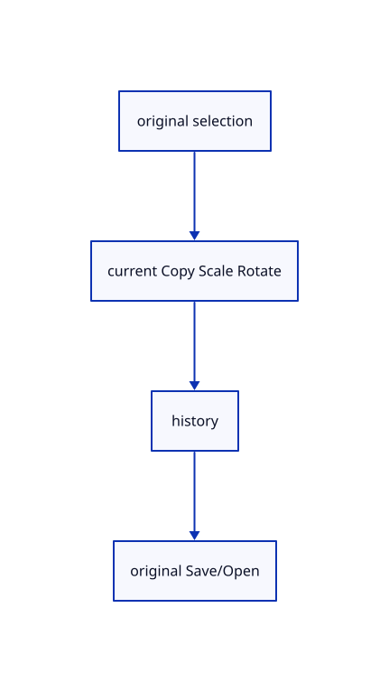

# 15.1.34 · Exercise original copy transforms history and exact persistence

**Chapter 15 · Transforms and surface construction · Section 15.1 · Transforms, extrusions and revolutions** · [Contents](contents.md)

**Typing: 0–0 minutes.** [Estimate](typing-load.md).

Copy the current integrated creation, preview, source edit and nested placement fixtures, then use the registered commands to create the rendered exercise.

## Type

Continue from [Retain earlier selection checks with source part support](77n-retain-earlier-selection-checks-with-source-part-support.md). [Save or recover your work](recovery.md).

<details>
<summary>Supplied validation fixture</summary>

Copy this supplied authoring fixture once. Continue with the browser build below; the course does not require running native tests.

### 1. `src/transform_tests.rs`

Copy integrated current copy/transform/original-edit/history/nested SaveOpen fixtures.

Copy this supplied file:

```text
--8<-- "journey/code/77o-exercise-original-copy-transforms-history-and-exact-persistence-01.rs"
```

</details>

<details>
<summary>Supplied validation fixture</summary>

Copy this supplied authoring fixture once. Continue with the browser build below; the course does not require running native tests.

### 2. `src/lib.rs`

Register the source transformation component.

<details>
<summary>Locate the existing block</summary>

```text

pub mod transform_commands;
```

</details>

After that block, append this supplied code:

```text
--8<-- "journey/code/77o-exercise-original-copy-transforms-history-and-exact-persistence-02.rs" skip=29
```

</details>

## Run and check

Run this from `session_viewer` to select the fixed dependency versions and install supplied binary assets. It updates Cargo.lock and preserves the previous lock. It does not write implementation code:

```sh
npm --prefix ../session_tests run course -- dependencies 15.1.34
```

In your project:

```sh
cd workspace/journey
REGEN_PROTO=0 cargo build --lib --locked --target wasm32-unknown-unknown -j1
REGEN_PROTO=0 CARGO_BUILD_JOBS=1 trunk serve --port 8780
```

Open `http://127.0.0.1:8780/`. Keep an existing Trunk server running; saving rebuilds it.

Three original boxes retain their shared source and independent placements. Copy repeats with separate target transactions; Scale modes and Rotate references preserve original geometry. Source-part edits retain rational weights, knots and validated CAD boundaries. Undo/Redo and Save/Open preserve original identity and nested placement.

### Recorded visual result

**Previous native render — current verification pending.**

Three original boxes display with copied identities and independent scaled/rotated placements.


*This recorded image predates a source or checker change. Rebuild this checkpoint before using it as current evidence; browser controls require separate acceptance.*

<details>
<summary>Code explanation and diagram</summary>


original selection → current Copy Scale Rotate → history → original Save/Open.



What survives a whole-object Copy and rotation?

Keep the original geometry allocation and its source data. The new row has a distinct identity and placement; its parent, name and colours remain.

Study estimate, including typing and experiments: 0.5–1 hours.

</details>

<details>
<summary>Optional experiment</summary>

Type Close, CPlane XY, Box w0,0,0 1 1 1, Select All, Copy 2,0,0, Scale 0.8, Rotate z 30, Copy -2,0,0, View Isometric, Select None and Fit, with spaces after Copy, Scale and Rotate. Try repeated Copy targets, Scale1D/2D/3D, a failed input, Escape and Undo/Redo. Save and reopen.

</details>

<details>
<summary>Check and save your work</summary>

Restore experimental edits, then run from `session_viewer`:

```sh
npm --prefix ../session_tests run course -- check 15.1.34
npm --prefix ../session_tests run course -- save 15.1.34
```

Source comparison leaves your project untouched. [Save and recovery instructions](recovery.md).

</details>

<details>
<summary>Viewer coverage and verification</summary>

Retain current Copy, Move, Scale and Rotate semantics. Copy creates a new row GUID under the same parent, keeps name/colours and original selection, and records one transaction per target. Copy repeats after each target; Enter finishes and Escape preserves completed copies. Scale supports 1D/2D/3D, an origin and factor or reference points/new length. Rotate uses the current plane for picked references and the selection gizmo center for direct world-axis angles. Original geometry remains shared for whole-object placement; source-part edits clone and rebuild only the edited original. Copy refuses parts. Preserve rational weights/knots, source flags, nested local placements and one transaction. Invalid input leaves accepted points, previous preview and Redo. Current CAD deformation checks adjacent trims before adoption. Original cloud point and streamed sheet edits remain unsupported in current production; source controls for more lanes connect with the complete inventory85. Existing course selected bounds now include precise original Line/Point/Curve lanes, so their direct rotation uses the selection center.

Earlier checks remain with two former Move-part rejection assertions updated for source-part support. Three copied current transform maths cases and nine copied current control/deformation/topology cases remain. Nine integrated cases cover copied parent/name/colour/shared source/new GUID, repeat-target Undo, current scale modes, reference lengths and previews, gizmo-centered/direct/plane rotations, invalid batches and preserved Redo, rational control Move/Scale, original CAD-face rebuild/Undo/SaveOpen, cancellation, and duplicate named nested groups/original source holders.

The preceding curve contract remains authored and unrun. The final transformation contract adds direct Copy and Rotate, repeat Copy and Undo, typed interactive Scale modes, invalid input/cancellation and a three-box exercise. Actual browser execution remains required.

[Full validation scope](release.md).

To reproduce the scripted acceptance of the reference checkpoint, run from `session_viewer` with the [course bundle server](release.md#reproduce) running on port 8781:

```sh
npm --prefix ../session_tests run course -- capture 15.1.34
```

This uses the verified reference bundle; it does not check or change your typed project.

</details>
