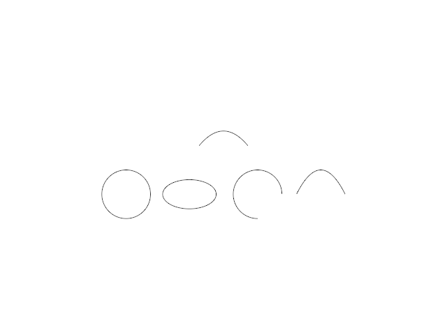

# 15.1.2 · Compute signed construction-plane rotation

**Chapter 15 · Transforms and surface construction · Section 15.1 · Transforms, extrusions and revolutions** · [Contents](contents.md)

**Typing: 10–19 minutes.** [Estimate](typing-load.md).

Project the two reference vectors onto the construction plane axes.

## Type

Continue from [Build directional scale transforms](77-copy-current-transformation-and-source-edit-algorithms.md). [Save or recover your work](recovery.md).

### 1. `src/transform_rotate.rs`

Compute signed construction-plane rotation.

Create the file and type:

```rust
--8<-- "journey/code/77sa-compute-signed-construction-plane-rotation-typed-01.rs"
```

### 2. `src/lib.rs`

Register the source transformation component.

<details>
<summary>Locate the existing block</summary>

```rust

pub mod transform_scale;
```

</details>

After that block, type:

```rust
--8<-- "journey/code/77-copy-current-transformation-and-source-edit-algorithms-04.rs" skip=26
```

<details>
<summary>Supplied validation fixture</summary>

Copy this supplied authoring fixture once. Continue with the browser build below; the course does not require running native tests.

### 3. `src/transform_rotate.rs`

Supply independent original-source and fixed-origin regressions.

<details>
<summary>Locate the existing block</summary>

```text
ot(&y));

    if ax.hypot(ay) <= 1e-12 || bx.hypot(by) <= 1e-12 {
        return None;
    }

    Some((ax * by - ay * bx).atan2(ax * bx + ay * by))
}

/// A turn of `radians` about the plane normal through `center`.
pub fn rotation(center: &Point, radians: f64, plane: &Plane) -> Xform {
    let to = Xform::translation(center[0], center[1], center[2]);
    let back = Xform::translation(-center[0], -center[1], -center[2]);
    &(&to * &Xform::rotation(&plane.z_axis(), radians, false)) * &back
}
```

</details>

After that block, append this supplied code:

```text
--8<-- "journey/code/77sa-compute-signed-construction-plane-rotation-typed-03.rs" skip=500
```

</details>

## Run and check

Run this from `session_viewer` to select the fixed dependency versions and install supplied binary assets. It updates Cargo.lock and preserves the previous lock. It does not write implementation code:

```sh
npm --prefix ../session_tests run course -- dependencies 15.1.2
```

In your project:

```sh
cd workspace/journey
REGEN_PROTO=0 cargo build --lib --locked --target wasm32-unknown-unknown -j1
REGEN_PROTO=0 CARGO_BUILD_JOBS=1 trunk serve --port 8780
```

Open `http://127.0.0.1:8780/`. Keep an existing Trunk server running; saving rebuilds it.


### Recorded visual result

**Previous native render — current verification pending.**

Original Circle, Ellipse, Arc, Parabola and freeform Curve remain visible.



*This recorded image predates a source or checker change. Rebuild this checkpoint before using it as current evidence; browser controls require separate acceptance.*

This reference image is shared with [15.1.1 · Build directional scale transforms](77-copy-current-transformation-and-source-edit-algorithms.md). It does not demonstrate a new feature by itself.

<details>
<summary>Code explanation and diagram</summary>

The 2D cross and dot products give a signed angle; a point on the centre has no defined angle. Compose translation to the centre, rotation about the plane normal and translation back. The rightmost transform acts first. This remains f64 CAD math; the renderer converts final display placements for the GPU.

original f64 CAD source → pure transform or original control addresses → later edit preview and GPU display.


Why use atan2 of the planar cross and dot products?

It preserves the rotation sign and quadrant without dividing by a potentially zero dot product.

Study estimate, including typing and experiments: 0.5–1 hours.

</details>

<details>
<summary>Optional experiment</summary>

Predict the signed angle from the plane x axis to its y axis and in the reverse direction. Verify that rotating about [5,5,0] keeps that centre fixed.

</details>

<details>
<summary>Check and save your work</summary>

Restore experimental edits, then run from `session_viewer`:

```sh
npm --prefix ../session_tests run course -- check 15.1.2
npm --prefix ../session_tests run course -- save 15.1.2
```

Source comparison leaves your project untouched. [Save and recovery instructions](recovery.md).

</details>

<details>
<summary>Viewer coverage and verification</summary>


Original edit preparation; the later connected command and control-picking browser exercises establish interaction behavior.

[Full validation scope](release.md).

</details>
