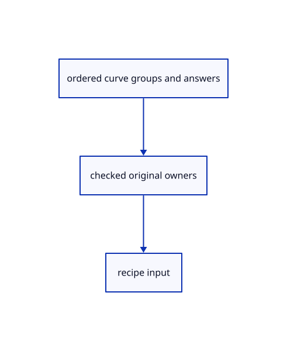

# 15.2.3 · Resolve a recipe input and guard picked source freshness

**Chapter 15 · Transforms and surface construction · Section 15.2 · Profile collection and surfacing** · [Contents](contents.md)

**Typing: 16–32 minutes.** [Estimate](typing-load.md).

Read ordered groups and answered steps, derive the current plane normal, and refuse a changed source before building.

## Type

Continue from [Own picked originals and world profile copies](78a-own-picked-originals-and-world-profile-copies.md). [Save or recover your work](recovery.md).

### 1. `src/gather_draft.rs`

Extend the pending gather owner with checked current recipe behavior.

<details>
<summary>Locate the existing block</summary>

```rust
        let row=scene.paths().iter().find(|row|row.id==id)?;Some(match &row.prepared.source{crate::chain::Source::Line(source)=>Geometry::Line(source.clone()),crate::chain::Source::Polyline(source)=>Geometry::Polyline(source.clone()),crate::chain::Source::Curve(source,_)=>Geometry::NurbsCurve(source.clone())})
    }
}
```

</details>

Edit the existing block to match this code; keep unchanged lines:

```rust
--8<-- "journey/code/78b-resolve-a-recipe-input-and-guard-picked-source-freshness-01.rs"
```

## Run and check

Run this from `session_viewer` to select the fixed dependency versions and install supplied binary assets. It updates Cargo.lock and preserves the previous lock. It does not write implementation code:

```sh
npm --prefix ../session_tests run course -- dependencies 15.2.3
```

In your project:

```sh
cd workspace/journey
REGEN_PROTO=0 cargo build --lib --locked --target wasm32-unknown-unknown -j1
REGEN_PROTO=0 CARGO_BUILD_JOBS=1 trunk serve --port 8780
```

Open `http://127.0.0.1:8780/`. Keep an existing Trunk server running; saving rebuilds it.


### Recorded visual result

**Previous native render — current verification pending.**

Three original boxes retain independent placements.


*This recorded image predates a source or checker change. Rebuild this checkpoint before using it as current evidence; browser controls require separate acceptance.*

This reference image is shared with [15.2.1 · Copy current curve collection and surfacing recipes](78-copy-current-curve-collection-and-surfacing-recipes.md). It does not demonstrate a new feature by itself.

<details>
<summary>Code explanation and diagram</summary>


ordered curve groups and answers → checked original owners → recipe input.



May an old world profile survive a placement edit?

Refuse it: its original allocation, world placement and visible unlocked eligibility must still match the captured source.

Study estimate, including typing and experiments: 0.5–1 hours.

</details>

<details>
<summary>Optional experiment</summary>

Move a picked original through another owner, then submit a distance. Start again instead of building from stale world coordinates.

</details>

<details>
<summary>Check and save your work</summary>

Restore experimental edits, then run from `session_viewer`:

```sh
npm --prefix ../session_tests run course -- check 15.2.3
npm --prefix ../session_tests run course -- save 15.2.3
```

Source comparison leaves your project untouched. [Save and recovery instructions](recovery.md).

</details>

<details>
<summary>Viewer coverage and verification</summary>


The preceding transformation browser contract remains authored and unrun. The final extrusion/revolution contract exercises the registered names, failed input, cap options, one Undo/Redo and the same rendered exercise. Actual browser execution remains required.

[Full validation scope](release.md).

To reproduce the scripted acceptance of the reference checkpoint, run from `session_viewer` with the [course bundle server](release.md#reproduce) running on port 8781:

```sh
npm --prefix ../session_tests run course -- capture 15.2.3
```

This uses the verified reference bundle; it does not check or change your typed project.

</details>
