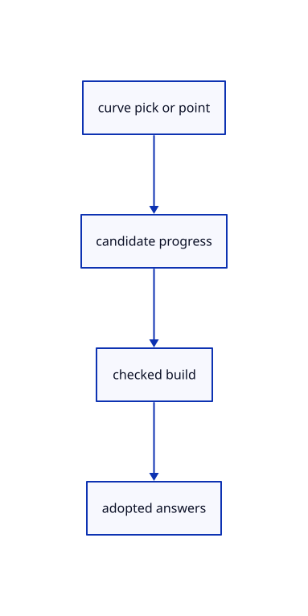

# 15.2.4 · Accept curve picks and geometric answers atomically

**Chapter 15 · Transforms and surface construction · Section 15.2 · Profile collection and surfacing** · [Contents](contents.md)

**Typing: 13–25 minutes.** [Estimate](typing-load.md).

Toggle a curve in the current ordered group. Stage point or distance answers and build before replacing the owner.

## Type

Continue from [Resolve a recipe input and guard picked source freshness](78b-resolve-a-recipe-input-and-guard-picked-source-freshness.md). [Save or recover your work](recovery.md).

### 1. `src/gather_draft.rs`

Extend the pending gather owner with checked current recipe behavior.

<details>
<summary>Locate the existing block</summary>

```rust
    pub fn prompt(&self)->String{let step=self.current().map_or("complete",Step::prompt);format!("{} · {step} · Esc cancels",self.recipe.name)}
    pub fn axis(&self)->Result<(Point,Vector),String>{Ok((self.recipe.axis)(&self.input()?))}
}
```

</details>

Edit the existing block to match this code; keep unchanged lines:

```rust
--8<-- "journey/code/78c-accept-curve-picks-and-geometric-answers-atomically-01.rs"
```

## Run and check

Run this from `session_viewer` to select the fixed dependency versions and install supplied binary assets. It updates Cargo.lock and preserves the previous lock. It does not write implementation code:

```sh
npm --prefix ../session_tests run course -- dependencies 15.2.4
```

In your project:

```sh
cd workspace/journey
REGEN_PROTO=0 cargo build --lib --locked --target wasm32-unknown-unknown -j1
REGEN_PROTO=0 CARGO_BUILD_JOBS=1 trunk serve --port 8780
```

Open `http://127.0.0.1:8780/`. Keep an existing Trunk server running; saving rebuilds it.


### Recorded visual result

**Previous native render — current verification pending.**

Three original boxes retain independent placements.


*This recorded image predates a source or checker change. Rebuild this checkpoint before using it as current evidence; browser controls require separate acceptance.*

This reference image is shared with [15.2.1 · Copy current curve collection and surfacing recipes](78-copy-current-curve-collection-and-surfacing-recipes.md). It does not demonstrate a new feature by itself.

<details>
<summary>Code explanation and diagram</summary>


curve pick or point → candidate progress → checked build → adopted answers.



Does a failed distance consume its question?

No. Keep previous progress, accepted answers and cursor. Zero extrusion remains retryable and creates no history.

Study estimate, including typing and experiments: 0.5–1 hours.

</details>

<details>
<summary>Optional experiment</summary>

Pick two curves, pick the first again to remove it, and Enter. Compare a zero distance with a valid signed distance.

</details>

<details>
<summary>Check and save your work</summary>

Restore experimental edits, then run from `session_viewer`:

```sh
npm --prefix ../session_tests run course -- check 15.2.4
npm --prefix ../session_tests run course -- save 15.2.4
```

Source comparison leaves your project untouched. [Save and recovery instructions](recovery.md).

</details>

<details>
<summary>Viewer coverage and verification</summary>


The preceding transformation browser contract remains authored and unrun. The final extrusion/revolution contract exercises the registered names, failed input, cap options, one Undo/Redo and the same rendered exercise. Actual browser execution remains required.

[Full validation scope](release.md).

To reproduce the scripted acceptance of the reference checkpoint, run from `session_viewer` with the [course bundle server](release.md#reproduce) running on port 8781:

```sh
npm --prefix ../session_tests run course -- capture 15.2.4
```

This uses the verified reference bundle; it does not check or change your typed project.

</details>
