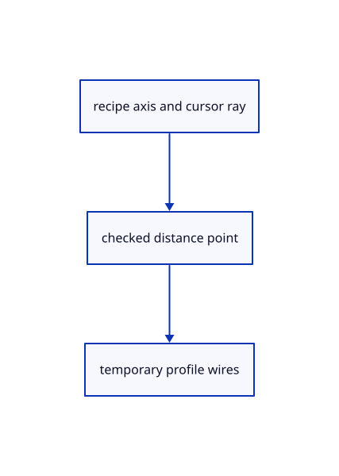

# 15.2.6 · Constrain distance input and draw lifted profile wires

**Chapter 15 · Transforms and surface construction · Section 15.2 · Profile collection and surfacing** · [Contents](contents.md)

**Typing: 12–24 minutes.** [Estimate](typing-load.md).

Find the cursor along the recipe axis and derive lifted profile outlines without inserting geometry or history.

## Type

Continue from [Read options and typed batches without partial results](78d-read-options-and-typed-batches-without-partial-results.md). [Save or recover your work](recovery.md).

### 1. `src/gather_draft.rs`

Constrain current distance questions and derive temporary lifted profile wires.

<details>
<summary>Locate the existing block</summary>

```rust
use crate::{cplane::CPlane,gather_input::{Answer,Input,Made,Picked,Progress,Recipe,Step},scene::{Scene,ObjectId}};
use session_rust::{Geometry,Point,Vector};
#[derive(Clone)]
pub struct Draft {pub recipe:&'static Recipe,pub choice:usize,pub progress:Progress,pub answers:Vec<Answer>,pub curves:Vec<(ObjectId,Picked)>,pub before:Vec<ObjectId>,pub frame:CPlane,pub typed:String,pub originals:Vec<(ObjectId,Geometry,session_rust::Xform)>}
impl Draft {
    pub fn new(recipe:&'static Recipe,text:&str,scene:&Scene,before:Vec<ObjectId>,frame:CPlane)->Result<Self,String>{
        let words=text.split_whitespace().collect::<Vec<_>>();let(choice,answers)=crate::gather_input::read(recipe,&words)?;for answer in &answers{match answer{Answer::Point(p)=>{crate::tool_coords::checked([p[0],p[1],p[2]]).map_err(str::to_owned)?;},Answer::Vector(v)if(0..3).any(|i|!v[i].is_finite()||v[i].abs()>1e12)=>return Err("Distance vector exceeds the accepted range".into()),_=>{}}}let mut result=Self{recipe,choice,progress:Progress::new(recipe.steps,answers.len()),answers,curves:Vec::new(),before:before.clone(),frame,typed:String::new(),originals:Vec::new()};
        for id in before{if scene.pick_id(id.value())==Some(id){if let Some(curve)=Self::world(scene,id){result.originals.push((id,Self::source(scene,id).unwrap(),scene.placement(id).unwrap()));result.curves.push((id,curve));}}}let rows=result.curves.iter().map(|(id,_)|id.value()).collect::<Vec<_>>();result.progress.preselect(recipe.steps,&rows);Ok(result)
    }
    pub fn current(&self)->Option<&'static Step>{self.recipe.steps.get(self.progress.step)}
    pub fn world(scene:&Scene,id:ObjectId)->Option<Picked>{
        let geometry=Self::source(scene,id)?;
        crate::gather_input::picked(&geometry,&scene.placement(id)?)
    }
    pub fn source(scene:&Scene,id:ObjectId)->Option<Geometry>{
        if let Some(row)=scene.lines().iter().find(|row|row.id==id){return Some(Geometry::Line(row.prepared.source.clone()))}
        let row=scene.paths().iter().find(|row|row.id==id)?;Some(match &row.prepared.source{crate::chain::Source::Line(source)=>Geometry::Line(source.clone()),crate::chain::Source::Polyline(source)=>Geometry::Polyline(source.clone()),crate::chain::Source::Curve(source,_)=>Geometry::NurbsCurve(source.clone())})
    }
    pub fn valid(&self,scene:&Scene)->Result<(),String>{
        for(id,source,place)in &self.originals{if !self.progress.picked().contains(&id.value()){continue}let current=Self::source(scene,*id).ok_or("Picked curve was removed")?;let same=match(source,current){(Geometry::Line(a),Geometry::Line(b))=>std::rc::Rc::ptr_eq(a,&b),(Geometry::Polyline(a),Geometry::Polyline(b))=>std::rc::Rc::ptr_eq(a,&b),(Geometry::NurbsCurve(a),Geometry::NurbsCurve(b))=>std::rc::Rc::ptr_eq(a,&b),_=>false};if !same||scene.placement(*id).is_none_or(|p|p.m!=place.m)||scene.pick_id(id.value())!=Some(*id){return Err("Picked curve changed; start again".into())}}Ok(())
    }
    pub fn input(&self)->Result<Input,String>{
        let curves=self.progress.rows.iter().map(|rows|rows.iter().map(|row|self.curves.iter().find(|(id,_)|id.value()==*row).map(|(_,curve)|curve.clone()).ok_or_else(||"Picked source is missing".into())).collect::<Result<Vec<_>,String>>()).collect::<Result<Vec<_>,_>>()?;
        let(x,y)=self.frame.axes();Ok(Input{curves,answers:self.answers[..self.progress.answered.min(self.answers.len())].to_vec(),choice:self.recipe.choices().nth(self.choice).unwrap_or(""),normal:x.cross(&y)})
    }
    pub fn build(&self)->Result<Option<Made>,String>{if self.progress.done(self.recipe.steps){(self.recipe.build)(&self.input()?).map(Some)}else{Ok(None)}}
    pub fn prompt(&self)->String{let step=self.current().map_or("complete",Step::prompt);format!("{} · {step} · Esc cancels",self.recipe.name)}
    pub fn axis(&self)->Result<(Point,Vector),String>{Ok((self.recipe.axis)(&self.input()?))}
    pub fn pick(&mut self,scene:&Scene,id:Option<ObjectId>)->Result<Option<Made>,String>{
        let id=id.ok_or("Nothing there · pick a line, polyline or curve")?;if scene.pick_id(id.value())!=Some(id){return Err("Pick a visible unlocked curve".into())}let mut next=self.clone();if !next.curves.iter().any(|(old,_)|*old==id){let curve=Self::world(scene,id).ok_or("Pick a line, polyline or curve")?;next.originals.push((id,Self::source(scene,id).unwrap(),scene.placement(id).unwrap()));next.curves.push((id,curve));}next.progress.pick(next.recipe.steps,id.value())?;let made=next.build()?;*self=next;Ok(made)
    }
    pub fn point(&mut self,point:[f64;3])->Result<Option<Made>,String>{
        let point=crate::tool_coords::checked(point).map_err(str::to_owned)?;let mut next=self.clone();let answer=match next.current(){Some(Step::Point(_))=>Answer::Point(Point::new(point[0],point[1],point[2])),Some(Step::Distance(_))=>{let(base,_)=next.axis()?;Answer::Vector(Vector::new(point[0]-base[0],point[1]-base[1],point[2]-base[2]))},_=>return Err("The current step needs a curve pick or a typed number".into())};next.progress.answer(next.recipe.steps,&mut next.answers,answer);let made=next.build()?;*self=next;Ok(made)
    }
    pub fn text(&mut self,text:&str,fixed:Option<CPlane>)->Result<Option<Made>,String>{
        crate::drawing_coords::set_plane(fixed);let mut next=self.clone();let words=text.split_whitespace().collect::<Vec<_>>();
        if words.is_empty(){next.progress.next(next.recipe.steps,&mut next.answers)?;}else{
            let mut index=0;while index<words.len(){
                let typed=format!("{}{}",next.typed,crate::primitive_options::compact(words[index]));
                if let Some(choice)=next.recipe.choices().position(|choice|crate::primitive_options::compact(choice)==typed){next.choice=choice;next.typed.clear();index+=1;continue}
                if next.recipe.choices().any(|choice|crate::primitive_options::compact(choice).starts_with(&typed)){next.typed=typed;index+=1;continue}
                if let Some((choice,count))=next.recipe.option_in(&words[index..]){next.choice=choice;next.typed.clear();index+=count;continue}
                let step=next.current().ok_or("Extra input after the completed command")?;let answer=step.read(words[index])?;
                match &answer{Answer::Point(point)=>{crate::tool_coords::checked([point[0],point[1],point[2]]).map_err(str::to_owned)?;},Answer::Vector(vector)if(0..3).any(|i|!vector[i].is_finite()||vector[i].abs()>1e12)=>return Err("Distance vector exceeds the accepted range".into()),_=>{}}
                next.typed.clear();next.progress.answer(next.recipe.steps,&mut next.answers,answer);index+=1;
            }
        }let made=next.build()?;*self=next;Ok(made)
    }
}
```

</details>

Edit the existing block to match this code; keep unchanged lines:

```rust
use crate::{cplane::CPlane,gather_input::{Answer,Input,Made,Picked,Progress,Recipe,Step},scene::{Scene,ObjectId}};
use session_rust::{Geometry,Point,Vector};
#[derive(Clone)]
pub struct Draft {pub recipe:&'static Recipe,pub choice:usize,pub progress:Progress,pub answers:Vec<Answer>,pub curves:Vec<(ObjectId,Picked)>,pub before:Vec<ObjectId>,pub frame:CPlane,pub typed:String,pub originals:Vec<(ObjectId,Geometry,session_rust::Xform)>}
impl Draft {
    pub fn new(recipe:&'static Recipe,text:&str,scene:&Scene,before:Vec<ObjectId>,frame:CPlane)->Result<Self,String>{
        let words=text.split_whitespace().collect::<Vec<_>>();let(choice,answers)=crate::gather_input::read(recipe,&words)?;for answer in &answers{match answer{Answer::Point(p)=>{crate::tool_coords::checked([p[0],p[1],p[2]]).map_err(str::to_owned)?;},Answer::Vector(v)if(0..3).any(|i|!v[i].is_finite()||v[i].abs()>1e12)=>return Err("Distance vector exceeds the accepted range".into()),_=>{}}}let mut result=Self{recipe,choice,progress:Progress::new(recipe.steps,answers.len()),answers,curves:Vec::new(),before:before.clone(),frame,typed:String::new(),originals:Vec::new()};
        for id in before{if scene.pick_id(id.value())==Some(id){if let Some(curve)=Self::world(scene,id){result.originals.push((id,Self::source(scene,id).unwrap(),scene.placement(id).unwrap()));result.curves.push((id,curve));}}}let rows=result.curves.iter().map(|(id,_)|id.value()).collect::<Vec<_>>();result.progress.preselect(recipe.steps,&rows);Ok(result)
    }
    pub fn current(&self)->Option<&'static Step>{self.recipe.steps.get(self.progress.step)}
    pub fn picks(&self)->bool{self.current().is_some_and(Step::curves)}
    pub fn world(scene:&Scene,id:ObjectId)->Option<Picked>{
        let geometry=Self::source(scene,id)?;
        crate::gather_input::picked(&geometry,&scene.placement(id)?)
    }
    pub fn source(scene:&Scene,id:ObjectId)->Option<Geometry>{
        if let Some(row)=scene.lines().iter().find(|row|row.id==id){return Some(Geometry::Line(row.prepared.source.clone()))}
        let row=scene.paths().iter().find(|row|row.id==id)?;Some(match &row.prepared.source{crate::chain::Source::Line(source)=>Geometry::Line(source.clone()),crate::chain::Source::Polyline(source)=>Geometry::Polyline(source.clone()),crate::chain::Source::Curve(source,_)=>Geometry::NurbsCurve(source.clone())})
    }
    pub fn valid(&self,scene:&Scene)->Result<(),String>{
        for(id,source,place)in &self.originals{if !self.progress.picked().contains(&id.value()){continue}let current=Self::source(scene,*id).ok_or("Picked curve was removed")?;let same=match(source,current){(Geometry::Line(a),Geometry::Line(b))=>std::rc::Rc::ptr_eq(a,&b),(Geometry::Polyline(a),Geometry::Polyline(b))=>std::rc::Rc::ptr_eq(a,&b),(Geometry::NurbsCurve(a),Geometry::NurbsCurve(b))=>std::rc::Rc::ptr_eq(a,&b),_=>false};if !same||scene.placement(*id).is_none_or(|p|p.m!=place.m)||scene.pick_id(id.value())!=Some(*id){return Err("Picked curve changed; start again".into())}}Ok(())
    }
    pub fn input(&self)->Result<Input,String>{
        let curves=self.progress.rows.iter().map(|rows|rows.iter().map(|row|self.curves.iter().find(|(id,_)|id.value()==*row).map(|(_,curve)|curve.clone()).ok_or_else(||"Picked source is missing".into())).collect::<Result<Vec<_>,String>>()).collect::<Result<Vec<_>,_>>()?;
        let(x,y)=self.frame.axes();Ok(Input{curves,answers:self.answers[..self.progress.answered.min(self.answers.len())].to_vec(),choice:self.recipe.choices().nth(self.choice).unwrap_or(""),normal:x.cross(&y)})
    }
    pub fn build(&self)->Result<Option<Made>,String>{if self.progress.done(self.recipe.steps){(self.recipe.build)(&self.input()?).map(Some)}else{Ok(None)}}
    pub fn prompt(&self)->String{let step=self.current().map_or("complete",Step::prompt);format!("{} · {step} · Esc cancels",self.recipe.name)}
    pub fn pick(&mut self,scene:&Scene,id:Option<ObjectId>)->Result<Option<Made>,String>{
        let id=id.ok_or("Nothing there · pick a line, polyline or curve")?;if scene.pick_id(id.value())!=Some(id){return Err("Pick a visible unlocked curve".into())}let mut next=self.clone();if !next.curves.iter().any(|(old,_)|*old==id){let curve=Self::world(scene,id).ok_or("Pick a line, polyline or curve")?;next.originals.push((id,Self::source(scene,id).unwrap(),scene.placement(id).unwrap()));next.curves.push((id,curve));}next.progress.pick(next.recipe.steps,id.value())?;let made=next.build()?;*self=next;Ok(made)
    }
    pub fn point(&mut self,point:[f64;3])->Result<Option<Made>,String>{
        let point=crate::tool_coords::checked(point).map_err(str::to_owned)?;let mut next=self.clone();let answer=match next.current(){Some(Step::Point(_))=>Answer::Point(Point::new(point[0],point[1],point[2])),Some(Step::Distance(_))=>{let(base,_)=next.axis()?;Answer::Vector(Vector::new(point[0]-base[0],point[1]-base[1],point[2]-base[2]))},_=>return Err("The current step needs a curve pick or a typed number".into())};next.progress.answer(next.recipe.steps,&mut next.answers,answer);let made=next.build()?;*self=next;Ok(made)
    }
    pub fn text(&mut self,text:&str,fixed:Option<CPlane>)->Result<Option<Made>,String>{
        crate::drawing_coords::set_plane(fixed);let mut next=self.clone();let words=text.split_whitespace().collect::<Vec<_>>();
        if words.is_empty(){next.progress.next(next.recipe.steps,&mut next.answers)?;}else{
            let mut index=0;while index<words.len(){
                let typed=format!("{}{}",next.typed,crate::primitive_options::compact(words[index]));
                if let Some(choice)=next.recipe.choices().position(|choice|crate::primitive_options::compact(choice)==typed){next.choice=choice;next.typed.clear();index+=1;continue}
                if next.recipe.choices().any(|choice|crate::primitive_options::compact(choice).starts_with(&typed)){next.typed=typed;index+=1;continue}
                if let Some((choice,count))=next.recipe.option_in(&words[index..]){next.choice=choice;next.typed.clear();index+=count;continue}
                let step=next.current().ok_or("Extra input after the completed command")?;let answer=step.read(words[index])?;
                match &answer{Answer::Point(point)=>{crate::tool_coords::checked([point[0],point[1],point[2]]).map_err(str::to_owned)?;},Answer::Vector(vector)if(0..3).any(|i|!vector[i].is_finite()||vector[i].abs()>1e12)=>return Err("Distance vector exceeds the accepted range".into()),_=>{}}
                next.typed.clear();next.progress.answer(next.recipe.steps,&mut next.answers,answer);index+=1;
            }
        }let made=next.build()?;*self=next;Ok(made)
    }
    pub fn axis(&self)->Result<(Point,Vector),String>{Ok((self.recipe.axis)(&self.input()?))}
    pub fn on_axis(&self,camera:&crate::camera::Camera,screen:[f32;2])->Option<[f64;3]>{
        let ray=camera.ray(screen)?;let(base,axis)=self.axis().ok()?;let direction=ray.direction;let(a,b)=(direction.dot(&direction),direction.dot(&axis));let denominator=a-b*b;if denominator<=0.01*a{return None}let offset=&ray.origin-&base;let distance=(a*offset.dot(&axis)-b*offset.dot(&direction))/denominator;let p=&base+&(axis*distance);crate::tool_coords::checked([p[0],p[1],p[2]]).ok()
    }
    pub fn outlines(&self,cursor:Option<[f64;3]>)->Vec<Vec<[f64;3]>>{
        if !matches!(self.current(),Some(Step::Distance(_))){return Vec::new()}let Some(cursor)=cursor else{return Vec::new()};let Ok((base,_))=self.axis()else{return Vec::new()};let offset=Vector::new(cursor[0]-base[0],cursor[1]-base[1],cursor[2]-base[2]);let Ok(input)=self.input()else{return Vec::new()};input.curves.iter().flatten().map(|curve|curve.outline().into_iter().map(|point|{let p=&point+&offset;[p[0],p[1],p[2]]}).collect()).collect()
    }
}
```

<details>
<summary>Optional patch references</summary>

Use these original edit fragments when comparing a saved checkpoint. Apply the complete blocks above.

```text
--8<-- "journey/code/78e-constrain-distance-input-and-draw-lifted-profile-wires-01.rs"
```

```text
--8<-- "journey/code/78e-constrain-distance-input-and-draw-lifted-profile-wires-02.rs"
```

```text
--8<-- "journey/code/78e-constrain-distance-input-and-draw-lifted-profile-wires-03.rs"
```

</details>

## Run and check

Run this from `session_viewer` to select the fixed dependency versions and install supplied binary assets. It updates Cargo.lock and preserves the previous lock. It does not write implementation code:

```sh
npm --prefix ../session_tests run course -- dependencies 15.2.6
```

In your project:

```sh
cd workspace/journey
REGEN_PROTO=0 cargo build --lib --locked --target wasm32-unknown-unknown -j1
REGEN_PROTO=0 CARGO_BUILD_JOBS=1 trunk serve --port 8780
```

Open `http://127.0.0.1:8780/`. Keep an existing Trunk server running; saving rebuilds it.


### Recorded visual result

**Previous native render — current verification pending.**

Three original boxes retain independent placements.


*This recorded image predates a source or checker change. Rebuild this checkpoint before using it as current evidence; browser controls require separate acceptance.*

This reference image is shared with [15.2.1 · Copy current curve collection and surfacing recipes](78-copy-current-curve-collection-and-surfacing-recipes.md). It does not demonstrate a new feature by itself.

<details>
<summary>Code explanation and diagram</summary>


recipe axis and cursor ray → checked distance point → temporary profile wires.



What if the camera ray follows the distance axis?

Its closest-axis calculation is unstable. Reject the point and keep the pending owner until a usable view or typed value arrives.

Study estimate, including typing and experiments: 0.5–1 hours.

</details>

<details>
<summary>Optional experiment</summary>

Hover a valid extrusion distance, then cancel. The profiles stay unchanged and Undo still refers to the previous real edit.

</details>

<details>
<summary>Check and save your work</summary>

Restore experimental edits, then run from `session_viewer`:

```sh
npm --prefix ../session_tests run course -- check 15.2.6
npm --prefix ../session_tests run course -- save 15.2.6
```

Source comparison leaves your project untouched. [Save and recovery instructions](recovery.md).

</details>

<details>
<summary>Viewer coverage and verification</summary>


The preceding transformation browser contract remains authored and unrun. The final extrusion/revolution contract exercises the registered names, failed input, cap options, one Undo/Redo and the same rendered exercise. Actual browser execution remains required.

[Full validation scope](release.md).

To reproduce the scripted acceptance of the reference checkpoint, run from `session_viewer` with the [course bundle server](release.md#reproduce) running on port 8781:

```sh
npm --prefix ../session_tests run course -- capture 15.2.6
```

This uses the verified reference bundle; it does not check or change your typed project.

</details>
