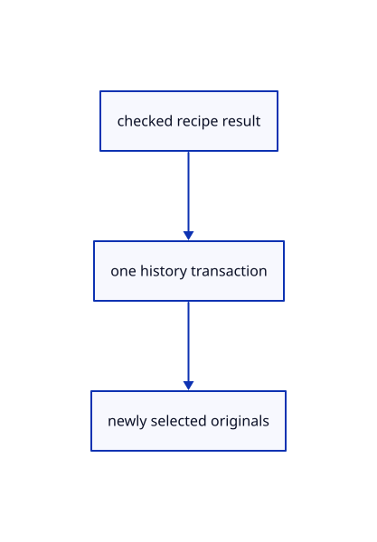

# 15.2.8 · Adopt every generated original in one history transaction

**Chapter 15 · Transforms and surface construction · Section 15.2 · Profile collection and surfacing** · [Contents](contents.md)

**Typing: 14–27 minutes.** [Estimate](typing-load.md).

Check source freshness, insert all generated originals as one transaction, and select the new rows after successful adoption.

## Type

Continue from [Carry gather state through the current tool owner](78f-carry-gather-state-through-the-current-tool-owner.md). [Save or recover your work](recovery.md).

### 1. `src/editor.rs`

Connect original curve collection and one checked geometry transaction.

<details>
<summary>Locate the existing block</summary>

```rust
        let draft=self.draft.as_ref().ok_or("No transform tool is running")?;let mut next=draft.transform.clone().ok_or("No transform tool is running")?;
        let outcome=next.text(text,draft.cursor,self.construction_plane).map_err(|message|self.primitive_failure(message))?;self.transform_outcome(next,outcome)
    }
    fn tool_text(&mut self,text:&str) -> Result<Change,&'static str> {
```

</details>

Edit the existing block to match this code; keep unchanged lines:

```rust
--8<-- "journey/code/78g-adopt-every-generated-original-in-one-history-transaction-01.rs"
```

## Run and check

Run this from `session_viewer` to select the fixed dependency versions and install supplied binary assets. It updates Cargo.lock and preserves the previous lock. It does not write implementation code:

```sh
npm --prefix ../session_tests run course -- dependencies 15.2.8
```

In your project:

```sh
cd workspace/journey
REGEN_PROTO=0 cargo build --lib --locked --target wasm32-unknown-unknown -j1
REGEN_PROTO=0 CARGO_BUILD_JOBS=1 trunk serve --port 8780
```

Open `http://127.0.0.1:8780/`. Keep an existing Trunk server running; saving rebuilds it.


### Recorded visual result

**Previous native render — current verification pending.**

Three original boxes retain independent placements.


*This recorded image predates a source or checker change. Rebuild this checkpoint before using it as current evidence; browser controls require separate acceptance.*

This reference image is shared with [15.2.1 · Copy current curve collection and surfacing recipes](78-copy-current-curve-collection-and-surfacing-recipes.md). It does not demonstrate a new feature by itself.

<details>
<summary>Code explanation and diagram</summary>


checked recipe result → one history transaction → newly selected originals.



Does Undo remove only the last profile result?

No. One completed recipe inserts every result in one history transaction. Undo restores all earlier profile rows together.

Study estimate, including typing and experiments: 0.5–1 hours.

</details>

<details>
<summary>Optional experiment</summary>

Extrude a placed rectangle and a line together. Verify the solid and ruled surface disappear with one Undo while both profiles remain.

</details>

<details>
<summary>Check and save your work</summary>

Restore experimental edits, then run from `session_viewer`:

```sh
npm --prefix ../session_tests run course -- check 15.2.8
npm --prefix ../session_tests run course -- save 15.2.8
```

Source comparison leaves your project untouched. [Save and recovery instructions](recovery.md).

</details>

<details>
<summary>Viewer coverage and verification</summary>


The preceding transformation browser contract remains authored and unrun. The final extrusion/revolution contract exercises the registered names, failed input, cap options, one Undo/Redo and the same rendered exercise. Actual browser execution remains required.

[Full validation scope](release.md).

To reproduce the scripted acceptance of the reference checkpoint, run from `session_viewer` with the [course bundle server](release.md#reproduce) running on port 8781:

```sh
npm --prefix ../session_tests run course -- capture 15.2.8
```

This uses the verified reference bundle; it does not check or change your typed project.

</details>
