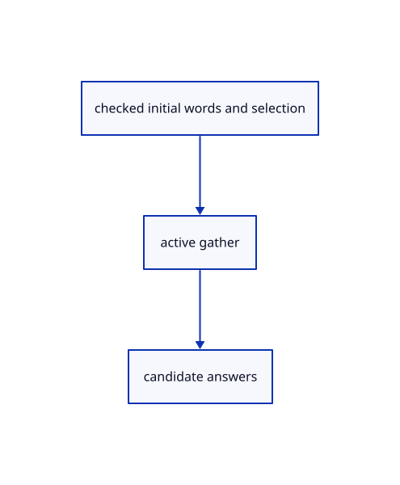

# 15.2.9 · Start and advance the recipe through the existing Editor

**Chapter 15 · Transforms and surface construction · Section 15.2 · Profile collection and surfacing** · [Contents](contents.md)

**Typing: 19–38 minutes.** [Estimate](typing-load.md).

Validate initial input before replacing the active owner. Reuse candidate point, text and pick paths for subsequent answers.

## Type

Continue from [Adopt every generated original in one history transaction](78g-adopt-every-generated-original-in-one-history-transaction.md). [Save or recover your work](recovery.md).

### 1. `src/editor.rs`

Connect original curve collection and one checked geometry transaction.

<details>
<summary>Locate the existing block</summary>

```rust
        let draft=self.draft.as_mut().ok_or("No gathering tool is running")?;draft.points=next.answers.iter().filter_map(|answer|if let crate::gather_input::Answer::Point(p)=answer{Some([p[0],p[1],p[2]])}else{None}).collect();draft.gather=Some(next);draft.cursor=None;draft.snapped=None;self.tool_status=draft.prompt();Ok(Change::View)
    }
    fn tool_text(&mut self,text:&str) -> Result<Change,&'static str> {
        if self.draft.as_ref().is_some_and(|d|d.transform.is_some()&&d.plane_points.is_none()){return self.transform_text(text);}
```

</details>

Edit the existing block to match this code; keep unchanged lines:

```rust
--8<-- "journey/code/78h-start-and-advance-the-recipe-through-the-existing-editor-01.rs"
```

## Run and check

Run this from `session_viewer` to select the fixed dependency versions and install supplied binary assets. It updates Cargo.lock and preserves the previous lock. It does not write implementation code:

```sh
npm --prefix ../session_tests run course -- dependencies 15.2.9
```

In your project:

```sh
cd workspace/journey
REGEN_PROTO=0 cargo build --lib --locked --target wasm32-unknown-unknown -j1
REGEN_PROTO=0 CARGO_BUILD_JOBS=1 trunk serve --port 8780
```

Open `http://127.0.0.1:8780/`. Keep an existing Trunk server running; saving rebuilds it.


### Recorded visual result

**Previous native render — current verification pending.**

Three original boxes retain independent placements.


*This recorded image predates a source or checker change. Rebuild this checkpoint before using it as current evidence; browser controls require separate acceptance.*

This reference image is shared with [15.2.1 · Copy current curve collection and surfacing recipes](78-copy-current-curve-collection-and-surfacing-recipes.md). It does not demonstrate a new feature by itself.

<details>
<summary>Code explanation and diagram</summary>


checked initial words and selection → active gather → candidate answers.



Can an invalid Extrude start discard a pending Curve?

No. Read and build the candidate first. Invalid dimensions keep the earlier drawing owner and its accepted points.

Study estimate, including typing and experiments: 0.5–1 hours.

</details>

<details>
<summary>Optional experiment</summary>

Begin Curve with one point, then try Extrude 0. Confirm the Curve owner survives. Cancel and select an original profile before Extrude.

</details>

<details>
<summary>Check and save your work</summary>

Restore experimental edits, then run from `session_viewer`:

```sh
npm --prefix ../session_tests run course -- check 15.2.9
npm --prefix ../session_tests run course -- save 15.2.9
```

Source comparison leaves your project untouched. [Save and recovery instructions](recovery.md).

</details>

<details>
<summary>Viewer coverage and verification</summary>


The preceding transformation browser contract remains authored and unrun. The final extrusion/revolution contract exercises the registered names, failed input, cap options, one Undo/Redo and the same rendered exercise. Actual browser execution remains required.

[Full validation scope](release.md).

To reproduce the scripted acceptance of the reference checkpoint, run from `session_viewer` with the [course bundle server](release.md#reproduce) running on port 8781:

```sh
npm --prefix ../session_tests run course -- capture 15.2.9
```

This uses the verified reference bundle; it does not check or change your typed project.

</details>
