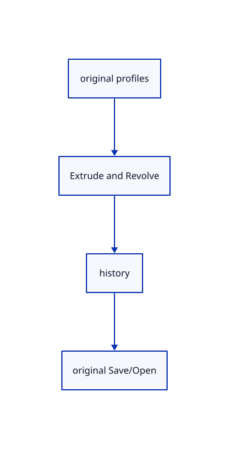

# 15.2.14 · Exercise profiles exact surfaces and one undo transaction

**Chapter 15 · Transforms and surface construction · Section 15.2 · Profile collection and surfacing** · [Contents](contents.md)

**Typing: 0–0 minutes.** [Estimate](typing-load.md).

Copy integrated original-profile fixtures, then create the rendered solid and exact revolved surface through registered commands.

## Type

Continue from [Pick original profiles through the browser integer pass](78l-pick-original-profiles-through-the-browser-integer-pass.md). [Save or recover your work](recovery.md).

<details>
<summary>Supplied validation fixture</summary>

Copy this supplied authoring fixture once. Continue with the browser build below; the course does not require running native tests.

### 1. `src/gather_tests.rs`

Copy integrated current gather/profile/history/options/freshness/SaveOpen fixtures.

Copy this supplied file:

```text
--8<-- "journey/code/78m-exercise-profiles-exact-surfaces-and-one-undo-transaction-01.rs"
```

</details>

<details>
<summary>Supplied validation fixture</summary>

Copy this supplied authoring fixture once. Continue with the browser build below; the course does not require running native tests.

### 2. `src/lib.rs`

Register the gather component.

<details>
<summary>Locate the existing block</summary>

```text

pub mod gather_registry;
```

</details>

After that block, append this supplied code:

```text
--8<-- "journey/code/78m-exercise-profiles-exact-surfaces-and-one-undo-transaction-02.rs" skip=26
```

</details>

## Run and check

Run this from `session_viewer` to select the fixed dependency versions and install supplied binary assets. It updates Cargo.lock and preserves the previous lock. It does not write implementation code:

```sh
npm --prefix ../session_tests run course -- dependencies 15.2.14
```

In your project:

```sh
cd workspace/journey
REGEN_PROTO=0 cargo build --lib --locked --target wasm32-unknown-unknown -j1
REGEN_PROTO=0 CARGO_BUILD_JOBS=1 trunk serve --port 8780
```

Open `http://127.0.0.1:8780/`. Keep an existing Trunk server running; saving rebuilds it.

A capped extrusion and an exact revolved surface retain original profiles. One completed recipe inserts all its results together. Current options, cancellation, invalid inputs, original source freshness and exact archives remain checked.

### Recorded visual result

**Previous native render — current verification pending.**

A capped rectangular extrusion and an exact revolved surface appear beside their retained original profiles.


*This recorded image predates a source or checker change. Rebuild this checkpoint before using it as current evidence; browser controls require separate acceptance.*

<details>
<summary>Code explanation and diagram</summary>


original profiles → Extrude and Revolve → history → original Save/Open.



What must Save keep after revolution?

Retain the original rational surface controls and knots, source and row identity, original profiles and placed document data.

Study estimate, including typing and experiments: 0.5–1 hours.

</details>

<details>
<summary>Optional experiment</summary>

Type Close, CPlane XY, Polyline Rectangle w-2,0,0 w-1,1,0, Select All, Extrude 1.5, Line w1.9,0,0 w1.9,0,1.5, Select Next, Nurbs Surface Revolve w1.5,0,0 w1.5,0,1, View Isometric, Select None and Fit, with spaces after Extrude. Try Cap Off, an invalid distance, Escape, Undo/Redo and Save/Open.

</details>

<details>
<summary>Check and save your work</summary>

Restore experimental edits, then run from `session_viewer`:

```sh
npm --prefix ../session_tests run course -- check 15.2.14
npm --prefix ../session_tests run course -- save 15.2.14
```

Source comparison leaves your project untouched. [Save and recovery instructions](recovery.md).

</details>

<details>
<summary>Viewer coverage and verification</summary>

Use maintained gather steps, progress, world-curve conversion, surfacing validation, extrusion and revolution recipes and native fixtures. Ordered preselection fills curve groups; clicking toggles picks and Enter accepts a group with its minimum. Lines, polylines and original NURBS curves are transformed into world inputs once without rewriting their sources. Extrude accepts a signed axis distance or a vector; Cap On is the default for a closed planar profile, while open, bent or in-plane profiles remain uncapped with a reason. Cap Off retains original side faces. Revolution collects profiles, axis start/end and angle; initial typed axis coordinates default to360 degrees. All created original geometries are one history transaction and become selected. Cancel restores the earlier selection. Candidate answers and builds are checked before adoption; missing, changed, hidden or locked picked originals are refused. Integer browser picks use whole curve owners independently of the previous selection mode.

All earlier native checks remain. Seventeen copied maintained gather/surfacing/extrusion/revolution cases and seven integrated cases cover ordered toggles and lock guards, placed multi-profile creation, one Undo and selected outputs, split Cap Off options, signed/vector distances, pending wires, invalid axis/distance batches and retained Redo, exact rational surface archives, unchanged source owners, and stale source/failed begin guards.

The preceding transformation browser contract remains authored and unrun. The final extrusion/revolution contract exercises the registered names, failed input, cap options, one Undo/Redo and the same rendered exercise. Actual browser execution remains required.

[Full validation scope](release.md).

To reproduce the scripted acceptance of the reference checkpoint, run from `session_viewer` with the [course bundle server](release.md#reproduce) running on port 8781:

```sh
npm --prefix ../session_tests run course -- capture 15.2.14
```

This uses the verified reference bundle; it does not check or change your typed project.

</details>
