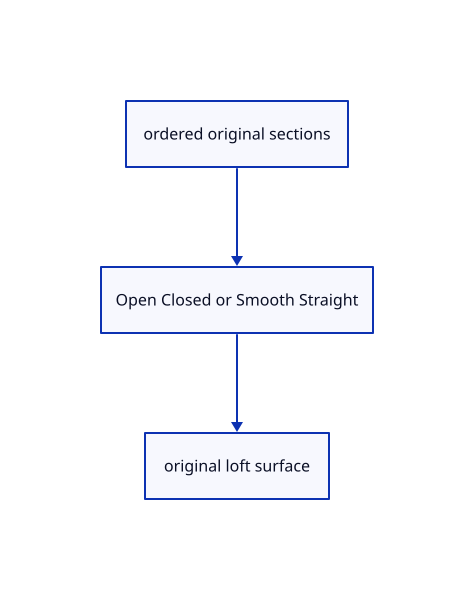

# 15.3.1 · Retain current loft section order and degree options

**Chapter 15 · Transforms and surface construction · Section 15.3 · Lofts, sweeps and Gordon surfaces** · [Contents](contents.md)

**Typing: 22–43 minutes.** [Estimate](typing-load.md).

Write both loft recipes on top of the section alignment already taught in 77zzi. Preserve picked order, choose open or closed sections, and select straight or smooth degree without changing the original profiles.

## Type

Continue from [Exercise profiles exact surfaces and one undo transaction](78m-exercise-profiles-exact-surfaces-and-one-undo-transaction.md). [Save or recover your work](recovery.md).

### 1. `src/loft_geometry.rs`

Type the original recipe and whole geometry helpers using the earlier shared owners.

Create the file and type:

```rust
--8<-- "journey/code/79-retain-current-loft-section-order-and-degree-options-typed-loft_geometry.rs"
```

<details>
<summary>Supplied validation fixture</summary>

Copy this supplied authoring fixture once. Continue with the browser build below; the course does not require running native tests.

### 2. `src/loft_geometry.rs`

Supply only the unchanged original geometry validation fixtures.

<details>
<summary>Locate the existing block</summary>

```text
use crate::gather_input::{Input, Made, Recipe, Step};
use crate::surfacing::{self, checked, count, curves};
use session_rust::{Point, Vector};

pub static RECIPE: Recipe = Recipe {
    name: "Loft",
    chips: &[
        ("Open", "Open"),
        ("Closed", "Closed"),
        ("Finish", ""),
        ("Cancel", "Escape"),
    ],
    steps: &[Step::Curves {
        prompt: "select curves in order",
        min: 2,
        max: usize::MAX,
    }],
    axis: no_axis,
    build,
};

/// Loft has no distance to slide.
pub fn no_axis(_input: &Input) -> (Point, Vector) {
    (Point::new(0.0, 0.0, 0.0), Vector::new(0.0, 0.0, 1.0))
}

/// A cubic loft through the curves in pick order; Closed returns to the first.
fn build(input: &Input) -> Result<Made, String> {
    let sections = curves(&input.curves[0]);
    let surface = surfacing::loft(&sections, input.choice == "Closed", 3)?;
    Ok(Made {
        geometries: vec![checked(surface, "loft")?],
        message: format!(
            "Lofted {} into a NURBS surface",
            count(sections.len(), "curve")
        ),
    })
}
```

</details>

After that block, append this supplied code:

```text
--8<-- "journey/code/79-retain-current-loft-section-order-and-degree-options-typed-loft_geometry-fixtures.rs" skip=1087
```

</details>

### 3. `src/lib.rs`

Register the current surfacing component.

<details>
<summary>Locate the existing block</summary>

```rust
#[cfg(test)]
mod gather_tests;
```

</details>

After that block, type:

```rust
--8<-- "journey/code/79-retain-current-loft-section-order-and-degree-options-02.rs" skip=31
```

### 4. `src/nurbs_loft_geometry.rs`

Type the original recipe and whole geometry helpers using the earlier shared owners.

Create the file and type:

```rust
--8<-- "journey/code/79-retain-current-loft-section-order-and-degree-options-typed-nurbs_loft_geometry.rs"
```

### 5. `src/lib.rs`

Register the current surfacing component.

<details>
<summary>Locate the existing block</summary>

```rust

pub mod loft_geometry;
```

</details>

After that block, type:

```rust
--8<-- "journey/code/79-retain-current-loft-section-order-and-degree-options-04.rs" skip=24
```

## Run and check

Run this from `session_viewer` to select the fixed dependency versions and install supplied binary assets. It updates Cargo.lock and preserves the previous lock. It does not write implementation code:

```sh
npm --prefix ../session_tests run course -- dependencies 15.3.1
```

In your project:

```sh
cd workspace/journey
REGEN_PROTO=0 cargo build --lib --locked --target wasm32-unknown-unknown -j1
REGEN_PROTO=0 CARGO_BUILD_JOBS=1 trunk serve --port 8780
```

Open `http://127.0.0.1:8780/`. Keep an existing Trunk server running; saving rebuilds it.

The capped rectangular extrusion and exact revolved surface remain visible while loft/sweep recipes connect. The final exercise creates an original surface through three curved sections.

### Recorded visual result

**Previous native render — current verification pending.**

The original capped extrusion and revolved surface remain visible.


*This recorded image predates a source or checker change. Rebuild this checkpoint before using it as current evidence; browser controls require separate acceptance.*

<details>
<summary>Code explanation and diagram</summary>


ordered original sections → Open Closed or Smooth Straight → original loft surface.



Why does Closed need three sections?

It returns through the first section. Two sections cannot enclose that route; reject before adopting a surface or changing history.

Study estimate, including typing and experiments: 0.5–1 hours.

</details>

<details>
<summary>Optional experiment</summary>

Inspect the middle-section fixture, seam alignment and Straight degree1. Compare it with Smooth degree clamped to the available sections.

</details>

<details>
<summary>Check and save your work</summary>

Restore experimental edits, then run from `session_viewer`:

```sh
npm --prefix ../session_tests run course -- check 15.3.1
npm --prefix ../session_tests run course -- save 15.3.1
```

Source comparison leaves your project untouched. [Save and recovery instructions](recovery.md).

</details>

<details>
<summary>Viewer coverage and verification</summary>


The preceding extrusion/revolution contract remains authored and unrun. The final loft/sweep browser contract adds current section options and minimum guards, ordered preselection for Sweep1/Sweep2, one Undo/Redo and the same rendered three-section exercise. Actual browser execution remains required.

[Full validation scope](release.md).

To reproduce the scripted acceptance of the reference checkpoint, run from `session_viewer` with the [course bundle server](release.md#reproduce) running on port 8781:

```sh
npm --prefix ../session_tests run course -- capture 15.3.1
```

This uses the verified reference bundle; it does not check or change your typed project.

</details>
