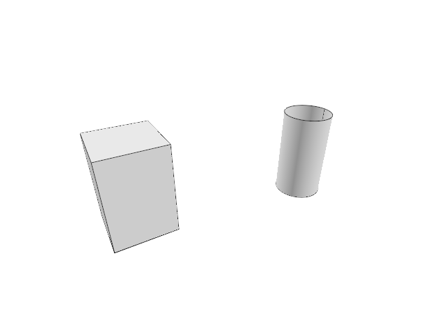

# 15.3.3 · Carry and blend original profiles along the rail

**Chapter 15 · Transforms and surface construction · Section 15.3 · Lofts, sweeps and Gordon surfaces** · [Contents](contents.md)

**Typing: 25–50 minutes.** [Estimate](typing-load.md).

Sort original profile stations, match their control rows with a straight kernel loft, and include their stations in the sampled rail frames. Blend matching local profiles between stations, transform each section into its rail frame, then validate the final cubic kernel loft.

## Type

Continue from [Frame original profiles on their rail](79aa-frame-original-profiles-on-their-rail.md). [Save or recover your work](recovery.md).

### 1. `src/sweep1_geometry.rs`

Extend this original owner with the day’s complete input helpers.

<details>
<summary>Locate the existing block</summary>

```rust
    let local = Xform::world_to_frame(
        &frame.origin(),
        &frame.x_axis(),
        &frame.y_axis(),
        &frame.z_axis(),
    );
    (t, local)
}
```

</details>

After that block, type:

```rust
/// The profiles carried along the rail, each kept where it sits; between two they blend.
pub fn sweep1(rail: &NurbsCurve, profiles: &[NurbsCurve]) -> Result<NurbsSurface, String> {
    if profiles.is_empty() {
        return Err("Select at least 1 profile".into());
    }

    let mut placed: Vec<(f64, NurbsCurve)> = profiles
        .iter()
        .map(|profile| {
            let (t, local) = on_rail(rail, profile);
            (t, profile.transformed(&local))
        })
        .collect();
    placed.sort_by(|a, b| a.0.total_cmp(&b.0));
    let (stations, locals): (Vec<f64>, Vec<NurbsCurve>) = placed.into_iter().unzip();
    let shared = if locals.len() == 1 {
        locals
    } else {
        // a straight loft makes the profiles share knots; its rows are the profiles again
        let bridge = Primitives::create_loft(&locals, 1);
        let rows: Vec<NurbsCurve> = bridge
            .get_nurbsknots(1)
            .iter()
            .take(locals.len())
            .filter_map(|v| bridge.iso_curve(0, *v))
            .collect();

        if rows.len() != locals.len() {
            return Err("The profiles could not be matched to each other".into());
        }

        rows
    };

    // frames at even lengths plus one at every profile, so the surface runs through them
    let count = (rail.span_count() * 2 + 1).clamp(5, 200);
    let mut params = rail.divide_by_count(count + 1, true).1;
    let (t0, t1) = rail.domain();
    let near = 1e-6 * (t1 - t0);
    params.retain(|t| stations.iter().all(|s| (t - s).abs() > near));
    params.extend_from_slice(&stations);
    params.sort_by(f64::total_cmp);
    params.dedup_by(|a, b| (*a - *b).abs() <= near);
    let mut sections = Vec::with_capacity(params.len());

    for t in params {
        let upper = stations.partition_point(|s| *s < t);
        let mut section = match upper {
            0 => shared[0].clone(),
            n if n == stations.len() => shared[n - 1].clone(),
            n => blend(
                &shared[n - 1],
                &shared[n],
                (t - stations[n - 1]) / (stations[n] - stations[n - 1]),
            ),
        };
        section.transform(&Xform::to_frame(&rail.perpendicular_plane_at(t, false)));
        sections.push(section);
    }

    let surface = Primitives::create_loft(&sections, 3);

    if !surface.is_valid() {
        return Err("The profiles could not be swept along the rail".into());
    }

    Ok(surface)
}
```

<details>
<summary>Optional patch references</summary>

Use these original edit fragments when comparing a saved checkpoint. Apply the complete blocks above.

```text
--8<-- "journey/code/79ab-carry-and-blend-original-profiles-along-the-rail-1.rs"
```

</details>

## Run and check

Run this from `session_viewer` to select the fixed dependency versions and install supplied binary assets. It updates Cargo.lock and preserves the previous lock. It does not write implementation code:

```sh
npm --prefix ../session_tests run course -- dependencies 15.3.3
```

In your project:

```sh
cd workspace/journey
REGEN_PROTO=0 cargo build --lib --locked --target wasm32-unknown-unknown -j1
REGEN_PROTO=0 CARGO_BUILD_JOBS=1 trunk serve --port 8780
```

Open `http://127.0.0.1:8780/`. Keep an existing Trunk server running; saving rebuilds it.

The sweep helpers can carry and blend the framed profiles along the original rail.

### Recorded visual result

**Previous native render — current verification pending.**



*This recorded image predates a source or checker change. Rebuild this checkpoint before using it as current evidence; browser controls require separate acceptance.*

This reference image is shared with [15.3.1 · Retain current loft section order and degree options](79-retain-current-loft-section-order-and-degree-options.md). It does not demonstrate a new feature by itself.

<details>
<summary>Code explanation and diagram</summary>


original rail and profiles → local section frames → kernel sweep surface.


Why include every profile station among the rail samples?

The resulting surface must pass through the selected sections at their original rail positions. Uniform rail samples alone can miss those stations.

Study estimate, including typing and experiments: 0.5–1 hours.

</details>

<details>
<summary>Optional experiment</summary>

Trace two profiles with different stations through matching, blending and the final surface.

</details>

<details>
<summary>Check and save your work</summary>

Restore experimental edits, then run from `session_viewer`:

```sh
npm --prefix ../session_tests run course -- check 15.3.3
npm --prefix ../session_tests run course -- save 15.3.3
```

Source comparison leaves your project untouched. [Save and recovery instructions](recovery.md).

</details>

<details>
<summary>Viewer coverage and verification</summary>

These original sweep helpers are preparatory until the existing sweep command registry connects them. The earlier drawing stays unchanged.


[Full validation scope](release.md).

</details>
