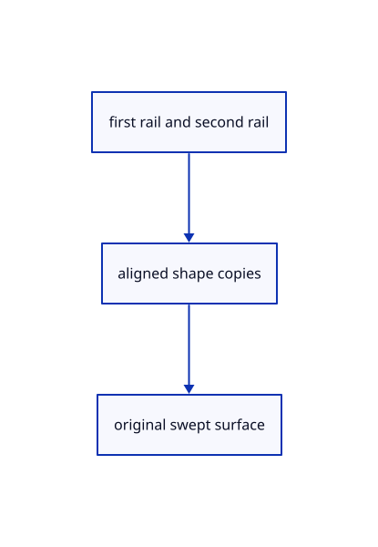

# 15.3.5 · Align shape curves between two original rails

**Chapter 15 · Transforms and surface construction · Section 15.3 · Lofts, sweeps and Gordon surfaces** · [Contents](contents.md)

**Typing: 24–48 minutes.** [Estimate](typing-load.md).

Orient a copy of the second rail to follow the first. Orient copies of the shape curves toward the first rail, then ask the kernel for one exact swept surface. Keep the picked originals unchanged and reuse the existing gather recipe.

## Type

Continue from [Connect original one-rail sweep inputs](79a-carry-original-profiles-along-one-rail.md). [Save or recover your work](recovery.md).

### 1. `src/sweep2_geometry.rs`

Type the original recipe and whole geometry helpers using the earlier shared owners.

Create the file and type:

```rust
--8<-- "journey/code/79b-align-shape-curves-between-two-original-rails-typed-sweep2_geometry.rs"
```

<details>
<summary>Supplied validation fixture</summary>

Copy this supplied authoring fixture once. Continue with the browser build below; the course does not require running native tests.

### 2. `src/sweep2_geometry.rs`

Supply only the unchanged original geometry validation fixtures.

<details>
<summary>Locate the existing block</summary>

```text
use crate::gather_input::{Input, Made, Recipe, Step};
use crate::surfacing::{checked, count, curves};
use session_rust::{NurbsCurve, NurbsSurface, Primitives};

pub static RECIPE: Recipe = Recipe {
    name: "Nurbs Surface Sweep2",
    chips: &[("Finish", ""), ("Cancel", "Escape")],
    steps: &[
        Step::Curves {
            prompt: "select the first rail",
            min: 1,
            max: 1,
        },
        Step::Curves {
            prompt: "select the second rail",
            min: 1,
            max: 1,
        },
        Step::Curves {
            prompt: "select shape curves",
            min: 1,
            max: usize::MAX,
        },
    ],
    axis: crate::gather_input::no_axis,
    build,
};

/// Rail 2 runs with rail 1 and every shape starts on rail 1.
pub fn sweep2(
    first: &NurbsCurve,
    second: &NurbsCurve,
    shapes: &[NurbsCurve],
) -> Result<NurbsSurface, String> {
    let mut second = second.clone();
    let start = first.point_at_start();

    if second
        .point_at_start()
        .distance(&first.point_at_end(), None)
        < second.point_at_start().distance(&start, None)
    {
        second.reverse();
    }

    let shapes: Vec<NurbsCurve> = shapes
        .iter()
        .map(|shape| {
            let mut shape = shape.clone();
            let near = |curve: &NurbsCurve, rail: &NurbsCurve| {
                curve.point_at_start().distance(
                    &rail.point_at(rail.closest_parameter(&curve.point_at_start())),
                    None,
                )
            };

            if near(&shape, &second) < near(&shape, first) {
                shape.reverse();
            }

            shape
        })
        .collect();
    let surface = Primitives::create_sweep2(first, &second, &shapes);

    if !surface.is_valid() {
        return Err("The shapes could not be swept along the rails".into());
    }

    Ok(surface)
}

/// The sweep of the shapes between the two rails.
fn build(input: &Input) -> Result<Made, String> {
    let shapes = curves(&input.curves[2]);
    let surface = sweep2(
        &input.curves[0][0].curve,
        &input.curves[1][0].curve,
        &shapes,
    )?;
    Ok(Made {
        geometries: vec![checked(surface, "sweep")?],
        message: format!("Swept {} along 2 rails", count(shapes.len(), "shape")),
    })
}
```

</details>

After that block, append this supplied code:

```text
--8<-- "journey/code/79b-align-shape-curves-between-two-original-rails-typed-sweep2_geometry-fixtures.rs" skip=2342
```

</details>

### 3. `src/lib.rs`

Register the current surfacing component.

<details>
<summary>Locate the existing block</summary>

```rust

pub mod sweep1_geometry;
```

</details>

After that block, type:

```rust
--8<-- "journey/code/79b-align-shape-curves-between-two-original-rails-02.rs" skip=26
```

## Run and check

Run this from `session_viewer` to select the fixed dependency versions and install supplied binary assets. It updates Cargo.lock and preserves the previous lock. It does not write implementation code:

```sh
npm --prefix ../session_tests run course -- dependencies 15.3.5
```

In your project:

```sh
cd workspace/journey
REGEN_PROTO=0 cargo build --lib --locked --target wasm32-unknown-unknown -j1
REGEN_PROTO=0 CARGO_BUILD_JOBS=1 trunk serve --port 8780
```

Open `http://127.0.0.1:8780/`. Keep an existing Trunk server running; saving rebuilds it.


### Recorded visual result

**Previous native render — current verification pending.**

The original capped extrusion and revolved surface remain visible.


*This recorded image predates a source or checker change. Rebuild this checkpoint before using it as current evidence; browser controls require separate acceptance.*

This reference image is shared with [15.3.1 · Retain current loft section order and degree options](79-retain-current-loft-section-order-and-degree-options.md). It does not demonstrate a new feature by itself.

<details>
<summary>Code explanation and diagram</summary>


first rail and second rail → aligned shape copies → original swept surface.



Does reversing rail2 change the saved source?

Alignment reverses a builder copy. Keep the original rail allocation and control data unchanged, including after Undo and Save/Open.

Study estimate, including typing and experiments: 0.5–1 hours.

</details>

<details>
<summary>Optional experiment</summary>

Inspect the reversed-rail fixture. Compare first rail, second rail and shape group order with the generic gather maximum/minimum rules.

</details>

<details>
<summary>Check and save your work</summary>

Restore experimental edits, then run from `session_viewer`:

```sh
npm --prefix ../session_tests run course -- check 15.3.5
npm --prefix ../session_tests run course -- save 15.3.5
```

Source comparison leaves your project untouched. [Save and recovery instructions](recovery.md).

</details>

<details>
<summary>Viewer coverage and verification</summary>


The preceding extrusion/revolution contract remains authored and unrun. The final loft/sweep browser contract adds current section options and minimum guards, ordered preselection for Sweep1/Sweep2, one Undo/Redo and the same rendered three-section exercise. Actual browser execution remains required.

[Full validation scope](release.md).

To reproduce the scripted acceptance of the reference checkpoint, run from `session_viewer` with the [course bundle server](release.md#reproduce) running on port 8781:

```sh
npm --prefix ../session_tests run course -- capture 15.3.5
```

This uses the verified reference bundle; it does not check or change your typed project.

</details>
