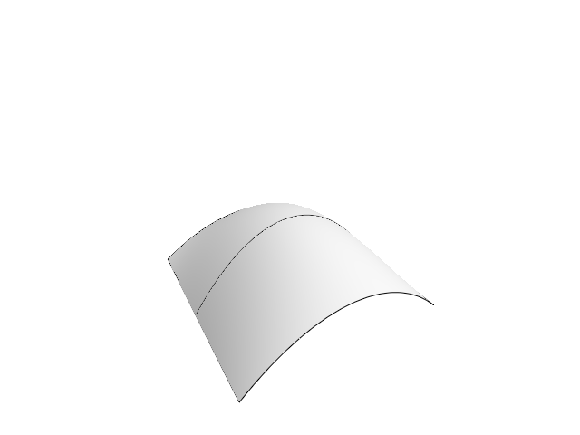
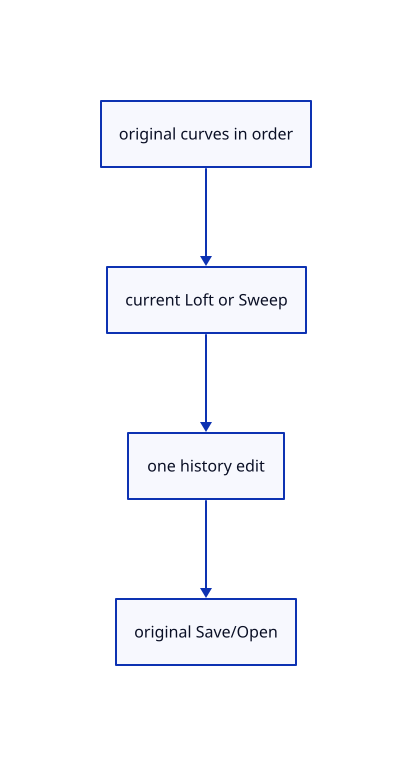

# 15.3.7 · Exercise original sections rail groups and exact persistence

**Chapter 15 · Transforms and surface construction · Section 15.3 · Lofts, sweeps and Gordon surfaces** · [Contents](contents.md)

**Typing: 0–0 minutes.** [Estimate](typing-load.md).

Copy integrated current option and group fixtures, then build the rendered surface through three original curved sections.

## Type

Continue from [Register loft sweep names options and aliases](79c-register-loft-sweep-names-options-and-aliases.md). [Save or recover your work](recovery.md).

<details>
<summary>Supplied validation fixture</summary>

Copy this supplied authoring fixture once. Continue with the browser build below; the course does not require running native tests.

### 1. `src/loft_tests.rs`

Copy integrated maintained loft/sweep group/order/options/source/archive fixtures.

Copy this supplied file:

```text
--8<-- "journey/code/79d-exercise-original-sections-rail-groups-and-exact-persistence-01.rs"
```

</details>

<details>
<summary>Supplied validation fixture</summary>

Copy this supplied authoring fixture once. Continue with the browser build below; the course does not require running native tests.

### 2. `src/lib.rs`

Register the current surfacing component.

<details>
<summary>Locate the existing block</summary>

```text

pub mod sweep2_geometry;
```

</details>

After that block, append this supplied code:

```text
--8<-- "journey/code/79d-exercise-original-sections-rail-groups-and-exact-persistence-02.rs" skip=26
```

</details>

## Run and check

Run this from `session_viewer` to select the fixed dependency versions and install supplied binary assets. It updates Cargo.lock and preserves the previous lock. It does not write implementation code:

```sh
npm --prefix ../session_tests run course -- dependencies 15.3.7
```

In your project:

```sh
cd workspace/journey
REGEN_PROTO=0 cargo build --lib --locked --target wasm32-unknown-unknown -j1
REGEN_PROTO=0 CARGO_BUILD_JOBS=1 trunk serve --port 8780
```

Open `http://127.0.0.1:8780/`. Keep an existing Trunk server running; saving rebuilds it.

A smooth original NURBS surface passes through three original sections. Current Open/Closed, Smooth/Straight and one/two-rail sweep recipes share ordered original picks and one checked history transaction. Original profiles, rational source data and exact archives remain preserved.

### Recorded visual result

**Previous native render — current verification pending.**

A smooth surface spans three retained original curved sections.



*This recorded image predates a source or checker change. Rebuild this checkpoint before using it as current evidence; browser controls require separate acceptance.*

<details>
<summary>Code explanation and diagram</summary>


original curves in order → current Loft or Sweep → one history edit → original Save/Open.



Can a short curve group create a partial surface?

No. Its minimum and builder validation must pass. Keep accepted picks and Redo when the group cannot yet build.

Study estimate, including typing and experiments: 0.5–1 hours.

</details>

<details>
<summary>Optional experiment</summary>

Type Close, Curve w-1,-1,0 w0,-1,1 w1,-1,0, Curve w-1,0,0 w0,0,1.5 w1,0,0, Curve w-1,1,0 w0,1,0.75 w1,1,0, Select All, Nurbs Surface Loft Smooth, View Isometric, Select None and Fit. Try Straight, Closed with only two sections, Sweep1 rail/profile and Sweep2 rail/rail/shape order, Escape, Undo/Redo and Save/Open.

</details>

<details>
<summary>Check and save your work</summary>

Restore experimental edits, then run from `session_viewer`:

```sh
npm --prefix ../session_tests run course -- check 15.3.7
npm --prefix ../session_tests run course -- save 15.3.7
```

Source comparison leaves your project untouched. [Save and recovery instructions](recovery.md).

</details>

<details>
<summary>Viewer coverage and verification</summary>

Use current Loft Open/Closed, Nurbs Surface Loft Smooth/Straight, Nurbs Surface Sweep1 and Sweep2 recipes and maintained algorithms. Loft collects at least two sections in pick order; Closed needs three and returns to the first section. Smooth uses a cubic target degree clamped to the available sections; Straight uses degree1 across sections. Sweep1 collects one rail then profile curves, keeps profiles in their drawn world locations and blends in rail station order. Sweep2 collects first rail, second rail then shape curves; it aligns rail direction and shapes to the first rail without mutating originals. Current world inputs are placed once, clamped/domain-normalized copies. All results use the original NURBS surface lane with one transaction. Preserve current aliases, failed group checks, previous selection on cancel and exact Save/Open. The generic gather owner from78 supplies input and browser picking; no duplicate input system.

All earlier checks remain. Five copied maintained loft/sweep cases and four integrated cases cover current degree options, original placement/source allocations and exact archives, Closed/group minimum rejection and preserved Redo, ordered rail auto-advance and duplicate-group refusal, two-rail preselection and current aliases.

The preceding extrusion/revolution contract remains authored and unrun. The final loft/sweep browser contract adds current section options and minimum guards, ordered preselection for Sweep1/Sweep2, one Undo/Redo and the same rendered three-section exercise. Actual browser execution remains required.

[Full validation scope](release.md).

To reproduce the scripted acceptance of the reference checkpoint, run from `session_viewer` with the [course bundle server](release.md#reproduce) running on port 8781:

```sh
npm --prefix ../session_tests run course -- capture 15.3.7
```

This uses the verified reference bundle; it does not check or change your typed project.

</details>
