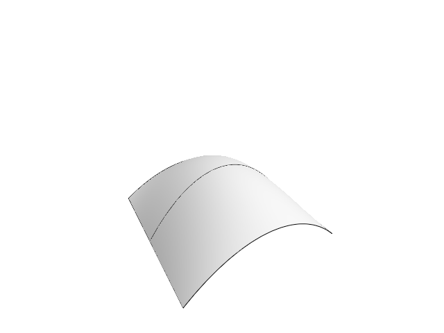
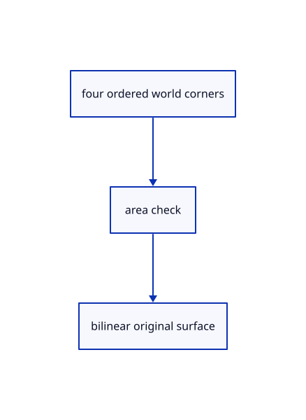

# 15.4.2 · Construct the patch through four ordered corners

**Chapter 15 · Transforms and surface construction · Section 15.4 · Curve networks and projection planes** · [Contents](contents.md)

**Typing: 16–31 minutes.** [Estimate](typing-load.md).

Describe four ordered corner inputs with the existing gather recipe. Reject a degenerate area, build the exact bilinear kernel patch, and return the validated source surface as one result.

## Type

Continue from [Build a surface through original curve networks](80-build-a-surface-through-two-directions-of-original-curves.md). [Save or recover your work](recovery.md).

### 1. `src/patch_geometry.rs`

Type the original recipe and whole geometry helpers using the earlier shared owners.

Create the file and type:

```rust
--8<-- "journey/code/80a-construct-the-patch-through-four-ordered-corners-typed-patch_geometry.rs"
```

<details>
<summary>Supplied validation fixture</summary>

Copy this supplied authoring fixture once. Continue with the browser build below; the course does not require running native tests.

### 2. `src/patch_geometry.rs`

Supply only the unchanged original geometry validation fixtures.

<details>
<summary>Locate the existing block</summary>

```text
use crate::gather_input::{Input, Made, Recipe, Step};
use crate::surfacing::checked;
use session_rust::{NurbsSurface, Point};

pub static RECIPE: Recipe = Recipe {
    name: "Nurbs Surface 4 Points",
    chips: &[("Cancel", "Escape")],
    steps: &[
        Step::Point("corner 1 of 4"),
        Step::Point("corner 2 of 4"),
        Step::Point("corner 3 of 4"),
        Step::Point("corner 4 of 4"),
    ],
    axis: crate::gather_input::no_axis,
    build,
};

/// The bilinear patch a, b, c, d: u runs a to b, v runs a to d.
pub fn patch(corners: &[Point; 4]) -> Result<NurbsSurface, String> {
    let [a, b, c, d] = corners;
    let area = (c - a).cross(&(d - b)).magnitude();
    let size = [b, c, d]
        .iter()
        .map(|p| p.distance(a, None))
        .fold(1.0, f64::max);

    if area <= 1e-12 * size * size {
        return Err("The 4 corners enclose no area".into());
    }

    let points = [a.clone(), d.clone(), b.clone(), c.clone()];
    NurbsSurface::create(false, false, 1, 1, 2, 2, &points)
}

/// The patch through the four answered corners.
fn build(input: &Input) -> Result<Made, String> {
    let corners: Vec<Point> = (0..4).filter_map(|index| input.point(index)).collect();
    let corners: [Point; 4] = corners
        .try_into()
        .map_err(|_| "Nurbs Surface 4 Points takes 4 corner points".to_string())?;
    Ok(Made {
        geometries: vec![checked(patch(&corners)?, "surface")?],
        message: "Created a NURBS surface from 4 corners".into(),
    })
}
```

</details>

After that block, append this supplied code:

```text
--8<-- "journey/code/80a-construct-the-patch-through-four-ordered-corners-typed-patch_geometry-fixtures.rs" skip=1504
```

</details>

### 3. `src/lib.rs`

Register the current surface component.

<details>
<summary>Locate the existing block</summary>

```rust

pub mod network_geometry;
```

</details>

After that block, type:

```rust
--8<-- "journey/code/80a-construct-the-patch-through-four-ordered-corners-02.rs" skip=27
```

## Run and check

Run this from `session_viewer` to select the fixed dependency versions and install supplied binary assets. It updates Cargo.lock and preserves the previous lock. It does not write implementation code:

```sh
npm --prefix ../session_tests run course -- dependencies 15.4.2
```

In your project:

```sh
cd workspace/journey
REGEN_PROTO=0 cargo build --lib --locked --target wasm32-unknown-unknown -j1
REGEN_PROTO=0 CARGO_BUILD_JOBS=1 trunk serve --port 8780
```

Open `http://127.0.0.1:8780/`. Keep an existing Trunk server running; saving rebuilds it.


### Recorded visual result

**Previous native render — current verification pending.**

The smooth surface and its original sections remain visible.



*This recorded image predates a source or checker change. Rebuild this checkpoint before using it as current evidence; browser controls require separate acceptance.*

This reference image is shared with [15.3.8 · Sample original network curve stations](79zza-sample-original-network-curve-stations.md). It does not demonstrate a new feature by itself.

<details>
<summary>Code explanation and diagram</summary>


four ordered world corners → area check → bilinear original surface.



What do the corner order and u v directions mean?

u runs from corner1 to corner2; v runs from corner1 to corner4. The patch reproduces all four corners and their mean at its center.

Study estimate, including typing and experiments: 0.5–1 hours.

</details>

<details>
<summary>Optional experiment</summary>

Inspect the nonplanar corner fixture and degenerate collinear rejection. Compare source controls with the independently derived display mesh.

</details>

<details>
<summary>Check and save your work</summary>

Restore experimental edits, then run from `session_viewer`:

```sh
npm --prefix ../session_tests run course -- check 15.4.2
npm --prefix ../session_tests run course -- save 15.4.2
```

Source comparison leaves your project untouched. [Save and recovery instructions](recovery.md).

</details>

<details>
<summary>Viewer coverage and verification</summary>


The preceding loft/sweep contract remains authored and unrun. The final network/patch contract adds four-corner retry, one Undo/Redo, current aliases and the same rendered original network and patch exercise. Actual browser execution remains required.

[Full validation scope](release.md).

To reproduce the scripted acceptance of the reference checkpoint, run from `session_viewer` with the [course bundle server](release.md#reproduce) running on port 8781:

```sh
npm --prefix ../session_tests run course -- capture 15.4.2
```

This uses the verified reference bundle; it does not check or change your typed project.

</details>
