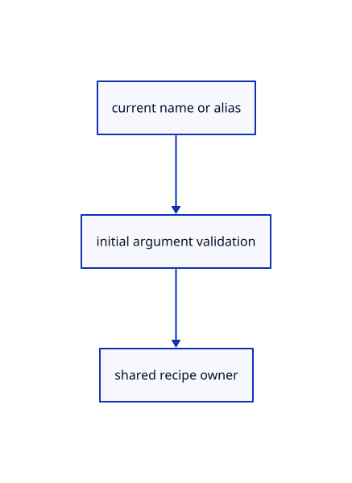

# 15.4.4 · Register network patch aliases and initial corner arity

**Chapter 15 · Transforms and surface construction · Section 15.4 · Curve networks and projection planes** · [Contents](contents.md)

**Typing: 18–35 minutes.** [Estimate](typing-load.md).

Extend the shared recipe registry and return initial arity errors before replacing the active drawing owner.

## Type

Continue from [Guide corner questions without retaining unrelated profiles](80b-guide-corner-questions-without-retaining-unrelated-profiles.md). [Save or recover your work](recovery.md).

### 1. `src/gather_registry.rs`

Register current network/patch names, aliases and initial four-corner argument validation.

<details>
<summary>Locate the existing block</summary>

```rust
use crate::{gather_input::Recipe,editor::Action};
pub const ENTRIES:&[(&str,&Recipe)]=&[("Loft",&crate::loft_geometry::RECIPE),("Nurbs Surface Loft",&crate::nurbs_loft_geometry::RECIPE),("Nurbs Surface Sweep1",&crate::sweep1_geometry::RECIPE),("Nurbs Surface Sweep2",&crate::sweep2_geometry::RECIPE),("Extrude",&crate::extrude_geometry::RECIPE),("Nurbs Surface Revolve",&crate::revolve_geometry::RECIPE)];
pub fn command(name:&str,text:&str)->Option<Action>{let(_,recipe)=ENTRIES.iter().find(|(label,_)|*label==name)?;Some(Action::GatherBegin{recipe,text:text.into()})}
pub fn alias(line:&str)->String{let mut words=line.split_whitespace();let Some(first)=words.next()else{return line.into()};let name=match first.to_ascii_lowercase().as_str(){"nurbssurface_loft"=>"Nurbs Surface Loft","nurbssurface_sweep1"=>"Nurbs Surface Sweep1","nurbssurface_sweep2"=>"Nurbs Surface Sweep2","nurbssurface_revolve"=>"Nurbs Surface Revolve",_=>return line.into()};std::iter::once(name).chain(words).collect::<Vec<_>>().join(" ")}
```

</details>

Edit the existing block to match this code; keep unchanged lines:

```rust
--8<-- "journey/code/80c-register-network-patch-aliases-and-initial-corner-arity-01.rs"
```

### 2. `src/commands.rs`

Register current network/patch names, aliases and initial four-corner argument validation.

<details>
<summary>Locate the existing block</summary>

```rust
    let (name, count) = matched(&words).ok_or("Unknown command. Type Help.")?;
    if let Some(action)=crate::transform_commands::action(name,&words[count..]){return action.map(Command::Editor);}
    if let Some(action)=crate::gather_registry::command(name,&words[count..].join(" ")){return Ok(Command::Editor(action));}
    if let Some(action)=crate::primitive_registry::command(name,&words[count..].join(" ")) {return Ok(Command::Editor(action));}
    if name=="CPlane" && words.len()>count {return crate::drawing_input::choice(&words[count..].join(" ")).map(Command::Editor).ok_or_else(||"CPlane (XY XZ YZ 3 Point View Cancel)".into());}
```

</details>

Edit the existing block to match this code; keep unchanged lines:

```rust
--8<-- "journey/code/80c-register-network-patch-aliases-and-initial-corner-arity-02.rs"
```

## Run and check

Run this from `session_viewer` to select the fixed dependency versions and install supplied binary assets. It updates Cargo.lock and preserves the previous lock. It does not write implementation code:

```sh
npm --prefix ../session_tests run course -- dependencies 15.4.4
```

In your project:

```sh
cd workspace/journey
REGEN_PROTO=0 cargo build --lib --locked --target wasm32-unknown-unknown -j1
REGEN_PROTO=0 CARGO_BUILD_JOBS=1 trunk serve --port 8780
```

Open `http://127.0.0.1:8780/`. Keep an existing Trunk server running; saving rebuilds it.


### Recorded visual result

**Previous native render — current verification pending.**

The smooth surface and its original sections remain visible.


*This recorded image predates a source or checker change. Rebuild this checkpoint before using it as current evidence; browser controls require separate acceptance.*

This reference image is shared with [15.3.7 · Exercise original sections rail groups and exact persistence](79d-exercise-original-sections-rail-groups-and-exact-persistence.md). It does not demonstrate a new feature by itself.

<details>
<summary>Code explanation and diagram</summary>


current name or alias → initial argument validation → shared recipe owner.



May an initial four-corner command contain only three points?

The maintained parser accepts no initial corners or exactly four. Reject an initial partial list; interactive answers begin after the empty command.

Study estimate, including typing and experiments: 0.5–1 hours.

</details>

<details>
<summary>Optional experiment</summary>

Try Nurbs Surface 4 Points with three initial corners while Curve has one accepted point. Compare current network aliases and interactive corner submission.

</details>

<details>
<summary>Check and save your work</summary>

Restore experimental edits, then run from `session_viewer`:

```sh
npm --prefix ../session_tests run course -- check 15.4.4
npm --prefix ../session_tests run course -- save 15.4.4
```

Source comparison leaves your project untouched. [Save and recovery instructions](recovery.md).

</details>

<details>
<summary>Viewer coverage and verification</summary>


The preceding loft/sweep contract remains authored and unrun. The final network/patch contract adds four-corner retry, one Undo/Redo, current aliases and the same rendered original network and patch exercise. Actual browser execution remains required.

[Full validation scope](release.md).

To reproduce the scripted acceptance of the reference checkpoint, run from `session_viewer` with the [course bundle server](release.md#reproduce) running on port 8781:

```sh
npm --prefix ../session_tests run course -- capture 15.4.4
```

This uses the verified reference bundle; it does not check or change your typed project.

</details>
