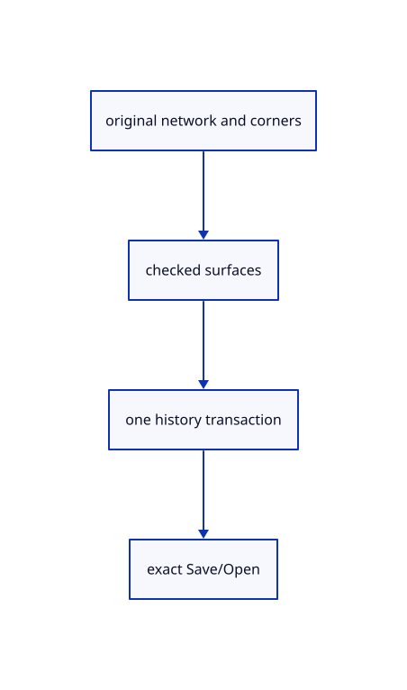

# 15.4.5 · Exercise networks corner retries and exact original archives

**Chapter 15 · Transforms and surface construction · Section 15.4 · Curve networks and projection planes** · [Contents](contents.md)

**Typing: 0–0 minutes.** [Estimate](typing-load.md).

Copy integrated current network/corner/history fixtures and build the rendered originals through registered commands.

## Type

Continue from [Register network patch aliases and initial corner arity](80c-register-network-patch-aliases-and-initial-corner-arity.md). [Save or recover your work](recovery.md).

<details>
<summary>Supplied validation fixture</summary>

Copy this supplied authoring fixture once. Continue with the browser build below; the course does not require running native tests.

### 1. `src/network_tests.rs`

Copy integrated current network/patch/original-source/history/archive fixtures.

Copy this supplied file:

```text
--8<-- "journey/code/80d-exercise-networks-corner-retries-and-exact-original-archives-01.rs"
```

</details>

<details>
<summary>Supplied validation fixture</summary>

Copy this supplied authoring fixture once. Continue with the browser build below; the course does not require running native tests.

### 2. `src/lib.rs`

Register the current surface component.

<details>
<summary>Locate the existing block</summary>

```text

pub mod patch_geometry;
```

</details>

After that block, append this supplied code:

```text
--8<-- "journey/code/80d-exercise-networks-corner-retries-and-exact-original-archives-02.rs" skip=25
```

</details>

## Run and check

Run this from `session_viewer` to select the fixed dependency versions and install supplied binary assets. It updates Cargo.lock and preserves the previous lock. It does not write implementation code:

```sh
npm --prefix ../session_tests run course -- dependencies 15.4.5
```

In your project:

```sh
cd workspace/journey
REGEN_PROTO=0 cargo build --lib --locked --target wasm32-unknown-unknown -j1
REGEN_PROTO=0 CARGO_BUILD_JOBS=1 trunk serve --port 8780
```

Open `http://127.0.0.1:8780/`. Keep an existing Trunk server running; saving rebuilds it.

An original surface passes through six shuffled network rulings beside a four-corner patch. Current group/orientation/area checks, pending guides, original source placement, one transaction and exact archives remain checked.

**Visual review: issue found.** This inherited network reference has faint or interrupted original input curves. Its aggregate pixel checks do not establish curve continuity or contrast. These are input curves, not a full NURBS isocurve display; visual-quality acceptance is incomplete.

[Visual review findings](visual-review.md).

### Recorded visual result

**Previous native render — current verification pending.**

The original network surface and four-corner patch display beside retained original network lines.


*This recorded image predates a source or checker change. Rebuild this checkpoint before using it as current evidence; browser controls require separate acceptance.*

<details>
<summary>Code explanation and diagram</summary>


original network and corners → checked surfaces → one history transaction → exact Save/Open.



Can a failed group keep its earlier picks?

Yes. Failed completion keeps the ordered group. Add its missing crossing curves and retry; no failed result may erase Redo or the originals.

Study estimate, including typing and experiments: 0.5–1 hours.

</details>

<details>
<summary>Optional experiment</summary>

Type Close and six lines: w0,1,0 to w2,1,1; w2,0,0 to w2,2,2; w2,0,0 to w0,0,0; w1,0,0 to w1,2,1; w0,2,0 to w2,2,2; w0,0,0 to w0,2,0. Use Line before each pair. Type Select All, Nurbs Surface Network, Nurbs Surface 4 Points w3,0,0 w4,0,0 w4,1,0.3 w3,1,0, View Isometric, Select None and Fit. Try a broken group, a degenerate fourth corner, Escape, Undo/Redo and Save/Open.

</details>

<details>
<summary>Check and save your work</summary>

Restore experimental edits, then run from `session_viewer`:

```sh
npm --prefix ../session_tests run course -- check 15.4.5
npm --prefix ../session_tests run course -- save 15.4.5
```

Source comparison leaves your project untouched. [Save and recovery instructions](recovery.md).

</details>

<details>
<summary>Viewer coverage and verification</summary>

Use maintained Nurbs Surface Network and Nurbs Surface 4 Points recipes, algorithms and fixtures. Network gathers two-direction curves in any order (maximum32); every member must cross every member of the other direction once. At least four curves form a valid network despite the gather minimum2. Four boundary curves take the exact Coons patch; larger networks use current bounded Gordon sampling and fitting. Preserve current direction/orientation copies, scale-based tolerance, density6 and maximum64 samples per direction. Four Points requires four initial typed corners or an interactive start with no corners; rejects zero area and keeps the four corners in current order. Initial command arity is checked before replacing an active owner. All points resolve to world coordinates once; world prefixes bypass the fixed plane. Accepted corner/axis points and cursor draw temporary guides, not saved geometry. Point-only recipes do not retain unrelated selected curve copies. All generated originals use one transaction and become selected. Preserve current aliases, source data, archive identity and cancellation.

All earlier checks remain. Four copied maintained cases cover shuffled/reversed saddle rulings, the exact four-boundary Coons surface, invalid networks and four-corner reproduction/degeneracy. Four integrated cases cover fixed-plane/world-prefix corners and temporary guides, one Undo and exact archives, initial arity/degenerate retry and Redo, placed shuffled originals, and short/broken groups accepting more curves.

The preceding loft/sweep contract remains authored and unrun. The final network/patch contract adds four-corner retry, one Undo/Redo, current aliases and the same rendered original network and patch exercise. Actual browser execution remains required.

[Full validation scope](release.md).

To reproduce the scripted acceptance of the reference checkpoint, run from `session_viewer` with the [course bundle server](release.md#reproduce) running on port 8781:

```sh
npm --prefix ../session_tests run course -- capture 15.4.5
```

This uses the verified reference bundle; it does not check or change your typed project.

</details>
