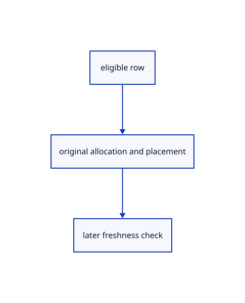

# 16.1.10 · Capture eligible original identity and placement

**Chapter 16 · Geometry editing and measurement · Section 16.1 · Projection and Split inputs** · [Contents](contents.md)

**Typing: 23–46 minutes.** [Estimate](typing-load.md).

Capture immutable original allocation and f64 placement together. Refuse hidden, locked, released or replaced owners before editing.

## Type

Continue from [Edit original curve intervals](81a-find-source-cutters-and-current-extension-reach.md). [Save or recover your work](recovery.md).

### 1. `src/source_edit.rs`

Capture and validate original allocation, placement and editing eligibility.

Create the file and type:

```rust
--8<-- "journey/code/81b-capture-eligible-original-identity-and-placement-01.rs"
```

### 2. `src/lib.rs`

Register the editing component.

<details>
<summary>Locate the existing block</summary>

```rust

pub mod interval_geometry;
```

</details>

After that block, type:

```rust
--8<-- "journey/code/81b-capture-eligible-original-identity-and-placement-02.rs" skip=28
```

## Run and check

Run this from `session_viewer` to select the fixed dependency versions and install supplied binary assets. It updates Cargo.lock and preserves the previous lock. It does not write implementation code:

```sh
npm --prefix ../session_tests run course -- dependencies 16.1.10
```

In your project:

```sh
cd workspace/journey
REGEN_PROTO=0 cargo build --lib --locked --target wasm32-unknown-unknown -j1
REGEN_PROTO=0 CARGO_BUILD_JOBS=1 trunk serve --port 8780
```

Open `http://127.0.0.1:8780/`. Keep an existing Trunk server running; saving rebuilds it.


**Visual review: issue found.** This inherited network reference has faint or interrupted original input curves. Its aggregate pixel checks do not establish curve continuity or contrast. These are input curves, not a full NURBS isocurve display; visual-quality acceptance is incomplete.

[Visual review findings](visual-review.md).

### Recorded visual result

**Previous native render — current verification pending.**

The original network and four-corner patch remain visible.


*This recorded image predates a source or checker change. Rebuild this checkpoint before using it as current evidence; browser controls require separate acceptance.*

This reference image is shared with [15.4.5 · Exercise networks corner retries and exact original archives](80d-exercise-networks-corner-retries-and-exact-original-archives.md). It does not demonstrate a new feature by itself.

<details>
<summary>Code explanation and diagram</summary>


eligible row → original allocation and placement → later freshness check.



Can a display mesh stand in for its original BRep?

No. Original family lookup checks CAD and surfaces before their derived mesh. Editing a proxy would lose the actual geometry.

Study estimate, including typing and experiments: 0.5–1 hours.

</details>

<details>
<summary>Optional experiment</summary>

Capture a placed rational curve, replace its source, and inspect the stale-owner rejection without changing the captured allocation.

</details>

<details>
<summary>Check and save your work</summary>

Restore experimental edits, then run from `session_viewer`:

```sh
npm --prefix ../session_tests run course -- check 16.1.10
npm --prefix ../session_tests run course -- save 16.1.10
```

Source comparison leaves your project untouched. [Save and recovery instructions](recovery.md).

</details>

<details>
<summary>Viewer coverage and verification</summary>


The preceding network/patch contract remains authored and unrun. The final editing contract adds projected originals, atomic Three Point retry, interval extension and active distance/cancellation. Actual browser execution remains required.

[Full validation scope](release.md).

To reproduce the scripted acceptance of the reference checkpoint, run from `session_viewer` with the [course bundle server](release.md#reproduce) running on port 8781:

```sh
npm --prefix ../session_tests run course -- capture 16.1.10
```

This uses the verified reference bundle; it does not check or change your typed project.

</details>
