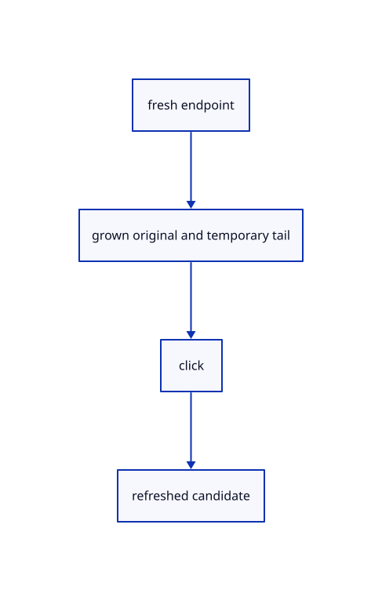

# 16.1.20 · Preview extension and refresh only changed originals

**Chapter 16 · Geometry editing and measurement · Section 16.1 · Projection and Split inputs** · [Contents](contents.md)

**Typing: 29–57 minutes.** [Estimate](typing-load.md).

Solve a fresh endpoint once, retain its temporary tail and resample the changed original after a successful click.

## Type

Continue from [Find the nearest visible curve end in CSS pixels](81k-find-the-nearest-visible-curve-end-in-css-pixels.md). [Save or recover your work](recovery.md).

### 1. `src/extend_draft.rs`

Add complete source-editing methods at their dependency boundary.

<details>
<summary>Locate the existing block</summary>

```rust
        best
    }
}
fn apart(a: [f64; 3], b: [f64; 3]) -> f64 {
```

</details>

Edit the existing block to match this code; keep unchanged lines:

```rust
--8<-- "journey/code/81l-preview-extension-and-refresh-only-changed-originals-01.rs"
```

## Run and check

Run this from `session_viewer` to select the fixed dependency versions and install supplied binary assets. It updates Cargo.lock and preserves the previous lock. It does not write implementation code:

```sh
npm --prefix ../session_tests run course -- dependencies 16.1.20
```

In your project:

```sh
cd workspace/journey
REGEN_PROTO=0 cargo build --lib --locked --target wasm32-unknown-unknown -j1
REGEN_PROTO=0 CARGO_BUILD_JOBS=1 trunk serve --port 8780
```

Open `http://127.0.0.1:8780/`. Keep an existing Trunk server running; saving rebuilds it.


**Visual review: issue found.** This inherited network reference has faint or interrupted original input curves. Its aggregate pixel checks do not establish curve continuity or contrast. These are input curves, not a full NURBS isocurve display; visual-quality acceptance is incomplete.

[Visual review findings](visual-review.md).

### Recorded visual result

**Previous native render — current verification pending.**

The original network and four-corner patch remain visible.


*This recorded image predates a source or checker change. Rebuild this checkpoint before using it as current evidence; browser controls require separate acceptance.*

This reference image is shared with [15.4.5 · Exercise networks corner retries and exact original archives](80d-exercise-networks-corner-retries-and-exact-original-archives.md). It does not demonstrate a new feature by itself.

<details>
<summary>Code explanation and diagram</summary>


fresh endpoint → grown original and temporary tail → click → refreshed candidate.



Does the hover preview make a history entry?

No. Only committing its checked original replacement does. Repeated hover on the same fresh endpoint reuses the result.

Study estimate, including typing and experiments: 0.5–1 hours.

</details>

<details>
<summary>Optional experiment</summary>

Inspect unchanged endpoint reuse, stale boundary rejection and the per-row refresh after a successful repeated click.

</details>

<details>
<summary>Check and save your work</summary>

Restore experimental edits, then run from `session_viewer`:

```sh
npm --prefix ../session_tests run course -- check 16.1.20
npm --prefix ../session_tests run course -- save 16.1.20
```

Source comparison leaves your project untouched. [Save and recovery instructions](recovery.md).

</details>

<details>
<summary>Viewer coverage and verification</summary>


The preceding network/patch contract remains authored and unrun. The final editing contract adds projected originals, atomic Three Point retry, interval extension and active distance/cancellation. Actual browser execution remains required.

[Full validation scope](release.md).

To reproduce the scripted acceptance of the reference checkpoint, run from `session_viewer` with the [course bundle server](release.md#reproduce) running on port 8781:

```sh
npm --prefix ../session_tests run course -- capture 16.1.20
```

This uses the verified reference bundle; it does not check or change your typed project.

</details>
