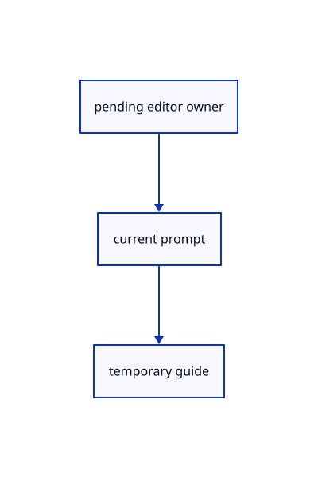

# 16.1.21 · Keep projection and extension in the pending tool owner

**Chapter 16 · Geometry editing and measurement · Section 16.1 · Projection and Split inputs** · [Contents](contents.md)

**Typing: 26–51 minutes.** [Estimate](typing-load.md).

Register current tool names, prompts, buttons and temporary guides. Construction-plane questions take priority over nested edit guides.

## Type

Continue from [Preview extension and refresh only changed originals](81l-preview-extension-and-refresh-only-changed-originals.md). [Save or recover your work](recovery.md).

### 1. `src/tool.rs`

Connect projection and extension to pending prompts, buttons and temporary guides.

Edit these blocks from bottom to top. Keep the surrounding lines unchanged.

<details>
<summary>Locate this block</summary>

```rust
        self.tool.build_on_plane(&world,self.frame)
    }
    pub fn outlines(&self)->Vec<Vec<[f64;3]>> {
        if let Some(gather)=&self.gather {gather.outlines(self.cursor)}else if let Some(primitive)=&self.primitive {primitive.outline(self.cursor)}else{vec![self.outline()]}
    }
    pub fn outline(&self)->Vec<[f64;3]> {
```

</details>

Replace it with:

```rust
        self.tool.build_on_plane(&world,self.frame)
    }
    pub fn outlines(&self)->Vec<Vec<[f64;3]>> {
        if let Some(points)=&self.plane_points{let mut points=points.clone();if let Some(cursor)=self.cursor{points.push(cursor)}return vec![points]}
        if let Some(extend)=&self.extend{return extend.hover.as_ref().map_or_else(Vec::new,|h|vec![h.tail.clone()])}
        if let Some(gather)=&self.gather {gather.outlines(self.cursor)}else if let Some(primitive)=&self.primitive {primitive.outline(self.cursor)}else{vec![self.outline()]}
    }
    pub fn outline(&self)->Vec<[f64;3]> {
```

<details>
<summary>Locate this block</summary>

```rust
pub const MAX_POINTS: usize = 4096;

// A draft owns unfinished points and a cursor, so preview motion cannot become saved geometry or an Undo transaction.
pub struct Draft { pub tool: Box<dyn Tool>, pub points: Vec<[f64; 3]>, pub cursor: Option<[f64; 3]>, pub snapped: Option<crate::snap::Kind>, pub frame: crate::cplane::CPlane, pub plane_points: Option<Vec<[f64;3]>>, pub primitive:Option<crate::primitive_draft::Draft>, pub transform:Option<crate::transform_draft::Draft>,pub gather:Option<crate::gather_draft::Draft> }

impl Draft {
    pub fn new(shape: Shape) -> Self { Self { gather:None,tool: Box::new(shape), points: Vec::new(), cursor: None, snapped: None, frame: crate::cplane::CPlane::Xy, plane_points: None, primitive:if let Shape::Primitive(shape)=shape {Some(crate::primitive_draft::Draft::new(shape,crate::cplane::CPlane::Xy,0).expect("Registered primitive option"))}else{None},transform:if let Shape::Transform(kind)=shape {Some(crate::transform_draft::Draft::new(kind,crate::cplane::CPlane::Xy))}else{None} } }
    pub fn prompt(&self) -> String {
        if self.plane_points.is_none(){if let Some(gather)=&self.gather{return gather.prompt()}}
        if self.plane_points.is_none() {if let Some(transform)=&self.transform {return transform.prompt();}}
        if self.plane_points.is_none() {if let Some(primitive)=&self.primitive {return primitive.prompt();}}
```

</details>

Replace it with:

```rust
pub const MAX_POINTS: usize = 4096;

// A draft owns unfinished points and a cursor, so preview motion cannot become saved geometry or an Undo transaction.
pub struct Draft { pub tool: Box<dyn Tool>, pub points: Vec<[f64; 3]>, pub cursor: Option<[f64; 3]>, pub snapped: Option<crate::snap::Kind>, pub frame: crate::cplane::CPlane, pub plane_points: Option<Vec<[f64;3]>>, pub primitive:Option<crate::primitive_draft::Draft>, pub transform:Option<crate::transform_draft::Draft>,pub gather:Option<crate::gather_draft::Draft>,pub project:Option<crate::project_draft::Draft>,pub extend:Option<crate::extend_draft::Draft> }

impl Draft {
    pub fn new(shape: Shape) -> Self { Self { project:None,extend:None,gather:None,tool: Box::new(shape), points: Vec::new(), cursor: None, snapped: None, frame: crate::cplane::CPlane::Xy, plane_points: None, primitive:if let Shape::Primitive(shape)=shape {Some(crate::primitive_draft::Draft::new(shape,crate::cplane::CPlane::Xy,0).expect("Registered primitive option"))}else{None},transform:if let Shape::Transform(kind)=shape {Some(crate::transform_draft::Draft::new(kind,crate::cplane::CPlane::Xy))}else{None} } }
    pub fn prompt(&self) -> String {
        if self.plane_points.is_none(){if let Some(p)=&self.project{return p.prompt()}if let Some(e)=&self.extend{return e.prompt()}}
        if self.plane_points.is_none(){if let Some(gather)=&self.gather{return gather.prompt()}}
        if self.plane_points.is_none() {if let Some(transform)=&self.transform {return transform.prompt();}}
        if self.plane_points.is_none() {if let Some(primitive)=&self.primitive {return primitive.prompt();}}
```

<details>
<summary>Locate this block</summary>

```rust
            Self::Polygon {sides} if points.len()==2=>crate::planar::points("polygon",plane,*sides,points).unwrap_or_default(),_=>points.to_vec()}
    }
    fn buttons(&self)->Vec<(String,String)> {
        if let Self::Gather(recipe)=self{return recipe.chips.iter().map(|(label,line)|((*label).into(),(*line).into())).collect()}
        if let Self::Transform(kind)=self {return crate::transform_draft::Draft::new(*kind,crate::cplane::CPlane::Xy).buttons();}
        if let Self::Primitive(shape)=self {return shape.options.iter().map(|(label,line)|((*label).into(),(*line).into())).collect();}
```

</details>

Replace it with:

```rust
            Self::Polygon {sides} if points.len()==2=>crate::planar::points("polygon",plane,*sides,points).unwrap_or_default(),_=>points.to_vec()}
    }
    fn buttons(&self)->Vec<(String,String)> {
        if matches!(self,Self::Project){return vec![("Cancel".into(),"Escape".into())]}
        if matches!(self,Self::Extend){return vec![("Distance".into(),"Distance".into()),("Next / Done".into(),"".into()),("Cancel".into(),"Escape".into())]}
        if let Self::Gather(recipe)=self{return recipe.chips.iter().map(|(label,line)|((*label).into(),(*line).into())).collect()}
        if let Self::Transform(kind)=self {return crate::transform_draft::Draft::new(*kind,crate::cplane::CPlane::Xy).buttons();}
        if let Self::Primitive(shape)=self {return shape.options.iter().map(|(label,line)|((*label).into(),(*line).into())).collect();}
```

<details>
<summary>Locate this block</summary>

```rust
}

#[derive(Clone, Copy, Debug)]
pub enum Shape { Gather(&'static crate::gather_input::Recipe), Point, Line, Move, Polyline, Curve, Rectangle, Polygon {sides:usize}, Primitive(&'static crate::primitive_shape::Shape), Transform(crate::transform_draft::Kind) }

impl Tool for Shape {
    fn name(&self) -> &'static str { match self { Self::Gather(recipe)=>recipe.name, Self::Point => "Point", Self::Line => "Line", Self::Move => "Move", Self::Polyline => "Polyline",Self::Curve=>"Curve", Self::Rectangle=>"Polyline Rectangle",Self::Polygon {..}=>"Polyline Polygon",Self::Primitive(shape)=>shape.name,Self::Transform(kind)=>kind.name() } }
    fn count(&self) -> usize { match self { Self::Gather(_)=>0, Self::Point => 1, Self::Line | Self::Move => 2, Self::Polyline|Self::Curve => 0,Self::Rectangle|Self::Polygon {..}=>2,Self::Primitive(_)|Self::Transform(_)=>0 } }
    fn sides(&self)->Option<usize> {if let Self::Polygon {sides}=self {Some(*sides)}else{None}}
    fn set_sides(&mut self,value:usize)->Result<(),&'static str> {
        if !(3..MAX_POINTS).contains(&value) {return Err("Polygon sides must be between 3 and 4095");}
```

</details>

Replace it with:

```rust
}

#[derive(Clone, Copy, Debug)]
pub enum Shape { Project,Extend, Gather(&'static crate::gather_input::Recipe), Point, Line, Move, Polyline, Curve, Rectangle, Polygon {sides:usize}, Primitive(&'static crate::primitive_shape::Shape), Transform(crate::transform_draft::Kind) }

impl Tool for Shape {
    fn name(&self) -> &'static str { match self { Self::Project=>"Project To Plane",Self::Extend=>"Extend",Self::Gather(recipe)=>recipe.name, Self::Point => "Point", Self::Line => "Line", Self::Move => "Move", Self::Polyline => "Polyline",Self::Curve=>"Curve", Self::Rectangle=>"Polyline Rectangle",Self::Polygon {..}=>"Polyline Polygon",Self::Primitive(shape)=>shape.name,Self::Transform(kind)=>kind.name() } }
    fn count(&self) -> usize { match self { Self::Project|Self::Extend=>0,Self::Gather(_)=>0, Self::Point => 1, Self::Line | Self::Move => 2, Self::Polyline|Self::Curve => 0,Self::Rectangle|Self::Polygon {..}=>2,Self::Primitive(_)|Self::Transform(_)=>0 } }
    fn sides(&self)->Option<usize> {if let Self::Polygon {sides}=self {Some(*sides)}else{None}}
    fn set_sides(&mut self,value:usize)->Result<(),&'static str> {
        if !(3..MAX_POINTS).contains(&value) {return Err("Polygon sides must be between 3 and 4095");}
```

<details>
<summary>Complete updated block reference</summary>

```rust
use crate::{marker::PreparedPoint, stroke::PreparedLine};
use std::rc::Rc;

pub enum Built { Point(PreparedPoint), Line(PreparedLine), Move([f64; 3]), Polyline(crate::chain::PreparedChain), Geometry(session_rust::Geometry) }

pub trait Tool: std::fmt::Debug {
    fn name(&self) -> &'static str;
    fn count(&self) -> usize;
    fn build(&self, points: &[[f64; 3]]) -> Result<Built, &'static str>;
    fn build_on_plane(&self,points:&[[f64;3]],_plane:crate::cplane::CPlane)->Result<Built,&'static str> {self.build(points)}
    fn outline(&self,points:&[[f64;3]],_plane:crate::cplane::CPlane)->Vec<[f64;3]> {points.to_vec()}
    fn sides(&self)->Option<usize> {None}
    fn set_sides(&mut self,_sides:usize)->Result<(),&'static str> {Err("Sides works while drawing a polygon")}
    fn buttons(&self) -> Vec<(String, String)> { vec![("Cancel".into(), "Escape".into())] }
}

#[derive(Clone, Copy, Debug)]
pub enum Shape { Project,Extend, Gather(&'static crate::gather_input::Recipe), Point, Line, Move, Polyline, Curve, Rectangle, Polygon {sides:usize}, Primitive(&'static crate::primitive_shape::Shape), Transform(crate::transform_draft::Kind) }

impl Tool for Shape {
    fn name(&self) -> &'static str { match self { Self::Project=>"Project To Plane",Self::Extend=>"Extend",Self::Gather(recipe)=>recipe.name, Self::Point => "Point", Self::Line => "Line", Self::Move => "Move", Self::Polyline => "Polyline",Self::Curve=>"Curve", Self::Rectangle=>"Polyline Rectangle",Self::Polygon {..}=>"Polyline Polygon",Self::Primitive(shape)=>shape.name,Self::Transform(kind)=>kind.name() } }
    fn count(&self) -> usize { match self { Self::Project|Self::Extend=>0,Self::Gather(_)=>0, Self::Point => 1, Self::Line | Self::Move => 2, Self::Polyline|Self::Curve => 0,Self::Rectangle|Self::Polygon {..}=>2,Self::Primitive(_)|Self::Transform(_)=>0 } }
    fn sides(&self)->Option<usize> {if let Self::Polygon {sides}=self {Some(*sides)}else{None}}
    fn set_sides(&mut self,value:usize)->Result<(),&'static str> {
        if !(3..MAX_POINTS).contains(&value) {return Err("Polygon sides must be between 3 and 4095");}
        let Self::Polygon {sides}=self else {return Err("Sides works while drawing a polygon")};*sides=value;Ok(())
    }
    fn build_on_plane(&self,points:&[[f64;3]],plane:crate::cplane::CPlane)->Result<Built,&'static str> {
        let (kind,sides)=match self {Self::Rectangle=>("rectangle",4),Self::Polygon {sides}=>("polygon",*sides),_=>return self.build(points)};
        let points=crate::planar::points(kind,plane,sides,points)?;Self::Polyline.build(&points)
    }
    fn outline(&self,points:&[[f64;3]],plane:crate::cplane::CPlane)->Vec<[f64;3]> {
        match self {Self::Rectangle if points.len()==2=>crate::planar::points("rectangle",plane,4,points).unwrap_or_default(),
            Self::Polygon {sides} if points.len()==2=>crate::planar::points("polygon",plane,*sides,points).unwrap_or_default(),_=>points.to_vec()}
    }
    fn buttons(&self)->Vec<(String,String)> {
        if matches!(self,Self::Project){return vec![("Cancel".into(),"Escape".into())]}
        if matches!(self,Self::Extend){return vec![("Distance".into(),"Distance".into()),("Next / Done".into(),"".into()),("Cancel".into(),"Escape".into())]}
        if let Self::Gather(recipe)=self{return recipe.chips.iter().map(|(label,line)|((*label).into(),(*line).into())).collect()}
        if let Self::Transform(kind)=self {return crate::transform_draft::Draft::new(*kind,crate::cplane::CPlane::Xy).buttons();}
        if let Self::Primitive(shape)=self {return shape.options.iter().map(|(label,line)|((*label).into(),(*line).into())).collect();}
        let mut buttons=vec![("Cancel".into(),"Escape".into())];
        if matches!(self,Self::Polyline|Self::Rectangle|Self::Polygon {..}) {
            for name in ["Points","Rectangle","Polygon"] {buttons.push((name.into(),format!("Polyline {name}")));}
        }
        if matches!(self,Self::Polyline|Self::Curve) {buttons.insert(0,("Close".into(),"Close".into()));}buttons
    }
    fn build(&self, points: &[[f64; 3]]) -> Result<Built, &'static str> {
        match (self, points) {
            (Self::Point, [p]) => Ok(Built::Point(PreparedPoint::new(Rc::new(session_rust::Point::new(p[0], p[1], p[2])))?)),
            (Self::Line, [a, b]) => {
                if a.iter().zip(b).all(|(a, b)| (a-b).abs() < 1e-12) { return Err("Line endpoints must differ"); }
                Ok(Built::Line(PreparedLine::new(Rc::new(session_rust::Line::new(a[0], a[1], a[2], b[0], b[1], b[2])))?))
            }
            (Self::Move, [a,b]) => Ok(Built::Move(std::array::from_fn(|i| b[i]-a[i]))),
            (Self::Polyline, points) if (2..=MAX_POINTS).contains(&points.len()) => {
                if !points.windows(2).any(|p| p[0] != p[1]) { return Err("Polyline points must differ"); }
                let points=points.iter().map(|p|session_rust::Point::new(p[0],p[1],p[2])).collect();
                Ok(Built::Polyline(crate::chain::PreparedChain::polyline(Rc::new(session_rust::Polyline::new(points)))?))
            }
            (Self::Curve,points) if (2..=MAX_POINTS).contains(&points.len())=>{
                if !points.windows(2).any(|p|p[0]!=p[1]) {return Err("Curve controls must differ");}
                let controls=points.iter().map(|p|session_rust::Point::new(p[0],p[1],p[2])).collect::<Vec<_>>();
                let source=crate::freeform_curve::curve(&controls);
                Ok(Built::Geometry(session_rust::Geometry::NurbsCurve(Rc::new(source))))
            },
            (Self::Rectangle|Self::Polygon {..},_)=>self.build_on_plane(points,crate::cplane::CPlane::Xy),
            _ => Err("The tool needs more points"),
        }
    }
}

pub const MAX_POINTS: usize = 4096;

// A draft owns unfinished points and a cursor, so preview motion cannot become saved geometry or an Undo transaction.
pub struct Draft { pub tool: Box<dyn Tool>, pub points: Vec<[f64; 3]>, pub cursor: Option<[f64; 3]>, pub snapped: Option<crate::snap::Kind>, pub frame: crate::cplane::CPlane, pub plane_points: Option<Vec<[f64;3]>>, pub primitive:Option<crate::primitive_draft::Draft>, pub transform:Option<crate::transform_draft::Draft>,pub gather:Option<crate::gather_draft::Draft>,pub project:Option<crate::project_draft::Draft>,pub extend:Option<crate::extend_draft::Draft> }

impl Draft {
    pub fn new(shape: Shape) -> Self { Self { project:None,extend:None,gather:None,tool: Box::new(shape), points: Vec::new(), cursor: None, snapped: None, frame: crate::cplane::CPlane::Xy, plane_points: None, primitive:if let Shape::Primitive(shape)=shape {Some(crate::primitive_draft::Draft::new(shape,crate::cplane::CPlane::Xy,0).expect("Registered primitive option"))}else{None},transform:if let Shape::Transform(kind)=shape {Some(crate::transform_draft::Draft::new(kind,crate::cplane::CPlane::Xy))}else{None} } }
    pub fn prompt(&self) -> String {
        if self.plane_points.is_none(){if let Some(p)=&self.project{return p.prompt()}if let Some(e)=&self.extend{return e.prompt()}}
        if self.plane_points.is_none(){if let Some(gather)=&self.gather{return gather.prompt()}}
        if self.plane_points.is_none() {if let Some(transform)=&self.transform {return transform.prompt();}}
        if self.plane_points.is_none() {if let Some(primitive)=&self.primitive {return primitive.prompt();}}
        let mut prompt=if let Some(points)=&self.plane_points {format!("CPlane 3 Point · point {} of 3 · Esc cancels",points.len()+1)}
            else if self.tool.count()==0 {format!("{} point {} · Enter finishes · Esc cancels",self.tool.name(),self.points.len()+1)}
            else {format!("{} point {} of {} · Esc cancels", self.tool.name(), self.points.len()+1, self.tool.count())};
        if let Some(sides)=self.tool.sides() {prompt.push_str(&format!(" · Sides {sides}"));}
        if let Some(kind)=self.snapped { prompt.push_str(&format!(" · Snap {kind:?}")); }
        prompt
    }
    pub fn submit(&mut self, point: [f64; 3]) -> Result<Option<Built>, &'static str> { self.submit_many(&[point]) }
    pub fn submit_many(&mut self, added: &[[f64;3]]) -> Result<Option<Built>, &'static str> {
        let mut points=self.points.clone();
        for &point in added { points.push(crate::tool_coords::checked(point)?); }
        let count=self.tool.count(); let limit=if count==0 {MAX_POINTS} else {count};
        if points.len()>limit {return Err("The tool has enough points");}
        let built=if count>0 && points.len()==count {Some(self.build_world(&points)?)} else {None};
        self.points=points;self.cursor=None;self.snapped=None;Ok(built)
    }
    pub fn finish(&self) -> Result<Built,&'static str> { self.build_world(&self.points) }
    // Finished coordinates already belong to the world; their prefix prevents applying a fixed plane a second time during replay.
    pub fn command(&self, points:&[[f64;3]]) -> String {
        let mut line=self.tool.name().to_owned();
        for p in points {line.push_str(&format!(" w{},{},{}",p[0],p[1],p[2]));}line
    }
    pub fn build_world(&self, points:&[[f64;3]]) -> Result<Built,&'static str> {
        let command=self.command(points);let text=&command[self.tool.name().len()..];
        let world=crate::drawing_input::points(text,crate::drawing_coords::plane(),self.frame,&[],None)?;
        self.tool.build_on_plane(&world,self.frame)
    }
    pub fn outlines(&self)->Vec<Vec<[f64;3]>> {
        if let Some(points)=&self.plane_points{let mut points=points.clone();if let Some(cursor)=self.cursor{points.push(cursor)}return vec![points]}
        if let Some(extend)=&self.extend{return extend.hover.as_ref().map_or_else(Vec::new,|h|vec![h.tail.clone()])}
        if let Some(gather)=&self.gather {gather.outlines(self.cursor)}else if let Some(primitive)=&self.primitive {primitive.outline(self.cursor)}else{vec![self.outline()]}
    }
    pub fn outline(&self)->Vec<[f64;3]> {
        let mut points=self.points.clone();if let Some(cursor)=self.cursor {points.push(cursor);}
        self.tool.outline(&points,self.frame)
    }
    pub fn hover(&mut self, point: Option<[f64; 3]>) -> Result<(), &'static str> {
        self.cursor = point.map(crate::tool_coords::checked).transpose()?; Ok(())
    }
}
```

</details>

<details>
<summary>Optional patch references</summary>

Use these original edit fragments when comparing a saved checkpoint. Apply the complete blocks above.

```text
--8<-- "journey/code/81m-keep-projection-and-extension-in-the-pending-tool-owner-01.rs"
```

```text
--8<-- "journey/code/81m-keep-projection-and-extension-in-the-pending-tool-owner-02.rs"
```

```text
--8<-- "journey/code/81m-keep-projection-and-extension-in-the-pending-tool-owner-03.rs"
```

```text
--8<-- "journey/code/81m-keep-projection-and-extension-in-the-pending-tool-owner-04.rs"
```

</details>

## Run and check

Run this from `session_viewer` to select the fixed dependency versions and install supplied binary assets. It updates Cargo.lock and preserves the previous lock. It does not write implementation code:

```sh
npm --prefix ../session_tests run course -- dependencies 16.1.21
```

In your project:

```sh
cd workspace/journey
REGEN_PROTO=0 cargo build --lib --locked --target wasm32-unknown-unknown -j1
REGEN_PROTO=0 CARGO_BUILD_JOBS=1 trunk serve --port 8780
```

Open `http://127.0.0.1:8780/`. Keep an existing Trunk server running; saving rebuilds it.


**Visual review: issue found.** This inherited network reference has faint or interrupted original input curves. Its aggregate pixel checks do not establish curve continuity or contrast. These are input curves, not a full NURBS isocurve display; visual-quality acceptance is incomplete.

[Visual review findings](visual-review.md).

### Recorded visual result

**Previous native render — current verification pending.**

The original network and four-corner patch remain visible.


*This recorded image predates a source or checker change. Rebuild this checkpoint before using it as current evidence; browser controls require separate acceptance.*

This reference image is shared with [15.4.5 · Exercise networks corner retries and exact original archives](80d-exercise-networks-corner-retries-and-exact-original-archives.md). It does not demonstrate a new feature by itself.

<details>
<summary>Code explanation and diagram</summary>


pending editor owner → current prompt → temporary guide.



Does changing CPlane discard a pending editing command?

The nested plane question stays within the owner. Its guide has priority until the plane question finishes or cancels.

Study estimate, including typing and experiments: 0.5–1 hours.

</details>

<details>
<summary>Optional experiment</summary>

Inspect Project’s accepted plane points, Extend’s temporary tail and the nested plane guide. None becomes scene geometry.

</details>

<details>
<summary>Check and save your work</summary>

Restore experimental edits, then run from `session_viewer`:

```sh
npm --prefix ../session_tests run course -- check 16.1.21
npm --prefix ../session_tests run course -- save 16.1.21
```

Source comparison leaves your project untouched. [Save and recovery instructions](recovery.md).

</details>

<details>
<summary>Viewer coverage and verification</summary>


The preceding network/patch contract remains authored and unrun. The final editing contract adds projected originals, atomic Three Point retry, interval extension and active distance/cancellation. Actual browser execution remains required.

[Full validation scope](release.md).

To reproduce the scripted acceptance of the reference checkpoint, run from `session_viewer` with the [course bundle server](release.md#reproduce) running on port 8781:

```sh
npm --prefix ../session_tests run course -- capture 16.1.21
```

This uses the verified reference bundle; it does not check or change your typed project.

</details>
