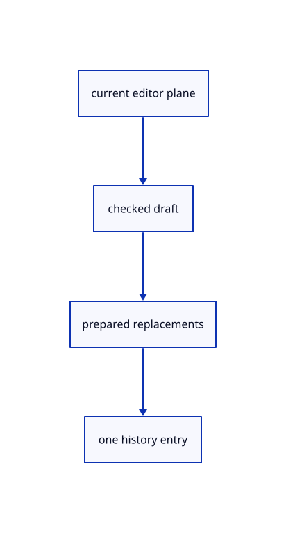

# 16.1.22 · Connect checked projection to one editor transaction

**Chapter 16 · Geometry editing and measurement · Section 16.1 · Projection and Split inputs** · [Contents](contents.md)

**Typing: 22–43 minutes.** [Estimate](typing-load.md).

Parse initial arguments under this editor’s plane context. Adopt replacements only after the complete plane and all originals validate.

## Type

Continue from [Keep projection and extension in the pending tool owner](81m-keep-projection-and-extension-in-the-pending-tool-owner.md). [Save or recover your work](recovery.md).

### 1. `src/editor.rs`

Connect complete source-editing methods to one checked history transaction.

<details>
<summary>Locate the existing block</summary>

```rust
    fn gather_text(&mut self,text:&str)->Result<Change,&'static str>{let mut next=self.draft.as_ref().and_then(|d|d.gather.clone()).ok_or("No gathering tool is running")?;next.valid(&self.scene).map_err(|message|self.primitive_failure(message))?;let made=next.text(text,self.construction_plane).map_err(|message|self.primitive_failure(message))?;self.gather_adopt(next,made)}
    fn gather_pick(&mut self,id:Option<ObjectId>)->Result<Change,&'static str>{let mut next=self.draft.as_ref().and_then(|d|d.gather.clone()).ok_or("No gathering tool is running")?;next.valid(&self.scene).map_err(|message|self.primitive_failure(message))?;let made=next.pick(&self.scene,id).map_err(|message|self.primitive_failure(message))?;self.gather_adopt(next,made)}
    fn tool_text(&mut self,text:&str) -> Result<Change,&'static str> {
        if self.draft.as_ref().is_some_and(|d|d.gather.is_some()&&d.plane_points.is_none()){return self.gather_text(text);}
```

</details>

Edit the existing block to match this code; keep unchanged lines:

```rust
--8<-- "journey/code/81n-connect-checked-projection-to-one-editor-transaction-01.rs"
```

## Run and check

Run this from `session_viewer` to select the fixed dependency versions and install supplied binary assets. It updates Cargo.lock and preserves the previous lock. It does not write implementation code:

```sh
npm --prefix ../session_tests run course -- dependencies 16.1.22
```

In your project:

```sh
cd workspace/journey
REGEN_PROTO=0 cargo build --lib --locked --target wasm32-unknown-unknown -j1
REGEN_PROTO=0 CARGO_BUILD_JOBS=1 trunk serve --port 8780
```

Open `http://127.0.0.1:8780/`. Keep an existing Trunk server running; saving rebuilds it.


**Visual review: issue found.** This inherited network reference has faint or interrupted original input curves. Its aggregate pixel checks do not establish curve continuity or contrast. These are input curves, not a full NURBS isocurve display; visual-quality acceptance is incomplete.

[Visual review findings](visual-review.md).

### Recorded visual result

**Previous native render — current verification pending.**

The original network and four-corner patch remain visible.


*This recorded image predates a source or checker change. Rebuild this checkpoint before using it as current evidence; browser controls require separate acceptance.*

This reference image is shared with [15.4.5 · Exercise networks corner retries and exact original archives](80d-exercise-networks-corner-retries-and-exact-original-archives.md). It does not demonstrate a new feature by itself.

<details>
<summary>Code explanation and diagram</summary>


current editor plane → checked draft → prepared replacements → one history entry.



Can a second editor change this projection’s input frame?

Resolve the command under the active editor’s own plane before parsing. Global parsing context must not leak across editors.

Study estimate, including typing and experiments: 0.5–1 hours.

</details>

<details>
<summary>Optional experiment</summary>

Inspect view-normal CPlane projection, named planes, Three Point startup and one transaction over all usable selected originals.

</details>

<details>
<summary>Check and save your work</summary>

Restore experimental edits, then run from `session_viewer`:

```sh
npm --prefix ../session_tests run course -- check 16.1.22
npm --prefix ../session_tests run course -- save 16.1.22
```

Source comparison leaves your project untouched. [Save and recovery instructions](recovery.md).

</details>

<details>
<summary>Viewer coverage and verification</summary>


The preceding network/patch contract remains authored and unrun. The final editing contract adds projected originals, atomic Three Point retry, interval extension and active distance/cancellation. Actual browser execution remains required.

[Full validation scope](release.md).

To reproduce the scripted acceptance of the reference checkpoint, run from `session_viewer` with the [course bundle server](release.md#reproduce) running on port 8781:

```sh
npm --prefix ../session_tests run course -- capture 16.1.22
```

This uses the verified reference bundle; it does not check or change your typed project.

</details>
