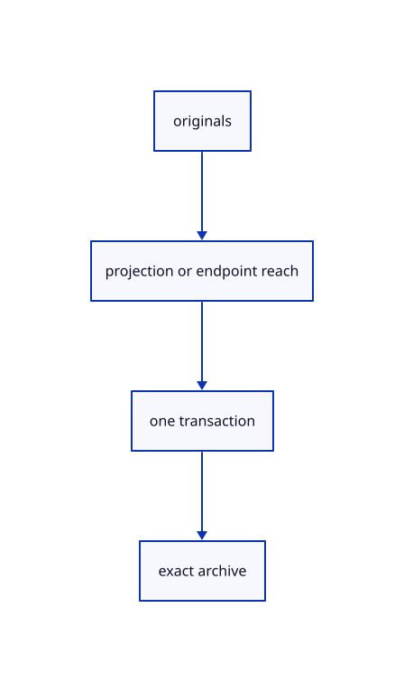

# 16.1.30 · Exercise original projection retry and repeated extension

**Chapter 16 · Geometry editing and measurement · Section 16.1 · Projection and Split inputs** · [Contents](contents.md)

**Typing: 0–0 minutes.** [Estimate](typing-load.md).

Copy integrated editing/history/archive fixtures and render projected originals with a repeatedly extended line.

## Type

Continue from [Route whole boundary picks and observe pending edits](81u-route-whole-boundary-picks-and-observe-pending-edits.md). [Save or recover your work](recovery.md).

<details>
<summary>Supplied validation fixture</summary>

Copy this supplied authoring fixture once. Continue with the browser build below; the course does not require running native tests.

### 1. `src/editing_tests.rs`

Copy integrated original-edit, retry, stale-owner, history and archive fixtures.

Copy this supplied file:

```text
--8<-- "journey/code/81v-exercise-original-projection-retry-and-repeated-extension-01.rs"
```

</details>

<details>
<summary>Supplied validation fixture</summary>

Copy this supplied authoring fixture once. Continue with the browser build below; the course does not require running native tests.

### 2. `src/lib.rs`

Register the editing component.

<details>
<summary>Locate the existing block</summary>

```text

pub mod editing_commands;
```

</details>

After that block, append this supplied code:

```text
--8<-- "journey/code/81v-exercise-original-projection-retry-and-repeated-extension-02.rs" skip=27
```

</details>

## Run and check

Run this from `session_viewer` to select the fixed dependency versions and install supplied binary assets. It updates Cargo.lock and preserves the previous lock. It does not write implementation code:

```sh
npm --prefix ../session_tests run course -- dependencies 16.1.30
```

In your project:

```sh
cd workspace/journey
REGEN_PROTO=0 cargo build --lib --locked --target wasm32-unknown-unknown -j1
REGEN_PROTO=0 CARGO_BUILD_JOBS=1 trunk serve --port 8780
```

Open `http://127.0.0.1:8780/`. Keep an existing Trunk server running; saving rebuilds it.

An extended original line and a projected original curve lie on the XY plane. Mixed-family projection, plane retry, endpoint reach, stale owners, history and exact original archives are checked.

### Recorded visual result

**Previous native render — current verification pending.**

The extended line and projected curve lie on XY with retained original geometry identities.


*This recorded image predates a source or checker change. Rebuild this checkpoint before using it as current evidence; browser controls require separate acceptance.*

<details>
<summary>Code explanation and diagram</summary>


originals → projection or endpoint reach → one transaction → exact archive.



What proves an original edit instead of a proxy edit?

Check original coordinates, rational weights and GUIDs, unchanged placements and old shared allocations, plus Save/Open and Undo/Redo.

Study estimate, including typing and experiments: 0.5–1 hours.

</details>

<details>
<summary>Optional experiment</summary>

Type Close, Line w0,0,1 w1,0,1, Select All, Project To Plane XY and Extend -0.5 1.5. Type Curve w2,0,1 w2.5,1,2 w3,0,1, Select All and Project To Plane XY. Type View Isometric, Select None and Fit. Try Project To Plane 3Point with a repeated or collinear answer, then a valid answer. Try Extend Distance1, click near a line end twice, Escape and Undo twice; the supplied tests also check scaled-world distances and nearest boundaries.

</details>

<details>
<summary>Check and save your work</summary>

Restore experimental edits, then run from `session_viewer`:

```sh
npm --prefix ../session_tests run course -- check 16.1.30
npm --prefix ../session_tests run course -- save 16.1.30
```

Source comparison leaves your project untouched. [Save and recovery instructions](recovery.md).

</details>

<details>
<summary>Viewer coverage and verification</summary>

Use maintained Project To Plane, cut/reach and normalized interval algorithms with their native fixtures. Project original point/line/polyline/rational curve/mesh data in world space and transform back to the same local placement; skip unsupported and collapsed results. CPlane projection follows the current view normal. Three Point validates candidate answers before adoption. Extend uses eligible original lines/polylines/curves, current end reach, nearest forward boundaries and positive world distance converted to local units. Cache boundary meshes and sampled candidates; screen bounds prune distant curves before segment tests. No mutation during hover. Each successful end click makes one transaction and allows another click. Preserve row/source identity, placements, original data, unrelated shared owners, selection restoration and Undo/Redo. Manual Reload is required when an editable original is released; current on-demand editable fetching, the red dashed overlay and label, and pending-owner CPU accounting remain in the final command/performance inventory. This checkpoint does not claim those later connections.

All earlier checks remain. Fifteen copied maintained pure cases cover projection, curve/plane cutters, end reach and normalized intervals. Seven integrated cases cover original mixed lanes, rational controls, placed data and exact archives, atomic Three Point retry, collapse/unsupported guards and Redo, repeated scaled-world-distance clicks, nearest boundaries and separate temporary highlights, interval style/retries, and misses/stale owners without history.

The preceding network/patch contract remains authored and unrun. The final editing contract adds projected originals, atomic Three Point retry, interval extension and active distance/cancellation. Actual browser execution remains required.

[Full validation scope](release.md).

To reproduce the scripted acceptance of the reference checkpoint, run from `session_viewer` with the [course bundle server](release.md#reproduce) running on port 8781:

```sh
npm --prefix ../session_tests run course -- capture 16.1.30
```

This uses the verified reference bundle; it does not check or change your typed project.

</details>
