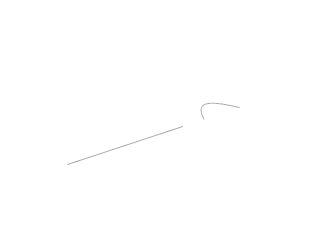
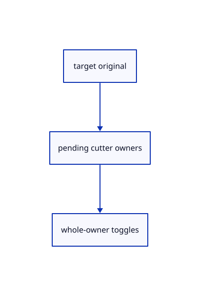

# 16.2.2 · Own the split target and toggle original cutters

**Chapter 16 · Geometry editing and measurement · Section 16.2 · Curve pieces and joined faces** · [Contents](contents.md)

**Typing: 15–30 minutes.** [Estimate](typing-load.md).

Capture one eligible original curve target and toggle distinct eligible cutters. Keep cutter highlights separate from target selection.

## Type

Continue from [Divide original curves and joined faces](82-divide-current-original-curve-families.md). [Save or recover your work](recovery.md).

### 1. `src/split_draft.rs`

Own the curve target and bounded original cutter toggles.

Create the file and type:

```rust
--8<-- "journey/code/82a-own-the-split-target-and-toggle-original-cutters-01.rs"
```

### 2. `src/lib.rs`

Register the source-splitting component.

<details>
<summary>Locate the existing block</summary>

```rust

pub mod split_geometry;
```

</details>

After that block, type:

```rust
--8<-- "journey/code/82a-own-the-split-target-and-toggle-original-cutters-02.rs" skip=25
```

## Run and check

Run this from `session_viewer` to select the fixed dependency versions and install supplied binary assets. It updates Cargo.lock and preserves the previous lock. It does not write implementation code:

```sh
npm --prefix ../session_tests run course -- dependencies 16.2.2
```

In your project:

```sh
cd workspace/journey
REGEN_PROTO=0 cargo build --lib --locked --target wasm32-unknown-unknown -j1
REGEN_PROTO=0 CARGO_BUILD_JOBS=1 trunk serve --port 8780
```

Open `http://127.0.0.1:8780/`. Keep an existing Trunk server running; saving rebuilds it.


### Recorded visual result

**Previous native render — current verification pending.**

The extended line and projected original curve remain visible.



*This recorded image predates a source or checker change. Rebuild this checkpoint before using it as current evidence; browser controls require separate acceptance.*

<details>
<summary>Code explanation and diagram</summary>


target original → pending cutter owners → whole-owner toggles.



Can the target also be its own cutter?

No. Refuse it before changing the list. Hidden, locked, released and unsupported cutter rows are also rejected.

Study estimate, including typing and experiments: 0.5–1 hours.

</details>

<details>
<summary>Optional experiment</summary>

Inspect the64-cutter ceiling and repeated-pick removal. Confirm the source target is a curve before accepting a pending operation.

</details>

<details>
<summary>Check and save your work</summary>

Restore experimental edits, then run from `session_viewer`:

```sh
npm --prefix ../session_tests run course -- check 16.2.2
npm --prefix ../session_tests run course -- save 16.2.2
```

Source comparison leaves your project untouched. [Save and recovery instructions](recovery.md).

</details>

<details>
<summary>Viewer coverage and verification</summary>


The preceding original-edit contract remains authored and unrun. The final split contract adds actual camera-projected target/cutter clicks, empty confirmation, completion, Escape and one Undo/Redo. Actual browser execution remains required.

[Full validation scope](release.md).

To reproduce the scripted acceptance of the reference checkpoint, run from `session_viewer` with the [course bundle server](release.md#reproduce) running on port 8781:

```sh
npm --prefix ../session_tests run course -- capture 16.2.2
```

This uses the verified reference bundle; it does not check or change your typed project.

</details>
