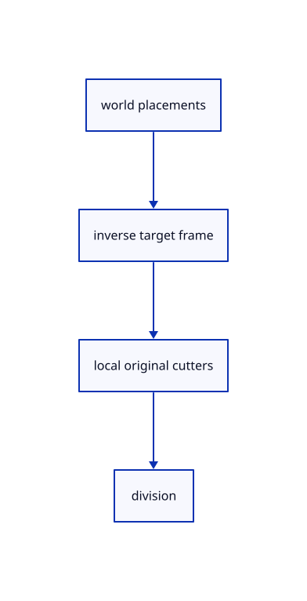

# 16.2.3 · Transform cutters into the target frame before dividing

**Chapter 16 · Geometry editing and measurement · Section 16.2 · Curve pieces and joined faces** · [Contents](contents.md)

**Typing: 12–23 minutes.** [Estimate](typing-load.md).

Validate source owners and placements, then transform each original cutter into the target’s local coordinates exactly once.

## Type

Continue from [Own the split target and toggle original cutters](82a-own-the-split-target-and-toggle-original-cutters.md). [Save or recover your work](recovery.md).

### 1. `src/split_draft.rs`

Prepare original split pieces from fresh local-frame cutter copies.

<details>
<summary>Locate the existing block</summary>

```rust
        Ok(())
    }
}
```

</details>

Edit the existing block to match this code; keep unchanged lines:

```rust
--8<-- "journey/code/82b-transform-cutters-into-the-target-frame-before-dividing-01.rs"
```

## Run and check

Run this from `session_viewer` to select the fixed dependency versions and install supplied binary assets. It updates Cargo.lock and preserves the previous lock. It does not write implementation code:

```sh
npm --prefix ../session_tests run course -- dependencies 16.2.3
```

In your project:

```sh
cd workspace/journey
REGEN_PROTO=0 cargo build --lib --locked --target wasm32-unknown-unknown -j1
REGEN_PROTO=0 CARGO_BUILD_JOBS=1 trunk serve --port 8780
```

Open `http://127.0.0.1:8780/`. Keep an existing Trunk server running; saving rebuilds it.


### Recorded visual result

**Previous native render — current verification pending.**

The extended line and projected original curve remain visible.


*This recorded image predates a source or checker change. Rebuild this checkpoint before using it as current evidence; browser controls require separate acceptance.*

This reference image is shared with [16.2.2 · Own the split target and toggle original cutters](82a-own-the-split-target-and-toggle-original-cutters.md). It does not demonstrate a new feature by itself.

<details>
<summary>Code explanation and diagram</summary>


world placements → inverse target frame → local original cutters → division.



What happens to a cutter’s saved placement?

It stays unchanged. Only a temporary curve copy is transformed for the target’s split calculation.

Study estimate, including typing and experiments: 0.5–1 hours.

</details>

<details>
<summary>Optional experiment</summary>

Compare a target under nested translation with a cutter in another document. Check stale allocation/model guards before invoking the algorithm.

</details>

<details>
<summary>Check and save your work</summary>

Restore experimental edits, then run from `session_viewer`:

```sh
npm --prefix ../session_tests run course -- check 16.2.3
npm --prefix ../session_tests run course -- save 16.2.3
```

Source comparison leaves your project untouched. [Save and recovery instructions](recovery.md).

</details>

<details>
<summary>Viewer coverage and verification</summary>


The preceding original-edit contract remains authored and unrun. The final split contract adds actual camera-projected target/cutter clicks, empty confirmation, completion, Escape and one Undo/Redo. Actual browser execution remains required.

[Full validation scope](release.md).

To reproduce the scripted acceptance of the reference checkpoint, run from `session_viewer` with the [course bundle server](release.md#reproduce) running on port 8781:

```sh
npm --prefix ../session_tests run course -- capture 16.2.3
```

This uses the verified reference bundle; it does not check or change your typed project.

</details>
