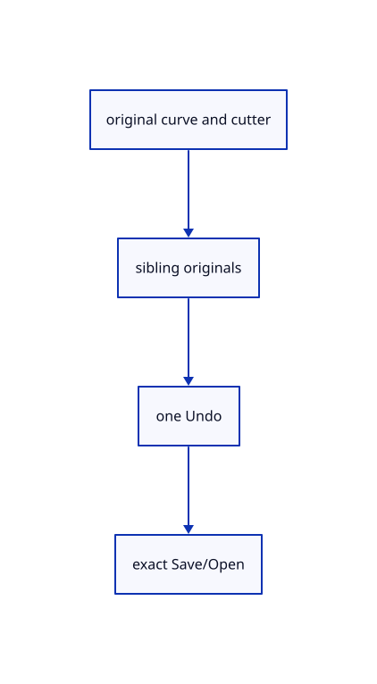

# 16.2.8 · Exercise curve pieces source inheritance and one-step Undo

**Chapter 16 · Geometry editing and measurement · Section 16.2 · Curve pieces and joined faces** · [Contents](contents.md)

**Typing: 0–0 minutes.** [Estimate](typing-load.md).

Copy integrated original split fixtures and display the selected first piece beside its sibling and retained cutter.

## Type

Continue from [Register Split and route mouse touch and confirmation](82f-register-split-and-route-mouse-touch-and-confirmation.md). [Save or recover your work](recovery.md).

<details>
<summary>Supplied validation fixture</summary>

Copy this supplied authoring fixture once. Continue with the browser build below; the course does not require running native tests.

### 1. `src/split_tests.rs`

Copy integrated source split, tree, placement, colour, stale, history and archive fixtures.

Copy this supplied file:

```text
--8<-- "journey/code/82g-exercise-curve-pieces-source-inheritance-and-one-step-undo-01.rs"
```

</details>

<details>
<summary>Supplied validation fixture</summary>

Copy this supplied authoring fixture once. Continue with the browser build below; the course does not require running native tests.

### 2. `src/lib.rs`

Register the source-splitting component.

<details>
<summary>Locate the existing block</summary>

```text

pub mod split_draft;
```

</details>

After that block, append this supplied code:

```text
--8<-- "journey/code/82g-exercise-curve-pieces-source-inheritance-and-one-step-undo-02.rs" skip=22
```

</details>

## Run and check

Run this from `session_viewer` to select the fixed dependency versions and install supplied binary assets. It updates Cargo.lock and preserves the previous lock. It does not write implementation code:

```sh
npm --prefix ../session_tests run course -- dependencies 16.2.8
```

In your project:

```sh
cd workspace/journey
REGEN_PROTO=0 cargo build --lib --locked --target wasm32-unknown-unknown -j1
REGEN_PROTO=0 CARGO_BUILD_JOBS=1 trunk serve --port 8780
```

Open `http://127.0.0.1:8780/`. Keep an existing Trunk server running; saving rebuilds it.

The selected first split piece is yellow beside its original sibling and retained cutter. The split preserves source placement, layer parent and identity and undoes as one operation.

### Recorded visual result

**Previous native render — current verification pending.**

A yellow first original split piece meets its black sibling at the retained original cutter.


*This recorded image predates a source or checker change. Rebuild this checkpoint before using it as current evidence; browser controls require separate acceptance.*

<details>
<summary>Code explanation and diagram</summary>


original curve and cutter → sibling originals → one Undo → exact Save/Open.



What proves the whole split is one change?

One Undo restores the original allocation and removes every added sibling. Redo restores all named pieces while keeping the cutter.

Study estimate, including typing and experiments: 0.5–1 hours.

</details>

<details>
<summary>Optional experiment</summary>

Type Close, Line w-2,0,0 w2,0,0 and Line w0,-2,0 w0,2,0. Type View Isometric, Select None and Fit. Click the horizontal target away from the crossing, type Split, then click the vertical cutter away from the crossing. Press Enter or tap Split. Inspect the two named original pieces; the first remains selected and the cutter remains. Try Undo, Redo, empty confirmation, toggling the cutter, Escape and Save/Open.

</details>

<details>
<summary>Check and save your work</summary>

Restore experimental edits, then run from `session_viewer`:

```sh
npm --prefix ../session_tests run course -- check 16.2.8
npm --prefix ../session_tests run course -- save 16.2.8
```

Source comparison leaves your project untouched. [Save and recovery instructions](recovery.md).

</details>

<details>
<summary>Viewer coverage and verification</summary>

Use maintained Split source family/cutter conversion, local placement, tolerance1e-6 and split algorithm. Original line/polyline/rational curve targets produce ordered named sibling originals. The first piece retains the target identity, later pieces receive independent GUIDs and keep the same source parent, placement and presentation colours. Cutters stay in the scene. Pending cutter picks are whole eligible original owners, toggle up to64, and do not replace ordinary target selection. Empty Enter retains the pending operation; nonempty completion and errors end it. Missed division makes no history entry. One successful split transaction covers replacement plus all siblings. Preserve old shared original allocations, other documents, Save/Open and Undo/Redo. Gizmo hides during cutter selection; view operations preserve the pending owner. Surface/BRep target acceptance connects in83; Element original support remains92. Released sources explicitly require Reload until on-demand command fetching connects in the complete inventory.

All earlier checks remain. Five integrated cases cover inherited layer/placement/presentation and unchanged other source holders, exact archives and one Undo/Redo; original polyline corners and rational curve pieces; toggled whole tree/rectangle picks and empty confirmation; no division/stale/locked originals and preserved Redo; current command arity, gizmo hiding, view preservation and command/Undo cancellation.

The preceding original-edit contract remains authored and unrun. The final split contract adds actual camera-projected target/cutter clicks, empty confirmation, completion, Escape and one Undo/Redo. Actual browser execution remains required.

[Full validation scope](release.md).

To reproduce the scripted acceptance of the reference checkpoint, run from `session_viewer` with the [course bundle server](release.md#reproduce) running on port 8781:

```sh
npm --prefix ../session_tests run course -- capture 16.2.8
```

This uses the verified reference bundle; it does not check or change your typed project.

</details>
