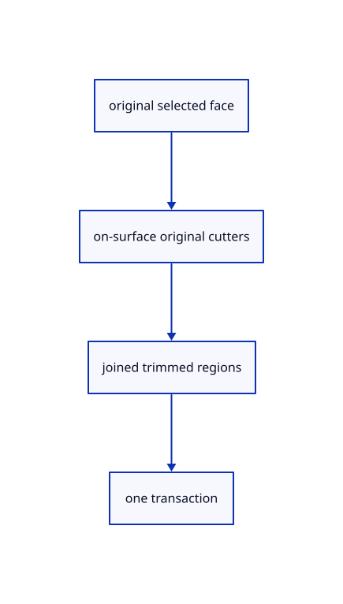

# 16.3.1 · Split original faces without separating the solid

**Chapter 16 · Geometry editing and measurement · Section 16.3 · Surface and curve measurement** · [Contents](contents.md)

**Typing: 0–0 minutes.** [Estimate](typing-load.md).

Allow original surfaces and explicitly selected BRep faces through the shared split owner. Retain one original BRep with trimmed regions.

## Type

Continue from [Exercise curve pieces source inheritance and one-step Undo](82g-exercise-curve-pieces-source-inheritance-and-one-step-undo.md). [Save or recover your work](recovery.md).

### 1. `src/split_draft.rs`

Allow original surfaces and validated BRep faces through the shared pending split owner.

<details>
<summary>Locate the existing block</summary>

```rust
    pub fn new(scene: &Scene, id: ObjectId, face: Option<usize>) -> Result<Self, String> {
        let target = Owner::capture(scene, id).map_err(str::to_owned)?;
        if !crate::split_geometry::is_cutter(&target.source) {
            return Err("Select a curve; surface-face splitting connects next".into());
        }
        let face = crate::split_geometry::face_index(&target.source, face)?;
        Ok(Self {
```

</details>

Edit the existing block to match this code; keep unchanged lines:

```rust
--8<-- "journey/code/83-split-original-faces-without-separating-the-solid-01.rs"
```

<details>
<summary>Supplied validation fixture</summary>

Copy this supplied authoring fixture once. Continue with the browser build below; the course does not require running native tests.

### 2. `src/split_face_tests.rs`

Copy integrated maintained joined-face, original placement, topology, area, archive and history fixtures.

Copy this supplied file:

```text
--8<-- "journey/code/83-split-original-faces-without-separating-the-solid-02.rs"
```

</details>

<details>
<summary>Supplied validation fixture</summary>

Copy this supplied authoring fixture once. Continue with the browser build below; the course does not require running native tests.

### 3. `src/lib.rs`

Register the copied original-face split fixtures.

<details>
<summary>Locate the existing block</summary>

```text
#[cfg(test)]
mod split_tests;
```

</details>

After that block, append this supplied code:

```text
--8<-- "journey/code/83-split-original-faces-without-separating-the-solid-03.rs" skip=30
```

</details>

## Run and check

Run this from `session_viewer` to select the fixed dependency versions and install supplied binary assets. It updates Cargo.lock and preserves the previous lock. It does not write implementation code:

```sh
npm --prefix ../session_tests run course -- dependencies 16.3.1
```

In your project:

```sh
cd workspace/journey
REGEN_PROTO=0 cargo build --lib --locked --target wasm32-unknown-unknown -j1
REGEN_PROTO=0 CARGO_BUILD_JOBS=1 trunk serve --port 8780
```

Open `http://127.0.0.1:8780/`. Keep an existing Trunk server running; saving rebuilds it.

One original surface becomes a two-region trimmed BRep beside its retained original cutter. Splitting a solid face keeps the solid joined; one Undo restores its original topology.

### Recorded visual result

**Previous native render — current verification pending.**

One original trimmed BRep displays both face regions and their shared boundary beside the retained cutter.


*This recorded image predates a source or checker change. Rebuild this checkpoint before using it as current evidence; browser controls require separate acceptance.*

<details>
<summary>Code explanation and diagram</summary>


original selected face → on-surface original cutters → joined trimmed regions → one transaction.



Does splitting a face create separate mesh objects?

No. A NURBS surface becomes one trimmed BRep. Splitting one face of a solid keeps that solid joined, replaces that face with regions and preserves its other faces. A multi-face BRep requires an explicit face selection.

Study estimate, including typing and experiments: 0.5–1 hours.

</details>

<details>
<summary>Optional experiment</summary>

Type Close, Nurbs Surface 4 Points w-2,-2,0 w2,-2,0 w2,2,0 w-2,2,0 and Line w0,-3,0 w0,3,0. Type View Isometric, Select None and Fit. Click the surface away from the cutter, type Split, click the cutter beyond the surface and press Enter. Inspect two trimmed faces on one original BRep; Undo restores the original surface and Redo restores both regions. For a solid box, Ctrl+Shift-select a face first and use a cutter lying on that face. A whole multi-face solid, out-of-range face or off-surface cutter is refused. Save/Open must retain the trimmed original.

</details>

<details>
<summary>Check and save your work</summary>

Restore experimental edits, then run from `session_viewer`:

```sh
npm --prefix ../session_tests run course -- check 16.3.1
npm --prefix ../session_tests run course -- save 16.3.1
```

Source comparison leaves your project untouched. [Save and recovery instructions](recovery.md).

</details>

<details>
<summary>Viewer coverage and verification</summary>

Use the maintained original surface/BRep split branches already supplied by the common source split module. Enable their face guards through the same pending-owner and one-transaction machinery. Curves produce siblings; surfaces produce one original trimmed BRep; a multi-face BRep needs one explicitly selected face and stays joined. Cutters must lie on the selected source face, after placement into its local coordinates. Keep source and row GUIDs, name, placement, original tree, other faces and old shared originals. Mesh proxies do not replace original CAD. Element originals connect with92. Released originals require Reload until current command fetching is completed in the final inventory.

All earlier checks remain. Three integrated cases adapt the maintained joined-box/area/invalid-cut fixture and cover one selected original face, out-of-range/whole-solid refusal, seven joined faces from a six-face box, exact half-region areas, source identity and one Undo/Redo; a placed original surface becoming one two-face BRep with the same GUID and exact Save/Open; and off-surface no-division without source mutation or Redo loss.

The preceding curve split contract remains authored and unrun. The face contract adds actual camera-projected surface/cutter clicks, original-family transition, one Undo/Redo and two retained face IDs. Actual browser execution remains required.

[Full validation scope](release.md).

To reproduce the scripted acceptance of the reference checkpoint, run from `session_viewer` with the [course bundle server](release.md#reproduce) running on port 8781:

```sh
npm --prefix ../session_tests run course -- capture 16.3.1
```

This uses the verified reference bundle; it does not check or change your typed project.

</details>
