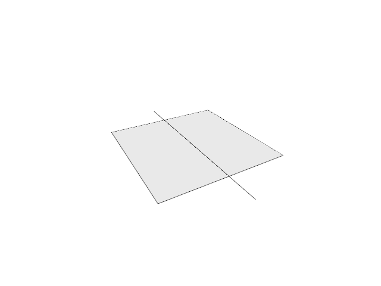

# 16.3.4 · Integrate original surface area

**Chapter 16 · Geometry editing and measurement · Section 16.3 · Surface and curve measurement** · [Contents](contents.md)

**Typing: 28–55 minutes.** [Estimate](typing-load.md).

Reuse mesh area for meshes, meshed BReps and Elements. Integrate the NURBS derivative cross product across knot spans with the original Gauss rule.

## Type

Continue from [Compute original mesh measures and curve length](83zb-compute-original-mesh-measures-and-curve-length.md). [Save or recover your work](recovery.md).

### 1. `src/measure_area.rs`

Type the complete original helpers introduced today.

Create the file and type:

```rust
--8<-- "journey/code/83ze-integrate-original-surface-area-1.rs"
```

### 2. `src/lib.rs`

Register surface area after curve length; reuse the earlier orientation owner.

<details>
<summary>Locate the existing block</summary>

```rust

pub mod measure_length;
```

</details>

After that block, type:

```rust
--8<-- "journey/code/83ze-integrate-original-surface-area-dedup-registration.rs" skip=25
```

<details>
<summary>Supplied validation fixture</summary>

Copy this supplied authoring fixture once. Continue with the browser build below; the course does not require running native tests.

### 3. `src/measure_area.rs`

Supply only the unchanged original validation fixtures.

<details>
<summary>Locate the existing block</summary>

```text
use crate::measure_math::compute_mesh_area;
use session_rust::{BRep,Geometry,NurbsSurface,Xform};
use session_rust::element::ElementGeometry;
/// World area of a surface kind placed by `place`, all faces or only `face`; None for other kinds.
pub fn compute_area(geometry: &Geometry, place: &Xform, face: Option<usize>) -> Option<f64> {
    match geometry {
        Geometry::Mesh(mesh) => Some(compute_mesh_area(mesh, place, face)),
        Geometry::BRep(brep) => Some(compute_brep_area(brep, place, face)),
        Geometry::NurbsSurface(surface) => Some(compute_surface_area(&surface.transformed(place))),
        Geometry::Element(element) => match element.geometry() {
            ElementGeometry::Mesh(mesh) => Some(compute_mesh_area(mesh, place, face)),
            ElementGeometry::BRep(brep) => Some(compute_brep_area(brep, place, face)),
            ElementGeometry::None => None,
        },
        _ => None,
    }
}

/// World area of a BRep's faces as the viewer meshes them; planar faces are exact.
fn compute_brep_area(brep: &BRep, place: &Xform, face: Option<usize>) -> f64 {
    let meshes = brep.face_meshes_q(Some(crate::cad_boundary::QUALITY));
    meshes
        .iter()
        .enumerate()
        .filter(|(index, _)| face.is_none_or(|face| face == *index))
        .map(|(_, mesh)| compute_mesh_area(mesh, place, None))
        .sum()
}

const GAUSS: [(f64, f64); 8] = [
    (-0.9602898564975363, 0.1012285362903763),
    (-0.7966664774136267, 0.2223810344533745),
    (-0.5255324099163290, 0.3137066458778873),
    (-0.1834346424956498, 0.3626837833783620),
    (0.1834346424956498, 0.3626837833783620),
    (0.5255324099163290, 0.3137066458778873),
    (0.7966664774136267, 0.2223810344533745),
    (0.9602898564975363, 0.1012285362903763),
]; // 8-point Gauss-Legendre nodes and weights on [-1, 1]

/// Area of a NURBS surface: |Su x Sv| integrated per knot span with 8 x 8 Gauss points.
fn compute_surface_area(surface: &NurbsSurface) -> f64 {
    let us = surface.get_span_vector(0);
    let vs = surface.get_span_vector(1);
    let mut total = 0.0;

    for u in us.windows(2) {
        let (uh, um) = ((u[1] - u[0]) * 0.5, (u[1] + u[0]) * 0.5); // half width, middle

        for v in vs.windows(2) {
            let (vh, vm) = ((v[1] - v[0]) * 0.5, (v[1] + v[0]) * 0.5);

            for (su, wu) in GAUSS {
                for (sv, wv) in GAUSS {
                    let derivatives = surface.evaluate(um + uh * su, vm + vh * sv, 1); // [S, Sv, Su]

                    if let [_, dv, du] = derivatives.as_slice() {
                        total += wu * wv * uh * vh * du.cross(dv).magnitude();
                    }
                }
            }
        }
    }

    total
}
```

</details>

After that block, append this supplied code:

```text
--8<-- "journey/code/83ze-integrate-original-surface-area-3.rs" skip=2714
```

</details>

## Run and check

Run this from `session_viewer` to select the fixed dependency versions and install supplied binary assets. It updates Cargo.lock and preserves the previous lock. It does not write implementation code:

```sh
npm --prefix ../session_tests run course -- dependencies 16.3.4
```

In your project:

```sh
cd workspace/journey
REGEN_PROTO=0 cargo build --lib --locked --target wasm32-unknown-unknown -j1
REGEN_PROTO=0 CARGO_BUILD_JOBS=1 trunk serve --port 8780
```

Open `http://127.0.0.1:8780/`. Keep an existing Trunk server running; saving rebuilds it.

Surface-area integration can measure original surface data before the measurement command connection.

### Recorded visual result

**Previous native render — current verification pending.**



*This recorded image predates a source or checker change. Rebuild this checkpoint before using it as current evidence; browser controls require separate acceptance.*

This reference image is shared with [16.3.2 · Visit original mesh triangles and format measures](83za-visit-original-mesh-triangles-and-format-measures.md). It does not demonstrate a new feature by itself.

<details>
<summary>Code explanation and diagram</summary>


original geometry → placed source → measure or refusal.


What does the derivative cross product measure?

Its magnitude converts a small parameter-space rectangle into surface area. The quadrature weights sum those local contributions over each knot span.

Study estimate, including typing and experiments: 0.5–1 hours.

</details>

<details>
<summary>Optional experiment</summary>

Compare uniform scaling with translation. Check the planar patch and exact cylinder surface against their known areas.

</details>

<details>
<summary>Check and save your work</summary>

Restore experimental edits, then run from `session_viewer`:

```sh
npm --prefix ../session_tests run course -- check 16.3.4
npm --prefix ../session_tests run course -- save 16.3.4
```

Source comparison leaves your project untouched. [Save and recovery instructions](recovery.md).

</details>

<details>
<summary>Viewer coverage and verification</summary>

These original measurement helpers prepare the later command bridge. The existing drawing stays unchanged.


[Full validation scope](release.md).

</details>
