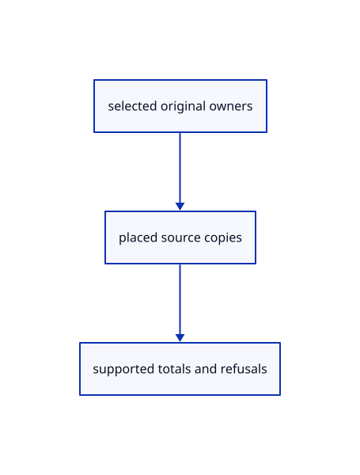

# 16.4.7 · Collect only supported finite original measurements

**Chapter 16 · Geometry editing and measurement · Section 16.4 · Solid volume, extension and Explode** · [Contents](contents.md)

**Typing: 22–43 minutes.** [Estimate](typing-load.md).

Transform temporary original copies and aggregate supported results. Track unsupported families and open solids separately.

## Type

Continue from [Report distance and world bounding lengths](84e-report-distance-and-world-bounding-lengths.md). [Save or recover your work](recovery.md).

### 1. `src/measure_mark.rs`

Collect original length, area and volume while keeping refusals explicit.

<details>
<summary>Locate the existing block</summary>

```rust
    BoundingLengths,
}
```

</details>

After that block, type:

```rust
--8<-- "journey/code/84f-collect-only-supported-finite-original-measurements-01.rs" skip=23
```

## Run and check

Run this from `session_viewer` to select the fixed dependency versions and install supplied binary assets. It updates Cargo.lock and preserves the previous lock. It does not write implementation code:

```sh
npm --prefix ../session_tests run course -- dependencies 16.4.7
```

In your project:

```sh
cd workspace/journey
REGEN_PROTO=0 cargo build --lib --locked --target wasm32-unknown-unknown -j1
REGEN_PROTO=0 CARGO_BUILD_JOBS=1 trunk serve --port 8780
```

Open `http://127.0.0.1:8780/`. Keep an existing Trunk server running; saving rebuilds it.


### Recorded visual result

**Previous native render — current verification pending.**

The original trimmed face and retained cutter remain visible.


*This recorded image predates a source or checker change. Rebuild this checkpoint before using it as current evidence; browser controls require separate acceptance.*

This reference image is shared with [16.3.1 · Split original faces without separating the solid](83-split-original-faces-without-separating-the-solid.md). It does not demonstrate a new feature by itself.

<details>
<summary>Code explanation and diagram</summary>


selected original owners → placed source copies → supported totals and refusals.



What happens when selection mixes curves with unsupported objects?

Supported originals contribute to the total; the result reports skipped objects. Released editable sources require Reload.

Study estimate, including typing and experiments: 0.5–1 hours.

</details>

<details>
<summary>Optional experiment</summary>

Trace selected-face ownership, original placement, finite result checks and open-solid names. No collection opens a history transaction.

</details>

<details>
<summary>Check and save your work</summary>

Restore experimental edits, then run from `session_viewer`:

```sh
npm --prefix ../session_tests run course -- check 16.4.7
npm --prefix ../session_tests run course -- save 16.4.7
```

Source comparison leaves your project untouched. [Save and recovery instructions](recovery.md).

</details>

<details>
<summary>Viewer coverage and verification</summary>


The preceding face-split contract remains authored and unrun. The final measurement contract adds actual point input, numeric values, transient annotations, Escape and one reversible original bounding box. Actual browser execution remains required.

[Full validation scope](release.md).

To reproduce the scripted acceptance of the reference checkpoint, run from `session_viewer` with the [course bundle server](release.md#reproduce) running on port 8781:

```sh
npm --prefix ../session_tests run course -- capture 16.4.7
```

This uses the verified reference bundle; it does not check or change your typed project.

</details>
