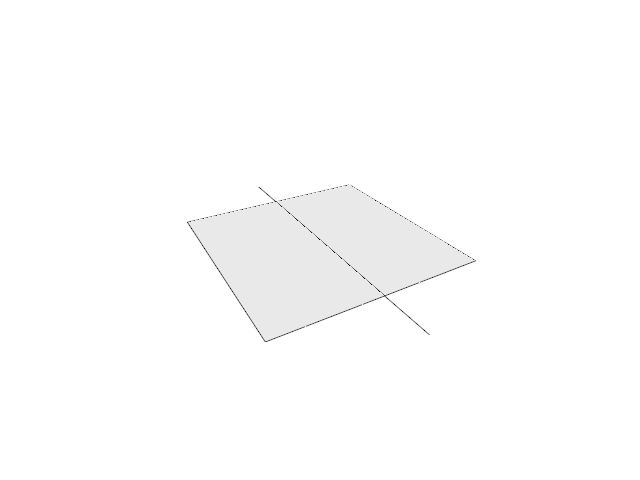
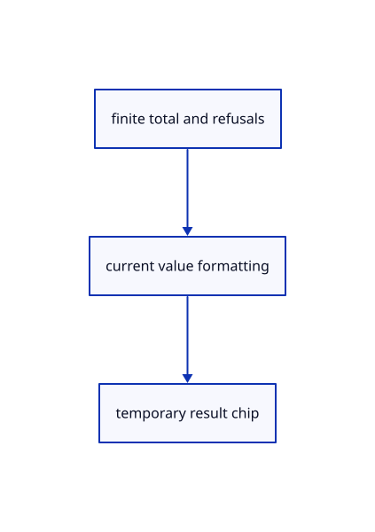

# 16.4.8 · Format totals refusals and three-axis box extents

**Chapter 16 · Geometry editing and measurement · Section 16.4 · Solid volume, extension and Explode** · [Contents](contents.md)

**Typing: 28–55 minutes.** [Estimate](typing-load.md).

Format values with current rounding and unit powers. Bound open-object names and attach one temporary value chip to the selected bounds.

## Type

Continue from [Collect only supported finite original measurements](84f-collect-only-supported-finite-original-measurements.md). [Save or recover your work](recovery.md).

### 1. `src/measure_mark.rs`

Report current formatted totals and world bounding lengths with bounded errors.

<details>
<summary>Locate the existing block</summary>

```rust
        Ok(result)
    }
}
```

</details>

Edit the existing block to match this code; keep unchanged lines:

```rust
--8<-- "journey/code/84g-format-totals-refusals-and-three-axis-box-extents-01.rs"
```

## Run and check

Run this from `session_viewer` to select the fixed dependency versions and install supplied binary assets. It updates Cargo.lock and preserves the previous lock. It does not write implementation code:

```sh
npm --prefix ../session_tests run course -- dependencies 16.4.8
```

In your project:

```sh
cd workspace/journey
REGEN_PROTO=0 cargo build --lib --locked --target wasm32-unknown-unknown -j1
REGEN_PROTO=0 CARGO_BUILD_JOBS=1 trunk serve --port 8780
```

Open `http://127.0.0.1:8780/`. Keep an existing Trunk server running; saving rebuilds it.


### Recorded visual result

**Previous native render — current verification pending.**

The original trimmed face and retained cutter remain visible.



*This recorded image predates a source or checker change. Rebuild this checkpoint before using it as current evidence; browser controls require separate acceptance.*

This reference image is shared with [16.3.1 · Split original faces without separating the solid](83-split-original-faces-without-separating-the-solid.md). It does not demonstrate a new feature by itself.

<details>
<summary>Code explanation and diagram</summary>


finite total and refusals → current value formatting → temporary result chip.



Should one open object erase a valid closed-object volume?

No. Report the measured closed total and separately name the refused open objects; an entirely unsupported selection returns an error.

Study estimate, including typing and experiments: 0.5–1 hours.

</details>

<details>
<summary>Optional experiment</summary>

Compare three-decimal and very small values, plural counts and skipped objects. More than three open names become three names plus a remaining count.

</details>

<details>
<summary>Check and save your work</summary>

Restore experimental edits, then run from `session_viewer`:

```sh
npm --prefix ../session_tests run course -- check 16.4.8
npm --prefix ../session_tests run course -- save 16.4.8
```

Source comparison leaves your project untouched. [Save and recovery instructions](recovery.md).

</details>

<details>
<summary>Viewer coverage and verification</summary>


The preceding face-split contract remains authored and unrun. The final measurement contract adds actual point input, numeric values, transient annotations, Escape and one reversible original bounding box. Actual browser execution remains required.

[Full validation scope](release.md).

To reproduce the scripted acceptance of the reference checkpoint, run from `session_viewer` with the [course bundle server](release.md#reproduce) running on port 8781:

```sh
npm --prefix ../session_tests run course -- capture 16.4.8
```

This uses the verified reference bundle; it does not check or change your typed project.

</details>
