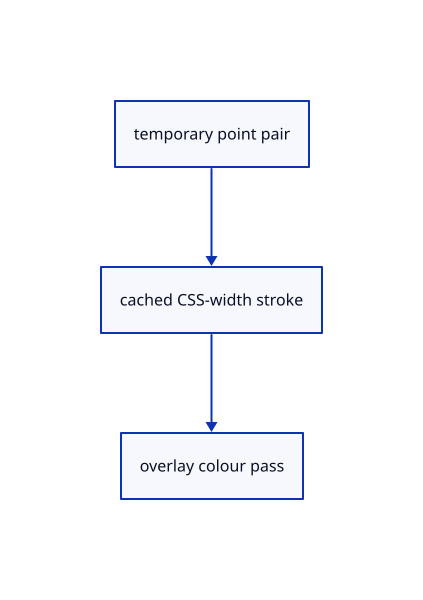

# 16.4.12 · Draw cached unpickable measurement strokes

**Chapter 16 · Geometry editing and measurement · Section 16.4 · Solid volume, extension and Explode** · [Contents](contents.md)

**Typing: 18–36 minutes.** [Estimate](typing-load.md).

Create a depth-independent overlay lane for temporary measurement segments. Reuse unchanged stroke allocation and keep it outside integer picks.

## Type

Continue from [Register measurements and end temporary marks predictably](84j-register-measurements-and-end-temporary-marks-predictably.md). [Save or recover your work](recovery.md).

### 1. `src/stroke_gpu.rs`

Add a colour-only overlay lane with explicit depth behaviour.

<details>
<summary>Locate the existing block</summary>

```rust
    }

    pub fn grid(device: &wgpu::Device, format: wgpu::TextureFormat) -> Self {
        Self::layout_depth(device, format, crate::stroke::SHADER, 44, 6,
```

</details>

Edit the existing block to match this code; keep unchanged lines:

```rust
--8<-- "journey/code/84k-draw-cached-unpickable-measurement-strokes-01.rs"
```

### 2. `src/measure_gpu.rs`

Cache unchanged marks and account for their actual stroke allocation.

Create the file and type:

```rust
--8<-- "journey/code/84k-draw-cached-unpickable-measurement-strokes-02.rs"
```

### 3. `src/lib.rs`

Register the measurement component.

<details>
<summary>Locate the existing block</summary>

```rust

pub mod measure_mark;
```

</details>

After that block, type:

```rust
--8<-- "journey/code/84k-draw-cached-unpickable-measurement-strokes-03.rs" skip=23
```

## Run and check

Run this from `session_viewer` to select the fixed dependency versions and install supplied binary assets. It updates Cargo.lock and preserves the previous lock. It does not write implementation code:

```sh
npm --prefix ../session_tests run course -- dependencies 16.4.12
```

In your project:

```sh
cd workspace/journey
REGEN_PROTO=0 cargo build --lib --locked --target wasm32-unknown-unknown -j1
REGEN_PROTO=0 CARGO_BUILD_JOBS=1 trunk serve --port 8780
```

Open `http://127.0.0.1:8780/`. Keep an existing Trunk server running; saving rebuilds it.


### Recorded visual result

**Previous native render — current verification pending.**

The original trimmed face and retained cutter remain visible.


*This recorded image predates a source or checker change. Rebuild this checkpoint before using it as current evidence; browser controls require separate acceptance.*

This reference image is shared with [16.3.1 · Split original faces without separating the solid](83-split-original-faces-without-separating-the-solid.md). It does not demonstrate a new feature by itself.

<details>
<summary>Code explanation and diagram</summary>


temporary point pair → cached CSS-width stroke → overlay colour pass.



Does the measurement line acquire a geometry pick address?

No. This overlay draws colour only. Its endpoints and value chip remain presentation data.

Study estimate, including typing and experiments: 0.5–1 hours.

</details>

<details>
<summary>Optional experiment</summary>

Inspect the 1.5 CSS-pixel width, Always depth comparison and disabled depth writes. Compare actual allocated bytes with used segments.

</details>

<details>
<summary>Check and save your work</summary>

Restore experimental edits, then run from `session_viewer`:

```sh
npm --prefix ../session_tests run course -- check 16.4.12
npm --prefix ../session_tests run course -- save 16.4.12
```

Source comparison leaves your project untouched. [Save and recovery instructions](recovery.md).

</details>

<details>
<summary>Viewer coverage and verification</summary>


The preceding face-split contract remains authored and unrun. The final measurement contract adds actual point input, numeric values, transient annotations, Escape and one reversible original bounding box. Actual browser execution remains required.

[Full validation scope](release.md).

To reproduce the scripted acceptance of the reference checkpoint, run from `session_viewer` with the [course bundle server](release.md#reproduce) running on port 8781:

```sh
npm --prefix ../session_tests run course -- capture 16.4.12
```

This uses the verified reference bundle; it does not check or change your typed project.

</details>
