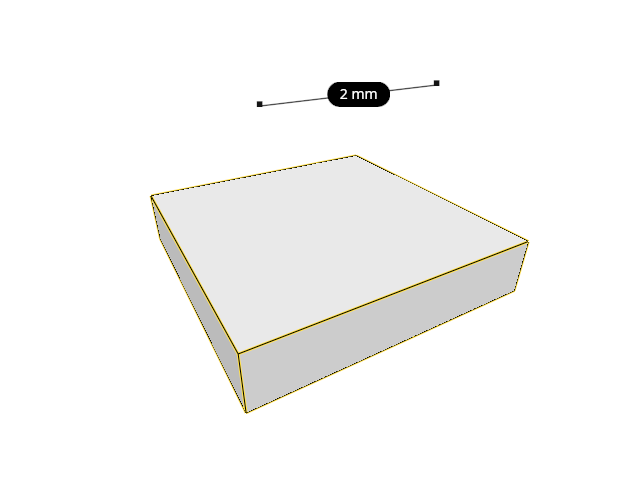

# 16.4.32 · Test crossing selection on original strokes

**Chapter 16 · Geometry editing and measurement · Section 16.4 · Solid volume, extension and Explode** · [Contents](contents.md)

**Typing: 24–48 minutes.** [Estimate](typing-load.md).

Dispatch original geometry families to their shared stroke builders. Crossing selection accepts an inside sample or a rectangle-crossing segment; cloud sampling remains bounded.

## Type

Continue from [Collect original boundary strokes](84znd-collect-original-boundary-strokes.md). [Save or recover your work](recovery.md).

### 1. `src/selection_region.rs`

Extend the existing original selection owner.

<details>
<summary>Locate the existing block</summary>

```rust
        if !(row >= 0.0 && (row as usize) < self.rows.len()) {
            return false;
        }

        self.rows[row as usize].partition_point(|x| *x < at.0) % 2 == 1
    }
}
```

</details>

After that block, type:

```rust
/// Whether `geometry`, its points projected by `project`, has a point inside the region or a stroke across its rectangle; None when only its box can tell.
pub(crate) fn touched(
    geometry: &Geometry,
    project: &dyn Fn([f64; 3]) -> Option<(f64, f64)>,
    region: &Region,
) -> Option<bool> {
    let strokes = strokes(geometry)?;
    let mut any = false;

    for stroke in &strokes {
        let points: Vec<Option<(f64, f64)>> = stroke.iter().map(|p| project(*p)).collect();

        if points.iter().flatten().any(|at| region.contains(*at)) {
            return Some(true);
        }

        for pair in points.windows(2) {
            if let [Some(a), Some(b)] = pair
                && region.crosses(*a, *b)
            {
                return Some(true);
            }
        }

        any |= !points.is_empty();
    }

    any.then_some(false)
}

/// The geometry as strokes in its own frame, each a run of points joined in order; None for a plane or a frame.
fn strokes(geometry: &Geometry) -> Option<Vec<Vec<[f64; 3]>>> {
    let strokes = match geometry {
        Geometry::Point(point) => vec![vec![xyz(point)]],
        Geometry::Line(line) => vec![vec![xyz(&line.start()), xyz(&line.end())]],
        Geometry::Polyline(polyline) => vec![
            polyline
                .coords
                .chunks_exact(3)
                .map(|c| [c[0], c[1], c[2]])
                .collect(),
        ],
        Geometry::NurbsCurve(curve) => vec![curve_samples(curve, CURVE_STEPS).collect()],
        Geometry::NurbsSurface(surface) => surface_strokes(surface, SURFACE_STEPS),
        Geometry::Mesh(mesh) => mesh_strokes(mesh),
        Geometry::BRep(brep) => brep_strokes(brep),
        Geometry::Element(element) => match element.geometry() {
            ElementGeometry::Mesh(mesh) => mesh_strokes(mesh),
            ElementGeometry::BRep(brep) => brep_strokes(brep),
            ElementGeometry::None => return None,
        },
        Geometry::PointCloud(cloud) => {
            let coords = cloud.coords();
            let step = (coords.len() / 3).div_ceil(CLOUD_SAMPLES).max(1);
            coords
                .chunks_exact(3)
                .step_by(step)
                .map(|c| vec![[c[0], c[1], c[2]]])
                .collect()
        }
        Geometry::Plane(_) | Geometry::OBB(_) => return None,
    };

    Some(strokes)
}
```

<details>
<summary>Optional patch references</summary>

Use these original edit fragments when comparing a saved checkpoint. Apply the complete blocks above.

```text
--8<-- "journey/code/84zne-test-crossing-selection-on-original-strokes-1.rs"
```

</details>

## Run and check

Run this from `session_viewer` to select the fixed dependency versions and install supplied binary assets. It updates Cargo.lock and preserves the previous lock. It does not write implementation code:

```sh
npm --prefix ../session_tests run course -- dependencies 16.4.32
```

In your project:

```sh
cd workspace/journey
REGEN_PROTO=0 cargo build --lib --locked --target wasm32-unknown-unknown -j1
REGEN_PROTO=0 CARGO_BUILD_JOBS=1 trunk serve --port 8780
```

Open `http://127.0.0.1:8780/`. Keep an existing Trunk server running; saving rebuilds it.


### Recorded visual result

**Previous native render — current verification pending.**



*This recorded image predates a source or checker change. Rebuild this checkpoint before using it as current evidence; browser controls require separate acceptance.*

This reference image is shared with [16.4.15 · Describe removable CAD parts](84zza-describe-removable-cad-parts.md). It does not demonstrate a new feature by itself.

<details>
<summary>Code explanation and diagram</summary>


original CAD samples → screen region → window or crossing result.


Why project each stroke before testing adjacent points?

Membership and crossing use screen pixels, while original geometry and its placements stay in world coordinates.

Study estimate, including typing and experiments: 0.8–1 hours.

</details>

<details>
<summary>Optional experiment</summary>

Trace a projected curve that crosses a rectangle although every sampled point lies outside. The browser connection is taught after these helpers.

</details>

<details>
<summary>Check and save your work</summary>

Restore experimental edits, then run from `session_viewer`:

```sh
npm --prefix ../session_tests run course -- check 16.4.32
npm --prefix ../session_tests run course -- save 16.4.32
```

Source comparison leaves your project untouched. [Save and recovery instructions](recovery.md).

</details>
