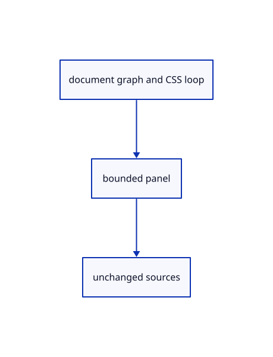

# 16.5.28 · Expose graph links and the lasso overlay

**Chapter 16 · Geometry editing and measurement · Section 16.5 · Text, styles and command integration** · [Contents](contents.md)

**Typing: 25–49 minutes.** [Estimate](typing-load.md).

Expose graph links and the lasso overlay.

## Type

Continue from [Connect cached guide and placed grid lanes](85z-connect-cached-guide-and-placed-grid-lanes.md). [Save or recover your work](recovery.md).

### 1. `src/tree_panel.rs`

Present existing graph and pointer state without editing originals.

Edit these blocks from bottom to top. Keep the surrounding lines unchanged.

<details>
<summary>Locate this block</summary>

```rust
        egui::Frame::group(ui.style()).fill(egui::Color32::from_rgb(248,248,248)).show(ui,|ui| {
            ui.set_width((root.available_width()/3.).clamp(240.,413.33334));ui.set_height((root.max_rect().height()-32.).max(60.));ui.horizontal(|ui| {ui.strong("Layers");let close=ui.button("×");record(controls,"tree/close","Close Layers",&close);if close.clicked() {model.open=false;}});
            dialogs(ui,model,controls);
            if pages>1 {ui.horizontal(|ui| {if ui.button("Previous").clicked() {model.page=model.page.saturating_sub(1);}ui.label(format!("{} / {pages}",model.page+1));if ui.button("Next").clicked() {model.page=(model.page+1).min(pages-1);}});}
            let height=(root.max_rect().height()-100.).max(60.);
            egui::ScrollArea::vertical().max_height(height).show(ui,|ui| {
```

</details>

Replace it with:

```rust
        egui::Frame::group(ui.style()).fill(egui::Color32::from_rgb(248,248,248)).show(ui,|ui| {
            ui.set_width((root.available_width()/3.).clamp(240.,413.33334));ui.set_height((root.max_rect().height()-32.).max(60.));ui.horizontal(|ui| {ui.strong("Layers");let close=ui.button("×");record(controls,"tree/close","Close Layers",&close);if close.clicked() {model.open=false;}});
            dialogs(ui,model,controls);
            ui.horizontal(|ui|{let button=ui.selectable_label(model.graph_open,format!("Graph ({})",model.graph.len()));record(controls,"tree/graph","Graph",&button);if button.clicked(){model.graph_open=!model.graph_open;}});
            if model.graph_open{egui::ScrollArea::vertical().id_salt("graph-table").max_height(150.).show(ui,|ui|{egui::Grid::new("graph-edges").striped(true).show(ui,|ui|{for title in ["Document","From","To","Attribute"]{ui.strong(title);}ui.end_row();for(doc,from,to,attribute)in model.graph.iter().take(128){for word in [doc,from,to,attribute]{ui.label(word);}ui.end_row();}});if model.graph.len()>128{ui.label(format!("Showing first 128 of {} edges",model.graph.len()));}});}
            if pages>1 {ui.horizontal(|ui| {if ui.button("Previous").clicked() {model.page=model.page.saturating_sub(1);}ui.label(format!("{} / {pages}",model.page+1));if ui.button("Next").clicked() {model.page=(model.page+1).min(pages-1);}});}
            let height=(root.max_rect().height()-100.).max(60.);
            egui::ScrollArea::vertical().max_height(height).show(ui,|ui| {
```

<details>
<summary>Locate this block</summary>

```rust
use std::collections::HashSet;

#[derive(Default)]
pub struct TreePanel {pub edit:Option<(String,crate::layer_edit::Edit)>,pub rename:Option<(String,String)>,pub rename_error:String,rename_focus:bool,pub confirm:Option<(String,usize)>,pub property:Option<(String,crate::layer_properties::Property)>,pub menu_rects:Vec<egui::Rect>,states:std::collections::HashMap<String,RowState>,pub open:bool,pub rows:Vec<Row>,pub selected:Vec<ObjectId>,expanded:HashSet<String>,pub rect:Option<egui::Rect>,pub action:Option<(Vec<ObjectId>,bool)>,page:usize}
impl TreePanel {
    pub fn refresh(&mut self,scene:&crate::scene::Scene,selected:Vec<ObjectId>) {
        self.rows=crate::hierarchy::rows(scene);self.selected=selected;self.states=self.rows.iter().map(|row|(row.key.clone(),RowState {hidden:scene.view.lamps.contains(&row.key)||!row.ids.is_empty()&&row.ids.iter().all(|id|scene.view.hidden.contains(id)),locked:!row.ids.is_empty()&&row.ids.iter().all(|id|scene.view.locked.contains(id)),selectable:row.ids.iter().any(|id|scene.pick_id(id.value()).is_some()),current:crate::layer_edit::current_key(scene).as_ref()==Some(&row.key),has_faces:row.ids.iter().any(|id|scene.objects().iter().any(|mesh|mesh.id==*id)),colours:[row.ids.iter().find_map(|id|scene.view.faces.get(id).copied()),row.ids.iter().find_map(|id|scene.view.edges.get(id).copied())],group:crate::layer_edit::locate(scene,&row.key).is_ok(),root:row.depth==0,holds_current:crate::layer_edit::holds_current(scene,&row.key)})).collect();
    }
    pub fn rename_result(&mut self,error:Option<&str>) {if let Some(error)=error {self.rename_error=error.into();self.rename_focus=true;} else {self.rename=None;self.rename_error.clear();}}
```

</details>

Replace it with:

```rust
use std::collections::HashSet;

#[derive(Default)]
pub struct TreePanel {pub graph_open:bool,pub graph:Vec<(String,String,String,String)>,pub edit:Option<(String,crate::layer_edit::Edit)>,pub rename:Option<(String,String)>,pub rename_error:String,rename_focus:bool,pub confirm:Option<(String,usize)>,pub property:Option<(String,crate::layer_properties::Property)>,pub menu_rects:Vec<egui::Rect>,states:std::collections::HashMap<String,RowState>,pub open:bool,pub rows:Vec<Row>,pub selected:Vec<ObjectId>,expanded:HashSet<String>,pub rect:Option<egui::Rect>,pub action:Option<(Vec<ObjectId>,bool)>,page:usize}
impl TreePanel {
    pub fn refresh(&mut self,scene:&crate::scene::Scene,selected:Vec<ObjectId>) {
        self.graph=crate::graph_edit::rows(scene);
        for doc in &scene.forest.documents{for(index,node)in doc.nodes.iter().enumerate(){if scene.groups.contains(&(doc.key,node.source.guid.clone()))&&doc.nodes[index+1..node.end].iter().filter_map(|n|n.object).any(|id|selected.contains(&id)){let mut parent=Some(index);while let Some(i)=parent{self.expanded.insert(format!("{}/{}",doc.key,doc.nodes[i].source.guid));parent=doc.nodes[i].parent;}}}}
        self.rows=crate::hierarchy::rows(scene);self.selected=selected;self.states=self.rows.iter().map(|row|(row.key.clone(),RowState {hidden:scene.view.lamps.contains(&row.key)||!row.ids.is_empty()&&row.ids.iter().all(|id|scene.view.hidden.contains(id)),locked:!row.ids.is_empty()&&row.ids.iter().all(|id|scene.view.locked.contains(id)),selectable:row.ids.iter().any(|id|scene.pick_id(id.value()).is_some()),current:crate::layer_edit::current_key(scene).as_ref()==Some(&row.key),has_faces:row.ids.iter().any(|id|scene.objects().iter().any(|mesh|mesh.id==*id)),colours:[row.ids.iter().find_map(|id|scene.view.faces.get(id).copied()),row.ids.iter().find_map(|id|scene.view.edges.get(id).copied())],group:crate::layer_edit::locate(scene,&row.key).is_ok(),root:row.depth==0,holds_current:crate::layer_edit::holds_current(scene,&row.key)})).collect();
    }
    pub fn rename_result(&mut self,error:Option<&str>) {if let Some(error)=error {self.rename_error=error.into();self.rename_focus=true;} else {self.rename=None;self.rename_error.clear();}}
```

<details>
<summary>Complete updated block reference</summary>

```rust
use crate::{hierarchy::Row,scene::ObjectId};
#[cfg(any(test,target_arch="wasm32"))]
use crate::command_dock::{Control,record};
use std::collections::HashSet;

#[derive(Default)]
pub struct TreePanel {pub graph_open:bool,pub graph:Vec<(String,String,String,String)>,pub edit:Option<(String,crate::layer_edit::Edit)>,pub rename:Option<(String,String)>,pub rename_error:String,rename_focus:bool,pub confirm:Option<(String,usize)>,pub property:Option<(String,crate::layer_properties::Property)>,pub menu_rects:Vec<egui::Rect>,states:std::collections::HashMap<String,RowState>,pub open:bool,pub rows:Vec<Row>,pub selected:Vec<ObjectId>,expanded:HashSet<String>,pub rect:Option<egui::Rect>,pub action:Option<(Vec<ObjectId>,bool)>,page:usize}
impl TreePanel {
    pub fn refresh(&mut self,scene:&crate::scene::Scene,selected:Vec<ObjectId>) {
        self.graph=crate::graph_edit::rows(scene);
        for doc in &scene.forest.documents{for(index,node)in doc.nodes.iter().enumerate(){if scene.groups.contains(&(doc.key,node.source.guid.clone()))&&doc.nodes[index+1..node.end].iter().filter_map(|n|n.object).any(|id|selected.contains(&id)){let mut parent=Some(index);while let Some(i)=parent{self.expanded.insert(format!("{}/{}",doc.key,doc.nodes[i].source.guid));parent=doc.nodes[i].parent;}}}}
        self.rows=crate::hierarchy::rows(scene);self.selected=selected;self.states=self.rows.iter().map(|row|(row.key.clone(),RowState {hidden:scene.view.lamps.contains(&row.key)||!row.ids.is_empty()&&row.ids.iter().all(|id|scene.view.hidden.contains(id)),locked:!row.ids.is_empty()&&row.ids.iter().all(|id|scene.view.locked.contains(id)),selectable:row.ids.iter().any(|id|scene.pick_id(id.value()).is_some()),current:crate::layer_edit::current_key(scene).as_ref()==Some(&row.key),has_faces:row.ids.iter().any(|id|scene.objects().iter().any(|mesh|mesh.id==*id)),colours:[row.ids.iter().find_map(|id|scene.view.faces.get(id).copied()),row.ids.iter().find_map(|id|scene.view.edges.get(id).copied())],group:crate::layer_edit::locate(scene,&row.key).is_ok(),root:row.depth==0,holds_current:crate::layer_edit::holds_current(scene,&row.key)})).collect();
    }
    pub fn rename_result(&mut self,error:Option<&str>) {if let Some(error)=error {self.rename_error=error.into();self.rename_focus=true;} else {self.rename=None;self.rename_error.clear();}}
    pub fn all(&mut self) {self.open=true;self.expanded.extend(self.rows.iter().enumerate().filter(|(index,r)|r.end>*index+1).map(|(_,r)|r.key.clone()));self.page=0;}
    pub fn visible(&self)->Vec<usize> {
        let mut out=Vec::new();let mut index=0;
        while index<self.rows.len() {out.push(index);let row=&self.rows[index];index=if self.expanded.contains(&row.key) {index+1} else {row.end.max(index+1)};}
        out
    }
}

#[cfg(any(test,target_arch="wasm32"))]
pub fn draw(root:&mut egui::Ui,model:&mut TreePanel,controls:&mut Option<Vec<Control>>) {
    model.rect=None;model.menu_rects.clear();if !model.open {return;}
    let visible=model.visible();let pages=visible.len().div_ceil(128).max(1);model.page=model.page.min(pages-1);
    let response=egui::Area::new("session-tree".into()).anchor(egui::Align2::RIGHT_TOP,egui::vec2(-8.,8.)).order(egui::Order::Foreground).show(root.ctx(),|ui| {
        egui::Frame::group(ui.style()).fill(egui::Color32::from_rgb(248,248,248)).show(ui,|ui| {
            ui.set_width((root.available_width()/3.).clamp(240.,413.33334));ui.set_height((root.max_rect().height()-32.).max(60.));ui.horizontal(|ui| {ui.strong("Layers");let close=ui.button("×");record(controls,"tree/close","Close Layers",&close);if close.clicked() {model.open=false;}});
            dialogs(ui,model,controls);
            ui.horizontal(|ui|{let button=ui.selectable_label(model.graph_open,format!("Graph ({})",model.graph.len()));record(controls,"tree/graph","Graph",&button);if button.clicked(){model.graph_open=!model.graph_open;}});
            if model.graph_open{egui::ScrollArea::vertical().id_salt("graph-table").max_height(150.).show(ui,|ui|{egui::Grid::new("graph-edges").striped(true).show(ui,|ui|{for title in ["Document","From","To","Attribute"]{ui.strong(title);}ui.end_row();for(doc,from,to,attribute)in model.graph.iter().take(128){for word in [doc,from,to,attribute]{ui.label(word);}ui.end_row();}});if model.graph.len()>128{ui.label(format!("Showing first 128 of {} edges",model.graph.len()));}});}
            if pages>1 {ui.horizontal(|ui| {if ui.button("Previous").clicked() {model.page=model.page.saturating_sub(1);}ui.label(format!("{} / {pages}",model.page+1));if ui.button("Next").clicked() {model.page=(model.page+1).min(pages-1);}});}
            let height=(root.max_rect().height()-100.).max(60.);
            egui::ScrollArea::vertical().max_height(height).show(ui,|ui| {
                for &index in visible.iter().skip(model.page*128).take(128) {
                    let row=model.rows[index].clone();let state=model.states.get(&row.key).copied().unwrap_or_default();ui.push_id(&row.key,|ui|ui.horizontal(|ui| {
                        ui.add_space(row.depth.min(12) as f32*12.);
                        if row.end>index+1 {let arrow=ui.small_button(if model.expanded.contains(&row.key) {"▾"} else {"▸"});record(controls,&format!("tree/open/{}",row.key),"Expand or collapse",&arrow);if arrow.clicked() {if !model.expanded.insert(row.key.clone()) {model.expanded.remove(&row.key);}}} else {ui.add_space(18.);}
                        let selected=row.ids.iter().any(|id|model.selected.contains(id));
                        let label=if row.label.is_empty() {row.ids.first().map_or("Group".into(),|id|format!("Object {}",id.value()))} else {row.label.clone()};
                        let label_width=(ui.available_width()-90.).max(24.);
                        let button=ui.add_enabled_ui(state.group || !row.readonly && state.selectable,|ui|ui.add_sized([label_width,20.],egui::Button::new(format!("{label} ({})",row.ids.len())).selected(selected).truncate())).inner.on_hover_text(&label).on_disabled_hover_text("Source attribute: read only; edit its parent");
                        record(controls,&format!("tree/select/{}",row.key),&label,&button);
                        if button.clicked() && state.selectable {model.action=Some((row.ids.clone(),ui.input(|input|input.modifiers.shift)));}
                        if state.group {if let Some(menu)=egui::Popup::context_menu(&button).show(|ui| {
                            use crate::layer_edit::Edit;
                            for (name,edit,enabled) in [("Set current",Some(Edit::Current),true),("New layer",Some(Edit::New {sublayer:false}),true),("New sublayer",Some(Edit::New {sublayer:true}),true),("Duplicate layer",Some(Edit::Duplicate),!state.root),("Change object layer",Some(Edit::Move(model.selected.clone())),!model.selected.is_empty()),("Copy object layer",Some(Edit::Copy(model.selected.clone())),!model.selected.is_empty()),("Rename",None,!state.root),("Delete",Some(Edit::Delete),!state.root&&!state.holds_current)] {
                                let button=ui.add_enabled(enabled,egui::Button::new(name));record(controls,&format!("layer/menu/{}/{name}",row.key),name,&button);
                                if button.clicked() {
                                    if name=="Rename" {model.rename=Some((row.key.clone(),row.label.clone()));model.rename_error.clear();model.rename_focus=true;}
                                    else if name=="Delete"&&!row.ids.is_empty() {model.confirm=Some((row.key.clone(),row.ids.len()));}
                                    else {model.edit=Some((row.key.clone(),edit.unwrap()));}
                                    ui.close();
                                }
                            }
                        }) {model.menu_rects.push(menu.response.rect);}}
                        properties(ui,&row.key,state,&mut model.property,&mut model.menu_rects,controls);
                    }));
                }
            });
        });
    });model.rect=model.open.then_some(response.response.rect);
}

#[derive(Clone,Copy,Default)]
struct RowState {hidden:bool,locked:bool,selectable:bool,current:bool,has_faces:bool,colours:[Option<[u8;3]>;2],group:bool,root:bool,holds_current:bool}

#[cfg(any(test,target_arch="wasm32"))]
fn properties(ui:&mut egui::Ui,key:&str,state:RowState,action:&mut Option<(String,crate::layer_properties::Property)>,menus:&mut Vec<egui::Rect>,controls:&mut Option<Vec<Control>>) {
    use crate::layer_properties::Property;
    for (name,label,property,enabled) in [("hide",if state.current {"✓"} else if state.hidden {"○"} else {"●"},Property::Hidden(!state.hidden),!state.current),("lock",if state.locked {"🔒"} else {"🔓"},Property::Locked(!state.locked),true)] {
        let button=ui.add_enabled(enabled,egui::Button::new(label)).on_hover_text(if name=="hide" {"Switch this row’s lamp; preserve the children’s own lamps"} else {"Lock or unlock selection of this row and children"});record(controls,&format!("layer/{name}/{key}"),name,&button);
        if button.clicked() {*action=Some((key.to_owned(),property));}
    }
    let button=ui.button("■").on_hover_text("Object colours; Faces and Edges are independent");record(controls,&format!("layer/colour/{key}"),"Colour",&button);
    if let Some(menu)=egui::Popup::menu(&button).close_behavior(egui::PopupCloseBehavior::CloseOnClickOutside).show(|ui| {
        let channel_id=egui::Id::new(("layer-colour-channel",key));
        let mut edge=ui.ctx().data_mut(|data|data.get_temp::<bool>(channel_id).unwrap_or(false))&&state.has_faces;
        if state.has_faces {ui.horizontal(|ui| {for (name,value) in [("Faces",false),("Edges",true)] {let button=ui.selectable_label(edge==value,name);record(controls,&format!("layer/channel/{key}/{name}"),name,&button);if button.clicked() {edge=value;}}});} else {ui.label("Object and child colours");}
        ui.ctx().data_mut(|data|data.insert_temp(channel_id,edge));
        let original=ui.button("Original");record(controls,&format!("layer/original/{key}/{edge}"),"Original",&original);if original.clicked() {*action=Some((key.to_owned(),Property::Colour {edge,rgb:None}));ui.close();}
        if let Some(rgb)=crate::layer_palette::draw(ui,key,edge,state.colours[usize::from(edge)],controls) {*action=Some((key.to_owned(),Property::Colour {edge,rgb:Some(rgb)}));}
    }) {menus.push(menu.response.rect);}
}

#[cfg(any(test,target_arch="wasm32"))]
fn dialogs(ui:&mut egui::Ui,model:&mut TreePanel,controls:&mut Option<Vec<Control>>) {
    if let Some((key,text))=model.rename.as_mut() {
        let id=egui::Id::new("layer-name-input");
        if std::mem::take(&mut model.rename_focus) {ui.memory_mut(|memory|memory.request_focus(id));}
        let cancel=ui.input_mut(|input|input.consume_key(egui::Modifiers::NONE,egui::Key::Escape));
        let mut submit=ui.input_mut(|input|input.consume_key(egui::Modifiers::NONE,egui::Key::Enter));
        ui.horizontal(|ui| {let field=ui.add(egui::TextEdit::singleline(text).id(id).char_limit(128).desired_width(130.));record(controls,"layer/name","Layer name",&field);let apply=ui.button("Rename");record(controls,"layer/name/apply","Rename",&apply);submit|=apply.clicked();});
        if !model.rename_error.is_empty() {ui.colored_label(egui::Color32::from_rgb(170,30,30),&model.rename_error);}
        if submit {model.edit=Some((key.clone(),crate::layer_edit::Edit::Rename(text.clone())));}
        if cancel {model.rename=None;model.rename_error.clear();ui.memory_mut(|memory|memory.surrender_focus(id));}
    }
    if let Some((key,count))=model.confirm.clone() {
        ui.label(format!("Delete this layer and {count} objects?"));
        ui.horizontal(|ui| {for (name,yes) in [("Delete",true),("Cancel",false)] {let button=ui.button(name);record(controls,&format!("layer/delete/{name}"),name,&button);if button.clicked() {if yes {model.edit=Some((key.clone(),crate::layer_edit::Edit::Delete));}model.confirm=None;}}});
    }
}
```

</details>

<details>
<summary>Optional patch references</summary>

Use these original edit fragments when comparing a saved checkpoint. Apply the complete blocks above.

```text
--8<-- "journey/code/85aa-expose-graph-links-and-the-lasso-overlay-01.rs"
```

```text
--8<-- "journey/code/85aa-expose-graph-links-and-the-lasso-overlay-02.rs"
```

</details>

### 2. `src/panel.rs`

Present existing graph and pointer state without editing originals.

Edit these blocks from bottom to top. Keep the surrounding lines unchanged.

<details>
<summary>Locate this block</summary>

```rust
        self.controls = Some(Vec::new());
        let mut line = None;
        let output = self.context.run_ui(input, |root| {
            if let Some(rectangle)=self.rectangle {
                let painter=root.ctx().layer_painter(egui::LayerId::new(egui::Order::Middle,egui::Id::new("selection-rectangle")));
                let [x0,y0,x1,y1]=rectangle.bounds.map(|v|v as f32);let rect=egui::Rect::from_min_max(egui::pos2(x0,y0),egui::pos2(x1,y1));
```

</details>

Replace it with:

```rust
        self.controls = Some(Vec::new());
        let mut line = None;
        let output = self.context.run_ui(input, |root| {
            if self.lasso.len()>1{let painter=root.ctx().layer_painter(egui::LayerId::new(egui::Order::Middle,egui::Id::new("selection-lasso")));for pair in self.lasso.iter().copied().chain(self.lasso.first().copied()).collect::<Vec<_>>().windows(2){painter.line_segment([egui::pos2(pair[0][0],pair[0][1]),egui::pos2(pair[1][0],pair[1][1])],egui::Stroke::new(1.5,egui::Color32::from_rgb(30,110,170)));}}
            if let Some(rectangle)=self.rectangle {
                let painter=root.ctx().layer_painter(egui::LayerId::new(egui::Order::Middle,egui::Id::new("selection-rectangle")));
                let [x0,y0,x1,y1]=rectangle.bounds.map(|v|v as f32);let rect=egui::Rect::from_min_max(egui::pos2(x0,y0),egui::pos2(x1,y1));
```

<details>
<summary>Locate this block</summary>

```rust
        // One layout pass prevents a future text event from being replayed.
        context.options_mut(|options| options.max_passes = 1.try_into().unwrap());
        let painter = egui_wgpu::Renderer::new(&renderer.device, format, Default::default());
        Self { rectangle:None,tree:Default::default(), number:Default::default(), commands: Commands(commands), consumed: false, pointer_owned: false, top: f32::INFINITY, controls: None, context, painter, events: Vec::new(), output: None,
            screen: egui_wgpu::ScreenDescriptor { size_in_pixels: [640, 480], pixels_per_point: 1.0 }, model: CommandLine {
            focus_command: true,
            ..Default::default()
```

</details>

Replace it with:

```rust
        // One layout pass prevents a future text event from being replayed.
        context.options_mut(|options| options.max_passes = 1.try_into().unwrap());
        let painter = egui_wgpu::Renderer::new(&renderer.device, format, Default::default());
        Self { lasso:Vec::new(),rectangle:None,tree:Default::default(), number:Default::default(), commands: Commands(commands), consumed: false, pointer_owned: false, top: f32::INFINITY, controls: None, context, painter, events: Vec::new(), output: None,
            screen: egui_wgpu::ScreenDescriptor { size_in_pixels: [640, 480], pixels_per_point: 1.0 }, model: CommandLine {
            focus_command: true,
            ..Default::default()
```

<details>
<summary>Locate this block</summary>

```rust
}

pub struct Panel {
    pub rectangle:Option<crate::rect_select::Rectangle>,
    pub tree:crate::tree_panel::TreePanel,
    number:crate::number_box::NumberBox,
```

</details>

Replace it with:

```rust
}

pub struct Panel {
    pub lasso:Vec<[f32;2]>,
    pub rectangle:Option<crate::rect_select::Rectangle>,
    pub tree:crate::tree_panel::TreePanel,
    number:crate::number_box::NumberBox,
```

<details>
<summary>Complete updated block reference</summary>

```rust
use crate::command_dock::{self, CommandLine, Commands as _, theme};
use crate::renderer::Renderer;

struct Commands(Vec<&'static str>);

impl command_dock::Commands for Commands {
    fn canonical(&self, line: &str) -> String {
        crate::commands::canonical(line)
    }
    fn choosing_option(&self, _: &str) -> bool {
        false
    }
    fn accept(&self, line: &str) -> (String, bool) {
        (self.canonical(line), true)
    }
    fn completions(&self, line: &str) -> Vec<&'static str> {
        crate::command_vocabulary::ranked(self.0.as_ref(), line)
    }
    fn browse(&self, line: &str) -> Vec<&'static str> {
        self.completions(line)
    }
}

pub struct Panel {
    pub lasso:Vec<[f32;2]>,
    pub rectangle:Option<crate::rect_select::Rectangle>,
    pub tree:crate::tree_panel::TreePanel,
    number:crate::number_box::NumberBox,
    commands: Commands,
    pub consumed: bool,
    pointer_owned: bool,
    top: f32,
    controls: Option<Vec<command_dock::Control>>,
    context: egui::Context,
    painter: egui_wgpu::Renderer,
    model: CommandLine,
    events: Vec<egui::Event>,
    output: Option<egui::FullOutput>,
    screen: egui_wgpu::ScreenDescriptor,
}

impl Panel {
    pub fn new(renderer: &Renderer, format: wgpu::TextureFormat, commands: Vec<&'static str>) -> Self {
        let context = egui::Context::default();
        context.set_fonts(theme::fonts([
            include_bytes!("../assets/text/NotoSans-Regular.subset.ttf"),
            include_bytes!("../assets/text/NotoSansSymbols2-Regular.subset.ttf"),
            include_bytes!("../assets/text/NotoSansSymbols-Regular.subset.ttf"),
        ]));
        context.set_theme(egui::Theme::Light);
        context.set_visuals(theme::visuals());
        // One layout pass prevents a future text event from being replayed.
        context.options_mut(|options| options.max_passes = 1.try_into().unwrap());
        let painter = egui_wgpu::Renderer::new(&renderer.device, format, Default::default());
        Self { lasso:Vec::new(),rectangle:None,tree:Default::default(), number:Default::default(), commands: Commands(commands), consumed: false, pointer_owned: false, top: f32::INFINITY, controls: None, context, painter, events: Vec::new(), output: None,
            screen: egui_wgpu::ScreenDescriptor { size_in_pixels: [640, 480], pixels_per_point: 1.0 }, model: CommandLine {
            focus_command: true,
            ..Default::default()
        } }
    }

    pub fn number(&mut self,prompt:Option<crate::number_box::NumberPrompt>) {
        if prompt.is_some() {self.model.focus_command=false;}
        else if self.number.number_prompt.is_some() {self.context.memory_mut(|m|m.surrender_focus(egui::Id::new("number-input")));}
        self.number.set(prompt);
    }

    pub fn tool(&mut self, prompt: String, options: Vec<(String, String)>) {
        self.model.drawing_prompt = prompt; self.model.options = options;
        if self.model.options.is_empty() { self.model.options_rect = None; }
        if !self.model.options.is_empty() { self.model.completion_visible = false; self.model.inline_suffix = false; }
    }

    pub fn cancel_input(&mut self) {
        self.model.command.clear(); self.model.completion_visible = false; self.model.inline_suffix = false;
        self.model.command_open = false; self.model.focus_command = false;
        self.context.memory_mut(|memory| memory.surrender_focus(egui::Id::new("command-input")));
    }

    pub fn repeat_line(&self)->Option<String> {
        if !self.model.command.trim().is_empty() {return Some(self.model.command.clone());}
        self.model.history.iter().rev().find_map(|line|line.strip_prefix("> ").and_then(|line|line.lines().next()).map(str::to_owned))
    }

    pub fn command(&self) -> &str { &self.model.command }

    pub fn history(&self) -> &std::collections::VecDeque<String> { &self.model.history }

    pub fn shortcut(&self, event: &web_sys::KeyboardEvent) -> Option<crate::shortcuts::Shortcut> {
        if self.number.number_prompt.is_some() || event.type_() != "keydown" || event.repeat() { return None; }
        crate::shortcuts::context_key(&self.context,&self.model.command,&event.key(),event.ctrl_key()||event.meta_key(),event.shift_key(),event.alt_key(),event.is_composing())
    }

    pub fn key(&mut self, event: &web_sys::KeyboardEvent) -> bool {

        if event.is_composing() { return false; }
        let modifiers = egui::Modifiers {
            alt: event.alt_key(), ctrl: event.ctrl_key(), shift: event.shift_key(),
            mac_cmd: event.meta_key(), command: event.ctrl_key() || event.meta_key(),
        };
        let text = event.type_() == "keydown" && event.key().chars().count() == 1
            && !modifiers.command && !modifiers.alt;
        if text && (!self.context.egui_wants_keyboard_input() || self.number.number_prompt.is_some()) {
            let number=self.number.number_prompt.is_some();
            if !self.context.egui_wants_keyboard_input() && !number { self.model.focus_command=true; }
            self.context.memory_mut(|memory|memory.request_focus(egui::Id::new(if number {"number-input"} else {"command-input"})));
            if !number {self.model.command_open=true;}
        }
        if !self.context.egui_wants_keyboard_input() { return false; }
        if let Some(key) = egui::Key::from_name(&event.key()) {
            self.events.push(egui::Event::Key {
                key, physical_key: None, pressed: event.type_() == "keydown",
                repeat: event.repeat(), modifiers,
            });
        }
        if text { self.events.push(egui::Event::Text(event.key())); }
        event.prevent_default();
        true
    }

    pub fn pointer(&mut self, event: &web_sys::PointerEvent, canvas: &web_sys::HtmlCanvasElement) -> bool {
        let rect = canvas.get_bounding_client_rect();
        let pos = egui::pos2((event.client_x() as f64 - rect.left()) as f32, (event.client_y() as f64 - rect.top()) as f32);
        let over = (self.tree.rect.is_some_and(|r|r.contains(pos)) || self.tree.menu_rects.iter().any(|r|r.contains(pos))) || self.number.number_rect.is_some_and(|r|r.contains(pos)) || pos.y >= self.top || (self.model.completion_rect.is_some_and(|r| r.contains(pos)) || self.model.options_rect.is_some_and(|r| r.contains(pos)));
        let owned = over || self.pointer_owned;
        if event.type_() == "pointerdown" {
            self.pointer_owned = over;
            if !over {
                self.model.command_open = false;
                self.model.focus_command = false;
                self.context.memory_mut(|memory| memory.surrender_focus(egui::Id::new("command-input")));
            }
        }
        self.events.push(egui::Event::PointerMoved(pos));
        if matches!(event.type_().as_str(), "pointercancel" | "lostpointercapture") {
            for button in [egui::PointerButton::Primary, egui::PointerButton::Middle, egui::PointerButton::Secondary] {
                self.events.push(egui::Event::PointerButton { pos, button, pressed: false, modifiers: Default::default() });
            }
            self.events.push(egui::Event::PointerGone);
        } else if matches!(event.type_().as_str(), "pointerdown" | "pointerup") {
            let button = match event.button() { 0 => egui::PointerButton::Primary, 1 => egui::PointerButton::Middle, _ => egui::PointerButton::Secondary };
            self.events.push(egui::Event::PointerButton { pos, button, pressed: event.type_() == "pointerdown", modifiers: Default::default() });
        }
        if matches!(event.type_().as_str(), "pointerup" | "pointercancel" | "lostpointercapture") { self.pointer_owned = false; }
        if owned { event.prevent_default(); }
        owned
    }

    pub fn wheel(&mut self, event: &web_sys::WheelEvent, canvas: &web_sys::HtmlCanvasElement) -> bool {
        let rect = canvas.get_bounding_client_rect();
        let pos = egui::pos2((event.client_x() as f64 - rect.left()) as f32, (event.client_y() as f64 - rect.top()) as f32);
        self.events.push(egui::Event::PointerMoved(pos));
        self.events.push(egui::Event::MouseWheel {
            unit: match event.delta_mode() { 1 => egui::MouseWheelUnit::Line, 2 => egui::MouseWheelUnit::Page, _ => egui::MouseWheelUnit::Point },
            phase: egui::TouchPhase::Move, delta: egui::vec2(-event.delta_x() as f32, -event.delta_y() as f32), modifiers: Default::default(),
        });
        let over = (self.tree.rect.is_some_and(|r|r.contains(pos)) || self.tree.menu_rects.iter().any(|r|r.contains(pos))) || self.number.number_rect.is_some_and(|r|r.contains(pos)) || pos.y >= self.top || (self.model.completion_rect.is_some_and(|r| r.contains(pos)) || self.model.options_rect.is_some_and(|r| r.contains(pos)));
        if over { event.prevent_default(); }
        over
    }

    pub fn free_frame(&self,size:[f64;2])->Option<[f64;4]> {
        if size.iter().any(|v|!v.is_finite()||*v<=0.) {return None;}
        let right=self.tree.rect.map_or(size[0],|r|r.left() as f64).clamp(size[0]*0.1,size[0]);
        let bottom=(self.top as f64).min(size[1]).max(size[1]*0.1);
        Some([0.,0.,right/size[0],bottom/size[1]])
    }

    pub fn inspect(&self) -> String {
        serde_json::json!({"tree_rect":self.tree.rect.map(|r|[r.min.x,r.min.y,r.max.x,r.max.y]),"tree_open":self.tree.open,"number":self.number.number,"number_error":self.number.number_error,"number_rect":self.number.number_rect.map(|r|[r.min.x,r.min.y,r.max.x,r.max.y]),"controls": self.controls, "command": self.model.command, "history": self.model.history, "status": self.model.status,
            "pointer_owned": self.pointer_owned,
            "top": self.top, "focused": self.context.egui_wants_keyboard_input(),
            "completion_rect": self.model.completion_rect.map(|r| [r.min.x, r.min.y, r.max.x, r.max.y]),
            "options": self.model.options, "options_rect": self.model.options_rect.map(|r| [r.min.x, r.min.y, r.max.x, r.max.y])}).to_string()
    }

    pub fn answer(&mut self, line: &str, message: &str) {
        self.model.remember(format!("> {line}\n{message}"));
        self.model.status = message.into();
    }

    pub fn result(&mut self, message: &str) {
        self.model.status = message.into();
        if self.number.number_prompt.is_some() {self.number.number_error=message.into();}
        if let Some(last) = self.model.history.back_mut()
            && let Some(at) = last.find('\n')
        {
            last.truncate(at + 1);
            last.push_str(message);
        }
    }

    pub fn update(
        &mut self,
        event: Option<&web_sys::Event>,
        canvas: &web_sys::HtmlCanvasElement,
    ) -> Result<Option<String>, wasm_bindgen::JsValue> {
        use wasm_bindgen::JsCast;
        let rect = canvas.get_bounding_client_rect();
        self.screen.size_in_pixels = [canvas.width(), canvas.height()];
        self.screen.pixels_per_point = canvas.width() as f32 / rect.width() as f32;
        self.consumed = false;
        if let Some(event) = event {
            if let Some(key) = event.dyn_ref::<web_sys::KeyboardEvent>() { self.consumed = self.key(key); }
            if let Some(pointer) = event.dyn_ref::<web_sys::PointerEvent>() {
                self.consumed = self.pointer(pointer, canvas);
                if event.type_() == "pointerdown" {
                    let options = web_sys::FocusOptions::new(); options.set_prevent_scroll(true);
                    canvas.focus_with_options(&options)?;
                    event.prevent_default();
                }
            }
            if let Some(wheel) = event.dyn_ref::<web_sys::WheelEvent>() { self.consumed = self.wheel(wheel, canvas); }
        }
        let number_open=self.number.number_prompt.is_some();
        let line = self.prepare();
        canvas.set_attribute("data-command-ui", &self.inspect())?;
        let Some(line) = line else { return Ok(None); };
        if number_open {return Ok(Some(line));}
        if !self.model.options.is_empty() { self.answer(&line, "Tool input submitted."); return Ok(Some(line)); }
        if line == "Escape" { return Ok(None); }
        if line.eq_ignore_ascii_case("Help") {
            self.answer(&line, &self.commands.0.join(" · "));
            return Ok(None);
        }
        self.answer(&line, "Command submitted.");
        Ok(Some(line))
    }

    fn prepare(&mut self) -> Option<String> {
        let size = self.screen.size_in_pixels;
        let mut input = egui::RawInput {
            focused: true,
            events: std::mem::take(&mut self.events),
            screen_rect: Some(egui::Rect::from_min_size(
                egui::Pos2::ZERO, egui::vec2(size[0] as f32, size[1] as f32) / self.screen.pixels_per_point,
            )),
            ..Default::default()
        };
        input.viewports.get_mut(&egui::ViewportId::ROOT).unwrap().native_pixels_per_point = Some(self.screen.pixels_per_point);
        self.controls = Some(Vec::new());
        let mut line = None;
        let output = self.context.run_ui(input, |root| {
            if self.lasso.len()>1{let painter=root.ctx().layer_painter(egui::LayerId::new(egui::Order::Middle,egui::Id::new("selection-lasso")));for pair in self.lasso.iter().copied().chain(self.lasso.first().copied()).collect::<Vec<_>>().windows(2){painter.line_segment([egui::pos2(pair[0][0],pair[0][1]),egui::pos2(pair[1][0],pair[1][1])],egui::Stroke::new(1.5,egui::Color32::from_rgb(30,110,170)));}}
            if let Some(rectangle)=self.rectangle {
                let painter=root.ctx().layer_painter(egui::LayerId::new(egui::Order::Middle,egui::Id::new("selection-rectangle")));
                let [x0,y0,x1,y1]=rectangle.bounds.map(|v|v as f32);let rect=egui::Rect::from_min_max(egui::pos2(x0,y0),egui::pos2(x1,y1));
                painter.rect_filled(rect,0.,egui::Color32::from_rgba_unmultiplied(160,160,160,40));
                let stroke=egui::Stroke::new(1.,egui::Color32::from_gray(110));
                let corners=[rect.left_top(),rect.right_top(),rect.right_bottom(),rect.left_bottom(),rect.left_top()];
                for pair in corners.windows(2) {if rectangle.crossing {
                    let length=pair[0].distance(pair[1]);let direction=(pair[1]-pair[0])/length;
                    for n in 0..((length/8.).ceil() as usize).min(16384) {let at=n as f32*8.;painter.line_segment([pair[0]+direction*at,pair[0]+direction*(at+4.).min(length)],stroke);}
                } else {painter.line_segment([pair[0],pair[1]],stroke);}}
            }
            crate::tree_panel::draw(root,&mut self.tree,&mut self.controls);
            crate::number_box::draw(root,&mut self.number,&mut self.controls);
            command_dock::draw(root, &mut self.model, &mut self.controls, &mut line, &self.commands, true);
        });
        if let Some(number)=self.number.take() {line=Some(number);}
        if let Some(control) = self.controls.as_ref().and_then(|items| items.iter().find(|item| item.key == "command/resize")) {
            self.top = control.rect[1];
        }
        if let Some(previous) = self.output.as_mut() { previous.append(output); }
        else { self.output = Some(output); }
        line
    }

    pub fn draw(&mut self, renderer: &Renderer, target: &wgpu::TextureView) {
        let Some(output) = self.output.take() else { return; };
        // The font atlas is a texture: upload its changed pixels before drawing the letters.
        for (id, delta) in &output.textures_delta.set {
            self.painter.update_texture(&renderer.device, &renderer.queue, *id, delta);
        }
        let jobs = self.context.tessellate(output.shapes, output.pixels_per_point);
        let mut encoder = renderer.device.create_command_encoder(&Default::default());
        let mut buffers = self.painter.update_buffers(
            &renderer.device, &renderer.queue, &mut encoder, &jobs, &self.screen,
        );
        let pass = encoder.begin_render_pass(&wgpu::RenderPassDescriptor {
            label: Some("command panel"),
            color_attachments: &[Some(wgpu::RenderPassColorAttachment {
                view: target, resolve_target: None, depth_slice: None,
                ops: wgpu::Operations { load: wgpu::LoadOp::Load, store: wgpu::StoreOp::Store },
            })],
            ..Default::default()
        });
        self.painter.render(&mut pass.forget_lifetime(), &jobs, &self.screen);
        buffers.push(encoder.finish());
        renderer.queue.submit(buffers);
        for id in output.textures_delta.free { self.painter.free_texture(&id); }
    }
}
```

</details>

<details>
<summary>Optional patch references</summary>

Use these original edit fragments when comparing a saved checkpoint. Apply the complete blocks above.

```text
--8<-- "journey/code/85aa-expose-graph-links-and-the-lasso-overlay-03.rs"
```

```text
--8<-- "journey/code/85aa-expose-graph-links-and-the-lasso-overlay-04.rs"
```

```text
--8<-- "journey/code/85aa-expose-graph-links-and-the-lasso-overlay-05.rs"
```

</details>

### 3. `src/measure_mark.rs`

Use the current finite measurement formatting condition.

<details>
<summary>Locate the existing block</summary>

```rust
    )
}
#[derive(Clone, Copy)]
pub enum Kind {
    Length,
```

</details>

Edit the existing block to match this code; keep unchanged lines:

```rust
--8<-- "journey/code/85aa-expose-graph-links-and-the-lasso-overlay-06.rs"
```

### 4. `src/scene_document.rs`

Retain the identical current document source.

<details>
<summary>Locate the existing block</summary>

```rust
pub fn open(scene:&mut Scene,bytes:&[u8])->Result<(),String> {
    let bundle=crate::archive::Bundle::decode(bytes)?;
    if !bundle.metadata.groups.is_empty() {return Err("Object groups arrive in a later subject".into());}
    let mut candidate=scene.clone();candidate.clear();let mut keys=Vec::new();
    for (source,meta) in bundle.documents.iter().zip(&bundle.metadata.documents) {keys.push(import(&mut candidate,source,&meta.name,&Xform::from_matrix(meta.place),meta.point_px)?);}
```

</details>

Edit the existing block to match this code; keep unchanged lines:

```rust
--8<-- "journey/code/85aa-expose-graph-links-and-the-lasso-overlay-07.rs"
```

## Run and check

Run this from `session_viewer` to select the fixed dependency versions and install supplied binary assets. It updates Cargo.lock and preserves the previous lock. It does not write implementation code:

```sh
npm --prefix ../session_tests run course -- dependencies 16.5.28
```

In your project:

```sh
cd workspace/journey
REGEN_PROTO=0 cargo build --lib --locked --target wasm32-unknown-unknown -j1
REGEN_PROTO=0 CARGO_BUILD_JOBS=1 trunk serve --port 8780
```

Open `http://127.0.0.1:8780/`. Keep an existing Trunk server running; saving rebuilds it.


### Recorded visual result

**Previous native render — current verification pending.**

The preceding solid, wire bounding box and temporary distance annotation remain visible.


*This recorded image predates a source or checker change. Rebuild this checkpoint before using it as current evidence; browser controls require separate acceptance.*

This reference image is shared with [16.4.14 · Exercise original boxes and temporary distance annotations](84m-exercise-original-boxes-and-temporary-distance-annotations.md). It does not demonstrate a new feature by itself.

<details>
<summary>Code explanation and diagram</summary>


document graph and CSS loop → bounded panel → unchanged sources.



Should a table hide its truncation?

No. Show the first 128 edges and the real total. The loop draws in CSS coordinates.

Study estimate, including typing and experiments: 0.5–1 hours.

</details>

<details>
<summary>Optional experiment</summary>

Inspect document/from/to/attribute columns and selected ancestor expansion.

</details>

<details>
<summary>Check and save your work</summary>

Restore experimental edits, then run from `session_viewer`:

```sh
npm --prefix ../session_tests run course -- check 16.5.28
npm --prefix ../session_tests run course -- save 16.5.28
```

Source comparison leaves your project untouched. [Save and recovery instructions](recovery.md).

</details>

<details>
<summary>Viewer coverage and verification</summary>

Expose graph links and the lasso overlay.

The inherited measurement browser contract remains authored and unrun. The current-command browser contract connects at85ay and still requires real browser execution.

[Full validation scope](release.md).

To reproduce the scripted acceptance of the reference checkpoint, run from `session_viewer` with the [course bundle server](release.md#reproduce) running on port 8781:

```sh
npm --prefix ../session_tests run course -- capture 16.5.28
```

This uses the verified reference bundle; it does not check or change your typed project.

</details>
