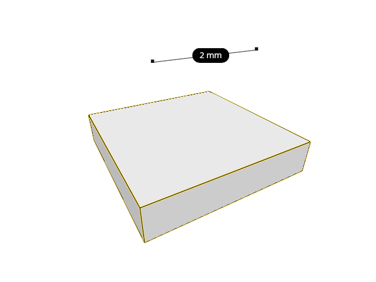
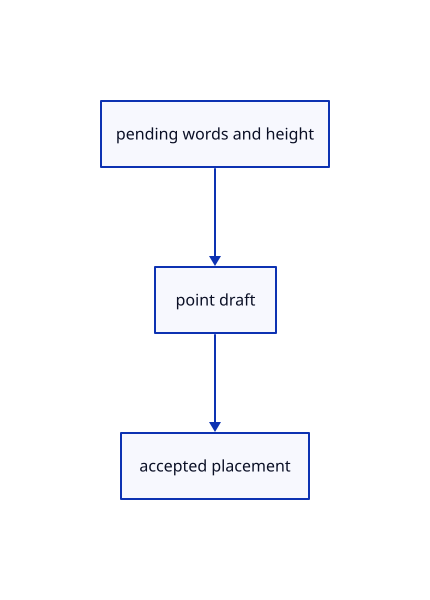

# 16.5.30 · Retain Text answers inside the existing point draft

**Chapter 16 · Geometry editing and measurement · Section 16.5 · Text, styles and command integration** · [Contents](contents.md)

**Typing: 12–23 minutes.** [Estimate](typing-load.md).

Retain Text answers inside the existing point draft.

## Type

Continue from [Own current pending command state](85ab-own-current-pending-command-state.md). [Save or recover your work](recovery.md).

### 1. `src/tool.rs`

Retain pending Text answers without creating source rows.

<details>
<summary>Locate the existing block</summary>

```rust

// A draft owns unfinished points and a cursor, so preview motion cannot become saved geometry or an Undo transaction.
pub struct Draft { pub tool: Box<dyn Tool>, pub points: Vec<[f64; 3]>, pub cursor: Option<[f64; 3]>, pub snapped: Option<crate::snap::Kind>, pub frame: crate::cplane::CPlane, pub plane_points: Option<Vec<[f64;3]>>, pub primitive:Option<crate::primitive_draft::Draft>, pub transform:Option<crate::transform_draft::Draft>,pub gather:Option<crate::gather_draft::Draft>,pub project:Option<crate::project_draft::Draft>,pub extend:Option<crate::extend_draft::Draft> }

impl Draft {
    pub fn new(shape: Shape) -> Self { Self { project:None,extend:None,gather:None,tool: Box::new(shape), points: Vec::new(), cursor: None, snapped: None, frame: crate::cplane::CPlane::Xy, plane_points: None, primitive:if let Shape::Primitive(shape)=shape {Some(crate::primitive_draft::Draft::new(shape,crate::cplane::CPlane::Xy,0).expect("Registered primitive option"))}else{None},transform:if let Shape::Transform(kind)=shape {Some(crate::transform_draft::Draft::new(kind,crate::cplane::CPlane::Xy))}else{None} } }
    pub fn prompt(&self) -> String {
        if self.plane_points.is_none(){if let Some(p)=&self.project{return p.prompt()}if let Some(e)=&self.extend{return e.prompt()}}
        if self.plane_points.is_none(){if let Some(gather)=&self.gather{return gather.prompt()}}
```

</details>

Edit the existing block to match this code; keep unchanged lines:

```rust
--8<-- "journey/code/85ac-retain-text-answers-inside-the-existing-point-draft-01.rs"
```

## Run and check

Run this from `session_viewer` to select the fixed dependency versions and install supplied binary assets. It updates Cargo.lock and preserves the previous lock. It does not write implementation code:

```sh
npm --prefix ../session_tests run course -- dependencies 16.5.30
```

In your project:

```sh
cd workspace/journey
REGEN_PROTO=0 cargo build --lib --locked --target wasm32-unknown-unknown -j1
REGEN_PROTO=0 CARGO_BUILD_JOBS=1 trunk serve --port 8780
```

Open `http://127.0.0.1:8780/`. Keep an existing Trunk server running; saving rebuilds it.


### Recorded visual result

**Previous native render — current verification pending.**

The preceding solid, wire bounding box and temporary distance annotation remain visible.



*This recorded image predates a source or checker change. Rebuild this checkpoint before using it as current evidence; browser controls require separate acceptance.*

This reference image is shared with [16.4.14 · Exercise original boxes and temporary distance annotations](84m-exercise-original-boxes-and-temporary-distance-annotations.md). It does not demonstrate a new feature by itself.

<details>
<summary>Code explanation and diagram</summary>


pending words and height → point draft → accepted placement.



Does asking Height insert a label?

No. Words and height remain pending until one valid point completes the original label.

Study estimate, including typing and experiments: 0.5–1 hours.

</details>

<details>
<summary>Optional experiment</summary>

Compare the draft prompt before and after accepting Height.

</details>

<details>
<summary>Check and save your work</summary>

Restore experimental edits, then run from `session_viewer`:

```sh
npm --prefix ../session_tests run course -- check 16.5.30
npm --prefix ../session_tests run course -- save 16.5.30
```

Source comparison leaves your project untouched. [Save and recovery instructions](recovery.md).

</details>

<details>
<summary>Viewer coverage and verification</summary>

Retain Text answers inside the existing point draft.

The inherited measurement browser contract remains authored and unrun. The current-command browser contract connects at85ay and still requires real browser execution.

[Full validation scope](release.md).

To reproduce the scripted acceptance of the reference checkpoint, run from `session_viewer` with the [course bundle server](release.md#reproduce) running on port 8781:

```sh
npm --prefix ../session_tests run course -- capture 16.5.30
```

This uses the verified reference bundle; it does not check or change your typed project.

</details>
