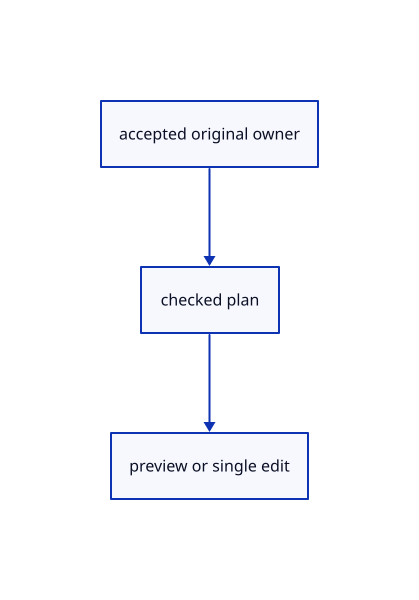

# 16.5.34 · Advance Trim through targets cutters and parts

**Chapter 16 · Geometry editing and measurement · Section 16.5 · Text, styles and command integration** · [Contents](contents.md)

**Typing: 16–31 minutes.** [Estimate](typing-load.md).

Advance Trim through targets cutters and parts.

## Type

Continue from [Commit prepared trims once](85af-commit-prepared-trims-once.md). [Save or recover your work](recovery.md).

### 1. `src/editor.rs`

<details>
<summary>Locate the existing block</summary>

```rust
    pub fn trimming_picks(&self)->bool{self.trim.as_ref().is_some_and(|t|t.picks())}
    pub fn trimming_parts(&self)->bool{self.trim.as_ref().is_some_and(|t|!t.picks())}
    fn commit_trim(&mut self)->Result<Change,&'static str>{
        let trim=self.trim.take().ok_or("Start Trim first")?;let before=trim.before.clone();if !trim.changed(){self.select_objects(before,false);self.tool_status="Trim cancelled · nothing changed".into();return Ok(Change::Preview)}
        let edits=trim.prepared_edits(&self.scene).map_err(|message|{self.select_objects(before.clone(),false);self.primitive_failure(message)})?;
        let result=self.history.try_edit(&mut self.scene,|scene|{for(id,pieces)in edits{crate::split_draft::adopt(scene,id,pieces)?}Ok(())});self.select_objects([],false);self.snap_index=None;result?;self.tool_status="Trimmed originals · one Undo restores them".into();Ok(Change::Scene)
    }
    fn begin_text(&mut self,words:String)->Result<Change,&'static str>{let text=crate::text_draft::Draft::new(words,self.camera.distance,self.last_text_height)?;self.apply(Action::BeginTool(crate::tool::Shape::Text))?;self.draft.as_mut().unwrap().text=Some(text);self.tool_status=self.draft.as_ref().unwrap().prompt();Ok(Change::View)}
```

</details>

Edit the existing block to match this code; keep unchanged lines:

```rust
--8<-- "journey/code/85ag-advance-trim-through-targets-cutters-and-parts-01.rs"
```

## Run and check

Run this from `session_viewer` to select the fixed dependency versions and install supplied binary assets. It updates Cargo.lock and preserves the previous lock. It does not write implementation code:

```sh
npm --prefix ../session_tests run course -- dependencies 16.5.34
```

In your project:

```sh
cd workspace/journey
REGEN_PROTO=0 cargo build --lib --locked --target wasm32-unknown-unknown -j1
REGEN_PROTO=0 CARGO_BUILD_JOBS=1 trunk serve --port 8780
```

Open `http://127.0.0.1:8780/`. Keep an existing Trunk server running; saving rebuilds it.


### Recorded visual result

**Previous native render — current verification pending.**

The preceding solid, wire bounding box and temporary distance annotation remain visible.


*This recorded image predates a source or checker change. Rebuild this checkpoint before using it as current evidence; browser controls require separate acceptance.*

This reference image is shared with [16.4.14 · Exercise original boxes and temporary distance annotations](84m-exercise-original-boxes-and-temporary-distance-annotations.md). It does not demonstrate a new feature by itself.

<details>
<summary>Code explanation and diagram</summary>


accepted original owner → checked plan → preview or single edit.



Does hovering a part edit geometry?

No. Hover updates the cached guide; a click updates a disposable preview until completion.

Study estimate, including typing and experiments: 0.5–1 hours.

</details>

<details>
<summary>Optional experiment</summary>

Start from whole selection, Enter after cutters, hover and remove a part, then compare Escape and final Enter.

</details>

<details>
<summary>Check and save your work</summary>

Restore experimental edits, then run from `session_viewer`:

```sh
npm --prefix ../session_tests run course -- check 16.5.34
npm --prefix ../session_tests run course -- save 16.5.34
```

Source comparison leaves your project untouched. [Save and recovery instructions](recovery.md).

</details>

<details>
<summary>Viewer coverage and verification</summary>

Advance Trim through targets cutters and parts.

The inherited measurement browser contract remains authored and unrun. The current-command browser contract connects at85ay and still requires real browser execution.

[Full validation scope](release.md).

To reproduce the scripted acceptance of the reference checkpoint, run from `session_viewer` with the [course bundle server](release.md#reproduce) running on port 8781:

```sh
npm --prefix ../session_tests run course -- capture 16.5.34
```

This uses the verified reference bundle; it does not check or change your typed project.

</details>
