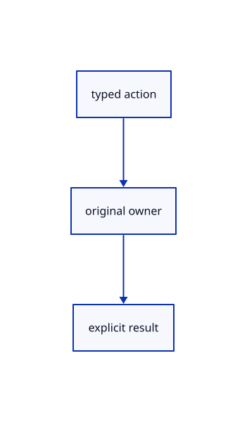

# 16.5.36 · Dispatch current original commands through checked owners

**Chapter 16 · Geometry editing and measurement · Section 16.5 · Text, styles and command integration** · [Contents](contents.md)

**Typing: 23–46 minutes.** [Estimate](typing-load.md).

Dispatch current original commands through checked owners.

## Type

Continue from [Adopt original pieces and arrowhead changes atomically](85ah-adopt-original-pieces-and-arrowhead-changes-atomically.md). [Save or recover your work](recovery.md).

### 1. `src/editor.rs`

Dispatch complete current original command actions.

<details>
<summary>Locate the existing block</summary>

```rust
        if self.split.is_some()&&!matches!(&action,Action::Split|Action::SplitPick(_)|Action::CancelSplit|Action::TreePick{..}|Action::Zoom(_)|Action::ZoomAt{..}|Action::PanScreen{..}|Action::Pan(_,_)|Action::Orbit(_,_)|Action::Fit|Action::FitSelected|Action::Projection(_)|Action::ResetView|Action::Background|Action::NormalView(_)|Action::Grid(_)|Action::ConstructionPlane(_)|Action::PlaneMenu|Action::Plane3){self.split=None;}
        match action {
            Action::Measure(kind)=>return self.measure_selection(kind),
            Action::MeasureDistance(text)=>return self.begin_measure_distance(&text),
```

</details>

Edit the existing block to match this code; keep unchanged lines:

```rust
--8<-- "journey/code/85ai-dispatch-current-original-commands-through-checked-owners-01.rs"
```

## Run and check

Run this from `session_viewer` to select the fixed dependency versions and install supplied binary assets. It updates Cargo.lock and preserves the previous lock. It does not write implementation code:

```sh
npm --prefix ../session_tests run course -- dependencies 16.5.36
```

In your project:

```sh
cd workspace/journey
REGEN_PROTO=0 cargo build --lib --locked --target wasm32-unknown-unknown -j1
REGEN_PROTO=0 CARGO_BUILD_JOBS=1 trunk serve --port 8780
```

Open `http://127.0.0.1:8780/`. Keep an existing Trunk server running; saving rebuilds it.


### Recorded visual result

**Previous native render — current verification pending.**

The preceding solid, wire bounding box and temporary distance annotation remain visible.


*This recorded image predates a source or checker change. Rebuild this checkpoint before using it as current evidence; browser controls require separate acceptance.*

This reference image is shared with [16.4.14 · Exercise original boxes and temporary distance annotations](84m-exercise-original-boxes-and-temporary-distance-annotations.md). It does not demonstrate a new feature by itself.

<details>
<summary>Code explanation and diagram</summary>


typed action → original owner → explicit result.



Does dispatch bypass original eligibility?

No. Each owner validates its current source, placement and accepted input before mutation.

Study estimate, including typing and experiments: 0.5–1 hours.

</details>

<details>
<summary>Optional experiment</summary>

Compare lasso phases, grouping, graph links, Text, Explode, Trim, queries, arrowheads and Escape. Invalid input must preserve original rows and history.

</details>

<details>
<summary>Check and save your work</summary>

Restore experimental edits, then run from `session_viewer`:

```sh
npm --prefix ../session_tests run course -- check 16.5.36
npm --prefix ../session_tests run course -- save 16.5.36
```

Source comparison leaves your project untouched. [Save and recovery instructions](recovery.md).

</details>

<details>
<summary>Viewer coverage and verification</summary>

Dispatch current original commands through checked owners.

The inherited measurement browser contract remains authored and unrun. The current-command browser contract connects at85ay and still requires real browser execution.

[Full validation scope](release.md).

To reproduce the scripted acceptance of the reference checkpoint, run from `session_viewer` with the [course bundle server](release.md#reproduce) running on port 8781:

```sh
npm --prefix ../session_tests run course -- capture 16.5.36
```

This uses the verified reference bundle; it does not check or change your typed project.

</details>
