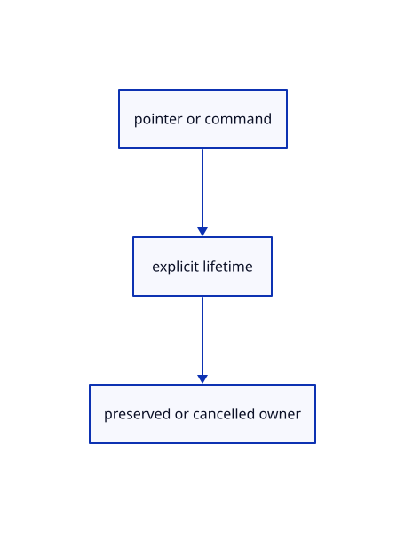

# 16.5.38 · Keep annotations during touch navigation and capture lasso input

**Chapter 16 · Geometry editing and measurement · Section 16.5 · Text, styles and command integration** · [Contents](contents.md)

**Typing: 28–56 minutes.** [Estimate](typing-load.md).

Keep annotations during touch navigation and capture lasso input.

## Type

Continue from [Preserve previews selection and accepted tool answers](85aj-preserve-previews-selection-and-accepted-tool-answers.md). [Save or recover your work](recovery.md).

### 1. `src/editor.rs`

Keep view controls and pending command lifecycles.

<details>
<summary>Locate the existing block</summary>

```rust

    pub fn apply(&mut self, action: Action) -> Result<Change, &'static str> {
        if !matches!(&action,Action::Zoom(_)|Action::ZoomAt{..}|Action::PanScreen{..}|Action::Pan(_,_)|Action::Orbit(_,_)|Action::Fit|Action::FitSelected|Action::Projection(_)|Action::ResetView|Action::Isometric|Action::Background|Action::NormalView(_)|Action::Grid(_)){self.mark=None;}
        match action {
            Action::StreamRefresh=>{self.snap_index=None;return Ok(Change::Scene);},
            Action::Touch(actions)=> {let mut change=Change::View;for action in actions {let next=self.apply(action)?;if next!=Change::View {change=next;}}return Ok(change);},
            Action::CanvasStart {from,to,size,modified,pointer}=>{self.canvas_drag=crate::canvas_drag::Drag::new(from,to,size,modified);if let Some(drag)=self.canvas_drag.as_mut() {drag.pointer=pointer;}return Ok(Change::View);},
            Action::CanvasMove {screen,size}=>{if let Some(drag)=self.canvas_drag.as_mut() {if drag.released.is_none()&&drag.size==size&&screen.iter().all(|v|v.is_finite()) {drag.to=screen;drag.update(&self.camera)?;}if drag.preview.is_some() {return Ok(Change::Preview);}}return Ok(Change::View);},
```

</details>

Edit the existing block to match this code; keep unchanged lines:

```rust
--8<-- "journey/code/85ak-keep-annotations-during-touch-navigation-and-capture-lasso-input-01.rs"
```

## Run and check

Run this from `session_viewer` to select the fixed dependency versions and install supplied binary assets. It updates Cargo.lock and preserves the previous lock. It does not write implementation code:

```sh
npm --prefix ../session_tests run course -- dependencies 16.5.38
```

In your project:

```sh
cd workspace/journey
REGEN_PROTO=0 cargo build --lib --locked --target wasm32-unknown-unknown -j1
REGEN_PROTO=0 CARGO_BUILD_JOBS=1 trunk serve --port 8780
```

Open `http://127.0.0.1:8780/`. Keep an existing Trunk server running; saving rebuilds it.


### Recorded visual result

**Previous native render — current verification pending.**

The preceding solid, wire bounding box and temporary distance annotation remain visible.


*This recorded image predates a source or checker change. Rebuild this checkpoint before using it as current evidence; browser controls require separate acceptance.*

This reference image is shared with [16.4.14 · Exercise original boxes and temporary distance annotations](84m-exercise-original-boxes-and-temporary-distance-annotations.md). It does not demonstrate a new feature by itself.

<details>
<summary>Code explanation and diagram</summary>


pointer or command → explicit lifetime → preserved or cancelled owner.



Why dispatch touch navigation before annotation cleanup?

Orbit and zoom change the view without completing or cancelling the measurement. Preserve its mark, and let captured lasso input follow its own pointer lifecycle.

Study estimate, including typing and experiments: 0.5–1 hours.

</details>

<details>
<summary>Optional experiment</summary>

Create a measurement, then rotate and zoom with touch; its mark remains. Start a lasso, move beyond the canvas edge and release; pointer capture must finish that gesture.

</details>

<details>
<summary>Check and save your work</summary>

Restore experimental edits, then run from `session_viewer`:

```sh
npm --prefix ../session_tests run course -- check 16.5.38
npm --prefix ../session_tests run course -- save 16.5.38
```

Source comparison leaves your project untouched. [Save and recovery instructions](recovery.md).

</details>

<details>
<summary>Viewer coverage and verification</summary>

Keep annotations during touch navigation and capture lasso input.

The inherited measurement browser contract remains authored and unrun. The current-command browser contract connects at85ay and still requires real browser execution.

[Full validation scope](release.md).

To reproduce the scripted acceptance of the reference checkpoint, run from `session_viewer` with the [course bundle server](release.md#reproduce) running on port 8781:

```sh
npm --prefix ../session_tests run course -- capture 16.5.38
```

This uses the verified reference bundle; it does not check or change your typed project.

</details>
