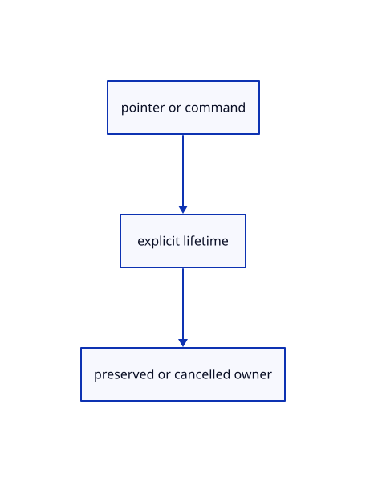

# 16.5.39 · Preserve pending originals during view changes

**Chapter 16 · Geometry editing and measurement · Section 16.5 · Text, styles and command integration** · [Contents](contents.md)

**Typing: 19–38 minutes.** [Estimate](typing-load.md).

Preserve pending originals during view changes.

## Type

Continue from [Keep annotations during touch navigation and capture lasso input](85ak-keep-annotations-during-touch-navigation-and-capture-lasso-input.md). [Save or recover your work](recovery.md).

### 1. `src/editor.rs`

Keep view controls and pending command lifecycles.

<details>
<summary>Locate the existing block</summary>

```rust
            },
            Action::CanvasCancel=>{let preview=self.canvas_drag.take().is_some_and(|d|d.preview.is_some());return Ok(if preview {Change::Preview} else {Change::View});},
            Action::SelectRows {ids,add,remove}=>{if self.split.is_some(){for id in ids{self.split_pick(Some(id))?;}return Ok(Change::View)}self.select_rows(ids,add,remove);return Ok(Change::View);},
            _=>{}
        }
        self.canvas_drag=None;
        let keep_gizmo=matches!(&action,Action::GizmoPress {..}|Action::GizmoTouch {..}|Action::GizmoMove {..}|Action::GizmoRelease {..}|Action::GizmoCancel|Action::GizmoNumber(_)|Action::Zoom(_)|Action::ZoomAt {..}|Action::PanScreen {..}|Action::Pan(_,_)|Action::Orbit(_,_)|Action::Fit|Action::FitSelected|Action::Projection(_)|Action::ResetView|Action::Background|Action::NormalView(_)|Action::Grid(_)|Action::Snap(_));
        let keep_edit=matches!(&action, Action::GizmoPress {..} | Action::GizmoTouch {..} | Action::GizmoMove {..} | Action::GizmoRelease {..} | Action::GizmoCancel | Action::GizmoNumber(_) | Action::BeginTool(_) | Action::Draw {..} | Action::ToolText(_) | Action::FinishTool | Action::CloseTool | Action::ConstructionPlane(_) | Action::PlaneMenu | Action::Plane3 | Action::ToolSides(_) | Action::BeginTransformation(_) | Action::Transformation {..} | Action::PrimitiveBegin {..} | Action::GatherBegin{..} | Action::GatherPick(_) | Action::Project(_) | Action::ExtendBegin{..} | Action::ExtendPick(_) | Action::Interval(_) | Action::ToolPoint(_) | Action::ToolScreen {..} | Action::ToolHover(_) | Action::CancelTool | Action::Snap(_) | Action::Zoom(_) | Action::ZoomAt {..} | Action::PanScreen {..} | Action::Pan(_,_) | Action::Orbit(_,_) | Action::Fit | Action::FitSelected | Action::Projection(_) | Action::ResetView | Action::Background | Action::NormalView(_) | Action::Grid(_));
        let mut change=self.apply_action(action)?;
        self.gizmo_hover=None;
```

</details>

Edit the existing block to match this code; keep unchanged lines:

```rust
--8<-- "journey/code/85al-preserve-pending-originals-during-view-changes-01.rs"
```

## Run and check

Run this from `session_viewer` to select the fixed dependency versions and install supplied binary assets. It updates Cargo.lock and preserves the previous lock. It does not write implementation code:

```sh
npm --prefix ../session_tests run course -- dependencies 16.5.39
```

In your project:

```sh
cd workspace/journey
REGEN_PROTO=0 cargo build --lib --locked --target wasm32-unknown-unknown -j1
REGEN_PROTO=0 CARGO_BUILD_JOBS=1 trunk serve --port 8780
```

Open `http://127.0.0.1:8780/`. Keep an existing Trunk server running; saving rebuilds it.


### Recorded visual result

**Previous native render — current verification pending.**

The preceding solid, wire bounding box and temporary distance annotation remain visible.


*This recorded image predates a source or checker change. Rebuild this checkpoint before using it as current evidence; browser controls require separate acceptance.*

This reference image is shared with [16.4.14 · Exercise original boxes and temporary distance annotations](84m-exercise-original-boxes-and-temporary-distance-annotations.md). It does not demonstrate a new feature by itself.

<details>
<summary>Code explanation and diagram</summary>


pointer or command → explicit lifetime → preserved or cancelled owner.



Does a view change invalidate a pending source operation?

It does not change the operation's original document intent. Preserve the source request and pending tool state unless an actual cancellation or document replacement invalidates them.

Study estimate, including typing and experiments: 0.5–1 hours.

</details>

<details>
<summary>Optional experiment</summary>

Begin a pending original-source operation, change the view and inspect its retained prompt. Cancel explicitly and confirm the operation cannot later complete into the document.

</details>

<details>
<summary>Check and save your work</summary>

Restore experimental edits, then run from `session_viewer`:

```sh
npm --prefix ../session_tests run course -- check 16.5.39
npm --prefix ../session_tests run course -- save 16.5.39
```

Source comparison leaves your project untouched. [Save and recovery instructions](recovery.md).

</details>

<details>
<summary>Viewer coverage and verification</summary>

Preserve pending originals during view changes.

The inherited measurement browser contract remains authored and unrun. The current-command browser contract connects at85ay and still requires real browser execution.

[Full validation scope](release.md).

To reproduce the scripted acceptance of the reference checkpoint, run from `session_viewer` with the [course bundle server](release.md#reproduce) running on port 8781:

```sh
npm --prefix ../session_tests run course -- capture 16.5.39
```

This uses the verified reference bundle; it does not check or change your typed project.

</details>
