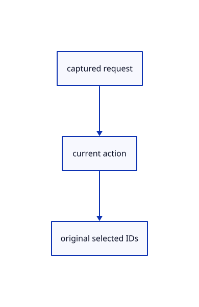

# 16.5.42 · Restore typed requests and their selected owners

**Chapter 16 · Geometry editing and measurement · Section 16.5 · Text, styles and command integration** · [Contents](contents.md)

**Typing: 16–31 minutes.** [Estimate](typing-load.md).

Restore typed requests and their selected owners.

## Type

Continue from [Capture source-backed command arguments](85an-capture-source-backed-command-arguments.md). [Save or recover your work](recovery.md).

### 1. `src/command_request.rs`

<details>
<summary>Locate the existing block</summary>

```rust
        Action::GatherBegin{recipe,text}=>Self::Gather{name:recipe.name.into(),text:text.clone()},Action::TrimPick(id)=>Self::Pick{kind:0,id:*id},Action::SplitPick(id)=>Self::Pick{kind:1,id:*id},Action::ExtendPick(id)=>Self::Pick{kind:2,id:*id},Action::GatherPick(id)=>Self::Pick{kind:3,id:*id},_=>return None,
    })}


}
```

</details>

Edit the existing block to match this code; keep unchanged lines:

```rust
--8<-- "journey/code/85ao-restore-typed-requests-and-their-selected-owners-01.rs"
```

## Run and check

Run this from `session_viewer` to select the fixed dependency versions and install supplied binary assets. It updates Cargo.lock and preserves the previous lock. It does not write implementation code:

```sh
npm --prefix ../session_tests run course -- dependencies 16.5.42
```

In your project:

```sh
cd workspace/journey
REGEN_PROTO=0 cargo build --lib --locked --target wasm32-unknown-unknown -j1
REGEN_PROTO=0 CARGO_BUILD_JOBS=1 trunk serve --port 8780
```

Open `http://127.0.0.1:8780/`. Keep an existing Trunk server running; saving rebuilds it.


### Recorded visual result

**Previous native render — current verification pending.**

The preceding solid, wire bounding box and temporary distance annotation remain visible.


*This recorded image predates a source or checker change. Rebuild this checkpoint before using it as current evidence; browser controls require separate acceptance.*

This reference image is shared with [16.5.40 · Route named views and whole trim picks](85am-route-named-views-and-whole-trim-picks.md). It does not demonstrate a new feature by itself.

<details>
<summary>Code explanation and diagram</summary>


captured request → current action → original selected IDs.



Can a missing recipe silently choose another command?

No. A changed or missing gathering recipe returns an error.

Study estimate, including typing and experiments: 0.5–1 hours.

</details>

<details>
<summary>Optional experiment</summary>

Compare whole selection, selected face and pending original cutter requests.

</details>

<details>
<summary>Check and save your work</summary>

Restore experimental edits, then run from `session_viewer`:

```sh
npm --prefix ../session_tests run course -- check 16.5.42
npm --prefix ../session_tests run course -- save 16.5.42
```

Source comparison leaves your project untouched. [Save and recovery instructions](recovery.md).

</details>

<details>
<summary>Viewer coverage and verification</summary>

Restore typed requests and their selected owners.

The inherited measurement browser contract remains authored and unrun. The current-command browser contract connects at85ay and still requires real browser execution.

[Full validation scope](release.md).

To reproduce the scripted acceptance of the reference checkpoint, run from `session_viewer` with the [course bundle server](release.md#reproduce) running on port 8781:

```sh
npm --prefix ../session_tests run course -- capture 16.5.42
```

This uses the verified reference bundle; it does not check or change your typed project.

</details>
