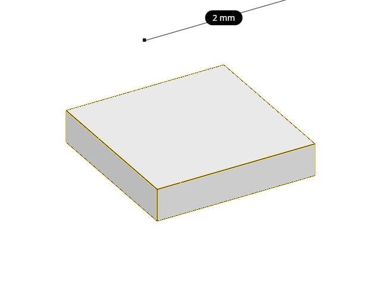
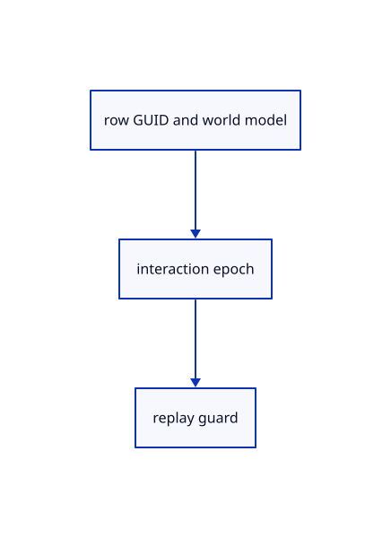

# 16.5.43 · Witness identities and placement during source loading

**Chapter 16 · Geometry editing and measurement · Section 16.5 · Text, styles and command integration** · [Contents](contents.md)

**Typing: 9–17 minutes.** [Estimate](typing-load.md).

Witness identities and placement during source loading.

## Type

Continue from [Restore typed requests and their selected owners](85ao-restore-typed-requests-and-their-selected-owners.md). [Save or recover your work](recovery.md).

### 1. `src/command_request.rs`

<details>
<summary>Locate the existing block</summary>

```rust
    pub fn ids(&self,editor:&Editor)->Vec<ObjectId>{match self{Self::Pick{id,..}=>id.iter().copied().collect(),_=>editor.selected_part.and(editor.selected).into_iter().chain(editor.selected_objects()).collect()}}
}
```

</details>

After that block, type:

```rust
--8<-- "journey/code/85ap-witness-identities-and-placement-during-source-loading-01.rs" skip=215
```

## Run and check

Run this from `session_viewer` to select the fixed dependency versions and install supplied binary assets. It updates Cargo.lock and preserves the previous lock. It does not write implementation code:

```sh
npm --prefix ../session_tests run course -- dependencies 16.5.43
```

In your project:

```sh
cd workspace/journey
REGEN_PROTO=0 cargo build --lib --locked --target wasm32-unknown-unknown -j1
REGEN_PROTO=0 CARGO_BUILD_JOBS=1 trunk serve --port 8780
```

Open `http://127.0.0.1:8780/`. Keep an existing Trunk server running; saving rebuilds it.


### Recorded visual result

**Previous native render — current verification pending.**

The preceding solid, wire bounding box and temporary distance annotation remain visible.



*This recorded image predates a source or checker change. Rebuild this checkpoint before using it as current evidence; browser controls require separate acceptance.*

This reference image is shared with [16.5.40 · Route named views and whole trim picks](85am-route-named-views-and-whole-trim-picks.md). It does not demonstrate a new feature by itself.

<details>
<summary>Code explanation and diagram</summary>


row GUID and world model → interaction epoch → replay guard.



Does orbit invalidate a waiting edit?

No. View changes preserve its epoch; changed commands or targets cancel it.

Study estimate, including typing and experiments: 0.5–1 hours.

</details>

<details>
<summary>Optional experiment</summary>

Inspect exact GUID, model and eligibility witnesses before loading.

</details>

<details>
<summary>Check and save your work</summary>

Restore experimental edits, then run from `session_viewer`:

```sh
npm --prefix ../session_tests run course -- check 16.5.43
npm --prefix ../session_tests run course -- save 16.5.43
```

Source comparison leaves your project untouched. [Save and recovery instructions](recovery.md).

</details>

<details>
<summary>Viewer coverage and verification</summary>

Witness identities and placement during source loading.

The inherited measurement browser contract remains authored and unrun. The current-command browser contract connects at85ay and still requires real browser execution.

[Full validation scope](release.md).

To reproduce the scripted acceptance of the reference checkpoint, run from `session_viewer` with the [course bundle server](release.md#reproduce) running on port 8781:

```sh
npm --prefix ../session_tests run course -- capture 16.5.43
```

This uses the verified reference bundle; it does not check or change your typed project.

</details>
