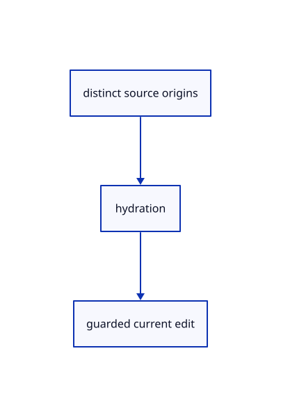

# 16.5.44 · Deduplicate original fetches and replay safely

**Chapter 16 · Geometry editing and measurement · Section 16.5 · Text, styles and command integration** · [Contents](contents.md)

**Typing: 10–20 minutes.** [Estimate](typing-load.md).

Deduplicate original fetches and replay safely.

## Type

Continue from [Witness identities and placement during source loading](85ap-witness-identities-and-placement-during-source-loading.md). [Save or recover your work](recovery.md).

### 1. `src/command_request.rs`

<details>
<summary>Locate the existing block</summary>

```rust
    pub fn capture(action:&Action,editor:&Editor)->Option<Self>{let request=Request::capture(action)?;let ids=request.ids(editor);let owners=ids.iter().filter_map(|id|Some((*id,editor.scene.row_guid(*id)?.to_owned(),editor.scene.placement(*id)?.m))).collect();Some(Self{request,ids,part:editor.selected_part,epoch:editor.interaction_epoch,owners})}
    pub fn valid(&self,editor:&Editor)->bool{self.epoch==editor.interaction_epoch&&self.owners.iter().all(|(id,guid,model)|editor.scene.pick_id(id.value())==Some(*id)&&editor.scene.row_guid(*id)==Some(guid)&&editor.scene.placement(*id).is_some_and(|p|p.m==*model))}


}
```

</details>

Edit the existing block to match this code; keep unchanged lines:

```rust
--8<-- "journey/code/85aq-deduplicate-original-fetches-and-replay-safely-01.rs"
```

## Run and check

Run this from `session_viewer` to select the fixed dependency versions and install supplied binary assets. It updates Cargo.lock and preserves the previous lock. It does not write implementation code:

```sh
npm --prefix ../session_tests run course -- dependencies 16.5.44
```

In your project:

```sh
cd workspace/journey
REGEN_PROTO=0 cargo build --lib --locked --target wasm32-unknown-unknown -j1
REGEN_PROTO=0 CARGO_BUILD_JOBS=1 trunk serve --port 8780
```

Open `http://127.0.0.1:8780/`. Keep an existing Trunk server running; saving rebuilds it.


### Recorded visual result

**Previous native render — current verification pending.**

The preceding solid, wire bounding box and temporary distance annotation remain visible.


*This recorded image predates a source or checker change. Rebuild this checkpoint before using it as current evidence; browser controls require separate acceptance.*

This reference image is shared with [16.5.40 · Route named views and whole trim picks](85am-route-named-views-and-whole-trim-picks.md). It does not demonstrate a new feature by itself.

<details>
<summary>Code explanation and diagram</summary>


distinct source origins → hydration → guarded current edit.



Can two instances fetch the same source twice?

No. Deduplicate by origin identity, then restore captured IDs and selected part before replay.

Study estimate, including typing and experiments: 0.5–1 hours.

</details>

<details>
<summary>Optional experiment</summary>

Compare failure restoration, source identity, one successful Undo and changed-target refusal.

</details>

<details>
<summary>Check and save your work</summary>

Restore experimental edits, then run from `session_viewer`:

```sh
npm --prefix ../session_tests run course -- check 16.5.44
npm --prefix ../session_tests run course -- save 16.5.44
```

Source comparison leaves your project untouched. [Save and recovery instructions](recovery.md).

</details>

<details>
<summary>Viewer coverage and verification</summary>

Deduplicate original fetches and replay safely.

The inherited measurement browser contract remains authored and unrun. The current-command browser contract connects at85ay and still requires real browser execution.

[Full validation scope](release.md).

To reproduce the scripted acceptance of the reference checkpoint, run from `session_viewer` with the [course bundle server](release.md#reproduce) running on port 8781:

```sh
npm --prefix ../session_tests run course -- capture 16.5.44
```

This uses the verified reference bundle; it does not check or change your typed project.

</details>
