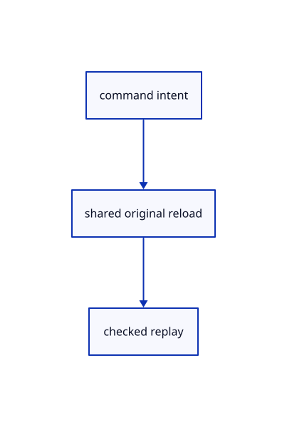

# 16.5.45 · Route source-backed edits through guarded replay

**Chapter 16 · Geometry editing and measurement · Section 16.5 · Text, styles and command integration** · [Contents](contents.md)

**Typing: 12–23 minutes.** [Estimate](typing-load.md).

Route source-backed edits through guarded replay.

## Type

Continue from [Deduplicate original fetches and replay safely](85aq-deduplicate-original-fetches-and-replay-safely.md). [Save or recover your work](recovery.md).

### 1. `src/edit_intent.rs`

Capture and replay current commands with guarded original loading.

Edit these blocks from bottom to top. Keep the surrounding lines unchanged.

<details>
<summary>Locate this block</summary>

```rust
use crate::{editor::{Action, Editor}, rehydrate::ReloadKey, scene::ObjectId};

#[derive(Clone, Copy, Debug, PartialEq)]
pub enum Intent {
    Move { id: ObjectId, offset: [f64; 3] },
    Delete { id: ObjectId },
    Save,
}

impl Intent {
    pub fn command(self) -> &'static str {
        match self { Self::Move { .. } => "Move", Self::Delete { .. } => "Delete", Self::Save => "Save" }
    }

    pub fn keys(&self, editor: &Editor) -> Result<Vec<ReloadKey>, &'static str> {
        match self {
            Self::Save => Ok(editor.reload_keys()),
            Self::Move { id, .. } | Self::Delete { id } => {
                let Some(row) = editor.scene.objects().iter().find(|row| row.id == *id) else {
```

</details>

Replace it with:

```rust
use crate::{editor::{Action, Editor}, rehydrate::ReloadKey, scene::ObjectId};

#[derive(Clone, Debug, PartialEq)]
pub enum Intent {
    Command(crate::command_request::Pending),
    Move { id: ObjectId, offset: [f64; 3] },
    Delete { id: ObjectId },
    Save,
}

impl Intent {
    pub fn command(&self) -> &'static str {
        match self { Self::Command(_)=>"Command",Self::Move { .. } => "Move", Self::Delete { .. } => "Delete", Self::Save => "Save" }
    }

    pub fn capture_for(action:&Action,editor:&Editor)->Result<Option<Self>,&'static str>{
        if let Action::Translate(offset)=action{if offset.iter().any(|v|!v.is_finite()){return Err("Move needs finite coordinates")}if offset.iter().all(|v|*v==0.){return Ok(None)}}
        if let Some(pending)=crate::command_request::Pending::capture(action,editor){if !pending.keys(editor).is_empty(){return Ok(Some(Self::Command(pending)))}}
        if editor.selected_objects().len()>1{return Ok(None)}Self::capture(action,editor.whole_selection())
    }

    pub fn keys(&self, editor: &Editor) -> Result<Vec<ReloadKey>, &'static str> {
        match self {
            Self::Command(pending)=>{if !pending.valid(editor){return Err("Command target changed before loading sources")}Ok(pending.keys(editor))},
            Self::Save => Ok(editor.reload_keys()),
            Self::Move { id, .. } | Self::Delete { id } => {
                let Some(row) = editor.scene.objects().iter().find(|row| row.id == *id) else {
```

<details>
<summary>Complete updated block reference</summary>

```rust
use crate::{editor::{Action, Editor}, rehydrate::ReloadKey, scene::ObjectId};

#[derive(Clone, Debug, PartialEq)]
pub enum Intent {
    Command(crate::command_request::Pending),
    Move { id: ObjectId, offset: [f64; 3] },
    Delete { id: ObjectId },
    Save,
}

impl Intent {
    pub fn command(&self) -> &'static str {
        match self { Self::Command(_)=>"Command",Self::Move { .. } => "Move", Self::Delete { .. } => "Delete", Self::Save => "Save" }
    }

    pub fn capture_for(action:&Action,editor:&Editor)->Result<Option<Self>,&'static str>{
        if let Action::Translate(offset)=action{if offset.iter().any(|v|!v.is_finite()){return Err("Move needs finite coordinates")}if offset.iter().all(|v|*v==0.){return Ok(None)}}
        if let Some(pending)=crate::command_request::Pending::capture(action,editor){if !pending.keys(editor).is_empty(){return Ok(Some(Self::Command(pending)))}}
        if editor.selected_objects().len()>1{return Ok(None)}Self::capture(action,editor.whole_selection())
    }

    pub fn keys(&self, editor: &Editor) -> Result<Vec<ReloadKey>, &'static str> {
        match self {
            Self::Command(pending)=>{if !pending.valid(editor){return Err("Command target changed before loading sources")}Ok(pending.keys(editor))},
            Self::Save => Ok(editor.reload_keys()),
            Self::Move { id, .. } | Self::Delete { id } => {
                let Some(row) = editor.scene.objects().iter().find(|row| row.id == *id) else {
                    return if editor.scene.contains(*id) { Ok(Vec::new()) }
                        else { Err("Object not found") };
                };
                Ok(ReloadKey::of(row).into_iter().collect())
            }
        }
    }

    pub fn capture(action: &Action, selected: Option<ObjectId>) -> Result<Option<Self>, &'static str> {
        Ok(match action {
            Action::Translate(offset) => {
                let id = selected.ok_or("Select an object before Move")?;
                if !offset.iter().all(|value| value.is_finite()) { return Err("Move needs finite coordinates"); }
                if offset.iter().all(|&value| value == 0.0) { None }
                else { Some(Self::Move { id, offset: *offset }) }
            }
            Action::Delete => selected.map(|id| Self::Delete { id }),
            _ => None,
        })
    }


}

#[cfg(test)]
mod tests {
    use super::*;
    use crate::{editor::Editor, reload_url::ReloadUrl};
    use std::rc::Rc;

    fn cold() -> Editor {
        let mut editor = Editor::default();
        editor.apply(Action::ReplaceAt(crate::specimen::bytes(), Rc::new(ReloadUrl::new("test:intent".into())))).unwrap();
        editor.apply(Action::SelectNext).unwrap();
        editor.apply(Action::UnloadSources).unwrap();
        editor
    }

    #[test]
    fn move_keeps_original_target_and_arguments_after_selection_changes() {
        let mut editor = cold(); let id = editor.selected.unwrap();
        let origin = Rc::downgrade(editor.scene.objects()[0].origin().unwrap());
        let intent = Intent::capture(&Action::Translate([0.125, -0.25, 0.5]), editor.selected).unwrap().unwrap();
        editor.apply(Action::SelectNext).unwrap(); editor.apply(Action::Orbit(0.1, 0.2)).unwrap();
        assert_ne!(editor.selected, Some(id));
        assert_eq!(intent, Intent::Move { id, offset: [0.125, -0.25, 0.5] });
        editor.apply(Action::Close).unwrap();
        assert!(origin.upgrade().is_none(), "intent owns no source or URL");
    }

    #[test]
    fn delete_keeps_its_original_target() {
        let mut editor = cold(); let id = editor.selected.unwrap();
        let intent = Intent::capture(&Action::Delete, editor.selected).unwrap().unwrap();
        editor.apply(Action::SelectNext).unwrap();
        assert_eq!(intent, Intent::Delete { id });
        assert_ne!(editor.selected, Some(id));
    }

    #[test]
    fn empty_edits_do_not_request_io_and_invalid_moves_are_rejected() {
        assert_eq!(Intent::capture(&Action::Delete, None).unwrap(), None);
        assert!(Intent::capture(&Action::Translate([0.0; 3]), None).is_err());
        let editor = Editor::default(); let id = editor.scene.objects()[0].id;
        assert_eq!(Intent::capture(&Action::Translate([0.0; 3]), Some(id)).unwrap(), None);
        assert!(Intent::capture(&Action::Translate([f64::NAN, 0.0, 0.0]), Some(id)).is_err());
        assert_eq!(Intent::capture(&Action::Fit, Some(id)).unwrap(), None);
    }
}
```

</details>

<details>
<summary>Optional patch references</summary>

Use these original edit fragments when comparing a saved checkpoint. Apply the complete blocks above.

```text
--8<-- "journey/code/85ar-route-source-backed-edits-through-guarded-replay-01.rs"
```

```text
--8<-- "journey/code/85ar-route-source-backed-edits-through-guarded-replay-02.rs"
```

</details>

### 2. `src/edit_replay.rs`

Capture and replay current commands with guarded original loading.

<details>
<summary>Locate the existing block</summary>

```rust
    pub fn replay(self, editor: &mut Editor) -> Result<Reply, &'static str> {
        match self {
            Self::Move { id, offset } => editor.move_object(id, offset).map(Reply::Changed),
            Self::Delete { id } => editor.delete_object(id).map(Reply::Changed),
```

</details>

Edit the existing block to match this code; keep unchanged lines:

```rust
--8<-- "journey/code/85ar-route-source-backed-edits-through-guarded-replay-03.rs"
```

### 3. `src/browser.rs`

Borrow the captured request while completing the reload reply.

<details>
<summary>Locate the existing block</summary>

```rust
        } else if event.type_() == "viewer-reload" {
            if let Some(reply) = reload_delivery.borrow_mut().take() {
                let command = reply.intent.map_or("Reload Sources", |intent| intent.command());
                match reply.complete(&mut editor) {
                    Ok(Some(crate::edit_replay::Reply::Changed(_))) => {
```

</details>

Edit the existing block to match this code; keep unchanged lines:

```rust
--8<-- "journey/code/85ar-route-source-backed-edits-through-guarded-replay-04.rs"
```

## Run and check

Run this from `session_viewer` to select the fixed dependency versions and install supplied binary assets. It updates Cargo.lock and preserves the previous lock. It does not write implementation code:

```sh
npm --prefix ../session_tests run course -- dependencies 16.5.45
```

In your project:

```sh
cd workspace/journey
REGEN_PROTO=0 cargo build --lib --locked --target wasm32-unknown-unknown -j1
REGEN_PROTO=0 CARGO_BUILD_JOBS=1 trunk serve --port 8780
```

Open `http://127.0.0.1:8780/`. Keep an existing Trunk server running; saving rebuilds it.


### Recorded visual result

**Previous native render — current verification pending.**

The preceding solid, wire bounding box and temporary distance annotation remain visible.


*This recorded image predates a source or checker change. Rebuild this checkpoint before using it as current evidence; browser controls require separate acceptance.*

This reference image is shared with [16.5.40 · Route named views and whole trim picks](85am-route-named-views-and-whole-trim-picks.md). It does not demonstrate a new feature by itself.

<details>
<summary>Code explanation and diagram</summary>


command intent → shared original reload → checked replay.



Should a zero Move trigger network IO?

No. Reject invalid offsets and return early for zero motion before source loading.

Study estimate, including typing and experiments: 0.5–1 hours.

</details>

<details>
<summary>Optional experiment</summary>

Compare multi-selection BoundingBox, selected-face Area and failed fetches.

</details>

<details>
<summary>Check and save your work</summary>

Restore experimental edits, then run from `session_viewer`:

```sh
npm --prefix ../session_tests run course -- check 16.5.45
npm --prefix ../session_tests run course -- save 16.5.45
```

Source comparison leaves your project untouched. [Save and recovery instructions](recovery.md).

</details>

<details>
<summary>Viewer coverage and verification</summary>

Route source-backed edits through guarded replay.

The inherited measurement browser contract remains authored and unrun. The current-command browser contract connects at85ay and still requires real browser execution.

[Full validation scope](release.md).

To reproduce the scripted acceptance of the reference checkpoint, run from `session_viewer` with the [course bundle server](release.md#reproduce) running on port 8781:

```sh
npm --prefix ../session_tests run course -- capture 16.5.45
```

This uses the verified reference bundle; it does not check or change your typed project.

</details>
