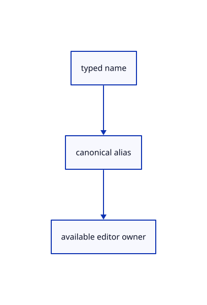

# 16.5.46 · Register current names views and command aliases

**Chapter 16 · Geometry editing and measurement · Section 16.5 · Text, styles and command integration** · [Contents](contents.md)

**Typing: 22–43 minutes.** [Estimate](typing-load.md).

Register current names, views and aliases. Normalize aliases before parsing and update the construction-plane branch in the same checkpoint, so CPlane XY keeps working during the rename.

## Type

Continue from [Route source-backed edits through guarded replay](85ar-route-source-backed-edits-through-guarded-replay.md). [Save or recover your work](recovery.md).

### 1. `src/commands.rs`

Register current actions and aliases before their argument parser. Normalize aliases and accept the renamed construction-plane owner in the same checkpoint.

Edit these blocks from bottom to top. Keep the surrounding lines unchanged.

<details>
<summary>Locate this block</summary>

```rust
    let (_, host) = HOSTS.iter().find(|(key, _)| *key == name).ok_or("Command registry is incomplete")?;
    Ok(Command::Host(*host))
}
```

</details>

Replace it with:

```rust
    let (_, host) = HOSTS.iter().find(|(key, _)| *key == name).ok_or("Command registry is incomplete")?;
    Ok(Command::Host(*host))
}

fn command_alias(line:&str)->String{
    let words=line.split_whitespace().collect::<Vec<_>>();let compact=words.join("").to_ascii_lowercase();
    for(alias,current)in[("object","Select Object"),("face","Select Face"),("edge","Select Edge"),("escape","Escape"),("esc","Escape")]{if compact==alias{return current.into()}}
    for count in (1..=words.len().min(2)).rev(){if ["ConstructionPlane","CPlane"].iter().any(|name|words[..count].join("").eq_ignore_ascii_case(name)){return std::iter::once("Construction Plane").chain(words[count..].iter().copied()).collect::<Vec<_>>().join(" ")}}
    line.into()
}
```

<details>
<summary>Locate this block</summary>

```rust
    if let Some(action)=crate::transform_commands::action(name,&words[count..]){return action.map(Command::Editor);}
    if let Some(action)=crate::gather_registry::command(name,&words[count..].join(" ")){return action.map(Command::Editor);}
    if let Some(action)=crate::primitive_registry::command(name,&words[count..].join(" ")) {return Ok(Command::Editor(action));}
    if name=="CPlane" && words.len()>count {return crate::drawing_input::choice(&words[count..].join(" ")).map(Command::Editor).ok_or_else(||"CPlane (XY XZ YZ 3 Point View Cancel)".into());}
    if matches!(name,"Point"|"Line"|"Curve"|"Polyline"|"Polyline Points"|"Polyline Rectangle"|"Polyline Polygon") && words.len()>count {
        let shape=match name {"Point"=>crate::tool::Shape::Point,"Curve"=>crate::tool::Shape::Curve,"Line"=>crate::tool::Shape::Line,"Polyline Rectangle"=>crate::tool::Shape::Rectangle,"Polyline Polygon"=>crate::tool::Shape::Polygon {sides:6},_=>crate::tool::Shape::Polyline};
        return Ok(Command::Editor(Action::Draw {shape,text:words[count..].join(" ")}));
```

</details>

Replace it with:

```rust
    if let Some(action)=crate::transform_commands::action(name,&words[count..]){return action.map(Command::Editor);}
    if let Some(action)=crate::gather_registry::command(name,&words[count..].join(" ")){return action.map(Command::Editor);}
    if let Some(action)=crate::primitive_registry::command(name,&words[count..].join(" ")) {return Ok(Command::Editor(action));}
    if name=="Construction Plane" && words.len()>count {return crate::drawing_input::choice(&words[count..].join(" ")).map(Command::Editor).ok_or_else(||"CPlane (XY XZ YZ 3 Point View Cancel)".into());}
    if matches!(name,"Point"|"Line"|"Curve"|"Polyline"|"Polyline Points"|"Polyline Rectangle"|"Polyline Polygon") && words.len()>count {
        let shape=match name {"Point"=>crate::tool::Shape::Point,"Curve"=>crate::tool::Shape::Curve,"Line"=>crate::tool::Shape::Line,"Polyline Rectangle"=>crate::tool::Shape::Rectangle,"Polyline Polygon"=>crate::tool::Shape::Polygon {sides:6},_=>crate::tool::Shape::Polyline};
        return Ok(Command::Editor(Action::Draw {shape,text:words[count..].join(" ")}));
```

<details>
<summary>Locate this block</summary>

```rust
}

pub fn parse(line: &str) -> Result<Command, String> {
    let line=crate::gather_registry::alias(line);
    let alias=crate::transform_commands::alias(&line);let line=alias.as_str();
    let words: Vec<_> = line.split_whitespace().collect();
```

</details>

Replace it with:

```rust
}

pub fn parse(line: &str) -> Result<Command, String> {
    let line=command_alias(line);let line=line.as_str();
    let line=crate::gather_registry::alias(line);
    let alias=crate::transform_commands::alias(&line);let line=alias.as_str();
    let words: Vec<_> = line.split_whitespace().collect();
```

<details>
<summary>Locate this block</summary>

```rust
}

pub fn canonical(line: &str) -> String {
    let line=crate::gather_registry::alias(line);
    let alias=crate::transform_commands::alias(&line);let line=alias.as_str();
    let words: Vec<_> = line.split_whitespace().collect();
```

</details>

Replace it with:

```rust
}

pub fn canonical(line: &str) -> String {
    let line=command_alias(line);let line=line.as_str();
    let line=crate::gather_registry::alias(line);
    let alias=crate::transform_commands::alias(&line);let line=alias.as_str();
    let words: Vec<_> = line.split_whitespace().collect();
```

<details>
<summary>Locate this block</summary>

```rust
    ("Pan Right", || Action::Pan(0.25, 0.0)),
    ("Orbit Right", || Action::Orbit(std::f64::consts::FRAC_PI_4, 0.0)),
    ("Orbit Up", || Action::Orbit(0.0, std::f64::consts::FRAC_PI_6)),
    ("View Isometric", || Action::Isometric),
    ("Fit", || Action::Fit),
    ("Fit Selected", || Action::FitSelected),
```

</details>

Replace it with:

```rust
    ("Pan Right", || Action::Pan(0.25, 0.0)),
    ("Orbit Right", || Action::Orbit(std::f64::consts::FRAC_PI_4, 0.0)),
    ("Orbit Up", || Action::Orbit(0.0, std::f64::consts::FRAC_PI_6)),
    ("View Top",||Action::NamedView(crate::camera::View::Top)),
    ("View Side",||Action::NamedView(crate::camera::View::Right)),
    ("View Front",||Action::NamedView(crate::camera::View::Front)),
    ("View Back",||Action::NamedView(crate::camera::View::Back)),
    ("View Left",||Action::NamedView(crate::camera::View::Left)),
    ("View Right",||Action::NamedView(crate::camera::View::Right)),
    ("View Bottom",||Action::NamedView(crate::camera::View::Bottom)),
    ("View Isometric Back",||Action::NamedView(crate::camera::View::IsoBack)),
    ("View Isometric", || Action::Isometric),
    ("Fit", || Action::Fit),
    ("Fit Selected", || Action::FitSelected),
```

<details>
<summary>Locate this block</summary>

```rust
    ("Select Face", || Action::PickMode(crate::pick_sources::Mode::Face)),
    ("Select Edge", || Action::PickMode(crate::pick_sources::Mode::Edge)),
    ("Select Control", || Action::PickMode(crate::pick_sources::Mode::Control)),
    ("Delete", || Action::Delete),
    ("Undo", || Action::Undo),
    ("Redo", || Action::Redo),
```

</details>

Replace it with:

```rust
    ("Select Face", || Action::PickMode(crate::pick_sources::Mode::Face)),
    ("Select Edge", || Action::PickMode(crate::pick_sources::Mode::Edge)),
    ("Select Control", || Action::PickMode(crate::pick_sources::Mode::Control)),
    ("Escape",||Action::Escape),
    ("Delete", || Action::Delete),
    ("Undo", || Action::Undo),
    ("Redo", || Action::Redo),
```

<details>
<summary>Locate this block</summary>

```rust
    ("Polyline Points",||Action::BeginTool(crate::tool::Shape::Polyline)),
    ("Polyline Rectangle",||Action::BeginTool(crate::tool::Shape::Rectangle)),
    ("Polyline Polygon",||Action::BeginTool(crate::tool::Shape::Polygon {sides:6})),
    ("CPlane",||Action::PlaneMenu),
    ("Hide",||Action::Hide),
    ("Show",||Action::Show),
    ("Example Box", || Action::AddBox),
```

</details>

Replace it with:

```rust
    ("Polyline Points",||Action::BeginTool(crate::tool::Shape::Polyline)),
    ("Polyline Rectangle",||Action::BeginTool(crate::tool::Shape::Rectangle)),
    ("Polyline Polygon",||Action::BeginTool(crate::tool::Shape::Polygon {sides:6})),
    ("Construction Plane",||Action::PlaneMenu),
    ("Hide",||Action::Hide),
    ("Show",||Action::Show),
    ("Example Box", || Action::AddBox),
```

<details>
<summary>Locate this block</summary>

```rust
    ("Snap Perp", || Action::Snap(crate::snap::Setting::Mode(crate::snap::PERP))),
    ("Move", || Action::BeginTool(crate::tool::Shape::Move)),
    ("Point", || Action::BeginTool(crate::tool::Shape::Point)),
    ("Line", || Action::BeginTool(crate::tool::Shape::Line)),
    ("BoundingBox",||Action::BoundingBox),
    ("Length BoundingBox",||Action::Measure(crate::measure_mark::Kind::BoundingLengths)),
```

</details>

Replace it with:

```rust
    ("Snap Perp", || Action::Snap(crate::snap::Setting::Mode(crate::snap::PERP))),
    ("Move", || Action::BeginTool(crate::tool::Shape::Move)),
    ("Point", || Action::BeginTool(crate::tool::Shape::Point)),
    ("Text",||Action::TextBegin(String::new())),
    ("Arrow",||Action::BeginTool(crate::tool::Shape::Arrow)),
    ("Line", || Action::BeginTool(crate::tool::Shape::Line)),
    ("BoundingBox",||Action::BoundingBox),
    ("Length BoundingBox",||Action::Measure(crate::measure_mark::Kind::BoundingLengths)),
```

<details>
<summary>Locate this block</summary>

```rust

pub type Factory = fn() -> Action;
pub const ACTIONS: &[(&str, Factory)] = &[
    ("Snap", || Action::Snap(crate::snap::Setting::Objects(None))),
    ("Snap On", || Action::Snap(crate::snap::Setting::Objects(Some(true)))),
    ("Snap Off", || Action::Snap(crate::snap::Setting::Objects(Some(false)))),
```

</details>

Replace it with:

```rust

pub type Factory = fn() -> Action;
pub const ACTIONS: &[(&str, Factory)] = &[
    ("Select By Name",||Action::Query(crate::selection_query::Query::Name(String::new()))),
    ("Select Small",||Action::Query(crate::selection_query::Query::Small(0.))),
    ("Add Group",||Action::AddGroup(String::new())),
    ("Add Edge",||Action::AddEdge),
    ("Select Lasso",||Action::SelectLasso),
    ("Trim",||Action::Trim),
    ("Explode",||Action::Explode),
    ("Arrowhead",||Action::Arrowhead(session_rust::Arrowhead::NONE)),
    ("Snap", || Action::Snap(crate::snap::Setting::Objects(None))),
    ("Snap On", || Action::Snap(crate::snap::Setting::Objects(Some(true)))),
    ("Snap Off", || Action::Snap(crate::snap::Setting::Objects(Some(false)))),
```

<details>
<summary>Complete updated block reference</summary>

```rust
use crate::editor::Action;

#[derive(Clone, Copy, Debug, PartialEq, Eq)]
pub enum Host { TextDemo, Help, Open, Replace, CancelOpen, Reload, CancelReload, Save, Report, PreviousReport, Selection, LayersOn, LayersOff, LayersAll }

pub enum Command { Editor(Action), Host(Host) }

pub type Factory = fn() -> Action;
pub const ACTIONS: &[(&str, Factory)] = &[
    ("Select By Name",||Action::Query(crate::selection_query::Query::Name(String::new()))),
    ("Select Small",||Action::Query(crate::selection_query::Query::Small(0.))),
    ("Add Group",||Action::AddGroup(String::new())),
    ("Add Edge",||Action::AddEdge),
    ("Select Lasso",||Action::SelectLasso),
    ("Trim",||Action::Trim),
    ("Explode",||Action::Explode),
    ("Arrowhead",||Action::Arrowhead(session_rust::Arrowhead::NONE)),
    ("Snap", || Action::Snap(crate::snap::Setting::Objects(None))),
    ("Snap On", || Action::Snap(crate::snap::Setting::Objects(Some(true)))),
    ("Snap Off", || Action::Snap(crate::snap::Setting::Objects(Some(false)))),
    ("Grid Snap", || Action::Snap(crate::snap::Setting::Grid(None))),
    ("Grid Snap On", || Action::Snap(crate::snap::Setting::Grid(Some(true)))),
    ("Grid Snap Off", || Action::Snap(crate::snap::Setting::Grid(Some(false)))),
    ("Snap End", || Action::Snap(crate::snap::Setting::Mode(crate::snap::END))),
    ("Snap Near", || Action::Snap(crate::snap::Setting::Mode(crate::snap::NEAR))),
    ("Snap Mid", || Action::Snap(crate::snap::Setting::Mode(crate::snap::MID))),
    ("Snap Center", || Action::Snap(crate::snap::Setting::Mode(crate::snap::CENTER))),
    ("Snap Perp", || Action::Snap(crate::snap::Setting::Mode(crate::snap::PERP))),
    ("Move", || Action::BeginTool(crate::tool::Shape::Move)),
    ("Point", || Action::BeginTool(crate::tool::Shape::Point)),
    ("Text",||Action::TextBegin(String::new())),
    ("Arrow",||Action::BeginTool(crate::tool::Shape::Arrow)),
    ("Line", || Action::BeginTool(crate::tool::Shape::Line)),
    ("BoundingBox",||Action::BoundingBox),
    ("Length BoundingBox",||Action::Measure(crate::measure_mark::Kind::BoundingLengths)),
    ("Length",||Action::Measure(crate::measure_mark::Kind::Length)),
    ("Area",||Action::Measure(crate::measure_mark::Kind::Area)),
    ("Volume",||Action::Measure(crate::measure_mark::Kind::Volume)),
    ("Measure Distance",||Action::MeasureDistance(String::new())),
    ("Curve",||Action::BeginTool(crate::tool::Shape::Curve)),
    ("Polyline",||Action::BeginTool(crate::tool::Shape::Polyline)),
    ("Polyline Points",||Action::BeginTool(crate::tool::Shape::Polyline)),
    ("Polyline Rectangle",||Action::BeginTool(crate::tool::Shape::Rectangle)),
    ("Polyline Polygon",||Action::BeginTool(crate::tool::Shape::Polygon {sides:6})),
    ("Construction Plane",||Action::PlaneMenu),
    ("Hide",||Action::Hide),
    ("Show",||Action::Show),
    ("Example Box", || Action::AddBox),
    ("Example Cloud LOD",||Action::AddCloudLod),
    ("Example Cloud",||Action::AddCloud),
    ("Example CAD",||Action::AddCad),
    ("Example Instances",||Action::AddInstances),
    ("Example Shape Reuse",||Action::AddShapeReuse),
    ("Example Nested Instances",||Action::AddNestedInstances),
    ("Example Sheet",||Action::AddSheet),
    ("Example Scene Text",||Action::AddText(crate::text::TextPlacement::WorldPlane {world:[-1.5,0.,1.],right:[1.,0.,0.],up:[0.,1.,0.],world_height:0.22})),
    ("Example Billboard",||Action::AddText(crate::text::TextPlacement::WorldBillboard {world:[-1.5,0.,1.],world_height:0.22})),
    ("Example Anchor",||Action::AddText(crate::text::TextPlacement::Anchor {world:[0.,0.,1.],offset:[8.,-12.]})),
    ("Example Nameplate",||Action::AddText(crate::text::TextPlacement::Nameplate {world:[0.,0.,1.],padding:[17.,4.],rounded:true})),
    ("Example Surface",||Action::AddSurface),
    ("Example Nested",||Action::AddNested),
    ("Example Line", || Action::AddLine),
    ("Example Point", || Action::AddPoint),
    ("Example Curve", || Action::AddCurve),
    ("Example Object Color", || Action::AddColours(crate::colour::Mode::Object)),
    ("Example Point Colors", || Action::AddColours(crate::colour::Mode::Points)),
    ("Example Face Colors", || Action::AddColours(crate::colour::Mode::Faces)),
    ("View Normals On", || Action::NormalView(true)),
    ("View Normals Off", || Action::NormalView(false)),
    ("View Grid On", || Action::Grid(Some(crate::grid::Settings::default()))),
    ("View Grid Off", || Action::Grid(None)),
    ("Example Sharp", || Action::AddNormals(crate::normal_example::Mode::Sharp)),
    ("Example Smooth", || Action::AddNormals(crate::normal_example::Mode::Smooth)),
    ("Example Winding", || Action::AddNormals(crate::normal_example::Mode::Winding)),
    ("Controls", || Action::Controls(true)),
    ("Controls On", || Action::Controls(true)),
    ("Controls Off", || Action::Controls(false)),
    ("Example Polyline", || Action::AddPolyline),
    ("Example Arrow", || Action::AddArrow),
    ("Example Triangle", || Action::ToggleExtra),
    ("Select Next", || Action::SelectNext),
    ("Select All", || Action::SelectAll),
    ("Select None", || Action::Picked(None)),
    ("Select Object", || Action::PickMode(crate::pick_sources::Mode::Object)),
    ("Select Face", || Action::PickMode(crate::pick_sources::Mode::Face)),
    ("Select Edge", || Action::PickMode(crate::pick_sources::Mode::Edge)),
    ("Select Control", || Action::PickMode(crate::pick_sources::Mode::Control)),
    ("Escape",||Action::Escape),
    ("Delete", || Action::Delete),
    ("Undo", || Action::Undo),
    ("Redo", || Action::Redo),
    ("Background", || Action::Background),
    ("Zoom In", || Action::Zoom(2.0)),
    ("Zoom Out", || Action::Zoom(0.5)),
    ("Pan Left", || Action::Pan(-0.25, 0.0)),
    ("Pan Right", || Action::Pan(0.25, 0.0)),
    ("Orbit Right", || Action::Orbit(std::f64::consts::FRAC_PI_4, 0.0)),
    ("Orbit Up", || Action::Orbit(0.0, std::f64::consts::FRAC_PI_6)),
    ("View Top",||Action::NamedView(crate::camera::View::Top)),
    ("View Side",||Action::NamedView(crate::camera::View::Right)),
    ("View Front",||Action::NamedView(crate::camera::View::Front)),
    ("View Back",||Action::NamedView(crate::camera::View::Back)),
    ("View Left",||Action::NamedView(crate::camera::View::Left)),
    ("View Right",||Action::NamedView(crate::camera::View::Right)),
    ("View Bottom",||Action::NamedView(crate::camera::View::Bottom)),
    ("View Isometric Back",||Action::NamedView(crate::camera::View::IsoBack)),
    ("View Isometric", || Action::Isometric),
    ("Fit", || Action::Fit),
    ("Fit Selected", || Action::FitSelected),
    ("View Reset", || Action::ResetView),
    ("View Perspective", || Action::Projection(crate::camera::Projection::Perspective)),
    ("View Orthographic", || Action::Projection(crate::camera::Projection::Orthographic)),
    ("Close", || Action::Close),
    ("Unload Sources", || Action::UnloadSources),
];

pub const HOSTS: &[(&str, Host)] = &[
    ("Layers On",Host::LayersOn),("Layers Off",Host::LayersOff),("Layers All",Host::LayersAll),
    ("Help", Host::Help),
    ("Open", Host::Open),
    ("Open Replace", Host::Replace),
    ("Cancel Open", Host::CancelOpen),
    ("Reload Sources", Host::Reload),
    ("Cancel Reload", Host::CancelReload),
    ("Save", Host::Save),
    ("Example Text",Host::TextDemo),
    ("Report", Host::Report),
    ("Report Previous", Host::PreviousReport),
    ("Selection", Host::Selection),
];

pub fn names() -> Vec<&'static str> {
    HOSTS.iter().map(|(name, _)| *name).chain(ACTIONS.iter().map(|(name, _)| *name)).chain(crate::primitive_registry::ENTRIES.iter().map(|(name,_,_)|*name)).chain(crate::transform_commands::NAMES.iter().copied()).chain(crate::editing_commands::NAMES.iter().copied()).chain(["Split"]).chain(crate::gather_registry::ENTRIES.iter().map(|(name,_)|*name)).collect()
}

// Choose the longest known name so Open Replace cannot become Open with an unwanted argument.
fn matched(words: &[&str]) -> Option<(&'static str, usize)> {
    names().into_iter().filter_map(|name| {
        let compact = name.split_whitespace().collect::<String>().to_ascii_lowercase();
        let mut rest = compact.as_str();
        for (index, word) in words.iter().enumerate() {
            let word = word.to_ascii_lowercase();
            rest = rest.strip_prefix(&word)?;
            if rest.is_empty() { return Some((name, index + 1, compact.len())); }
        }
        None
    }).max_by_key(|(_, _, letters)| *letters).map(|(name, count, _)| (name, count))
}

pub fn canonical(line: &str) -> String {
    let line=command_alias(line);let line=line.as_str();
    let line=crate::gather_registry::alias(line);
    let alias=crate::transform_commands::alias(&line);let line=alias.as_str();
    let words: Vec<_> = line.split_whitespace().collect();
    matched(&words).map_or_else(|| line.trim().to_owned(), |(name, count)| {
        std::iter::once(name).chain(words[count..].iter().copied()).collect::<Vec<_>>().join(" ")
    })
}

pub fn parse(line: &str) -> Result<Command, String> {
    let line=command_alias(line);let line=line.as_str();
    let line=crate::gather_registry::alias(line);
    let alias=crate::transform_commands::alias(&line);let line=alias.as_str();
    let words: Vec<_> = line.split_whitespace().collect();
    let (name, count) = matched(&words).ok_or("Unknown command. Type Help.")?;
    if name=="Measure Distance"{if words.len()>count+2{return Err("Measure Distance takes two points".into())}return Ok(Command::Editor(Action::MeasureDistance(words[count..].join(" "))))}
    if name=="Split"{return if words.len()==count{Ok(Command::Editor(Action::Split))}else{Err("Split takes no arguments".into())};}
    if let Some(action)=crate::editing_commands::action(name,&words[count..]){return action.map(Command::Editor);}
    if let Some(action)=crate::transform_commands::action(name,&words[count..]){return action.map(Command::Editor);}
    if let Some(action)=crate::gather_registry::command(name,&words[count..].join(" ")){return action.map(Command::Editor);}
    if let Some(action)=crate::primitive_registry::command(name,&words[count..].join(" ")) {return Ok(Command::Editor(action));}
    if name=="Construction Plane" && words.len()>count {return crate::drawing_input::choice(&words[count..].join(" ")).map(Command::Editor).ok_or_else(||"CPlane (XY XZ YZ 3 Point View Cancel)".into());}
    if matches!(name,"Point"|"Line"|"Curve"|"Polyline"|"Polyline Points"|"Polyline Rectangle"|"Polyline Polygon") && words.len()>count {
        let shape=match name {"Point"=>crate::tool::Shape::Point,"Curve"=>crate::tool::Shape::Curve,"Line"=>crate::tool::Shape::Line,"Polyline Rectangle"=>crate::tool::Shape::Rectangle,"Polyline Polygon"=>crate::tool::Shape::Polygon {sides:6},_=>crate::tool::Shape::Polyline};
        return Ok(Command::Editor(Action::Draw {shape,text:words[count..].join(" ")}));
    }
    if name == "Move" && words.len()>count {
        return crate::offset::parse(&format!("Move {}", words[count..].join(" ")))
            .map(|offset| Command::Editor(Action::Translate(offset))).map_err(str::to_owned);
    }
    if name == "Grid Snap" && words.len() > count {
        if words.len() != count+1 { return Err("Grid Snap (On Off) or a spacing".into()); }
        let step = words[count].parse::<f64>().map_err(|_| "Grid Snap (On Off) or a spacing")?;
        if !step.is_finite() || step<=0. { return Err("The grid spacing must be above zero · Example: Grid Snap 50".into()); }
        return Ok(Command::Editor(Action::Snap(crate::snap::Setting::Spacing(step))));
    }
    if words.len() != count { return Err(format!("{name} takes no arguments")); }
    if let Some((_, make)) = ACTIONS.iter().find(|(key, _)| *key == name) { return Ok(Command::Editor(make())); }
    let (_, host) = HOSTS.iter().find(|(key, _)| *key == name).ok_or("Command registry is incomplete")?;
    Ok(Command::Host(*host))
}

fn command_alias(line:&str)->String{
    let words=line.split_whitespace().collect::<Vec<_>>();let compact=words.join("").to_ascii_lowercase();
    for(alias,current)in[("object","Select Object"),("face","Select Face"),("edge","Select Edge"),("escape","Escape"),("esc","Escape")]{if compact==alias{return current.into()}}
    for count in (1..=words.len().min(2)).rev(){if ["ConstructionPlane","CPlane"].iter().any(|name|words[..count].join("").eq_ignore_ascii_case(name)){return std::iter::once("Construction Plane").chain(words[count..].iter().copied()).collect::<Vec<_>>().join(" ")}}
    line.into()
}
```

</details>

<details>
<summary>Optional patch references</summary>

Use these original edit fragments when comparing a saved checkpoint. Apply the complete blocks above.

```text
--8<-- "journey/code/85as-register-current-names-views-and-command-aliases-01.rs"
```

```text
--8<-- "journey/code/85as-register-current-names-views-and-command-aliases-02.rs"
```

```text
--8<-- "journey/code/85as-register-current-names-views-and-command-aliases-03.rs"
```

```text
--8<-- "journey/code/85as-register-current-names-views-and-command-aliases-04.rs"
```

```text
--8<-- "journey/code/85as-register-current-names-views-and-command-aliases-05.rs"
```

```text
--8<-- "journey/code/85as-register-current-names-views-and-command-aliases-06.rs"
```

```text
--8<-- "journey/code/85as-register-current-names-views-and-command-aliases-07.rs"
```

```text
--8<-- "journey/code/85as-register-current-names-views-and-command-aliases-08.rs"
```

```text
--8<-- "journey/code/85as-register-current-names-views-and-command-aliases-09.rs"
```

</details>

## Run and check

Run this from `session_viewer` to select the fixed dependency versions and install supplied binary assets. It updates Cargo.lock and preserves the previous lock. It does not write implementation code:

```sh
npm --prefix ../session_tests run course -- dependencies 16.5.46
```

In your project:

```sh
cd workspace/journey
REGEN_PROTO=0 cargo build --lib --locked --target wasm32-unknown-unknown -j1
REGEN_PROTO=0 CARGO_BUILD_JOBS=1 trunk serve --port 8780
```

Open `http://127.0.0.1:8780/`. Keep an existing Trunk server running; saving rebuilds it.


### Recorded visual result

**Previous native render — current verification pending.**

The preceding solid, wire bounding box and temporary distance annotation remain visible.


*This recorded image predates a source or checker change. Rebuild this checkpoint before using it as current evidence; browser controls require separate acceptance.*

This reference image is shared with [16.5.40 · Route named views and whole trim picks](85am-route-named-views-and-whole-trim-picks.md). It does not demonstrate a new feature by itself.

<details>
<summary>Code explanation and diagram</summary>


typed name → canonical alias → available editor owner.



Is CPlane still accepted?

Yes. Construction Plane, ConstructionPlane and CPlane resolve to the same current owner.

Study estimate, including typing and experiments: 0.5–1 hours.

</details>

<details>
<summary>Optional experiment</summary>

Try Object, Face, Edge, Esc and the named views; preserve the established H/S/F and Undo/Redo shortcuts.

</details>

<details>
<summary>Check and save your work</summary>

Restore experimental edits, then run from `session_viewer`:

```sh
npm --prefix ../session_tests run course -- check 16.5.46
npm --prefix ../session_tests run course -- save 16.5.46
```

Source comparison leaves your project untouched. [Save and recovery instructions](recovery.md).

</details>

<details>
<summary>Viewer coverage and verification</summary>

Register current names views and command aliases.

The inherited measurement browser contract remains authored and unrun. The current-command browser contract connects at85ay and still requires real browser execution.

[Full validation scope](release.md).

To reproduce the scripted acceptance of the reference checkpoint, run from `session_viewer` with the [course bundle server](release.md#reproduce) running on port 8781:

```sh
npm --prefix ../session_tests run course -- capture 16.5.46
```

This uses the verified reference bundle; it does not check or change your typed project.

</details>
